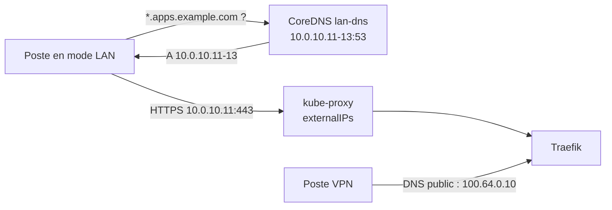

Un cluster Kubernetes sans IP publique expose souvent ses services par un VPN maillé comme Tailscale : le reverse proxy reçoit une adresse sur le réseau privé virtuel, et le DNS public de `*.apps.example.com` pointe vers cette adresse. Seuls les postes membres du VPN atteignent les services, y compris ceux qui se trouvent physiquement sur le même réseau local que les serveurs. Ouvrir un accès direct depuis ce réseau local se heurte à des contraintes fréquentes en entreprise : le DNS et le DHCP de l'organisation sont gérés par une autre équipe, aucune adresse fixe n'est réservable, et le DNS public doit rester inchangé pour les utilisateurs du VPN. Cet article décrit une solution qui combine des `externalIPs` sur le Service du reverse proxy et un CoreDNS dédié, interrogé uniquement par les postes configurés à cet effet.

<!--truncate-->

## Le besoin et ses contraintes

L'objectif est un **mode LAN optionnel** : un poste du réseau local, configuré une fois, joint `https://grafana.apps.example.com` sans client VPN, avec le même certificat et la même authentification. Un poste non configuré, ou un poste membre du VPN, ne doit constater aucun changement.

Les mêmes noms doivent être conservés. Un second domaine (`*.lan.apps.example.com`) semble plus simple, mais le [forward-auth](./2026-09-30-authentik-kubernetes.md) redirige vers un fournisseur d'identité dont l'URL est fixe, et le certificat wildcard ne couvre qu'un niveau de sous-domaine : chaque application devrait être déclarée deux fois.

## Options écartées

| Option | Raison du rejet |
| --- | --- |
| Deux enregistrements A publics (IP VPN + IP LAN) | Round-robin côté client : délais d'attente aléatoires, clients non navigateurs qui ne basculent pas, collision possible avec une adresse privée identique sur un autre réseau |
| Subnet router du VPN | Le DNS public pointerait vers l'IP LAN, et les routes de sous-réseau ne sont pas transmises aux machines partagées vers d'autres tailnets |
| DNS complet du poste vers un résolveur interne (type Pi-hole) | Point unique de défaillance pour toute la résolution du poste, alors que seule une zone est concernée |
| MetalLB en mode L2 | Exige une plage d'adresses hors DHCP, donc l'accès à la configuration réseau |
| `hostPort` sur le pod du reverse proxy | Épingle le reverse proxy à un nœud |

La solution retenue repose sur deux briques déjà présentes dans tout cluster : kube-proxy et CoreDNS.

## Point d'entrée : externalIPs

Le champ `spec.externalIPs` d'un Service liste des adresses pour lesquelles kube-proxy intercepte le trafic à destination des ports du Service. Kubernetes ne gère pas ces adresses : il ne les attribue à aucune interface et ne vérifie pas leur existence. Elles doivent être routées vers un nœud par le réseau. En choisissant les adresses LAN de nœuds existants, ce routage est acquis : tout paquet adressé à `10.0.10.11:443` atteint le nœud qui porte cette adresse, et kube-proxy le redirige vers les pods du Service.

```yaml
# values.yaml du chart Traefik
service:
  spec:
    type: ClusterIP
    externalIPs:
      - 10.0.10.11   # node-1
      - 10.0.10.12   # node-2
      - 10.0.10.13   # node-3
```

Le Service reste en `ClusterIP` : son exposition sur le VPN (annotation de l'opérateur Tailscale) est inchangée, et le Deployment du reverse proxy ne redémarre pas. Seuls les ports du Service sont capturés sur ces adresses (80 et 443 ici) ; SSH, l'API Kubernetes sur 6443 et le kubelet restent joignables normalement.

Avant d'ajouter une adresse, il faut vérifier qu'aucun processus du nœud n'écoute déjà sur les ports concernés (`ss -tulpn`) : kube-proxy capture le trafic avant qu'il n'atteigne un service local. Le stub `systemd-resolved` écoute sur `127.0.0.53` et n'entre pas en conflit avec le port 53 de l'adresse LAN.

## Résolution : un CoreDNS de zone

Les postes doivent résoudre `*.apps.example.com` vers les adresses LAN, et tous les autres noms normalement. Un second CoreDNS, distinct de celui du cluster, sert la zone avec le [plugin `template`](https://coredns.io/plugins/template/) :

```text
apps.example.com:1053 {
    errors
    reload
    template IN A {
        answer "{{ .Name }} 60 IN A 10.0.10.11"
        answer "{{ .Name }} 60 IN A 10.0.10.12"
        answer "{{ .Name }} 60 IN A 10.0.10.13"
    }
    template ANY ANY {
        rcode NOERROR
    }
}
.:1053 {
    errors
    reload
    cache 30
    forward . /etc/resolv.conf
}
```

- `template IN A` répond à toute requête A de la zone, apex compris, avec les trois adresses ; `{{ .Name }}` reprend le nom demandé.
- `template ANY ANY { rcode NOERROR }` renvoie une réponse vide (NODATA) pour les autres types, notamment AAAA. Sans enregistrement IPv6, le poste ne se replie pas vers une éventuelle adresse publique.
- `reload` recharge le Corefile quand la ConfigMap change, sans redémarrer le pod. Le plugin `file`, plus classique pour servir une zone, n'est rechargé que si le numéro de série du SOA augmente : une modification oubliant le serial reste sans effet.
- Le bloc `.` transmet les autres noms au résolveur du nœud. Il est nécessaire parce que certains clients, `systemd-resolved` en tête, peuvent envoyer n'importe quelle requête à n'importe quel serveur DNS du lien.

### Déploiement

```yaml
apiVersion: apps/v1
kind: Deployment
metadata:
  name: lan-dns
spec:
  replicas: 2
  selector:
    matchLabels: {app: lan-dns}
  template:
    metadata:
      labels: {app: lan-dns}
    spec:
      topologySpreadConstraints:
        - maxSkew: 1
          topologyKey: kubernetes.io/hostname
          whenUnsatisfiable: DoNotSchedule
          labelSelector:
            matchLabels: {app: lan-dns}
      dnsPolicy: Default
      securityContext:
        runAsNonRoot: true
        runAsUser: 65532
        seccompProfile: {type: RuntimeDefault}
      containers:
        - name: coredns
          image: registry.k8s.io/coredns/coredns:v1.11.1
          args: ["-conf", "/etc/coredns/Corefile"]
          ports:
            - {name: dns, containerPort: 1053, protocol: UDP}
            - {name: dns-tcp, containerPort: 1053, protocol: TCP}
          securityContext:
            allowPrivilegeEscalation: false
            readOnlyRootFilesystem: true
            capabilities:
              drop: ["ALL"]
              add: ["NET_BIND_SERVICE"]
          volumeMounts:
            - {name: config, mountPath: /etc/coredns, readOnly: true}
      volumes:
        - name: config
          configMap: {name: lan-dns}
---
apiVersion: v1
kind: Service
metadata:
  name: lan-dns
spec:
  type: ClusterIP
  selector: {app: lan-dns}
  externalIPs: [10.0.10.11, 10.0.10.12, 10.0.10.13]
  ports:
    - {name: dns, port: 53, targetPort: 1053, protocol: UDP}
    - {name: dns-tcp, port: 53, targetPort: 1053, protocol: TCP}
```

Plusieurs choix méritent une explication :

- **Port 1053 dans le conteneur, 53 sur le Service** : le processus tourne sans root et n'a pas besoin de lier un port privilégié.
- **`NET_BIND_SERVICE` malgré le port 1053** : le binaire de l'image officielle porte cette *file capability*. Avec `drop: ["ALL"]` seul, le noyau refuse l'exécution (`exec /coredns: operation not permitted`) avant même le démarrage. Le CoreDNS du cluster déclare la même capability pour cette raison.
- **`dnsPolicy: Default`** : le pod hérite du `/etc/resolv.conf` du nœud et non du DNS du cluster. Le `forward` transmet ainsi les noms externes au résolveur de l'organisation, sans jamais exposer les noms `*.svc.cluster.local` au réseau local.
- **Deux réplicas répartis sur deux nœuds**, avec un PodDisruptionBudget `minAvailable: 1` ([PodDisruptionBudget et haute disponibilité](../06-orchestration/2026-04-03-kubernetes-haute-disponibilite-pdb.md)) : la section sur les clients Linux montre pourquoi une indisponibilité, même brève, a des effets durables.

### Une seule liste d'adresses

Les adresses apparaissent trois fois : `externalIPs` du reverse proxy, `externalIPs` du DNS, réponses de la zone. Le chart Traefik rend ses `extraObjects` avec la fonction Helm `tpl`, ce qui permet d'y relire `.Values.service.spec.externalIPs` et de ne maintenir qu'une liste :

```yaml
extraObjects:
  - apiVersion: v1
    kind: ConfigMap
    metadata:
      name: lan-dns
    data:
      Corefile: |
        apps.example.com:1053 {
            reload
            template IN A {
        {{- range .Values.service.spec.externalIPs }}
                answer "{{ "{{ .Name }}" }} 60 IN A {{ . }}"
        {{- end }}
            }
            template ANY ANY {
                rcode NOERROR
            }
        }
  # Objet en chaîne : une valeur {{ }} n'est pas du YAML valide dans un objet
  - |
    apiVersion: v1
    kind: Service
    metadata:
      name: lan-dns
    spec:
      externalIPs: {{ toJson .Values.service.spec.externalIPs }}
```

`{{ .Name }}` appartient à la syntaxe du plugin CoreDNS et non à Helm : il doit être échappé en `{{ "{{ .Name }}" }}` pour traverser `tpl` intact. Le Service est déclaré comme chaîne YAML, rendue par `tpl` avant d'être analysée, car `externalIPs: {{ ... }}` ne serait pas un objet YAML valide.

## Configuration des postes

Seule la zone `apps.example.com` est redirigée vers le DNS du cluster : le reste de la résolution du poste n'est pas modifié.



### Linux (NetworkManager et systemd-resolved)

```bash
nmcli -t -f NAME,DEVICE con show --active
nmcli con mod "<profil du réseau local>" +ipv4.dns "10.0.10.11,10.0.10.12,10.0.10.13"
nmcli con up "<profil du réseau local>"
```

La configuration est rattachée au profil de connexion : elle s'applique automatiquement sur le réseau concerné et reste inactive ailleurs. Il faut donc un profil propre à ce réseau ; un profil filaire générique réutilisé sur un autre réseau enverrait les requêtes vers des adresses injoignables.

`systemd-resolved` interroge un seul serveur à la fois par lien et ne passe au suivant qu'en cas d'échec. Les serveurs ajoutés manuellement précèdent ceux du DHCP : si le DNS du cluster tombe, le poste bascule sur le DNS de l'organisation, qui renvoie l'adresse VPN publique, et **y reste** jusqu'à la reconnexion. D'où les deux réplicas et le PDB. Rétablir le comportement attendu : `resolvectl flush-caches` puis `nmcli con up`.

### Windows

Une règle NRPT (*Name Resolution Policy Table*) associe un espace de noms à des serveurs DNS, en PowerShell administrateur :

```powershell
Add-DnsClientNrptRule -Namespace ".apps.example.com" -NameServers 10.0.10.11,10.0.10.12,10.0.10.13
# retrait
Get-DnsClientNrptRule | ? Namespace -eq ".apps.example.com" | Remove-DnsClientNrptRule -Force
```

### macOS

Un fichier par domaine dans `/etc/resolver` :

```bash
sudo mkdir -p /etc/resolver
printf 'nameserver 10.0.10.11\nnameserver 10.0.10.12\nnameserver 10.0.10.13\n' | sudo tee /etc/resolver/apps.example.com
# retrait
sudo rm /etc/resolver/apps.example.com
```

Sous Windows et macOS, la règle est globale et ne dépend pas du réseau : hors site, les noms de la zone ne résolvent plus tant qu'elle n'est pas retirée. Le reste d'Internet fonctionne normalement, ce qui rend le symptôme déroutant.

### Vérifier

```bash
dig @10.0.10.12 grafana.apps.example.com +short     # trois adresses LAN
dig @10.0.10.12 example.org +short                  # résolution normale
curl -sk -o /dev/null -w '%{http_code}\n' \
  --resolve grafana.apps.example.com:443:10.0.10.11 https://grafana.apps.example.com
```

Le dernier test atteint le reverse proxy par le chemin LAN sans dépendre du DNS ; une redirection (302) vers le fournisseur d'identité confirme que la chaîne complète répond.

## Pièges et limites

- **Sécurité des externalIPs** : quiconque peut créer ou modifier un Service peut revendiquer une adresse arbitraire et intercepter le trafic qui lui est destiné (CVE-2020-8554, sans correctif possible dans Kubernetes). Sur un cluster partagé, l'admission `DenyServiceExternalIPs` ou une politique Kyverno / Gatekeeper restreint ce champ aux Services autorisés.
- **Audience élargie** : le reverse proxy devient joignable par tout le réseau local. Chaque route sans middleware d'authentification (applications à login natif, webhooks publics) doit être revue avant l'ouverture.
- **Résolveur ouvert** : le bloc `forward` résout n'importe quel nom pour qui l'interroge. Il n'est joignable que depuis le réseau local, mais reste un service DNS récursif à considérer comme tel.
- **Qualité de lien hétérogène** : le client choisit l'une des trois adresses. Un nœud dont la carte réseau négocie 100 Mb/s au lieu de 1 Gb/s ralentit une connexion sur trois ; le retirer de la liste suffit, la zone DNS suivant automatiquement.
- **Panne d'un nœud** : son adresse ne répond plus. Les navigateurs essaient l'adresse suivante, certains clients en ligne de commande non.
- **Pas de gain de disponibilité** : avec un seul pod de reverse proxy, le chemin LAN n'est pas plus disponible que le chemin VPN.

## Conclusion

`externalIPs` et un CoreDNS de zone donnent un accès LAN sans aucune modification du réseau de l'organisation : les adresses des nœuds servent de points d'entrée, et la redirection DNS se limite à une zone sur les postes volontaires. Le DNS public, le certificat et l'authentification restent identiques, ce qui garde un seul jeu de noms pour les deux chemins. Le coût se situe côté postes, avec une configuration différente par système et des comportements de bascule DNS à connaître, et côté sécurité, puisque le champ `externalIPs` et le résolveur récursif exigent une vigilance explicite.

## Application / Projet lié

<ProjectLinks>
  <ProjectLink to="/docs/projects/professionnel/sonu-k8s-cluster" title="Cluster Kubernetes interne SONU">Accès optionnel depuis le réseau local sans client Tailscale : Traefik sur les adresses de trois nœuds par `externalIPs`, CoreDNS dédié en deux réplicas avec PodDisruptionBudget, liste d'adresses unique relue par `tpl`, guide de configuration des postes Linux, Windows et macOS.</ProjectLink>
</ProjectLinks>
