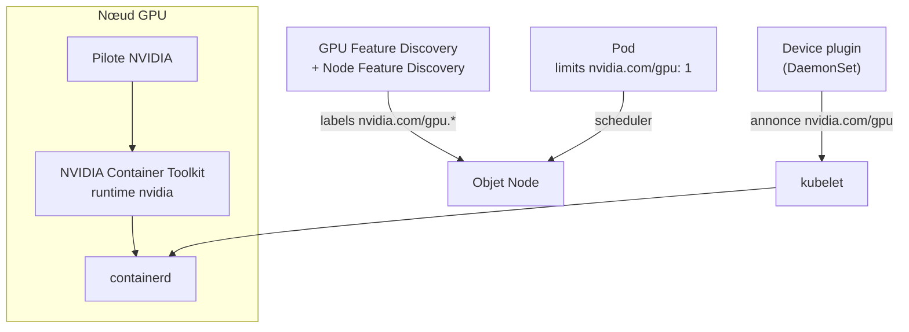

Un nœud Kubernetes équipé d'une carte NVIDIA n'expose rien de plus qu'un autre : le kubelet ne connaît que le CPU, la mémoire et le stockage éphémère, et un conteneur ne voit pas les périphériques `/dev/nvidia*` de l'hôte. Pour qu'un pod d'entraînement ou d'inférence obtienne une carte, plusieurs couches doivent coopérer : le pilote sur l'hôte, un runtime de conteneurs capable d'injecter le GPU, un composant qui annonce les cartes au scheduler, et des labels qui permettent de choisir entre des cartes différentes. Cet article décrit cette chaîne sur un cluster kubeadm hétérogène, ses pièges et la supervision des cartes.

<!--truncate-->

## La chaîne complète



| Couche | Rôle |
| --- | --- |
| Pilote | Module noyau et bibliothèques utilisateur (`libcuda`, `nvidia-smi`) |
| NVIDIA Container Toolkit | Runtime `nvidia` qui monte périphériques et bibliothèques du pilote dans le conteneur |
| Device plugin | Annonce au kubelet une ressource étendue `nvidia.com/gpu` par carte et indique au runtime laquelle injecter |
| GPU Feature Discovery (GFD) | Pose sur le nœud des labels décrivant la carte (modèle, mémoire, architecture) |
| Node Feature Discovery (NFD) | Publie ces labels sur l'objet Node ; dépendance de GFD |

## Préparer un nœud

Cette partie se fait sur l'hôte, hors de Kubernetes. Le choix de la branche du pilote dépend de l'architecture des cartes : la branche 580 est la dernière à prendre en charge les générations Maxwell, Pascal et Volta. Sur un parc qui recycle d'anciennes cartes, elle fixe donc la version pour tous les nœuds GPU.

Une fois le pilote installé (`nvidia-smi` doit lister la carte), le container toolkit fournit l'outil `nvidia-ctk`, qui écrit la configuration de containerd :

```bash
sudo nvidia-ctk runtime configure --runtime=containerd --set-as-default
sudo systemctl restart containerd
```

`--set-as-default` fait du runtime `nvidia` le runtime par défaut de containerd sur ce nœud : tout conteneur passe par lui, ce qui évite de déclarer une `RuntimeClass` dans chaque pod. Ce choix a une conséquence de sécurité, détaillée plus bas.

Le nœud reçoit enfin un label, posé à la main :

```bash
kubectl label node gpu-node-1 nvidia.com/gpu.present=true
```

L'affinité par défaut du chart du device plugin retient ce label : le plugin, GFD et les workers NFD se déploient seuls sur le nœud dès qu'il est posé.

## Le device plugin

Le chart officiel `nvdp/nvidia-device-plugin` installe le plugin en DaemonSet. Les valeurs utiles sont peu nombreuses :

```yaml
# values.yaml
gfd:
  enabled: true        # labels nvidia.com/gpu.product, gpu.memory, gpu.compute.major...

nfd:
  worker:
    nodeSelector:      # workers NFD inutiles hors des nœuds GPU
      nvidia.com/gpu.present: "true"
```

```bash
helm repo add nvdp https://nvidia.github.io/k8s-device-plugin
helm upgrade nvidia-device-plugin nvdp/nvidia-device-plugin --version 0.20.1 \
  --install --wait --atomic -n kube-system --values values.yaml
```

Le plugin s'enregistre auprès du kubelet, qui ajoute la ressource à la capacité du nœud :

```bash
kubectl get node gpu-node-1 -o jsonpath='{.status.allocatable.nvidia\.com/gpu}'
# 1
```

### Demander une carte

Un conteneur demande une carte comme il demande de la mémoire, mais en limite uniquement : une ressource étendue ne se surengage pas, la requête est implicitement égale à la limite.

```yaml
containers:
  - name: train
    image: nvidia/cuda:12.6.3-base-ubuntu24.04
    command: ["nvidia-smi"]
    resources:
      limits:
        nvidia.com/gpu: 1
```

La valeur est un entier : une carte est attribuée entière à un conteneur, et un pod qui en demande une reste `Pending` tant qu'aucune n'est libre. Le plugin propose un partage par *time-slicing*, qui annonce plusieurs répliques de chaque carte, mais la documentation précise qu'aucune isolation n'est assurée entre les conteneurs qui se partagent la même carte, ni en mémoire ni en calcul.

Aucun taint n'est nécessaire sur les nœuds GPU : seuls les pods qui demandent `nvidia.com/gpu` consomment la carte, et les autres pods peuvent occuper le CPU et la mémoire du nœud. Un taint devient utile quand ces nœuds doivent être réservés aux charges GPU.

### Choisir la carte

Sans autre précision, le scheduler place le pod sur n'importe quel nœud disposant d'une carte libre. Sur un cluster hétérogène, les labels posés par GFD permettent de choisir :

```bash
kubectl get nodes -L nvidia.com/gpu.product,nvidia.com/gpu.memory,nvidia.com/gpu.compute.major
# NAME         GPU.PRODUCT                GPU.MEMORY   GPU.COMPUTE.MAJOR
# gpu-node-1   NVIDIA-GeForce-GTX-1070    8192         6
# gpu-node-2   Quadro-M5000               8192         5
```

Imposer une carte (le pod attend qu'elle se libère) :

```yaml
nodeSelector:
  nvidia.com/gpu.product: NVIDIA-GeForce-GTX-1070
```

Préférer une carte, avec repli sur une autre si elle est occupée :

```yaml
affinity:
  nodeAffinity:
    preferredDuringSchedulingIgnoredDuringExecution:
      - weight: 100
        preference:
          matchExpressions:
            - key: nvidia.com/gpu.product
              operator: In
              values: [NVIDIA-GeForce-GTX-1070]
```

`nvidia.com/gpu.compute.major` permet aussi d'exprimer une contrainte d'architecture plutôt que de modèle, par exemple `Gt 5` pour exclure Maxwell.

## Piège : les CRD de Node Feature Discovery

NFD est installé comme sous-chart du device plugin, et ses CRD se trouvent dans le répertoire `crds/` de ce sous-chart. Helm traite ce répertoire de façon particulière : les CRD qu'il contient sont installées au premier `helm install`, puis **jamais mises à jour ni supprimées**. Deux situations en découlent :

- une release créée sans GFD puis passée à `gfd.enabled: true` par `helm upgrade` n'installe pas les CRD : les workers NFD démarrent en erreur et aucun label n'apparaît ;
- une montée de version du chart conserve les anciennes CRD, potentiellement incompatibles avec le nouveau NFD.

Dans les deux cas, les CRD s'appliquent à la main depuis le chart téléchargé :

```bash
helm pull nvdp/nvidia-device-plugin --version 0.20.1 --untar -d /tmp/nvdp
kubectl apply --server-side \
  -f /tmp/nvdp/nvidia-device-plugin/charts/node-feature-discovery/crds/nfd-api-crds.yaml
```

Cette étape doit figurer dans la procédure de montée de version du chart, puisqu'aucun outil ne la rappelle.

## Piège : le GPU sans le demander

Avec le runtime `nvidia` par défaut, le device plugin n'est pas le seul chemin vers une carte. Dans sa stratégie par défaut (`deviceListStrategy: envvar`), il communique au runtime la carte attribuée par la variable `NVIDIA_VISIBLE_DEVICES`. Or le runtime lit cette variable dans tout conteneur, qu'elle vienne du plugin ou de l'image. Les images CUDA officielles fixent `NVIDIA_VISIBLE_DEVICES=all` : un pod lancé à partir de l'une d'elles, **sans demander `nvidia.com/gpu`**, reçoit toutes les cartes du nœud. Le scheduler l'ignore et peut attribuer la même carte à un autre pod.

Deux réglages ferment ce chemin :

```yaml
# values.yaml du device plugin
deviceListStrategy: volume-mounts
```

```toml
# /etc/nvidia-container-runtime/config.toml, sur chaque nœud GPU
accept-nvidia-visible-devices-envvar-when-unprivileged = false
```

Le plugin transmet alors la liste des cartes par des montages de volumes, que seul le kubelet peut produire, et le runtime ignore la variable d'environnement pour les conteneurs non privilégiés. L'autre approche consiste à ne pas faire du runtime `nvidia` le runtime par défaut, et à le désigner par une `RuntimeClass` dans les seuls pods GPU.

## Superviser les cartes

L'outil de référence de NVIDIA, DCGM et son exporter Prometheus, vise les GPU de datacenter. Sur les cartes grand public et workstation, seule une partie de ses fonctions est disponible, et les générations Maxwell, Pascal et Volta imposent ses paquets CUDA 12. `nvidia_gpu_exporter` prend une autre voie : il interroge `nvidia-smi`, disponible pour toute carte gérée par le pilote, et expose les métriques `nvidia_smi_*` (utilisation, mémoire, température, puissance).

L'exporter ne doit pas consommer la carte qu'il observe : s'il demandait `nvidia.com/gpu: 1`, la carte serait réservée en permanence et indisponible pour les jobs. Il s'appuie donc sur le comportement décrit dans la section précédente :

```yaml
apiVersion: apps/v1
kind: DaemonSet
metadata:
  name: nvidia-gpu-exporter
  namespace: kube-system
spec:
  selector:
    matchLabels: {app: nvidia-gpu-exporter}
  template:
    metadata:
      labels: {app: nvidia-gpu-exporter}
      annotations:
        prometheus.io/scrape: "true"
        prometheus.io/port: "9835"
    spec:
      nodeSelector:
        nvidia.com/gpu.present: "true"
      automountServiceAccountToken: false
      securityContext:
        runAsNonRoot: true
        runAsUser: 65534
        seccompProfile: {type: RuntimeDefault}
      containers:
        - name: exporter
          image: docker.io/utkuozdemir/nvidia_gpu_exporter:1.15.1
          args: ["--web.listen-address=:9835"]
          env:
            - name: NVIDIA_VISIBLE_DEVICES
              value: all
            - name: NVIDIA_DRIVER_CAPABILITIES
              value: utility        # nvidia-smi et NVML, sans les bibliothèques CUDA
          ports:
            - {name: metrics, containerPort: 9835}
          securityContext:
            allowPrivilegeEscalation: false
            capabilities: {drop: [ALL]}
          resources:
            requests: {cpu: 10m, memory: 32Mi}
            limits: {memory: 64Mi}
```

Aucune demande `nvidia.com/gpu`, ni `privileged`, ni `hostPath` : le runtime `nvidia` monte `nvidia-smi` et les périphériques d'après la variable d'environnement. Ce montage repose précisément sur le chemin que le durcissement de la section précédente ferme. Les deux choix sont liés : une fois `accept-nvidia-visible-devices-envvar-when-unprivileged = false` appliqué, l'exporter doit passer en `privileged` avec un montage explicite de `/dev/nvidia*`.

Les métriques alimentent ensuite les tableaux de bord et une alerte de température (`nvidia_smi_temperature_gpu > 85` pendant 10 minutes).

## Compatibilité des images

Le pilote n'est pas la seule contrainte sur un parc ancien. CUDA 13 a retiré la prise en charge des architectures Maxwell, Pascal et Volta : les images doivent rester en CUDA 12.x. Les frameworks suivent le même mouvement, et chaque version de PyTorch ou TensorFlow ne compile ses noyaux que pour une liste d'architectures. Une image récente peut démarrer sur la carte, voir le GPU dans `nvidia-smi`, puis échouer au premier calcul avec une erreur `no kernel image is available for execution on the device`.

## GPU Operator

NVIDIA propose le GPU Operator, qui installe lui-même pilote, toolkit, device plugin, GFD et DCGM sous forme de conteneurs, sans intervention sur l'hôte. Sa matrice de support vise les GPU de datacenter et des versions récentes de Kubernetes. Sur un cluster ancien équipé de cartes grand public, l'installation manuelle de l'hôte et le chart du device plugin seul restent la voie praticable, au prix d'une procédure de préparation à documenter pour chaque nouveau nœud GPU.

## Conclusion

Un GPU devient une ressource ordonnançable par l'empilement de quatre composants : pilote et runtime sur l'hôte, device plugin pour la comptabilité, GFD et NFD pour la description des cartes. La demande `nvidia.com/gpu` et les labels `nvidia.com/gpu.*` couvrent l'usage courant, y compris sur un parc hétérogène. Les difficultés se situent aux frontières : les CRD qu'Helm n'installe qu'une fois, le runtime par défaut qui donne accès aux cartes hors de toute comptabilité, et l'âge des cartes, qui fixe la branche du pilote, la version de CUDA et l'outillage de supervision.

## Application / Projet lié

<ProjectLinks>
  <ProjectLink to="/docs/projects/professionnel/sonu-k8s-cluster" title="Cluster Kubernetes interne SONU">Mise en service de deux nœuds GPU de générations différentes : préparation des hôtes, chart du device plugin avec GPU Feature Discovery déployé par la CI, CRD Node Feature Discovery appliquées à la main, guide de choix de la carte pour les équipes et exporter de métriques qui ne réserve pas la carte.</ProjectLink>
</ProjectLinks>
