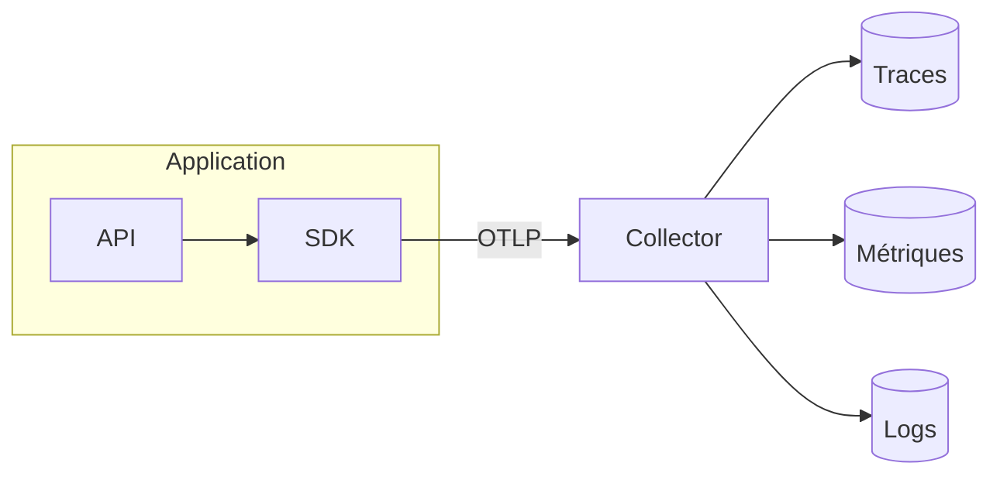

Une application qui expose des métriques à Prometheus, écrit ses logs pour Loki et envoie des traces à un outil d'APM utilise souvent trois bibliothèques, trois formats et trois agents différents. Changer d'outil de traces oblige alors à réinstrumenter le code, et rien ne relie le log d'une erreur à la requête qui l'a produite. OpenTelemetry part de ce constat : il définit une seule manière de produire, de décrire et de transporter la télémétrie, indépendante de l'outil qui la stockera. Cet article présente ce que couvre le projet, les briques qui le composent et les deux notions qui rendent les données exploitables d'un outil à l'autre, la ressource et les conventions sémantiques.

<!--truncate-->

## Un standard, pas un backend

OpenTelemetry est un projet de la CNCF né en 2019 de la fusion d'OpenTracing et d'OpenCensus, deux initiatives concurrentes qui visaient le même objectif. Il fournit :

- une **spécification** : le modèle de données de chaque signal, le comportement attendu des bibliothèques, le protocole de transport ;
- une **implémentation par langage** (Python, Go, Java, JavaScript, .NET, Rust…) ;
- des **bibliothèques d'instrumentation** pour les frameworks et clients courants (serveurs HTTP, clients HTTP, pilotes de base de données) ;
- un service de collecte, le **Collector**.

Le projet s'arrête au transport. Il ne stocke aucune donnée, ne fournit aucune interface de consultation et ne déclenche aucune alerte : ces rôles reviennent aux backends, qu'ils soient libres (Prometheus, Loki, Tempo, Jaeger, SigNoz) ou commerciaux. Ce découpage évite l'enfermement : une application instrumentée une fois peut changer de backend par simple configuration.

## Trois signaux

OpenTelemetry traite trois types de données, appelés signaux, tous trois stables dans la spécification.

- **Les traces** suivent une requête à travers les services qu'elle traverse. Chaque opération (réception de la requête, appel d'une API, requête SQL) devient un *span*, avec un début, une fin et des attributs ; l'ensemble des spans d'une même requête forme la trace.
- **Les métriques** sont des valeurs agrégées dans le temps : nombre de requêtes, durée au 95ᵉ percentile, mémoire utilisée. Elles coûtent peu à stocker et servent aux alertes.
- **Les logs** sont des événements horodatés. OpenTelemetry ne remplace pas les bibliothèques de logs existantes : il s'y branche, et ajoute à chaque ligne l'identifiant de la trace en cours.

Un quatrième signal, les **profils** (consommation CPU et mémoire au niveau des fonctions), est en alpha publique depuis mars 2026.

Ces signaux existaient avant OpenTelemetry. Le projet les produit avec le même SDK et les relie entre eux : un log porte l'identifiant de sa trace, une métrique peut pointer vers une trace d'exemple. Sur une autoroute, la métrique serait le compteur de passages d'un péage, la trace le trajet complet d'un véhicule, et le log la note prise par un agent à un instant donné. Relier les trois permet de passer d'un bouchon constaté au véhicule qui l'a causé.

## Les briques

### API et SDK séparés

Le code d'une application, ou d'une bibliothèque, n'appelle que l'**API** : démarrer un span, incrémenter un compteur. L'API ne fait rien par elle-même ; sans implémentation branchée, chaque appel est une opération vide (*no-op*) qui ne coûte presque rien et ne produit aucune donnée.

Le **SDK** est cette implémentation. C'est lui qui regroupe les données en lots, applique l'échantillonnage, ajoute les informations sur le service émetteur et exporte le tout. Il est choisi et configuré par l'application finale, jamais par une bibliothèque.

Cette séparation permet à une bibliothèque de s'instrumenter sans rien imposer : si l'application qui l'utilise n'installe pas de SDK, l'instrumentation reste inerte et l'application fonctionne normalement.

### OTLP

Le SDK exporte ses données avec **OTLP** (*OpenTelemetry Protocol*), un protocole unique pour les trois signaux, transporté en gRPC (port 4317 par convention) ou en HTTP (port 4318). La plupart des backends récents l'acceptent directement : Prometheus 3 dispose d'un récepteur OTLP, Loki 3 et Tempo aussi.

### Le Collector

Le **Collector** est un service intermédiaire entre les applications et les backends. Sa configuration décrit des *pipelines*, un par signal, composés de trois étages :

- les **receivers** reçoivent les données (OTLP, mais aussi le scrape Prometheus, des fichiers de logs…) ;
- les **processors** les transforment : regroupement en lots, filtrage, ajout ou suppression d'attributs, échantillonnage ;
- les **exporters** les envoient vers un ou plusieurs backends.

Le Collector est facultatif, un SDK peut exporter directement vers un backend. Il découple cependant les applications de l'infrastructure : changer de backend, filtrer une donnée sensible ou réduire un volume se fait dans sa configuration, sans redéployer les applications. Il existe en version *core*, limitée aux composants de base, et *contrib*, qui en ajoute plusieurs centaines. Des distributions l'empaquettent avec leurs propres choix, comme [Alloy](./2026-10-25-alloy.md) chez Grafana.

## La ressource : qui émet

Chaque donnée produite par un SDK est accompagnée d'une **ressource**, l'ensemble des attributs qui décrivent l'émetteur : `service.name`, `service.version`, `deployment.environment.name`, `host.name`, et dans un cluster `k8s.namespace.name` ou `k8s.pod.name`. Elle est commune aux trois signaux, ce qui permet de filtrer de la même façon traces, métriques et logs d'un service.

`service.name` est le seul attribut à renseigner impérativement. Sans lui, le SDK utilise `unknown_service`, et toutes les applications non configurées se retrouvent mélangées sous ce nom. La variable d'environnement `OTEL_SERVICE_NAME` le fixe sans toucher au code.

## Les conventions sémantiques

Un attribut n'est utile que si son nom est le même partout. Si un service note la méthode HTTP dans `method`, un autre dans `httpMethod` et un troisième dans `verb`, aucun dashboard ni aucune requête ne peut les traiter ensemble. Les **conventions sémantiques** fixent ces noms pour chaque domaine :

| Domaine | Exemples d'attributs |
|---|---|
| HTTP | `http.request.method`, `http.response.status_code`, `http.route`, `url.full` |
| Bases de données | `db.system.name`, `db.query.text` |
| Service | `service.name`, `service.version` |

Elles couvrent aussi les métriques : la durée des requêtes reçues par un serveur HTTP s'appelle `http.server.request.duration`, quel que soit le langage ou le framework. Un dashboard construit sur ce nom fonctionne donc pour un service Python comme pour un service Go.

Ces conventions évoluent. Les attributs HTTP ont été renommés lors de leur stabilisation (`http.method` est devenu `http.request.method`, `http.status_code` est devenu `http.response.status_code`), et certaines bibliothèques d'instrumentation émettent encore les anciens noms par défaut. La variable `OTEL_SEMCONV_STABILITY_OPT_IN` (valeurs `http`, `database`) les fait passer aux noms stables ; tant qu'elle n'est pas positionnée, deux nomenclatures peuvent coexister dans un même backend.

## Limites

- **Maturité inégale** : la spécification est stable pour les trois signaux, mais les SDK et les bibliothèques d'instrumentation n'avancent pas au même rythme selon les langages.
- **Conventions en transition** : les renommages d'attributs imposent de vérifier les noms réellement émis avant de construire dashboards et alertes.
- **Un composant de plus** : le Collector apporte de la souplesse au prix d'un service à déployer, à superviser et à configurer.
- **Aucune exploitation incluse** : stockage, consultation et alertes restent à choisir et à opérer à côté.

## Conclusion

OpenTelemetry normalise la production et le transport de la télémétrie, sans prendre position sur son stockage. L'API reste inerte tant que l'application n'a pas choisi de SDK, OTLP transporte les trois signaux, et le Collector, optionnel, sépare le code des backends. La ressource et les conventions sémantiques donnent aux données des noms communs : sans elles, les traces, métriques et logs de services écrits dans des langages différents ne pourraient pas être interrogés ensemble.

## Ressources utiles

- [Documentation OpenTelemetry](https://opentelemetry.io/docs/)
- [Concepts : signaux](https://opentelemetry.io/docs/concepts/signals/)
- [Spécification OTLP](https://opentelemetry.io/docs/specs/otlp/)
- [Collector](https://opentelemetry.io/docs/collector/)
- [Conventions sémantiques](https://opentelemetry.io/docs/specs/semconv/)

## Application / Projet lié

<ProjectLinks>
  <ProjectLink to="/docs/projects/professionnel/sonu-k8s-cluster" title="Cluster Kubernetes interne DiscoDiode">Instrumentation OpenTelemetry du cluster : traces de Traefik et des applications internes envoyées en OTLP à Alloy, stockées dans Tempo et reliées aux métriques Prometheus et aux logs Loki dans Grafana.</ProjectLink>
</ProjectLinks>
