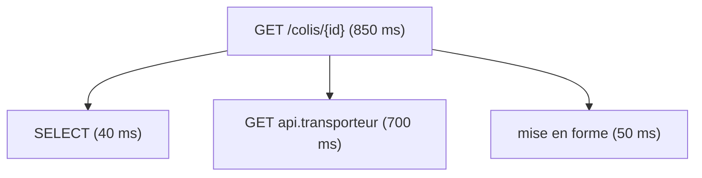

Une page qui met 850 ms à s'afficher ne dit pas où ce temps est passé. Dans une architecture où un service en appelle d'autres, la lenteur peut venir d'une requête SQL, d'une API externe ou d'un service situé trois appels plus loin, et chaque service ne voit que sa propre part. Une trace distribuée reconstitue le parcours complet de la requête, opération par opération, à travers tous les services qu'elle traverse. Cet article décrit le modèle de données d'une trace dans [OpenTelemetry](./2026-11-01-opentelemetry.md), la façon dont le contexte passe d'un service à l'autre, et la manière dont l'échantillonnage décide des traces conservées.

<!--truncate-->

## Le span, unité de base

Un **span** représente une opération : la réception d'une requête HTTP, un appel à une API, une requête SQL, un calcul. Il porte :

- un **nom** (`GET /colis/{id}`, `SELECT`) ;
- une **heure de début et de fin**, dont se déduit sa durée ;
- un **statut** ;
- des **attributs**, paires clé-valeur nommées selon les conventions sémantiques (`http.request.method`, `http.response.status_code`, `db.system.name`) ;
- éventuellement des **événements**, des instants horodatés dans la vie du span, comme une exception levée.

Le nom d'un span reste générique : `GET /colis/{id}` et non `GET /colis/42`. Les valeurs propres à la requête vont dans les attributs, sans quoi chaque requête produirait un nom différent et aucun regroupement par opération ne serait possible.

## De spans à trace

Une **trace** est l'ensemble des spans produits par une même requête. Deux identifiants suffisent à la reconstituer :

- le **`trace_id`**, 16 octets aléatoires, identique pour tous les spans de la requête ;
- le **`parent_span_id`**, qui désigne le span dont celui-ci est l'enfant. Le premier span, la racine, n'en a pas.

Chaque span est envoyé séparément, dès qu'il se termine, par le service qui l'a produit. Aucun service ne détient la trace entière : le backend regroupe les spans par `trace_id`, puis les ordonne en arbre grâce aux `parent_span_id`.



L'interface de consultation affiche cet arbre en cascade : une ligne par span, une barre proportionnelle à sa durée, placée sur un axe de temps commun. L'exemple ci-dessus répond à la question de départ : 700 des 850 ms sont passées à attendre l'API du transporteur, et optimiser la requête SQL ne changerait presque rien.

Un service ajoute un enfant au span en cours sans avoir à le désigner. Le SDK maintient un **contexte**, le span actif à un instant donné ; tout span créé pendant ce temps en devient l'enfant. Les bibliothèques d'instrumentation s'appuient sur ce mécanisme : le span du client HTTP se rattache tout seul au span du serveur qui traite la requête.

## Cinq types de spans

Le champ `kind` indique le rôle du service dans l'opération.

| `kind` | Rôle | Exemple |
|---|---|---|
| `SERVER` | le service **reçoit** une requête synchrone | requête HTTP entrante |
| `CLIENT` | le service **émet** une requête synchrone | appel HTTP sortant, requête SQL |
| `INTERNAL` | opération interne, sans réseau | calcul, transformation |
| `PRODUCER` | le service dépose un message | publication dans une file |
| `CONSUMER` | le service traite un message | lecture depuis une file |

Une requête SQL vers une base locale reste un span `CLIENT` : le critère est l'appel à un autre composant, pas la distance réseau. Chaque appel entre deux services instrumentés produit une paire : un span `CLIENT` chez l'appelant, un span `SERVER` chez l'appelé, enfant du premier. C'est à partir de ces paires que les backends déduisent la carte des appels entre services.

## Statut et erreurs

Le statut d'un span vaut `UNSET` par défaut, `ERROR` en cas d'échec, ou `OK` si le code le fixe explicitement. Les conventions sémantiques précisent quand une réponse HTTP est une erreur : un 5xx passe en `ERROR` les spans des deux côtés, alors qu'un 4xx ne passe en `ERROR` que le span `CLIENT`. Une ressource introuvable est une erreur de l'appelant, pas une panne du serveur ; le span `SERVER` d'une 404 reste `UNSET`.

Une erreur se propage de proche en proche dans la trace. Si un service répond 503, le span `CLIENT` de son appelant passe en erreur, puis, si l'appelant renvoie lui-même un 500, son span `SERVER`. Le premier span en erreur dans l'ordre de l'arbre indique l'origine de la panne.

## Propagation du contexte

À l'intérieur d'un processus, le contexte vit en mémoire. Entre deux services, il doit voyager avec la requête. Le standard **W3C Trace Context**, utilisé par défaut par OpenTelemetry, le transporte dans l'en-tête HTTP `traceparent` :

```text
traceparent: 00-4bf92f3577b34da6a3ce929d0e0e4736-00f067aa0ba902b7-01
             │  │                                │                └─ flags (01 = échantillonné)
             │  └─ trace_id                      └─ span_id de l'appelant
             └─ version
```

Deux opérations encadrent l'appel :

- l'**injection** : le client HTTP de l'appelant écrit `traceparent` dans la requête sortante, avec le `trace_id` en cours et l'identifiant de son span `CLIENT` ;
- l'**extraction** : le serveur appelé lit l'en-tête et crée son span `SERVER` avec le même `trace_id` et, pour parent, le span `CLIENT` reçu.

Les bibliothèques d'instrumentation des clients et des serveurs HTTP font ces deux opérations ; le backend n'intervient qu'ensuite, pour regrouper les spans. Un service non instrumenté ignore l'en-tête sans conséquence : la trace s'arrête à lui, mais le span `CLIENT` de l'appelant garde la durée de l'appel. Un proxy ou une passerelle qui supprime les en-têtes inconnus coupe en revanche la trace en deux.

Le contexte peut aussi transporter des paires clé-valeur métier, appelées *baggage*, dans l'en-tête `baggage`. Elles circulent vers tous les services en aval, mais ne sont pas ajoutées aux spans tant qu'un service ne les y recopie pas.

## Échantillonnage à la racine

Garder toutes les traces d'un service très sollicité coûte cher en stockage. L'**échantillonnage** décide quelles traces conserver. Dans le SDK, il se configure par deux variables :

```text
OTEL_TRACES_SAMPLER=parentbased_traceidratio
OTEL_TRACES_SAMPLER_ARG=0.1
```

`traceidratio` ne tire pas au sort : il calcule la décision à partir du `trace_id`, lui-même aléatoire, en gardant les traces dont l'identifiant tombe dans la proportion demandée. Le calcul est déterministe, si bien que deux services réglés sur le même ratio prennent la même décision pour une même trace.

La décision est prise une seule fois, par le premier service instrumenté que traverse la requête, puis transmise dans le dernier champ de `traceparent`. Le préfixe `parentbased_` fait suivre cette décision par les services en aval : un service qui reçoit un parent applique son choix, et n'utilise son propre ratio que lorsqu'il est la racine. Sans ce comportement, chaque service tirerait indépendamment ses 10 %, et les traces conservées seraient presque toutes incomplètes. Avec lui, une trace est soit entière, soit absente. Le sampler par défaut du SDK est `parentbased_always_on`, qui garde tout.

L'échantillonnage ne concerne que les traces. Les métriques produites par le SDK comptent toutes les requêtes, échantillonnées ou non : débits, taux d'erreur et percentiles restent exacts à 1 % comme à 100 %.

## Limites

- **Décision prise trop tôt** : à la racine, le service ne sait pas encore si la requête finira en erreur ou en lenteur. À 10 %, neuf requêtes en erreur sur dix sont écartées comme les autres. L'échantillonnage en fin de trace (*tail sampling*), fait dans un Collector qui attend la fin de chaque trace, lève cette limite au prix d'une mise en mémoire des spans.
- **Propagation fragile** : un composant intermédiaire qui ne transmet pas `traceparent`, un traitement asynchrone dont le contexte n'est pas transmis, ou un format de propagation différent entre deux services coupent la trace.
- **Horloges** : les durées viennent des horloges de machines différentes. Un décalage entre elles peut placer un span enfant avant son parent sur la cascade, sans que les durées propres de chaque span soient faussées.

## Conclusion

Une trace est un arbre de spans reconstruit après coup par le backend, à partir de deux identifiants : le `trace_id` commun à la requête et le `parent_span_id` de chaque span. Le type d'un span décrit le rôle du service dans l'échange, et chaque appel entre services instrumentés laisse une paire `CLIENT`-`SERVER`. L'en-tête `traceparent` porte le contexte d'un service à l'autre, avec la décision d'échantillonnage prise une seule fois à la racine, ce qui garantit des traces complètes au prix de ne pas savoir à l'avance lesquelles seront intéressantes.

## Ressources utiles

- [Concepts : traces](https://opentelemetry.io/docs/concepts/signals/traces/)
- [Propagation du contexte](https://opentelemetry.io/docs/concepts/context-propagation/)
- [W3C Trace Context](https://www.w3.org/TR/trace-context/)
- [Échantillonnage](https://opentelemetry.io/docs/concepts/sampling/)
- [Conventions sémantiques HTTP, statut des spans](https://opentelemetry.io/docs/specs/semconv/http/http-spans/#status)

## Application / Projet lié

<ProjectLinks>
  <ProjectLink to="/docs/projects/professionnel/sonu-k8s-cluster" title="Cluster Kubernetes interne DiscoDiode">Traces qui démarrent à Traefik, décision d'échantillonnage prise au point d'entrée et suivie par les applications internes grâce à l'en-tête traceparent.</ProjectLink>
</ProjectLinks>
