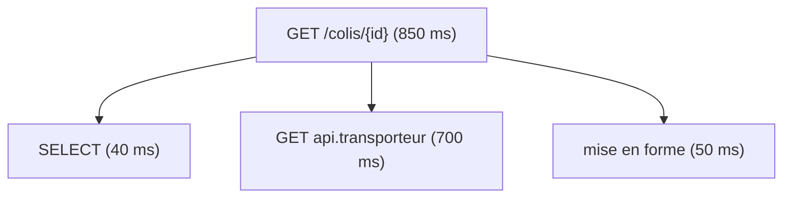

Une page qui met 850 ms à s'afficher ne dit pas où ce temps est passé. Dans une architecture où un service en appelle d'autres, la lenteur peut venir d'une requête SQL, d'une API externe ou d'un service situé trois appels plus loin. Chaque service ne voit que sa propre part : ses logs donnent sa durée de traitement, rarement celle des appels qu'il a faits, et jamais celle des appels faits plus loin par ses voisins. Une trace distribuée reconstitue après coup le parcours complet de la requête, opération par opération, à travers tous les services qu'elle traverse. [OpenTelemetry](./2026-11-01-opentelemetry.md) en définit le modèle de données et la façon dont le contexte de la requête passe d'un service à l'autre.

<!--truncate-->

## Le span, unité de base

Un span représente une opération : la réception d'une requête HTTP, un appel à une API, une requête SQL, un calcul. Il porte un nom, une heure de début et une heure de fin dont se déduit sa durée, un statut et des attributs, des paires clé-valeur nommées selon les conventions sémantiques (`http.request.method`, `http.response.status_code`, `db.system.name`). Il peut aussi porter des événements, des instants horodatés dans sa vie, comme une exception levée au milieu du traitement.

Le nom d'un span reste générique : `GET /colis/{id}` et non `GET /colis/42`. Les valeurs propres à la requête vont dans les attributs. Un identifiant placé dans le nom produirait un nom différent par requête, et aucun regroupement par opération ne serait possible, ni dans l'interface de recherche, ni dans les métriques que certains backends calculent à partir des spans.

## D'un ensemble de spans à une trace

Une trace est l'ensemble des spans produits par une même requête. Deux identifiants suffisent à la reconstituer. Le `trace_id`, 16 octets aléatoires, est le même pour tous les spans de la requête. Le `parent_span_id` désigne le span dont celui-ci est l'enfant ; le premier span, la racine, n'en a pas.

Chaque span est exporté séparément, dès qu'il se termine, par le service qui l'a produit. Aucun service ne détient la trace entière : le backend regroupe les spans par `trace_id`, puis les ordonne en arbre grâce aux `parent_span_id`. Une trace n'est donc jamais « terminée » du point de vue du backend, qui doit attendre un certain temps les spans en retard avant de la considérer comme complète.



L'interface de consultation affiche cet arbre en cascade : une ligne par span, une barre proportionnelle à sa durée, placée sur un axe de temps commun. L'exemple ci-dessus répond à la question de départ : 700 des 850 ms sont passées à attendre l'API du transporteur, et optimiser la requête SQL ne changerait presque rien.

Le code d'un service n'a pas à désigner le parent de chaque nouveau span. Le SDK maintient un contexte, qui contient le span actif à un instant donné, et tout span créé pendant ce temps en devient l'enfant. Les bibliothèques d'instrumentation s'appuient sur ce mécanisme : le span du client HTTP se rattache de lui-même au span du serveur qui traite la requête en cours, parce qu'il est créé pendant que ce dernier est actif.

## Le type d'un span

Le champ `kind` indique le rôle du service dans l'opération. Il prend cinq valeurs.

| `kind` | Rôle | Exemple |
|---|---|---|
| `SERVER` | le service reçoit une requête synchrone | requête HTTP entrante |
| `CLIENT` | le service émet une requête synchrone | appel HTTP sortant, requête SQL |
| `INTERNAL` | opération interne, sans appel à un autre composant | calcul, transformation |
| `PRODUCER` | le service dépose un message | publication dans une file |
| `CONSUMER` | le service traite un message | lecture depuis une file |

Une requête SQL vers une base installée sur la même machine reste un span `CLIENT` : le critère est l'appel à un autre composant, quelle que soit la distance réseau. Chaque appel entre deux services instrumentés produit une paire de spans, un `CLIENT` chez l'appelant et un `SERVER` chez l'appelé, enfant du premier. Les backends déduisent de ces paires la carte des appels entre services. L'écart entre les deux durées mesure le temps passé hors des deux services, sur le réseau ou dans un proxy intermédiaire.

La relation parent-enfant ne suffit pas aux traitements par lots. Un span `CONSUMER` qui traite d'un coup cinquante messages, publiés par cinquante requêtes différentes, ne peut avoir qu'un seul parent. Les liens de span (*span links*) le rattachent aux autres : chaque lien désigne un span d'une autre trace, sans relation de hiérarchie, et l'interface de consultation permet de passer de l'une à l'autre.

## Statut et erreurs

Le statut d'un span vaut `UNSET` par défaut, `ERROR` en cas d'échec, ou `OK` si le code le fixe explicitement. Les conventions sémantiques précisent quand une réponse HTTP est une erreur, et la règle dépend du côté. Un 5xx passe en `ERROR` les spans des deux côtés. Un 4xx ne passe en `ERROR` que le span `CLIENT` : une ressource introuvable est une erreur de l'appelant, et le span `SERVER` d'une 404 reste `UNSET`. Un tableau de bord qui compte les spans `SERVER` en erreur mesure ainsi les pannes du service, sans les requêtes mal formées de ses clients.

Une erreur remonte de proche en proche dans la trace. Si un service répond 503, le span `CLIENT` de son appelant passe en erreur, puis, si l'appelant renvoie lui-même un 500, son propre span `SERVER`. Plusieurs spans rouges s'empilent alors dans la cascade, et c'est le plus profond dans l'arbre qui indique l'origine de la panne.

## Propagation du contexte

À l'intérieur d'un processus, le contexte vit en mémoire. Entre deux services, il doit voyager avec la requête. OpenTelemetry utilise par défaut le standard W3C Trace Context, qui le transporte dans l'en-tête HTTP `traceparent`, et le format W3C Baggage pour l'en-tête `baggage`. Voici une requête sortante après injection du contexte :

```http
GET /suivi/42 HTTP/1.1
Host: api.example.com
traceparent: 00-4bf92f3577b34da6a3ce929d0e0e4736-00f067aa0ba902b7-01
baggage: client.offre=premium
```

`traceparent` contient quatre champs séparés par des tirets : la version du format (`00`), le `trace_id` sur 32 caractères hexadécimaux, l'identifiant du span `CLIENT` de l'appelant sur 16 caractères, et des indicateurs, dont le dernier bit signale que la trace est échantillonnée (`01`).

Deux opérations encadrent l'appel. À l'injection, le client HTTP de l'appelant écrit l'en-tête dans la requête sortante, avec le `trace_id` en cours et l'identifiant de son span `CLIENT`. À l'extraction, le serveur appelé lit l'en-tête et crée son span `SERVER` avec le même `trace_id` et, pour parent, le span `CLIENT` reçu. Les bibliothèques d'instrumentation des clients et des serveurs HTTP font ces deux opérations ; le backend n'intervient qu'ensuite, pour regrouper les spans.

Un service non instrumenté ignore l'en-tête sans dommage. La trace s'arrête à lui, mais le span `CLIENT` de l'appelant garde la durée totale de l'appel. Un proxy ou une passerelle qui retire les en-têtes inconnus coupe en revanche la trace en deux : les spans en aval démarrent une nouvelle trace, avec un autre `trace_id`, et rien ne les relie plus à la requête d'origine.

Le *baggage* transporte des paires clé-valeur métier (`client.offre=premium` ci-dessus) vers tous les services en aval. Il ne s'ajoute pas aux spans tant qu'un service ne les y recopie pas, et il voyage en clair dans chaque requête, y compris vers des services tiers : il ne doit contenir aucune donnée sensible.

## L'échantillonnage à la racine

Garder toutes les traces d'un service très sollicité coûte cher en stockage et en réseau. L'échantillonnage décide quelles traces conserver. Dans le SDK, il se règle par `OTEL_TRACES_SAMPLER` et `OTEL_TRACES_SAMPLER_ARG`, par exemple `parentbased_traceidratio` avec un argument de `0.1` pour garder une trace sur dix. Le réglage par défaut, `parentbased_always_on`, garde tout.

`traceidratio` ne tire pas au sort à chaque requête : il calcule sa décision à partir du `trace_id`, lui-même aléatoire, et garde les traces dont l'identifiant tombe dans la proportion demandée. Le calcul est déterministe, si bien que deux services réglés sur le même ratio prennent la même décision pour une même trace.

La décision est prise une seule fois, par le premier service instrumenté que traverse la requête, puis transmise dans le dernier champ de `traceparent`. Le préfixe `parentbased_` fait suivre cette décision par les services en aval : un service qui reçoit un parent applique le choix de celui-ci, et n'utilise son propre ratio que lorsqu'il est lui-même la racine. Sans ce comportement, chaque service tirerait indépendamment ses 10 %, et les traces conservées seraient presque toutes incomplètes. Avec lui, une trace est soit entière, soit absente. Le point d'entrée du trafic, souvent un reverse proxy instrumenté, fixe ainsi le taux pour tout le système.

L'échantillonnage ne concerne que les traces. Les métriques produites par le SDK comptent toutes les requêtes, échantillonnées ou non : débits, taux d'erreur et percentiles restent exacts à 1 % comme à 100 %. Celles qu'un backend calcule à partir des spans, en revanche, ne voient que les traces conservées et doivent être corrigées du taux d'échantillonnage.

## Pièges et limites

La décision d'échantillonnage arrive trop tôt. À la racine, le service ne sait pas encore si la requête finira en erreur ou en lenteur : à 10 %, neuf requêtes en erreur sur dix disparaissent avec les autres. L'échantillonnage en fin de trace (*tail sampling*), fait dans un Collector qui attend la fin de chaque trace avant de décider, garde toutes les traces en erreur ou lentes. Il demande en échange de garder tous les spans en mémoire pendant le délai d'attente, et que tous les spans d'une même trace arrivent au même Collector, ce qui complique sa mise à l'échelle.

La propagation est fragile. Un composant intermédiaire qui ne transmet pas `traceparent`, un traitement asynchrone (thread, file de tâches) dont le contexte n'est pas transmis explicitement, ou deux services qui n'utilisent pas le même format de propagation coupent la trace sans aucun message d'erreur. Le symptôme est une trace qui s'arrête trop tôt, ou des traces orphelines dont la racine est un span `SERVER` au milieu de la chaîne.

Les durées viennent des horloges de machines différentes. Un décalage entre elles peut placer un span enfant avant son parent dans la cascade. La durée propre de chaque span reste juste, puisqu'elle est mesurée sur une seule machine, mais leur position relative devient trompeuse.

Le volume, enfin, croît avec le nombre de services traversés : une requête qui touche dix services produit une vingtaine de spans au minimum, chacun avec ses attributs, et davantage dès que les appels SQL et les étapes internes sont tracés. Une trace complète pèse alors souvent plus lourd que les logs de la même requête.

## Alternatives écartées

Un identifiant de requête généré au point d'entrée et recopié dans les logs de chaque service (`X-Request-ID`) permet de retrouver tous les logs d'une requête. Il ne donne ni la hiérarchie des appels ni leur durée : il faut reconstituer l'enchaînement à la main, en comparant des horodatages.

Les formats de propagation antérieurs, B3 de Zipkin ou l'en-tête `uber-trace-id` de Jaeger, restent pris en charge par OpenTelemetry au travers de propagateurs dédiés. Ils ne servent plus qu'à cohabiter avec des services instrumentés avant l'arrivée du standard W3C : deux formats sur un même chemin obligent à configurer plusieurs propagateurs (`OTEL_PROPAGATORS`) sur chaque service de la frontière.

Les agents d'APM propriétaires produisent des traces comparables, avec leur propre format et leur propre propagation. Une application instrumentée pour l'un d'eux doit l'être de nouveau pour en changer, alors qu'une instrumentation OpenTelemetry change de backend par simple configuration.

## Conclusion

Les traces distribuées se justifient quand une requête traverse plusieurs services et que la question « où passe le temps ? » revient régulièrement : la cascade y répond en une lecture, là où les logs demandent de recouper des horodatages. Elles supposent que chaque composant du chemin transmette `traceparent` et que les noms de spans restent génériques. L'échantillonnage à la racine oblige ensuite à choisir entre un stockage coûteux et des erreurs perdues, sauf à ajouter un Collector capable d'attendre la fin des traces.

## Ressources utiles

- [Concepts : traces](https://opentelemetry.io/docs/concepts/signals/traces/)
- [Propagation du contexte](https://opentelemetry.io/docs/concepts/context-propagation/)
- [W3C Trace Context](https://www.w3.org/TR/trace-context/)
- [Échantillonnage](https://opentelemetry.io/docs/concepts/sampling/)
- [Conventions sémantiques HTTP, statut des spans](https://opentelemetry.io/docs/specs/semconv/http/http-spans/#status)

## Application / Projet lié

<ProjectLinks>
  <ProjectLink to="/docs/projects/personnel/homelab" title="HomeLab">Traefik ouvre une trace pour chaque requête entrante et l'envoie en OTLP à Alloy, qui la transmet à Tempo : le reverse proxy est la racine de chaque trace et y fixe la décision d'échantillonnage.</ProjectLink>
</ProjectLinks>
