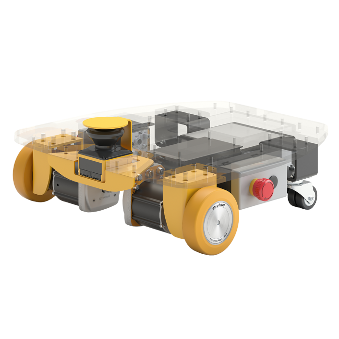

<ProjectMeta
  start="2021"
  end="2022"
  role="Principal contributeur"
  domain="Robotique mobile, pilotage de base motorisée"
  stack={["ROS", "Python", "Gazebo"]}
/>

## Contexte

Le projet EZ Wheel Navigation constitue le volet "base mobile" de [Reachy Mobile](reachy-mobile.md) à EirLab : doter le robot Reachy d'une mobilité réelle grâce à une base motorisée EZ Wheel.

## Réalisations

Le workspace ROS 1 comprend les paquets catkin suivants :

- `reachy_mobile_description` : modèle URDF de la base et du robot, visualisation dans RViz et simulation dans Gazebo ;
- `reachy_mobile_slam` : cartographie avec `hector_mapping` à partir des scans laser ;
- `reachy_mobile_navigation` : localisation AMCL sur la carte produite et planification avec `move_base`, plus un nœud Python qui expose l'envoi d'objectifs de navigation par une API Flask ;
- `reachy_mobile_teleop` : téléopération de la base au clavier.

Les paramètres de navigation ont été réglés au fil des essais sur la base réelle (portée de détection des obstacles, pondération des coûts, déplacement en marche avant uniquement), et le lancement de la navigation est relié à l'API appelée depuis Reachy. Un guide d'utilisation de la base est destiné aux autres membres du fablab.

## Rôle

J'ai structuré le workspace ROS 1 et développé l'essentiel de ses paquets catkin, réglé les paramètres de navigation, relié le lancement de la navigation à l'API appelée depuis Reachy et rédigé le guide d'utilisation. Un autre membre de l'équipe a dessiné les pièces mécaniques (plaques d'adaptation de la base, pièce de maintien imprimée en 3D) et finalisé la configuration du planificateur local TEB.

## Résultats

La base dispose d'une carte de son environnement produite par le SLAM et rejoint les objectifs de navigation qui lui sont envoyés. Ces objectifs sont émis depuis l'interface web de [Reachy Mobile](reachy-mobile.md), ce qui relie déplacement de la base et pilotage du robot dans une même chaîne.

## Liens

- 💻 Code source : [GitHub](https://github.com/Eirlab/reachy_mobile_ezwheel)
- [Reachy Mobile](reachy-mobile.md) : code du robot
