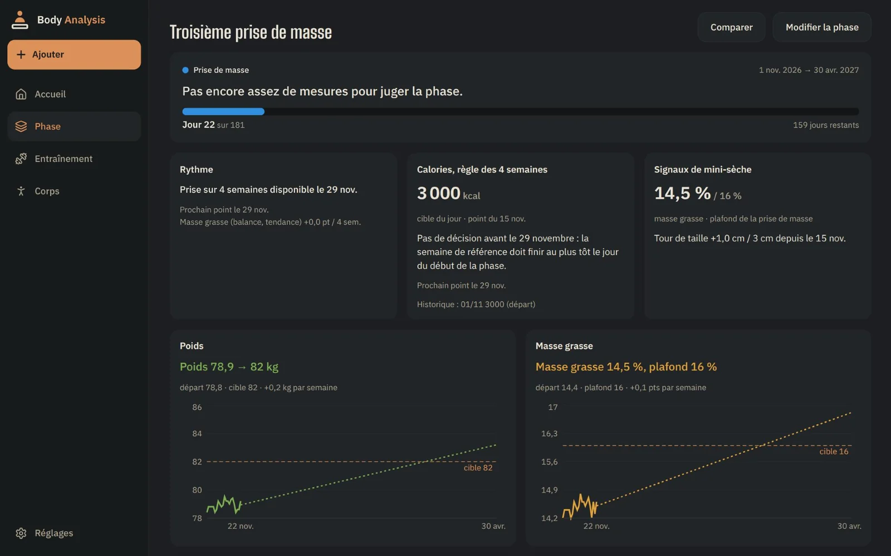
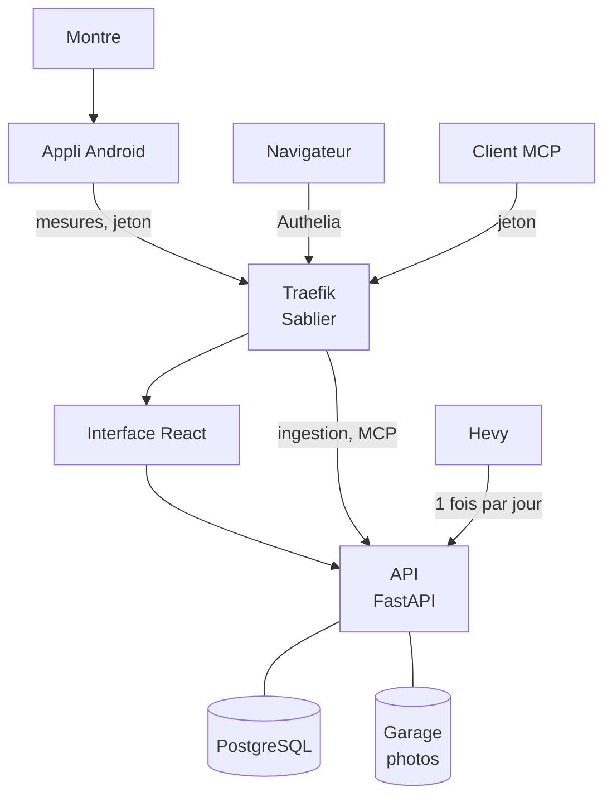

<ProjectMeta
  start="2023"
  role="Auteur (projet solo)"
  domain="Analyse de données, quantified self"
  stack={["FastAPI", "React", "PostgreSQL", "Garage", "Docker", "Android", "MCP"]}
/>

## Contexte

Samsung Health exporte des fichiers CSV et des fichiers d'activité bruts, sans visualisation exploitable. Passer par une application tierce aurait signifié confier des données de santé (poids, composition corporelle, fréquence cardiaque, photos de suivi) à un service externe. Toute la chaîne, de l'ingestion à l'interface, tourne donc sur l'infrastructure personnelle et reçoit des données en continu depuis 2023. Projet personnel, conçu et développé seul.

La première version était une application Streamlit d'un seul bloc. Elle a été réécrite en 2026 en une API FastAPI et une interface React, avec une base PostgreSQL et un stockage objet S3 pour les photos. En novembre 2026, l'application a été refondue une seconde fois autour de trois questions : la phase avance-t-elle, est-ce que cela se voit, comment va l'entraînement. Elle répondait jusque-là à beaucoup de questions, sans répondre directement à aucune de celles-là.

## Architecture

Trois entrées mènent aux mêmes services du backend : la synchronisation de l'appli Android, l'interface web et le serveur MCP. Les mesures de la montre arrivent par l'appli Android, les séances de musculation par une synchronisation quotidienne avec Hevy, les phases et les photos par le navigateur.

Les calculs (verdict de phase, règle des calories, progression des exercices, signal de récupération, découpage des séances, ratios des mensurations) vivent dans une partie du backend isolée de la base de données et du framework web : chaque calcul reçoit des données et renvoie un résultat, ce qui le rend testable sans infrastructure. Les services lisent la base avec SQLAlchemy, appellent ces calculs et renvoient le résultat. Rien ne tourne en tâche de fond : tout est calculé à la lecture ou à l'écriture.

## Refonte : supprimer pour répondre à trois questions

La refonte a d'abord été une suppression. L'application est passée de 32 tables à 25, de 51 outils MCP à 34 (en comptant ceux ajoutés depuis) et de neuf pages à quatre onglets. L'import de l'export ZIP de Samsung Health a été retiré : l'appli Android alimente désormais seule la base.

La suppression des données passe par une migration Alembic sans retour arrière. Comme l'API applique les migrations à chaque démarrage, cette migration est verrouillée : elle refuse de s'exécuter tant qu'une variable d'environnement ne contient pas son identifiant exact. Sans cette variable, l'API ne démarre pas et la base reste intacte. Le retour en arrière est refusé par conception : la restauration passe par la sauvegarde. La procédure de production impose de sauvegarder la base et les photos, de vérifier que l'archive contient toutes les tables attendues, puis de compter les séances sur une restauration de cette sauvegarde, ce qui prouve en même temps qu'elle se restaure. La migration regroupe aussi chaque séance de musculation enregistrée par la montre en une seule séance, au lieu d'une par exercice.

## Synchronisation depuis le téléphone

L'export ZIP demandait une manipulation sur le téléphone à chaque mise à jour. En octobre 2026, une appli Android écrite en Kotlin avec Jetpack Compose l'a remplacé : elle lit Samsung Health par son SDK et envoie les nouvelles mesures à l'API, sur une entrée dédiée protégée par un jeton. Elle lit six types de données : composition corporelle, aliments, séances (avec tracé GPS et longueurs de bassin), sommeil, fréquence cardiaque et score d'énergie. Elle synchronise deux fois par jour, peu après chaque nouvelle séance ou pesée, et à la demande. Android peut décaler chaque passage selon l'état de la batterie et du réseau.

Pour ne perdre aucune mesure sans tout renvoyer à chaque passage, l'appli demande au SDK les mesures modifiées depuis la dernière synchronisation réussie, un repère par type de donnée. Ce repère n'avance que lorsque le serveur a accepté toutes les mesures de son type : une coupure réseau ou une panne de l'API, quelle que soit sa durée, est rattrapée au passage suivant, et un échec qui dure déclenche une alerte sur le téléphone. Chaque lecture reprend aussi les deux jours précédents, et l'API reconnaît chaque mesure à son identifiant, si bien qu'un envoi répété ne crée aucun doublon. Les types de données inconnus sont comptés puis ignorés, et une ancienne version de l'appli reçoit toujours une réponse positive, plutôt qu'un refus qu'elle renverrait en boucle. Après une séance de musculation, la synchronisation relance aussi le rapprochement avec les séances Hevy.

## Entraînement : montre et Hevy

La course et la natation viennent de la montre, la musculation de Hevy, qui reste l'outil de saisie : l'application n'écrit jamais dans Hevy. L'écran s'ouvre sur la semaine en cours, du lundi au dimanche, puis sur trois onglets : musculation, natation et course.

**Synchronisation Hevy.** Les séances et les routines sont récupérées depuis Hevy une fois par jour, en lecture seule, au premier réveil de l'application ou tôt le matin si elle tourne déjà. L'export CSV de Hevy sert de secours et passe par le même import. Une séance y est reconnue à son heure de début, et son contenu est comparé à la version en base : réimporter un fichier n'ajoute rien, une séance modifiée est mise à jour, et une séance absente du fichier n'est jamais supprimée, pour qu'un export ancien ou partiel ne détruise rien. Chaque modification d'une routine dans Hevy en garde une version, pour conserver l'historique du programme. Une séance Hevy est rattachée à la séance de la montre qui la recoupe, à dix minutes près, quel que soit l'ordre d'arrivée des deux.

**Musculation.** Chaque exercice d'une routine porte un voyant de progression : « charger », « redescendre », « en cours » ou « à découvrir ». Il compare la charge conseillée à la dernière charge de travail, avec un objectif de trois séries de douze répétitions. L'application estime la charge maximale sur une répétition (formule d'Epley) et montre le volume hebdomadaire par muscle sur une silhouette, d'après une correspondance entre exercices et muscles réglable dans les Réglages.

**Course.** Le type d'une séance (fractionné, sortie longue ou hors programme) est déduit à l'affichage : la cadence enregistrée par la montre repère les blocs de course, dont le nombre est comparé à celui de l'étape en cours du programme. Rien n'est stocké, ce qui permet de changer la règle sans toucher à la base, et une correction manuelle l'emporte toujours. Le détail d'une séance affiche la fréquence cardiaque, la carte du parcours colorée selon la vitesse et, pour un fractionné, le découpage en répétitions et en récupérations.

**Signal de récupération.** Quatre indicateurs sont évalués : la charge d'entraînement des sept derniers jours rapportée à celle des vingt-huit derniers (méthode TRIMP), la fréquence cardiaque de nuit, le sommeil et le score d'énergie. Une alerte ne se déclenche que lorsque deux indicateurs dépassent leur seuil, pour qu'elle ne sonne pas chaque semaine.

## Phases dynamiques

Une phase (prise de masse, sèche, maintien) porte ses objectifs et, depuis novembre 2026, ses règles : une fourchette de rythme en kilos par semaine, une règle de calories, un seuil de tour de taille, une durée maximale et des pauses.

**Moyennes sur sept jours.** Le verdict lit le poids, la masse grasse et le muscle en moyenne sur sept jours, pour qu'une pesée isolée ne fausse ni le départ ni la tendance. Avant quatorze jours de phase, l'application n'avance ni tendance ni conseil sur les calories, et la phase n'a pas de verdict tant que le poids n'est pas jugé.

**Règle des calories proposée, jamais appliquée.** Tous les quatorze jours, la variation du poids moyen est comparée à deux seuils : en dessous du seuil bas, l'application propose d'ajouter un pas de calories, au-dessus du seuil haut d'en retirer un, et entre les deux de ne rien changer. La proposition reste bornée par un plancher et un plafond, et attend d'être appliquée, depuis l'interface ou par MCP. Chaque cible est une ligne datée de l'historique : rien n'est modifié en silence. Une pause pendant ces quatorze jours bloque l'ajustement.

**Plafond de masse grasse et signaux.** Pendant une prise de masse, la masse grasse sert de plafond : l'atteindre déclenche le signal de mini-sèche, et ne compte jamais comme un objectif atteint. Un second signal suit la hausse du tour de taille depuis le début de la prise. L'application ne juge pas les photos : l'alerte renvoie vers leur comparaison, et la décision reste manuelle.

**Plan et alertes.** La page de phase montre la phase en cours et les suivantes sur une frise. Avancer ou retarder la mini-sèche affiche les nouvelles dates avant de les enregistrer, avec les mêmes règles depuis l'interface et par MCP. Les alertes (signal, rythme hors fourchette, durée dépassée, ajustement à appliquer, fin de phase proche) apparaissent sur l'accueil, en haut de la page de phase et dans le bilan de phase exposé par MCP.

## Mensurations

Les relevés au ruban se saisissent, se corrigent et se suppriment depuis l'interface ou par MCP. Un relevé peut être partiel (le tour de taille chaque semaine, le reste chaque mois). L'écran montre les écarts depuis le début de la phase, une silhouette annotée avec la dernière valeur de chaque mesure, des ratios accompagnés chacun de son repère, de son sens et de sa source, et la symétrie entre gauche et droite. Ces relevés alimentent le signal de tour de taille des phases.

## Photos et confidentialité

Les photos de suivi corporel sont privées par nature. Elles sont rangées dans un stockage objet S3 plutôt que sur le disque de l'application, et un seul module du backend parle au stockage : le reste du code ne le connaît pas, et les tests le remplacent par une imitation. Ce découplage a servi en octobre 2026 : l'image MinIO ayant été retirée de Docker Hub, la production est passée sur une instance Garage dédiée sans modifier le code de l'API.

Le traitement des images repose sur Pillow et OpenCV. Le type réel d'un fichier envoyé est déterminé d'après son contenu, sans se fier à son extension ni à ce que déclare le navigateur. L'orientation est corrigée d'après les informations enregistrées par l'appareil photo. En mode confidentiel, chaque photo est floutée au moment de l'affichage, et la version floutée n'est jamais conservée : l'original reste la seule version stockée.

Pour comparer deux photos d'un même angle de vue, l'API recale chaque photo sur la plus récente de cet angle. Le calcul travaille sur une copie réduite : il repère la peau et les contrastes, essaie plusieurs positions de départ, les affine chacune avec un algorithme d'alignement d'OpenCV, puis garde la meilleure. Le recalage se limite à une rotation, un agrandissement et un déplacement, puisqu'un corps ne se déforme pas autrement entre deux photos, et il est écarté si les deux images ne se ressemblent pas assez une fois alignées. Le résultat est enregistré sous forme de quelques nombres, que le navigateur applique à l'affichage, comme l'égalisation de la lumière : les images stockées ne sont jamais réécrites. Quand le calcul échoue, la galerie marque la photo « À recaler », et il suffit de désigner deux ou trois détails communs aux deux photos. Le serveur MCP permet aussi ce recalage manuel : il affiche chaque photo sous une grille pour relever la position d'un même détail, puis un aperçu des deux photos superposées avant d'enregistrer.

## Serveur MCP

Quand un jeton est configuré, l'API expose un serveur MCP ; sans jeton, il n'existe pas. Ses 34 outils passent par les mêmes services que l'interface : 21 en lecture (bilan de phase, courbes du corps, séances, progression d'un exercice, volume par muscle, signal de récupération, mensurations, photos) et 13 en écriture (phases, cibles de calories, report de la phase suivante, mensurations, photos, import Hevy, consignes d'exercice, correspondance des muscles). Les règles de validation sont celles de l'interface, y compris les bornes des objectifs et l'interdiction de faire se chevaucher deux phases. Les écritures se limitent volontairement à ce périmètre : supprimer une phase déjà commencée ou une photo passe par l'interface. En production, la synchronisation du téléphone et le serveur MCP contournent Authelia et s'authentifient par jeton. L'agrégateur MCP du [homelab](homelab.md) expose ces outils avec ceux des autres services.

## Déploiement

L'application se compose de quatre services orchestrés par Docker Compose : PostgreSQL, le stockage objet (MinIO en développement, Garage en production), l'API et l'interface. Une seconde base PostgreSQL sert aux tests d'intégration, pour que les tests ne touchent jamais aux données réelles. L'interface a deux modes : un serveur de développement avec rechargement à chaud, actif par défaut, et une image de production, des fichiers statiques servis par nginx, que l'on démarre à la demande pour la valider avant la bascule sans interrompre le développement.

L'API applique les migrations Alembic à son démarrage, avant de servir la première requête : le schéma de la base suit toujours la version du code déployée.

GitHub Actions construit les images de l'API et de l'interface et les publie sur GitHub Container Registry à chaque modification de la branche principale. Depuis octobre 2026, ce travail tourne sur le runner auto-hébergé du homelab. En production, l'application tourne sur le [homelab](homelab.md) : utilisée quelques minutes par semaine, elle est arrêtée par Sablier après 30 minutes d'inactivité et redémarrée à la première requête, ce qui libère la mémoire de ses conteneurs au repos. C'est aussi pourquoi la synchronisation Hevy se déclenche au réveil de l'API plutôt qu'à heure fixe.

L'interface suit la charte graphique commune aux applications du homelab : thème sombre, un seul accent de couleur, nom de l'application en deux tons, libellés en français.

## Résultats

Les mesures de la montre, les séances Hevy et les photos de suivi sont analysées sur l'infrastructure personnelle, sans service tiers. Les mesures arrivent du téléphone plusieurs fois par jour sans saisie ni export, et une coupure ne fait perdre aucune donnée.

Depuis la refonte, l'application s'ouvre sur trois questions : où en est la phase, ce que montrent les photos, comment avance l'entraînement. Le rythme, les calories et les signaux d'une phase se recalculent à chaque consultation, et aucune cible ne change sans validation. Des photos prises à plusieurs semaines d'écart se comparent directement, sans retouche des originaux. Le serveur MCP lit les mêmes données et applique les mêmes règles que l'interface.

## Limites connues

- La synchronisation dépend de Hevy : quand la connexion échoue, les Réglages l'indiquent et l'export CSV prend le relais.
- Seules la course, la natation et la musculation sont suivies. La refonte a supprimé les autres séances ainsi que la musculation antérieure à juin 2025, et l'historique de Samsung Health ne peut plus être importé.

## Liens

- [HomeLab](homelab.md) : infrastructure qui héberge l'application

Le dépôt est privé.
