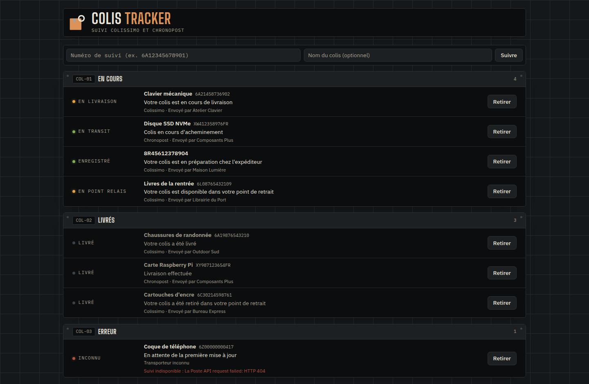
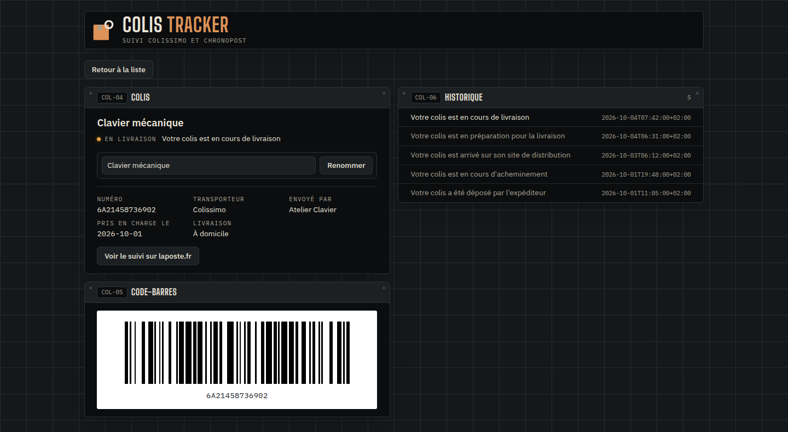
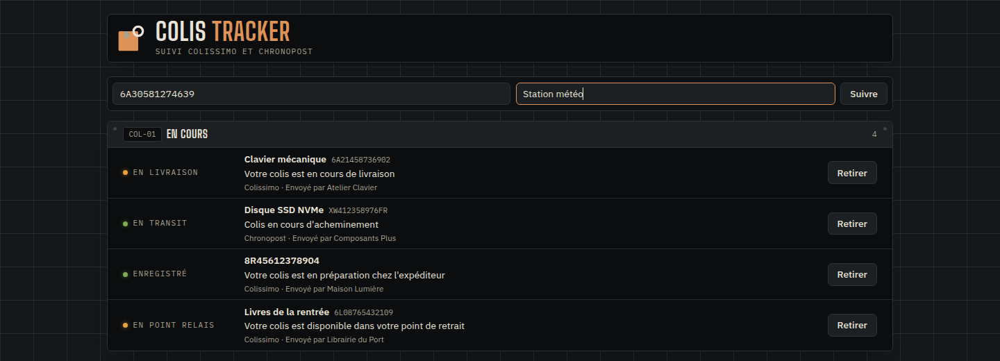
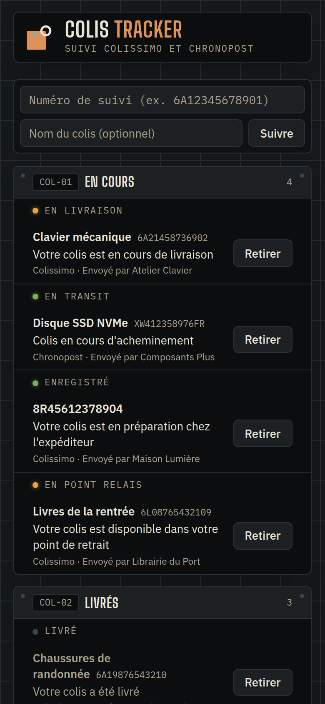
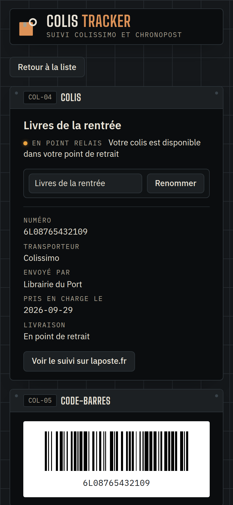
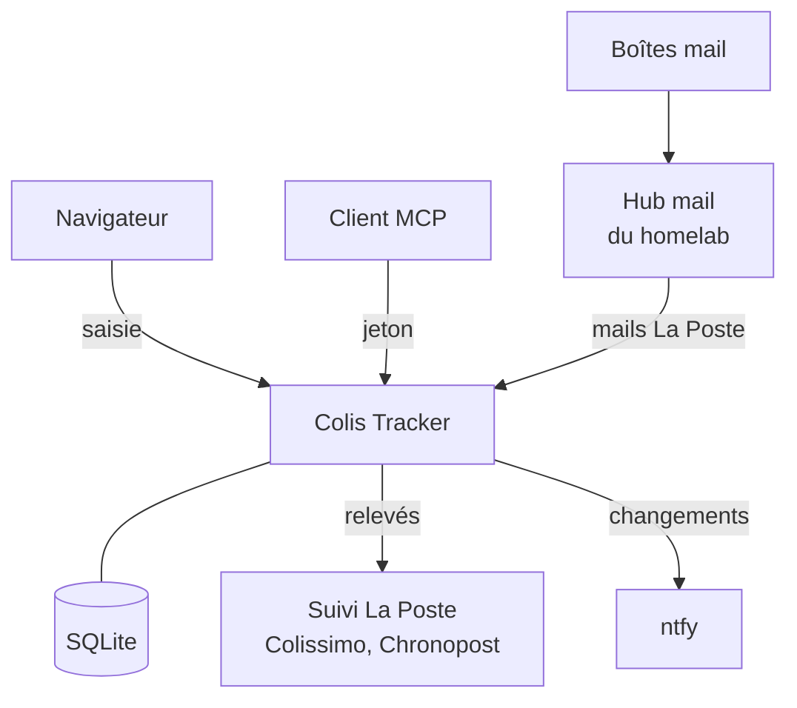

import Tabs from '@theme/Tabs';
import TabItem from '@theme/TabItem';

<ProjectMeta
  start="2026"
  role="Auteur (projet solo)"
  domain="Application web auto-hébergée, suivi de colis"
  stack={["Python", "FastAPI", "HTMX", "SQLite", "MCP", "Docker", "GitHub Actions", "uv"]}
/>

## Contexte

Suivre ses colis sans compte professionnel ni service payant (17TRACK, AfterShip) n'a pas de solution simple : ni La Poste ni les marchands ne proposent d'API de suivi au grand public. Or presque toutes les livraisons reçues passent par le groupe La Poste, y compris une partie des commandes Amazon. Colis Tracker interroge donc directement le suivi de La Poste, sans service intermédiaire. Écrite en septembre 2026, l'application tourne sur le [homelab](homelab.md). Projet personnel, conçu et développé seul.

Le besoin était double : voir d'un coup d'œil l'état de tous les colis en cours, et ne plus recopier les numéros de suivi à la main.

## Aperçu

Les captures viennent d'une instance locale remplie de colis fictifs. Sur la liste, les colis sont groupés en trois sections (en cours, livrés, en erreur), avec un voyant d'état, le dernier message du transporteur et l'expéditeur.

<Tabs>
  <TabItem value="detail" label="Détail d'un colis">
    

    La page de détail réunit les informations du colis, son historique complet tel que La Poste le renvoie et le code-barres du numéro de suivi.
  </TabItem>
  <TabItem value="ajout" label="Ajout d'un colis">
    

    L'ajout manuel ne demande que le numéro de suivi ; le nom est facultatif et se modifie ensuite depuis la page de détail.
  </TabItem>
  <TabItem value="mobile" label="Vue mobile">
    

      
      
    

    L'interface s'adapte au téléphone, ce qui permet de présenter le code-barres directement au guichet du point relais.
  </TabItem>
</Tabs>

## Architecture

Colis Tracker est une application FastAPI dont les pages sont rendues par le serveur et mises à jour par HTMX. Les colis tiennent dans un seul fichier SQLite, sans base externe. Trois entrées créent un colis : la saisie dans le navigateur, l'import des mails d'expédition et le serveur MCP.

## Suivi par La Poste

La page de suivi de laposte.fr interroge elle-même, depuis le navigateur, un service qui renvoie l'historique complet d'un colis, sans authentification. L'application appelle ce même service, comme le fait déjà une intégration Home Assistant. Ce service n'est pas documenté et peut changer sans préavis : l'application est écrite pour échouer proprement plutôt que d'afficher un état faux. Quand La Poste demande de ralentir, l'application attend le délai indiqué avant de réessayer, et un colis en erreur est rangé dans sa propre section, après les colis livrés, avec le message reçu.

Colissimo et Chronopost n'utilisent pas les mêmes codes d'événement : chacun a sa table de correspondance vers des étapes communes (pris en charge, en transit, en livraison, livré, en erreur). Comme La Poste renvoie toute la chronologie à chaque appel, l'historique affiché est complet, y compris les étapes antérieures à l'ajout du colis.

Le rythme des relevés suit l'état du colis : toutes les 15 minutes quand il est en cours de livraison, toutes les 45 minutes sinon, aucun la nuit, et plus aucun une fois le colis livré. La Poste renvoie aussi une date de livraison prévue, que la liste et la page de détail affichent sous forme de compte à rebours (« Demain », « Dans 3 jours », « En retard »). Une notification ntfy part à chaque changement d'étape, et aussi quand La Poste annonce ou décale la date sans changer d'étape. Quand le colis arrive en point relais, la notification contient le code-barres du numéro de suivi, que la page de détail affiche aussi pour le présenter au guichet depuis le téléphone.

## Import automatique depuis les mails

Recopier un numéro de suivi depuis un mail d'expédition est la tâche que l'application devait supprimer. Un module facultatif relève une boîte mail à intervalle régulier :

- seuls les mails envoyés par La Poste sont analysés : le serveur de mail filtre déjà les expéditeurs, et l'application revérifie l'adresse de chaque mail ;
- le numéro de suivi est cherché dans le texte du mail, d'abord après un libellé connu, puis, à défaut, d'après la forme du numéro lui-même ;
- chaque colis trouvé est créé et relevé aussitôt, sans attendre le cycle suivant ;
- tout mail traité, avec ou sans numéro, est rangé dans un dossier dédié, pour ne jamais être analysé deux fois.

L'analyse des mails est séparée de la connexion au serveur, ce qui permet de la tester sur des mails d'exemple sans boîte réelle. L'accès passe par IMAP, le protocole standard, avec un mot de passe dédié à l'application, sans dépendre d'un fournisseur de messagerie.

Sur le homelab, l'application relève le hub mail local, qui rassemble toutes les boîtes, et non plus directement la boîte du fournisseur : les identifiants du fournisseur ne sont ainsi stockés qu'à un seul endroit.

## Serveur MCP

Quand un jeton est configuré, l'application expose un serveur MCP, qui permet à un assistant IA de suivre les colis ; sans jeton, il n'existe pas. Ses outils couvrent la liste filtrée (en cours, livrés, en erreur), le détail avec l'historique, le code-barres en image, l'ajout, le renommage et la suppression. Un colis ajouté par MCP suit le même chemin qu'un colis ajouté depuis l'interface : il est enregistré puis relevé aussitôt. L'agrégateur MCP du [homelab](homelab.md) expose ces outils avec ceux des autres services.

## Déploiement

À chaque modification, GitHub Actions vérifie les types, lance les tests et construit l'image, puis la publie sur GitHub Container Registry. Le homelab déploie une version précise de l'image, comme pour ses autres services, et non la dernière publiée. L'interface suit la charte graphique commune aux applications du homelab.

## Résultats

Un mail d'expédition de La Poste suffit à créer le colis et à lancer son suivi, sans rien recopier. Colissimo et Chronopost se suivent sans compte ni clé d'accès, avec l'historique complet de chaque colis, une notification à chaque étape et la date de livraison prévue. Au point relais, le code-barres se présente depuis le téléphone et passe au scanner.

## Limites connues

- Seuls Colissimo et Chronopost sont couverts : pas de Mondial Relay, DPD ni GLS.
- L'import par mail ne reconnaît que les mails de La Poste, pas les confirmations d'expédition envoyées par les marchands.
- L'application dépend d'un service non documenté : une évolution du site de La Poste peut la rendre inopérante jusqu'à son adaptation.

## Liens

- 💻 Code source : [github.com/sedelpeuch/colis-tracker](https://github.com/sedelpeuch/colis-tracker)
- [HomeLab](homelab.md) : infrastructure qui héberge l'application
