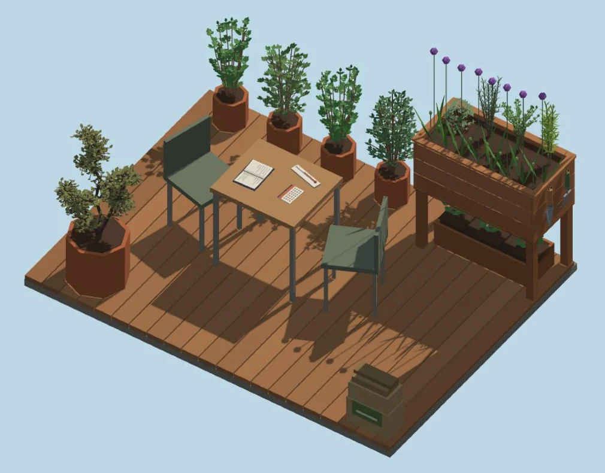
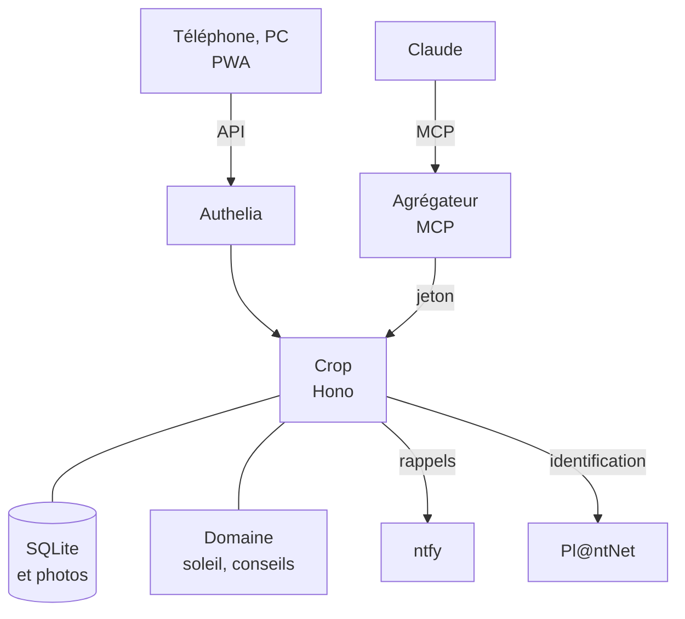
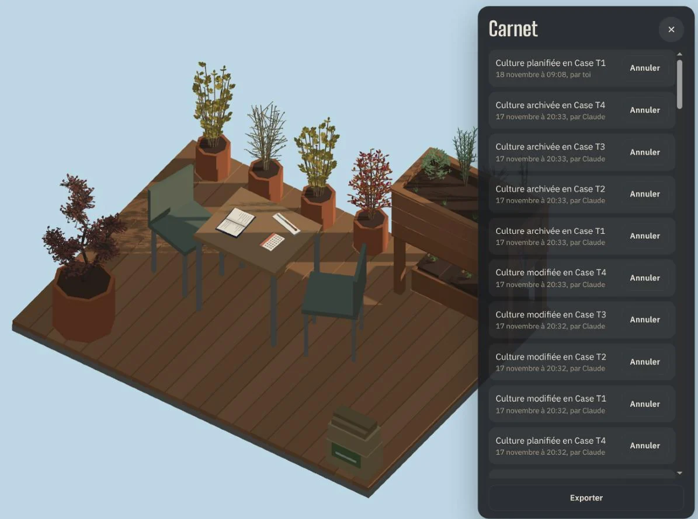
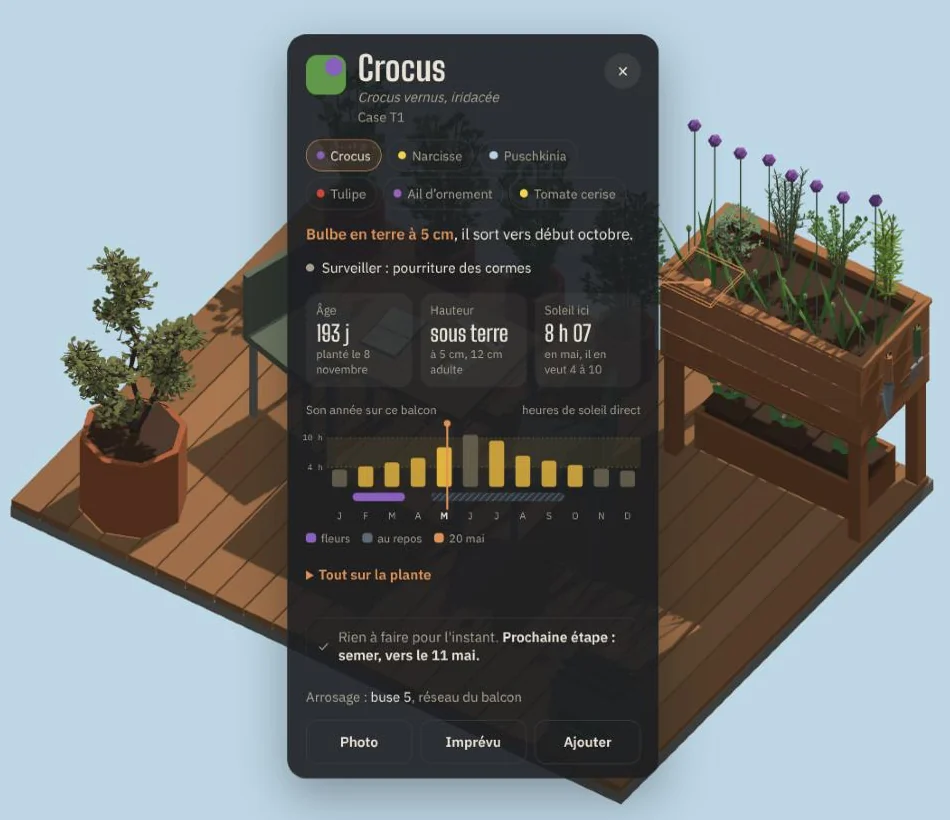
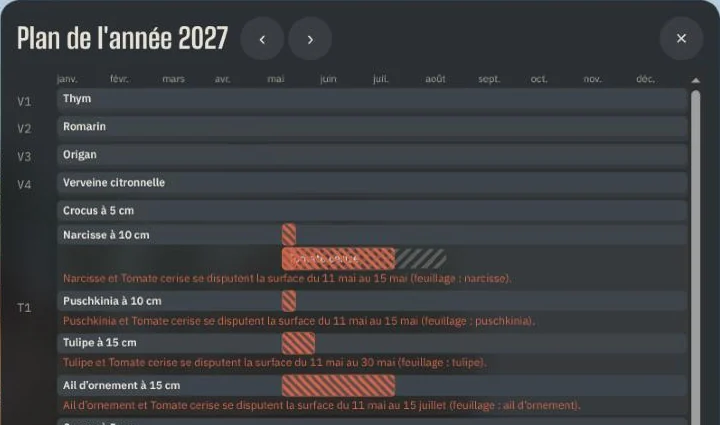
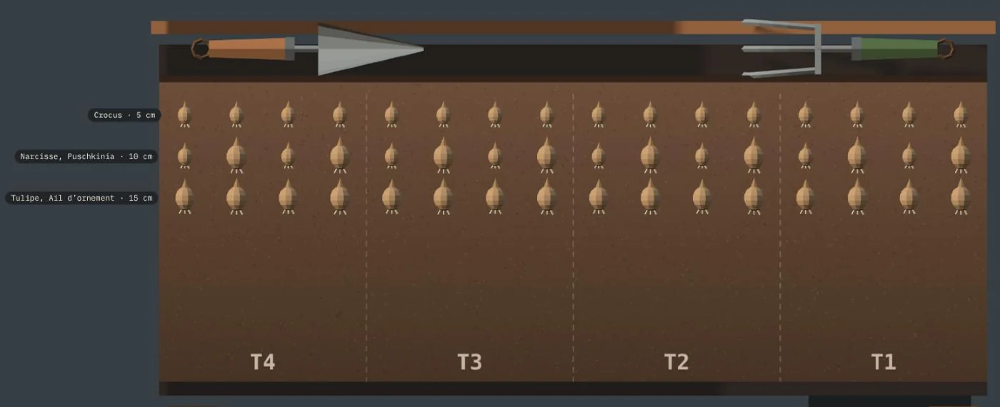
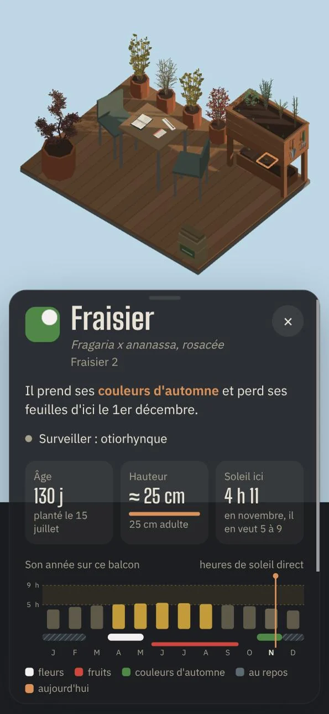

<ProjectMeta
  start="2026"
  role="Auteur (projet solo)"
  domain="Application web auto-hébergée, jardinage sur balcon"
  stack={["TypeScript", "Svelte", "Three.js", "Hono", "SQLite", "MCP", "Docker", "GitHub Actions"]}
/>

## Contexte

Le balcon compte seize emplacements : huit cases dans un grand bac, trois fraisiers dans un petit bac et cinq pots. Jusqu'ici, tout restait de mémoire ou sur papier. Un papier liste des tâches, mais il ne dit ni où ni quand : l'ensoleillement d'un coin à l'autre, les conflits de calendrier (le basilic contre le feuillage des bulbes plantés en couches), la rotation d'une année sur l'autre se jugeaient à l'œil, et les photos restaient dans la galerie du téléphone sans lien avec une plante.

Le besoin avait deux usages. Au balcon, téléphone en main, il faut voir ce qui attend une action et la valider en deux gestes. Au calme, sur un grand écran, il faut construire le plan de l'année et être conseillé avant de planter. S'y ajoutait une exigence venue du [homelab](homelab.md) : que Claude puisse tout lire et tout faire dans l'application, sans passer par l'interface, avec la possibilité de voir ce qu'il a changé et de le défaire.

Une maquette Three.js du grand bac, écrite avant le projet, a servi de référence visuelle. Elle ne savait pas sélectionner certains emplacements en vue isométrique, parce que les plantes de devant les masquaient : cette limite a orienté la conception de la sélection. L'application a été écrite les 15, 16 et 17 novembre 2026. Projet personnel, conçu et développé seul.

## Architecture

Le code tient dans un monorepo pnpm de trois paquets. Le domaine est du TypeScript pur, sans entrées-sorties : modèle, position du soleil, croissance, conseils, génération et décalage des actions. Le serveur, écrit avec Hono, porte l'API, le serveur MCP, la base SQLite, les photos et les tâches planifiées. L'interface est une PWA Svelte avec une scène Three.js. Un seul conteneur sert l'API, le MCP, une route de santé et les fichiers de la PWA.

Un projet entièrement en TypeScript a été retenu, avec le domaine partagé par le serveur et le navigateur, parce que le calcul du soleil, de la croissance et des conseils s'écrit alors une seule fois. Le navigateur s'en sert pour l'aperçu instantané (curseur de date, ombres), le serveur pour les valeurs de référence et pour le MCP. Un back Python, la pile habituelle des autres applications, avait été écarté : la logique métier aurait existé deux fois, ou seulement côté serveur, et le curseur de date aurait attendu le réseau. Tout faire dans le navigateur avec un back réduit au stockage a été écarté aussi : le MCP n'aurait pu donner ni les heures de soleil ni les conseils.

## Un registre de commandes, deux façades

Chaque opération, lecture ou écriture, est déclarée une seule fois dans un registre, avec un schéma Zod qui décrit ses paramètres. L'API HTTP et le serveur MCP sont générés depuis ce registre : un outil MCP par entrée, mêmes nom, description et schéma que l'appel de l'interface. L'interface et Claude disposent ainsi des mêmes opérations. Un test vérifie que l'ensemble des commandes appelées par le front est dans le registre et que le serveur MCP liste un outil par entrée.

Le serveur MCP fonctionne sans état, sur le transport HTTP streamable. Chaque requête porte un jeton, comparé en temps constant pour ne rien laisser deviner par la durée de la comparaison, et le serveur refuse de démarrer sans jeton.

Chaque appel porte un identifiant unique créé par le client. Un identifiant déjà vu renvoie le résultat enregistré au lieu de rejouer la commande, ce qui rend sûrs les renvois réseau et la file hors ligne. Un identifiant réutilisé par une autre commande est refusé.

## Historique et annulation

Une commande produit un lot de changements, avec l'origine de l'appel (l'interface ou Claude) et, pour chaque ligne touchée, son état avant et après. Rien ne s'efface : supprimer renseigne une date d'archivage et l'historique peut restaurer.

Annuler un lot rejoue les états « avant » dans l'ordre inverse, dans une transaction, et crée lui-même un lot, ce qui permet d'annuler une annulation. Si une ligne a changé depuis le lot à annuler, l'annulation est refusée avec la liste des lignes en cause : il n'y a pas de fusion automatique. Les changements de Claude restent marqués comme non vus jusqu'à l'ouverture de l'historique, pour qu'une modification en masse ne passe pas inaperçue. Le toast qui suit une action dure cinq secondes et appelle cette même annulation de lot.

## Ensoleillement calculé

La position du soleil suit l'algorithme NOAA. Le balcon est décrit par un fichier JSON de boîtes (sol, murs, garde-corps, bacs, pots, mobilier), chacune avec un coefficient de transmission : 0 pour un mur, 1 pour le garde-corps en verre, une valeur intermédiaire pour le mobilier à lattes. Pour un emplacement et un jour, le calcul prend cinq points sur la surface de l'emplacement et un pas de dix minutes. À chaque pas, un rayon part vers le soleil et les transmissions des boîtes traversées se multiplient ; le pas compte comme ensoleillé au-dessus de 0,5. Le résultat est la moyenne des cinq points.

Le serveur calcule les 365 jours des 16 emplacements et les garde en base. Le cache dépend d'une empreinte de la géométrie : corriger une cote du fichier recalcule l'ensemble. Le conteneur ne se déclare en bonne santé qu'une fois ce cache prêt, avec deux minutes de marge au démarrage. Côté navigateur, la même fonction oriente la lumière et les ombres de la scène, mais les heures affichées viennent toujours du serveur.

## Conseils de plantation

Le domaine calcule la liste des conseils d'une culture envisagée, chacun avec une gravité (information, avertissement ou conflit) et une raison qui cite toujours son chiffre ou sa source. Un conseil n'empêche jamais d'enregistrer. Cinq règles existent :

- soleil : les heures de soleil de l'emplacement au mois clé de l'espèce sortent de la plage qu'elle supporte ;
- chevauchement : deux cultures se chevauchent sur le même emplacement et la même couche, feuillage des bulbes compris ;
- rotation : la même famille botanique occupait l'emplacement l'année précédente, et le conseil propose les emplacements libres sans cette famille ;
- gel : la date de semis ou de plantation sort de la fenêtre calée sur la date moyenne de dernière gelée ;
- voisinage : un voisin direct figure dans la liste des mauvaises associations de l'espèce.

La date moyenne de dernière gelée vient de relevés journaliers de Météo-France sur 1996-2025 : la gelée la plus tardive de la série tombe le 7 avril, et le 10 avril a été retenu pour couvrir toutes les années. La source est enregistrée avec la valeur et reprise dans le texte des conseils.

## Plan, actions et catalogue

Planifier une culture crée ses actions à partir du modèle de l'espèce : une suite d'étapes (semer, repiquer, pincer, récolter) avec leur décalage en jours, chacune pointant vers la précédente. Décaler une action de N jours décale en cascade toutes celles qui en dépendent, en un seul lot d'historique. Une récolte étalée est une seule action avec une durée. Les étapes annuelles des vivaces (une taille de printemps, par exemple) sont recréées chaque 1er janvier à 0 h 05, et au démarrage le serveur ajoute celles de l'année à venir, ce qui rattrape un 1er janvier manqué.

« À faire » et « en retard » ne sont pas stockés : le domaine les calcule à partir de la date prévue, de la date de réalisation et du jour courant, parce qu'un état stocké deviendrait faux à minuit.

Le catalogue compte 22 espèces. Il se charge depuis les fichiers du dépôt au premier démarrage, puis il vit en base : il se modifie depuis l'interface, et par Claude depuis le MCP. Une espèce s'ajoute sans code : le formulaire choisit une forme générique par port (touffe, rosette, liane, bulbe, arbuste, graminée) et ses couleurs, avec un aperçu 3D. Une photo envoyée à Pl@ntNet propose des noms, et le choix de l'un d'eux crée une fiche pré-remplie au statut « à compléter ». La clé de l'API reste côté serveur. Plusieurs espèces ont un dessin sur mesure.

Chaque espèce du catalogue a une fiche d'entretien (rusticité, arrosage, sol, fertilisation, taille, récolte, rempotage, toxicité, problèmes courants), dont chaque entrée renvoie à des sources consultées le 16 novembre 2026 (RHS, Truffaut, ASPCA, Wikipédia). Une fiche déjà renseignée en base n'est jamais écrasée ; une fiche invalide empêche le démarrage.

## Scène 3D et usage hors ligne

La caméra est orthographique, avec les vues « dessus » et « coupe » d'un bac, la coupe montrant les couches de bulbes. Une plante prévue mais pas encore plantée est rendue en transparence, sans ombre portée.

Pour la sélection, chaque emplacement a une boîte invisible qui couvre sa surface et la hauteur de sa plante. Seules ces boîtes reçoivent le rayon, jamais les plantes, ce qui corrige le défaut de la maquette ; si le rayon en touche plusieurs, la plus proche du point touché à l'écran l'emporte. Les tests Playwright touchent chacun des 16 emplacements sous 8 angles de caméra. Si WebGL est indisponible, une liste des emplacements remplace la scène.

La PWA garde le dernier état en cache : la scène s'affiche depuis lui, puis se met à jour quand le serveur répond. Les écritures rapides (valider, décaler, noter un imprévu) passent par une file d'attente dans IndexedDB, chacune avec son identifiant, qui se vide au retour du réseau et à chaque ouverture de l'application, parce qu'iOS ne gère pas Background Sync. Le budget de performance du besoin (3D affichée en moins de 2 secondes, 30 images par seconde en rotation) est vérifié par un test Playwright qui émule un téléphone ralenti.

## Rappels

Un planificateur interne, en fuseau Europe/Paris, envoie sur ntfy le lundi à 8 h un résumé des actions de la semaine par emplacement, et chaque jour à 8 h une notification pour les actions marquées « sans retard possible » dans le modèle de l'espèce (rentrer une plante avant le gel, par exemple). Un clic ouvre l'emplacement concerné dans l'application. Les envois sont journalisés en base pour qu'un redémarrage ne renvoie pas une notification déjà partie. Le planificateur ne démarre que si l'URL de ntfy, le sujet et l'URL publique sont tous renseignés.

## Déploiement

L'image Docker est construite en deux étapes et publiée sur GitHub Container Registry à chaque version taguée. Sur le homelab, le conteneur tourne derrière Traefik et Authelia, avec l'image épinglée par digest comme les autres services. Le serveur MCP est appelé par l'agrégateur MCP du homelab sur le réseau Docker interne, sans passer par Traefik. Le volume qui contient la base et les photos est sauvegardé avec les données critiques du homelab. SQLite n'étant copiée de façon cohérente qu'à l'arrêt, le conteneur est arrêté pendant la sauvegarde, et il recalcule alors son cache d'ensoleillement au redémarrage.

## Résultats

Le balcon se consulte à n'importe quelle date : les plantes poussent, fleurissent et fanent selon le curseur, les cultures prévues sont rendues en transparence et chaque emplacement donne ses heures de soleil. Planter déclenche des conseils chiffrés et sourcés avant l'enregistrement. Valider une action prend deux taps dans l'interface, ou une phrase adressée à Claude.

Les changements de Claude sont marqués dans l'historique et un lot s'annule d'un geste, y compris après coup. Le catalogue couvre les 22 espèces cultivées, chacune avec sa fiche d'entretien sourcée.

## Limites connues

- Il n'y a pas de comptes : quiconque passe Authelia voit et modifie le même balcon, et l'historique ne distingue pas qui a agi depuis l'interface (seules les actions de Claude sont marquées).
- Il n'y a pas de synchronisation en temps réel : un appareil voit les changements des autres au prochain chargement.
- Les cotes du balcon autres que celles du grand bac ont été estimées sur une photo à l'écriture de la spécification. Les heures de soleil et les conseils en dépendent, et le fichier de géométrie est fait pour les corriger.
- Claude ne voit pas la scène 3D : un rendu côté serveur n'est pas dans le périmètre actuel, il lit l'état, les photos et les heures de soleil par le MCP.
- Les formulaires du plan et du catalogue demandent le réseau : seules les écritures rapides se font hors ligne.
- Le catalogue de départ n'est chargé qu'une fois, et les fichiers de géométrie et de climat sont copiés dans l'image : les corriger demande de reconstruire l'image.
- Une fois la session Authelia expirée, l'application installée affiche ses données en cache mais ses requêtes partent vers la page de connexion ; les écritures faites hors ligne repartent à la réouverture, après reconnexion.
- L'identification par photo dépend de l'offre gratuite de Pl@ntNet, limitée à 500 identifications par jour.

## Liens

- 💻 Le dépôt est privé.
- [HomeLab](homelab.md) : infrastructure qui héberge l'application
