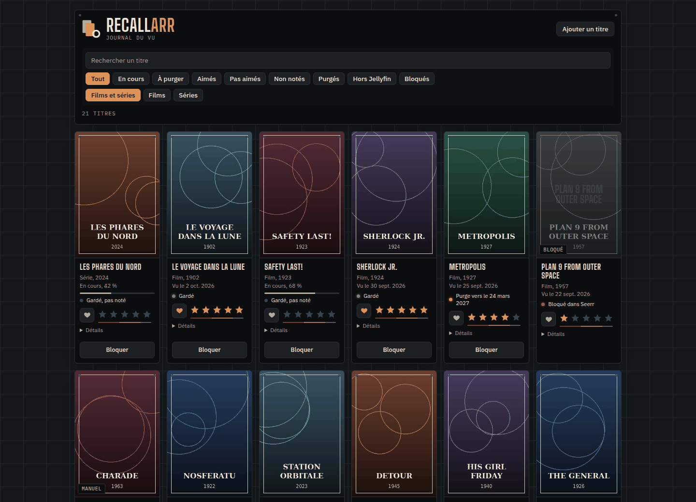
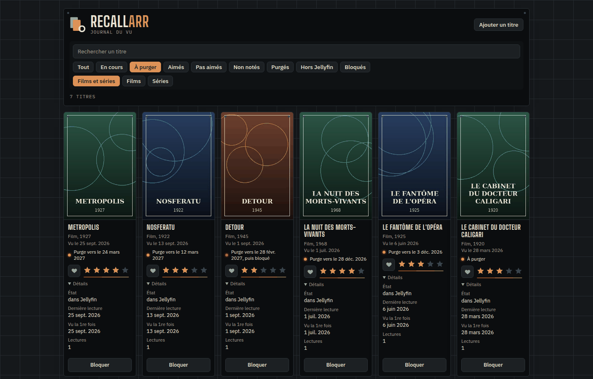
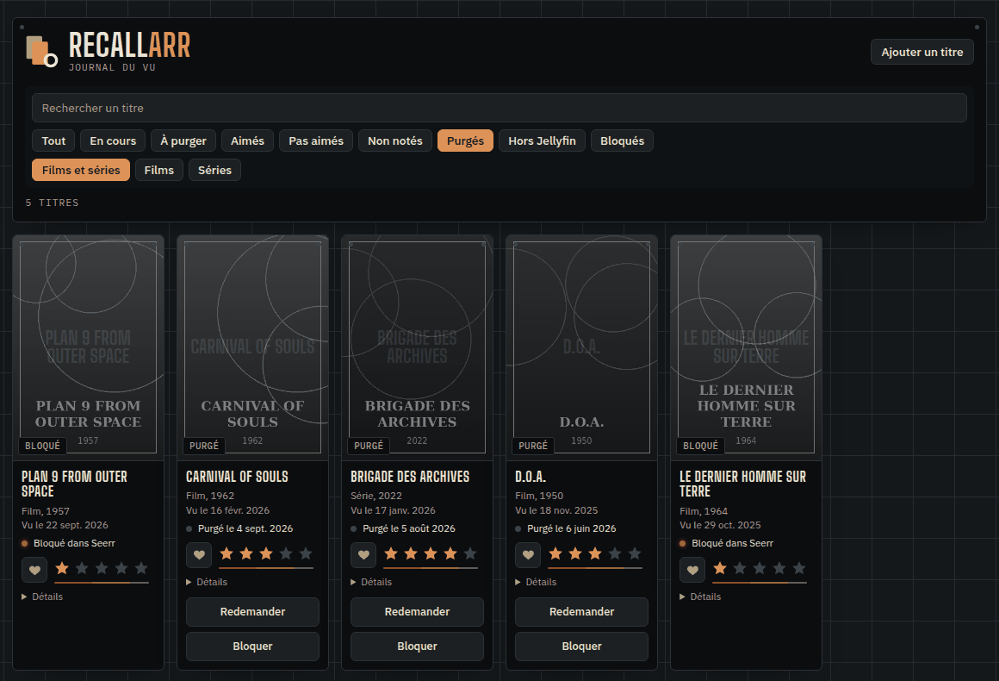
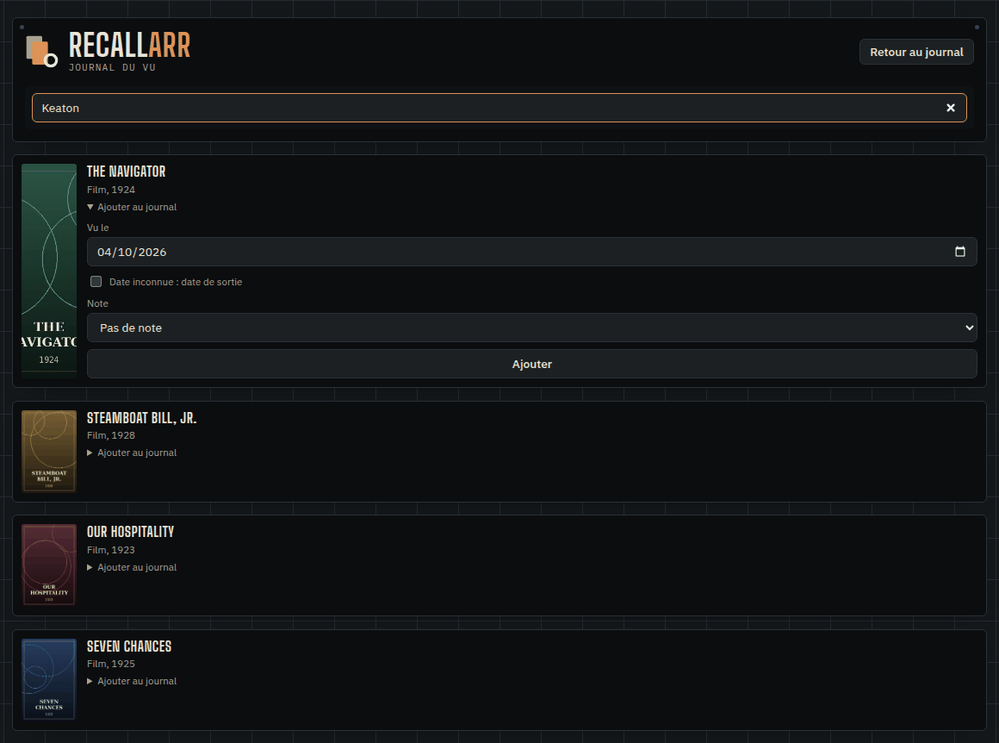
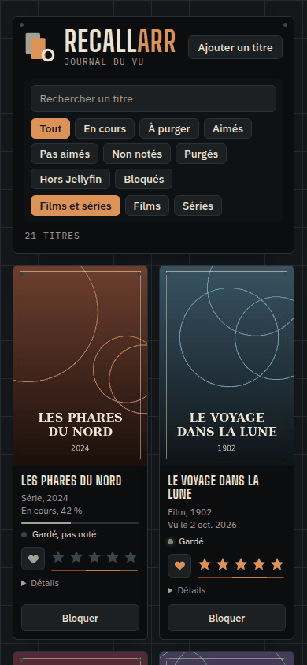
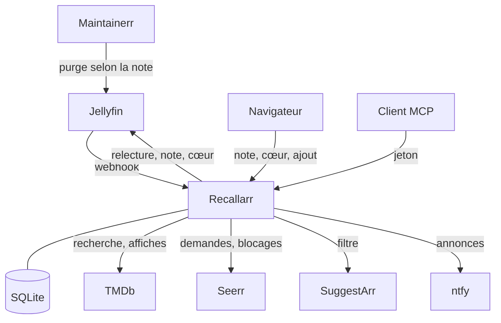

import Tabs from '@theme/Tabs';
import TabItem from '@theme/TabItem';

<ProjectMeta
  start="2026"
  role="Auteur (projet solo)"
  domain="Médiathèque personnelle, application web auto-hébergée"
  stack={["Python", "FastAPI", "HTMX", "SQLite", "Jellyfin", "MCP", "Docker", "GitHub Actions"]}
/>

## Contexte

La médiathèque du [homelab](homelab.md) est servie par Jellyfin et nettoyée automatiquement : un titre regardé depuis longtemps et peu apprécié finit par être supprimé pour libérer de la place. Jellyfin oublie alors tout de lui, y compris le fait qu'il a été vu et la note qui lui avait été donnée. Il manquait une mémoire : savoir ce qui a déjà été regardé, ce qui a plu, et éviter qu'un titre déjà vu et mal noté revienne.

Deux outils de suivi existants ont été évalués puis écartés : l'un ajoutait ses propres fonctions de découverte et de demande, déjà assurées ailleurs, sans pouvoir les masquer ; l'autre ne lisait ni la note ni l'historique de Jellyfin. Recallarr se limite donc à ce besoin. Écrit en octobre 2026, il a été complété les semaines suivantes par le suivi des nouvelles saisons et des suites. Projet personnel, conçu et développé seul.

## Aperçu

Les captures viennent d'une instance locale peuplée de films du domaine public et de séries fictives, avec des affiches générées pour l'occasion. Sur le journal, chaque carte réunit l'affiche, la date de dernière lecture, la note en étoiles, le cœur et le devenir du titre, avec des filtres par état et par type.

<Tabs>
  <TabItem value="devenir" label="Devenir des titres">
    

    Le filtre "À purger" liste les titres que le nettoyage retirera, avec la date prévue et la mention "puis bloqué" pour ceux notés 1 ou 2 étoiles.
  </TabItem>
  <TabItem value="purges" label="Purgés et bloqués">
    

    Un titre purgé reste dans le journal avec sa note et peut être redemandé ou bloqué ; un titre bloqué ne sera plus proposé.
  </TabItem>
  <TabItem value="ajout" label="Ajout d'un titre">
    

    Un titre vu hors de la médiathèque se retrouve par une recherche TMDb et s'ajoute avec sa date de visionnage, ou sa date de sortie si elle est inconnue.
  </TabItem>
  <TabItem value="mobile" label="Vue mobile">
    

    La grille passe à deux colonnes sur téléphone, où la note et le cœur se modifient au doigt.
  </TabItem>
</Tabs>

## Architecture

Recallarr est une application FastAPI dont les pages sont rendues par le serveur et mises à jour par HTMX, sans application JavaScript à construire. Le journal tient dans une base SQLite, à côté d'un cache des affiches sur disque : l'application ne dépend d'aucune base externe.

## Synchronisation : webhook et réconciliation

Jellyfin prévient Recallarr par webhook à chaque fin de lecture, changement de note ou de favori, et suppression d'un titre. L'application ne retient du message que l'identifiant du titre, puis le relit dans Jellyfin : elle ne dépend pas du format du message et travaille toujours sur l'état réel. Le webhook est protégé par un jeton.

Un message peut se perdre, si l'application est arrêtée ou si Jellyfin redémarre. Une réconciliation au démarrage, puis chaque nuit, rattrape les événements manqués et repère les titres sortis de la bibliothèque. Elle ne conclut jamais à tort : si Jellyfin répond vide ou en erreur, aucun titre n'est marqué comme purgé, sans quoi une panne passagère viderait tout le journal. Une série est suivie comme un tout et datée par ses épisodes. Les webhooks et les modifications faites depuis l'interface sont traités un par un, pour qu'ils ne s'écrasent pas.

## Règles de note et de favori

La note en étoiles et le favori de Jellyfin restent cohérents grâce à quelques règles, isolées et testées à part :

- 5 étoiles : le titre est un favori et reste dans la médiathèque ;
- 3 ou 4 étoiles : le titre sera retiré au prochain nettoyage ;
- 1 ou 2 étoiles : le titre est retiré puis bloqué dans l'outil de demandes, Seerr, pour qu'il ne soit plus jamais proposé ;
- le favori l'emporte sur la note : marquer un favori donne 5 étoiles, et une note plus basse est refusée tant que le favori est posé.

Le délai avant retrait dépend de la note : 30, 60, 150 ou 330 jours après la dernière lecture pour 1, 2, 3 ou 4 étoiles, puis 30 jours dans la collection des titres bientôt supprimés. Ces délais sont ceux des règles de Maintainerr, l'outil qui fait le nettoyage. Une série dont le visionnage n'est pas terminé n'est jamais retirée, sauf si elle est notée 1 ou 2 étoiles.

Chaque carte affiche le devenir du titre d'après ces règles et sa date de dernière lecture : gardé, retiré à telle date, ou bloqué. La note et le favori se modifient aussi depuis Recallarr, ce qui sert devant les applications de télévision qui n'affichent pas les notes : la modification va dans Jellyfin si le titre y est encore, dans le journal sinon, avec les mêmes règles.

## Titres vus ailleurs et suggestions

Un titre vu hors de la médiathèque (au cinéma, sur une autre plateforme) s'ajoute par une recherche TMDb, avec sa date de visionnage et une note facultative. Si la date est inconnue, Recallarr retient la date de sortie, ou celle du dernier épisode diffusé pour une série. Les affiches sont cherchées dans le cache, puis dans Jellyfin, puis dans TMDb, et restent visibles après le retrait d'un titre. La clé d'accès à TMDb ne quitte pas le serveur.

Le journal sert aussi de filtre aux suggestions automatiques de SuggestArr. Toutes les 15 minutes, celles qui portent sur un titre déjà vu sont rejetées, et celles qui portent sur un titre mal noté ou bloqué sont écartées pour de bon. Une suggestion sur un titre inconnu du journal attend toujours une validation manuelle.

## Nouvelles saisons, suites et rapatriement

Une série purgée, ou ajoutée à la main, n'est plus suivie par Sonarr : sa saison suivante passerait inaperçue. De même, Radarr ne suit pas les sagas de films. Après chaque réconciliation, Recallarr fait donc trois vérifications, qui demandent toutes un accès à TMDb.

**Nouvelles saisons.** Chaque série absente de Jellyfin et non bloquée est comparée à TMDb. Une saison sortie après les saisons vues est demandée seule dans Seerr si la série est notée plus de 2 étoiles ou en favori, et simplement annoncée par ntfy si elle n'est pas notée. Les saisons déjà vues ne sont pas redemandées, pour ne pas les télécharger une seconde fois. Les saisons vues sont relues dans Jellyfin ou indiquées à l'ajout manuel, et se corrigent sur la carte.

**Suites des films.** Pour chaque film du journal qui appartient à une saga TMDb, Recallarr cherche les films sortis ou annoncés après le dernier film vu de la saga. Une suite est demandée dans Seerr si ce dernier film est noté plus de 2 étoiles, annoncée par ntfy s'il n'est pas noté, et n'est traitée qu'une fois. La carte du film porte alors une plaque « Suite », et un onglet « Nouveautés » regroupe saisons et suites.

**Rapatriement des 5 étoiles.** Un titre noté 5 étoiles ou en favori est censé rester dans la médiathèque, mais un titre vu ailleurs ou renoté après une purge n'y est pas. Recallarr le demande alors dans Seerr, en entier et une seule fois. Quand le titre arrive dans Jellyfin, ce que le webhook signale, Recallarr lui rend ses 5 étoiles et le marque vu à la date de visionnage connue.

Si Seerr ou TMDb ne répond pas, rien n'est retenu et la vérification recommence au passage suivant.

## Serveur MCP et export

Quand un jeton est configuré, l'application expose un serveur MCP, qui permet à un assistant IA de consulter et de modifier le journal ; sans jeton, il n'existe pas. Ses outils passent par les mêmes actions que l'interface, avec les mêmes refus : une note de 3 étoiles sur un titre en favori est refusée par MCP comme dans le navigateur. Ils couvrent la recherche et la lecture des titres, la note, le favori, les saisons vues, l'ajout d'un titre vu ailleurs, la demande et le blocage dans Seerr, et le lancement d'une réconciliation. L'agrégateur MCP du [homelab](homelab.md) les expose à une seule adresse avec ceux des autres services.

Le journal entier s'exporte aussi en CSV (vu, note sur 5, favori) depuis l'interface.

## Déploiement

L'application tourne en conteneur sur le homelab, à côté de Jellyfin. À chaque publication, GitHub Actions vérifie les types, lance les tests (règles, synchronisation, vérifications de nuit, serveur MCP, pages web, avec les services externes simulés) et publie l'image sur GitHub Container Registry. L'interface suit la charte graphique commune aux applications du homelab : thème sombre, un seul accent de couleur, nom en deux tons.

## Résultats

Un titre retiré de la médiathèque reste dans le journal avec sa note, et peut être redemandé ou bloqué. Les titres mal notés ne reviennent plus, ni par une demande ni par une suggestion. Note et favori restent cohérents entre Jellyfin, le journal et le nettoyage, y compris pour les titres notés devant la télévision. Une nouvelle saison ou une suite d'un titre qui a plu arrive sans intervention, et les autres sont seulement annoncées.

## Limites connues

- Les délais de retrait sont écrits dans le code de Recallarr et doivent être alignés à la main sur la configuration de Maintainerr : une modification d'un côté seulement fausse les dates affichées.
- Recallarr dépend des API de Jellyfin, Seerr et SuggestArr, qui évoluent sans prévenir : une nouvelle version de l'un d'eux peut interrompre une fonction jusqu'à l'adaptation de Recallarr.

## Liens

- [HomeLab](homelab.md) : infrastructure qui héberge l'application

Le dépôt est privé.
