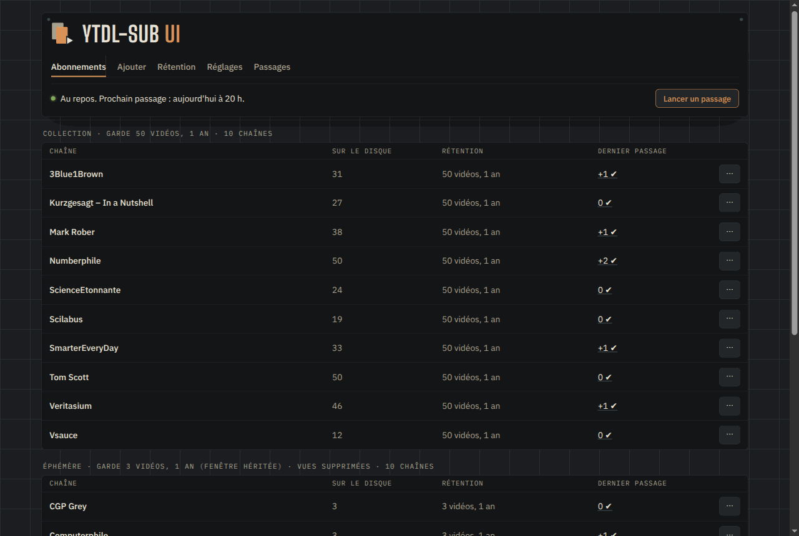
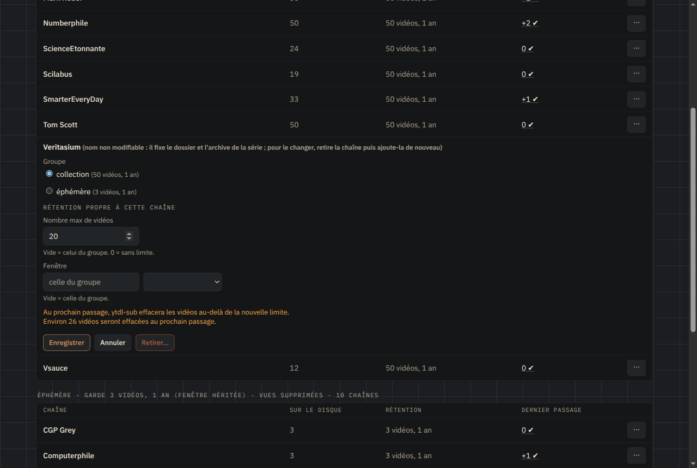
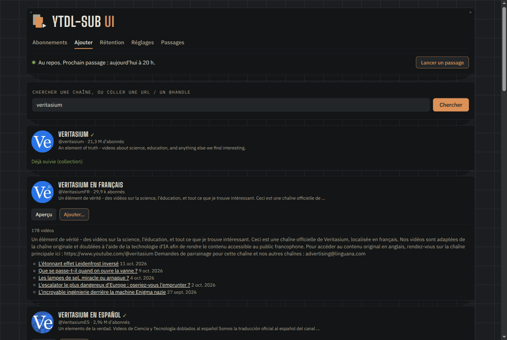
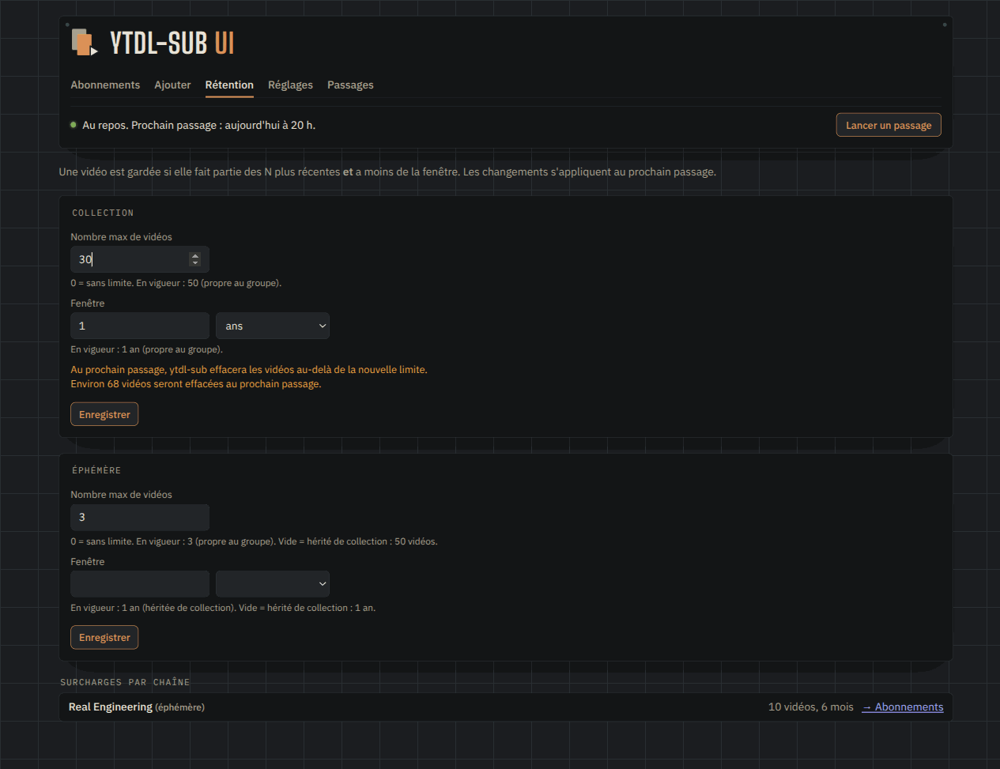
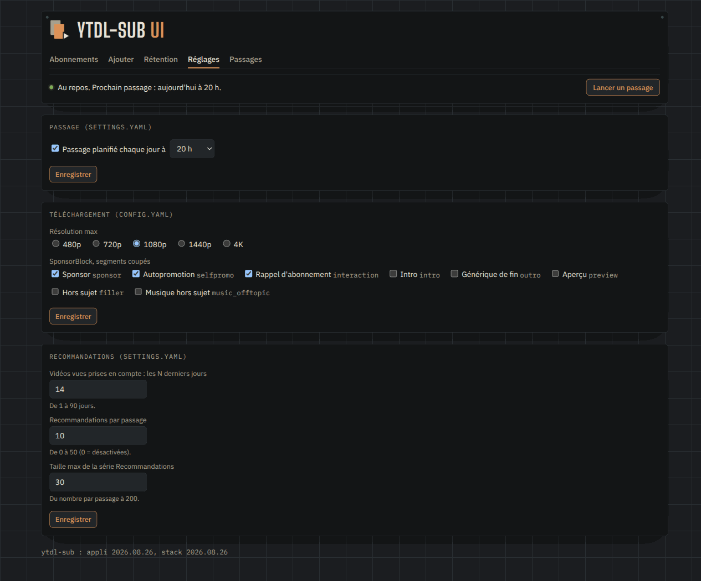
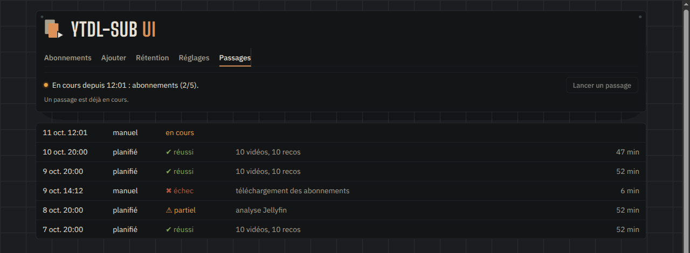
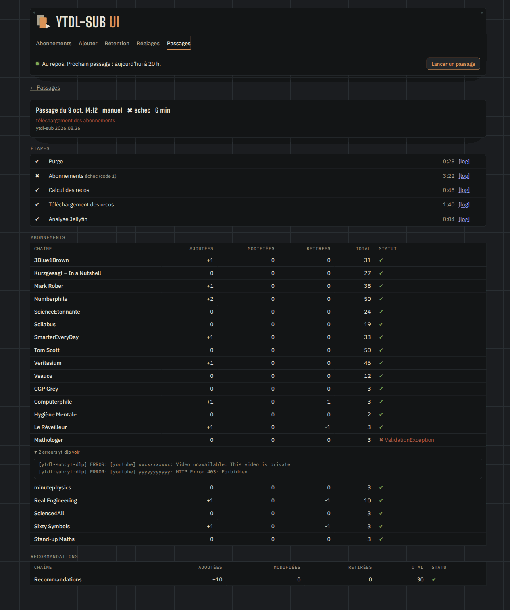
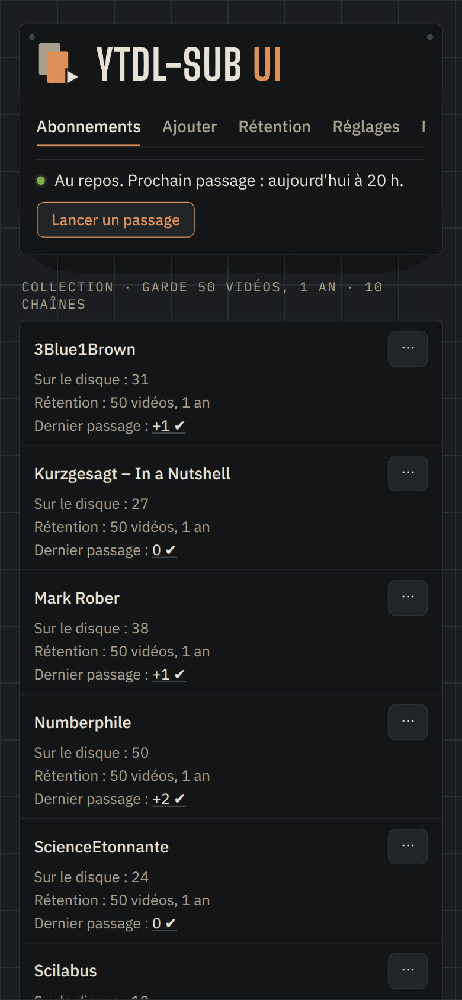
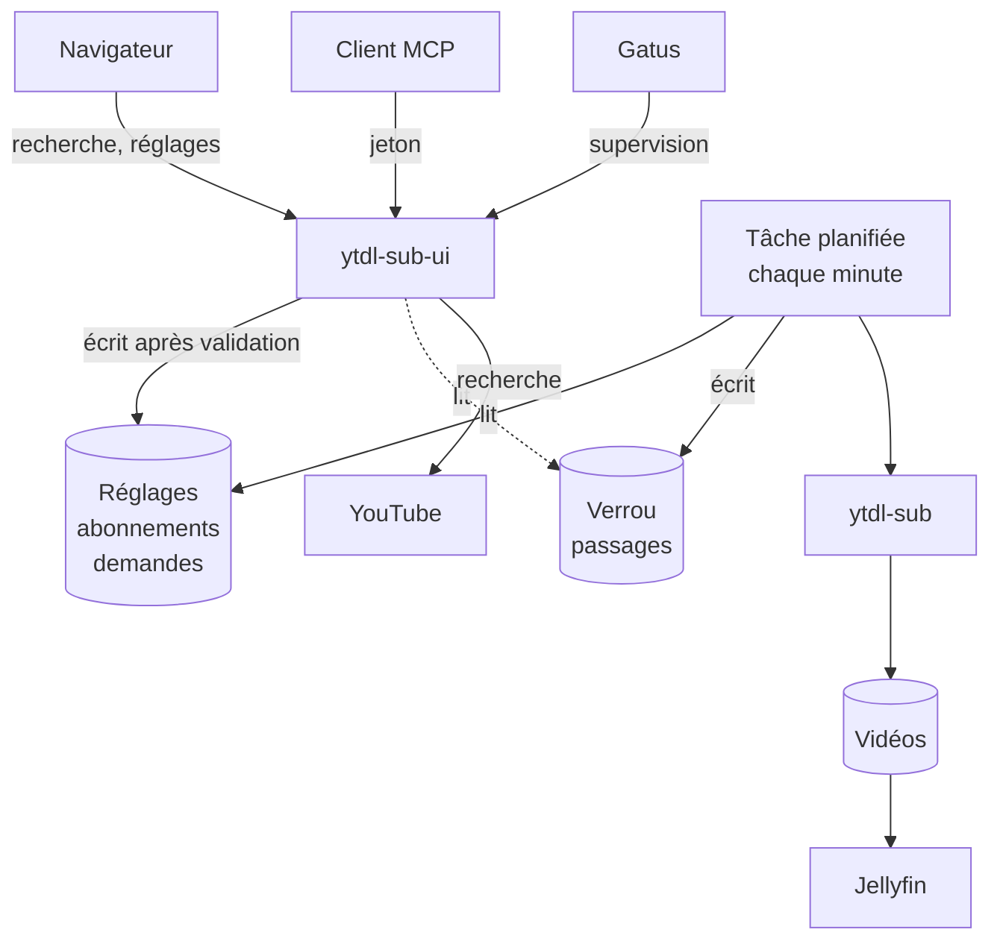

import Tabs from '@theme/Tabs';
import TabItem from '@theme/TabItem';

<ProjectMeta
  start="2026"
  role="Auteur (projet solo)"
  domain="Vidéo auto-hébergée, application web d'administration"
  stack={["Python", "FastAPI", "HTMX", "ytdl-sub", "Jellyfin", "MCP", "Docker", "GitHub Actions"]}
/>

## Contexte

Le [homelab](homelab.md) remplace YouTube par Jellyfin : chaque soir, ytdl-sub télécharge les nouvelles vidéos des chaînes suivies, sans publicité et sponsors coupés, et les range en séries. Ce passage quotidien fait plus que télécharger : il supprime les vidéos déjà vues des chaînes « éphémères » et ajoute des recommandations calculées d'après ce qui a été regardé dans Jellyfin. Tout se règle dans des fichiers YAML : suivre une nouvelle chaîne demandait de retrouver son identifiant, d'éditer un fichier, de le versionner, puis de redéployer. Il manquait une interface pour chercher une chaîne, l'ajouter, régler la rétention et voir ce que le passage du soir avait fait.

Les applications existantes ont été évaluées puis écartées. L'interface officielle de ytdl-sub n'est qu'un éditeur de texte dans le navigateur, sans recherche ni vue des abonnements. Pinchflat, TubeArchivist et MeTube remplaceraient ytdl-sub, et avec lui la purge des vidéos vues et les recommandations ; le développement de Pinchflat était de plus en pause, et sa rétention se comptait depuis la date de téléchargement. ytdl-sub-ui pilote donc ytdl-sub sans le remplacer : ytdl-sub télécharge, l'application édite ses fichiers. Écrite en octobre 2026, c'est un projet personnel, conçu et développé seul.

## Aperçu

Les captures viennent d'une instance de démonstration : stack simulée, abonnements à des chaînes publiques de vulgarisation scientifique, passages fictifs.

<Tabs>
  <TabItem value="modifier" label="Abonnements">
    

    Chaque chaîne se modifie en place : groupe, rétention propre, retrait. Un effet destructeur est annoncé avant l'envoi, chiffré à partir des archives de la série.
  </TabItem>
  <TabItem value="ajouter" label="Ajouter">
    

    Une chaîne se retrouve par son nom, sans compte Google, ou par son URL. Les chaînes déjà suivies sont signalées, et un aperçu des dernières vidéos précède l'ajout.
  </TabItem>
  <TabItem value="retention" label="Rétention">
    

    Nombre de vidéos et fenêtre de chaque groupe, avec l'héritage entre groupes et les réglages propres à une chaîne. Baisser une limite annonce combien de vidéos partiront au prochain passage.
  </TabItem>
  <TabItem value="reglages" label="Réglages">
    

    Heure du passage, résolution maximale, segments SponsorBlock coupés et paramètres des recommandations, en trois blocs écrits chacun dans son fichier.
  </TabItem>
  <TabItem value="passages" label="Passages">
    

    

    L'historique donne le déclencheur, le statut et la durée de chaque passage, et le bandeau suit le passage en cours étape par étape. Le détail reprend le résumé que ytdl-sub produit à chaque passage, une ligne par chaîne, avec les erreurs de téléchargement.
  </TabItem>
  <TabItem value="mobile" label="Vue mobile">
    

    Sur téléphone, chaque ligne devient une carte.
  </TabItem>
</Tabs>

## Architecture

ytdl-sub-ui est une application FastAPI dont les pages sont rendues par le serveur et mises à jour par HTMX. Elle n'a pas de base de données : tout l'état vit dans les fichiers de la stack de téléchargement, que l'application et la tâche planifiée de la stack se partagent.

## Piloter sans remplacer

L'application ne télécharge rien et ne lance jamais un passage elle-même. Elle modifie les fichiers que ytdl-sub lit déjà, et dépose une demande de passage que la tâche planifiée de la stack prend en charge. Cette tâche tourne chaque minute : elle lance un passage si une demande attend, ou le passage du soir à l'heure réglée. Changer l'heure ne demande donc jamais de redémarrer un conteneur, et « Lancer un passage » démarre en moins d'une minute. La tâche laisse aussi un signe de vie à chaque minute, qui permet de repérer en trois minutes un planificateur arrêté.

L'historique des passages, le résumé par chaîne et les erreurs sont relus dans les fichiers et les journaux que la tâche écrit à chaque étape. L'application tourne en un seul processus.

## Un seul écrivain par fichier, un verrou partagé

Le contrat entre l'application et la stack tient en une règle : chaque fichier n'a qu'un seul écrivain. L'application écrit la configuration, les abonnements, ses réglages et la demande de passage ; la tâche planifiée écrit le verrou, son signe de vie et le compte rendu des passages. Chaque écriture prépare d'abord un fichier complet à côté, puis le met en place d'un seul coup : un lecteur voit l'ancienne version ou la nouvelle, jamais un fichier à moitié écrit.

La tâche tient un verrou pendant tout le passage, et l'application le prend, sans attendre, pendant chacune de ses modifications. Une modification de la configuration ou des abonnements est donc refusée pendant un passage, et un passage ne peut pas démarrer au milieu d'une écriture. Les réglages que ytdl-sub ne lit pas (heure, recommandations) restent modifiables pendant un passage : sans cela, le premier rattrapage, qui dure plusieurs soirs, bloquerait aussi le changement d'heure. Le bandeau d'état consulte ce verrou toutes les cinq secondes, sauf pendant les écritures de l'application, pour ne jamais faire échouer sa propre modification.

## Validation par ytdl-sub avant écriture

Une erreur dans un fichier de configuration ne se verrait qu'à 20 h, par un passage en échec. Chaque modification est donc vérifiée par ytdl-sub lui-même, dans la version exacte qu'utilise la stack, avant d'être mise en place. Le mode de simulation de ytdl-sub a été écarté : il contacte YouTube et dure environ une heure. La vérification se contente de charger la configuration et les abonnements, à part, sans accès réseau, en cinq secondes environ, et porte sur le contenu exact qui sera écrit. En cas de refus, rien n'est écrit, et le message de ytdl-sub s'affiche.

Chaque modification suit le même cycle : prise du verrou, relecture du fichier, vérification qu'il n'a pas changé depuis l'ouverture du formulaire (pour ne pas écraser une modification faite ailleurs), modification, validation par ytdl-sub, copie de l'ancienne version dans un historique de vingt versions, puis mise en place.

## Préservation des commentaires YAML

Les fichiers modifiés par l'application sont aussi lus et commentés à la main. La bibliothèque ruamel.yaml a été retenue parce qu'elle réécrit un fichier sans le reformater : commentaires, ordre des clés, guillemets et accents sont conservés, et un fichier relu puis réécrit sans changement reste identique, ce qu'un test vérifie sur les fichiers de production. Une nouvelle chaîne s'insère à sa place alphabétique sans retrier les autres, et une entrée écrite sous une forme que l'application ne sait pas modifier s'affiche en lecture seule et reste intacte.

## Effacement borné

Retirer une chaîne garde ses vidéos par défaut, car ytdl-sub n'efface jamais une série retirée. L'option « Effacer aussi les vidéos » annonce le nombre de vidéos et la place occupée, demande une confirmation, puis vérifie une série de conditions. Le dossier doit se trouver directement dans le dossier des vidéos, ne pas être un raccourci vers un autre emplacement, ni un dossier caché, ni la série des recommandations. Il doit contenir l'archive de la série, qui prouve son identité, n'être utilisé par aucun autre abonnement, et l'application doit tenir le verrou. Le fichier d'abonnements est modifié d'abord, le dossier effacé ensuite : un échec laisse au pire une série orpheline, jamais un abonnement privé de son archive, qui relancerait le téléchargement de toute la chaîne.

## Recherche de chaînes sans compte

La recherche de chaînes et l'aperçu des dernières vidéos passent par la même source que le calcul des recommandations de la stack, sans compte Google ni clé d'accès : l'application ne détient aucun secret. Une URL collée ou un identifiant de chaîne est converti en adresse stable, qui ne change pas si la chaîne change de nom. Les tests rejouent des réponses enregistrées et ne font aucun appel réseau.

## Serveur MCP et supervision

Quand un jeton est configuré, l'application expose un serveur MCP qui reprend les écrans sous forme d'outils ; sans jeton, il n'existe pas. En lecture, les outils couvrent les abonnements, les vidéos orphelines, la rétention, les réglages, l'état de la stack, les passages et leur journal, la recherche de chaînes et l'aperçu. En écriture, ils permettent d'ajouter, de modifier ou de retirer une chaîne, d'effacer une série orpheline, de régler la rétention d'un groupe, l'heure du passage, les recommandations et le téléchargement, et de demander un passage. Ils passent par les mêmes fonctions que les écrans, donc par le même verrou, la même validation par ytdl-sub, le même historique et le même effacement borné. Une modification de chaîne ou de rétention peut être simulée : l'outil annonce son effet, par exemple le nombre de vidéos qui seraient effacées, sans rien écrire. L'agrégateur MCP du [homelab](homelab.md) expose ces outils avec ceux des autres services.

Gatus supervise l'application par deux accès : l'un vérifie qu'elle a démarré et lit ses fichiers, l'autre renvoie l'état de la stack, dont l'âge du dernier signe de vie de la tâche planifiée. Une sonde qui compare cet âge à un seuil repère une tâche arrêtée sans attendre le passage du soir. L'article [Gatus](/blog/2026/10/03/07-monitoring/gatus) décrit l'outil de supervision et son modèle de sondes.

## Déploiement

À chaque modification, GitHub Actions lance les tests et la vérification des types, et ne publie l'image sur GitHub Container Registry que si tout passe. L'application tourne en conteneur sur le homelab, à côté de la stack de téléchargement. Pour développer sans toucher à la vraie stack, un simulateur reproduit la tâche planifiée : signe de vie, verrou, passages par étapes et comptes rendus dans le format de ytdl-sub.

## Résultats

Chercher, ajouter, modifier ou retirer une chaîne se fait depuis le navigateur, y compris sur téléphone, sans plus éditer de fichier à la main. Aucune modification ne peut casser le passage du soir, puisque ytdl-sub la valide avant sa mise en place, et l'ancienne version reste dans l'historique. Le nombre de vidéos effacées est annoncé avant l'envoi, et un effacement ne peut viser que le dossier de la série retirée. ytdl-sub reste le moteur : la purge des vidéos vues et les recommandations sont conservées.

## Limites connues

- La configuration et les abonnements ne se modifient pas pendant un passage ; pendant le premier rattrapage d'une nouvelle installation, qui dure plusieurs soirs, ils restent donc figés.
- Une entrée écrite à la main sous une forme que l'interface ne sait pas modifier ne se change qu'en éditant le fichier.

## Liens

- [HomeLab](homelab.md) : infrastructure qui héberge la stack de téléchargement et l'application
- [Gatus](/blog/2026/10/03/07-monitoring/gatus) : l'outil de supervision qui surveille l'application

Le dépôt est privé.
