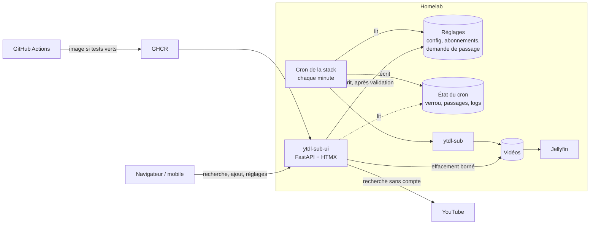

import Tabs from '@theme/Tabs';
import TabItem from '@theme/TabItem';

<ProjectMeta
  start="2026"
  end="2026"
  role="Auteur (projet solo)"
  domain="Vidéo auto-hébergée, application web d'administration"
  stack={["Python", "FastAPI", "HTMX", "ytdl-sub", "Jellyfin", "Docker", "GitHub Actions"]}
/>

## Contexte

Mon [homelab](homelab.md) remplace YouTube par Jellyfin : chaque soir, ytdl-sub télécharge les nouvelles vidéos des chaînes suivies, sans publicité et sponsors coupés, et les range en séries. Le passage quotidien fait plus que télécharger : il supprime les vidéos déjà vues des chaînes "éphémères" et ajoute des recommandations calculées d'après ce qui a été regardé dans Jellyfin. Tout se règle dans des fichiers YAML : suivre une nouvelle chaîne demandait de retrouver son identifiant, d'éditer un fichier, de le versionner puis de redéployer. Ce qui manquait était une interface pour chercher une chaîne, l'ajouter, régler la rétention et voir ce que le passage du soir avait fait.

Les applications existantes ont été évaluées puis écartées. L'interface officielle de ytdl-sub n'est qu'un éditeur de code dans le navigateur, sans recherche ni vue des abonnements. Pinchflat, TubeArchivist et MeTube remplaceraient ytdl-sub, et avec lui la purge des vidéos vues et les recommandations ; Pinchflat avait de plus un développement en pause et une rétention comptée depuis la date de téléchargement. J'ai donc écrit une application qui pilote ytdl-sub sans le remplacer : ytdl-sub télécharge, l'application édite ses fichiers.

## Aperçu

Captures réalisées sur une instance de démonstration : stack simulée, abonnements à des chaînes publiques de vulgarisation scientifique, passages fictifs.

<Tabs>
  <TabItem value="modifier" label="Abonnements">
    

    Chaque chaîne se modifie en place : groupe, rétention propre, retrait. Un effet destructeur est annoncé avant l'envoi, chiffré à partir des archives de la série.
  </TabItem>
  <TabItem value="ajouter" label="Ajouter">
    

    Une chaîne se retrouve par son nom, sans compte Google, ou par son URL. Les chaînes déjà suivies sont signalées, et un aperçu des dernières vidéos précède l'ajout.
  </TabItem>
  <TabItem value="retention" label="Rétention">
    

    Nombre de vidéos et fenêtre de chaque groupe, avec l'héritage entre groupes et les surcharges par chaîne. Baisser une limite annonce combien de vidéos partiront au prochain passage.
  </TabItem>
  <TabItem value="reglages" label="Réglages">
    

    Heure du passage, résolution maximale, segments SponsorBlock coupés et paramètres des recommandations, en trois blocs écrits chacun dans son fichier.
  </TabItem>
  <TabItem value="passages" label="Passages">
    

    

    L'historique donne le déclencheur, le statut et la durée de chaque passage, et le bandeau suit le passage en cours étape par étape. Le détail reprend le tableau "Download Summary" de ytdl-sub, une ligne par chaîne, avec les erreurs de téléchargement.
  </TabItem>
  <TabItem value="mobile" label="Vue mobile">
    

    Sur téléphone, chaque ligne devient une carte.
  </TabItem>
</Tabs>

## Stack technique

  

    
Backend

    
Python, FastAPI, httpx, Jinja2, ruamel.yaml

  

  

    
Frontend

    
HTMX, rendu serveur, lisible sur téléphone

  

  

    
Données

    
Aucune base : l'état vit dans les fichiers de la stack (YAML, JSON, logs)

  

  

    
Intégrations

    
ytdl-sub (validation), API interne de YouTube, cron de la stack par fichiers et verrou partagé

  

  

    
CI/CD

    
GitHub Actions, GitHub Container Registry, Docker

  

  

    
Qualité

    
pytest, ty (vérification de types), ruff, uv

  

## Architecture

## Piloter sans remplacer

L'application ne télécharge rien et ne lance jamais ytdl-sub pour un passage. Elle édite les fichiers que ytdl-sub lit déjà, et dépose une demande de passage que le cron de la stack consomme. Le cron tourne chaque minute : il lance un passage manuel si une demande est en attente, ou le passage planifié à l'heure réglée. Changer l'heure ne recrée donc jamais le conteneur, et "Lancer un passage" répond en moins d'une minute. Un battement de cœur écrit par le cron permet de signaler un planificateur arrêté en trois minutes.

Tout l'état reste dans les fichiers de la stack : pas de base de données, un seul processus. L'historique des passages, le résumé par chaîne et les erreurs sont relus dans les fichiers et les logs que le cron écrit à chaque étape.

## Un seul écrivain par fichier, un verrou partagé

Le contrat entre l'application et la stack tient en une règle : chaque fichier a un seul écrivain. L'application écrit la configuration, les abonnements, ses réglages et la demande de passage ; le cron écrit le verrou, le battement et le compte rendu des passages. Toute écriture passe par un fichier temporaire, puis un renommage atomique.

Le cron tient un verrou pendant tout le passage, et l'application le prend, sans attente, pendant chacune de ses modifications. Une modification de la configuration ou des abonnements est donc refusée pendant un passage, et un passage ne peut pas démarrer en pleine écriture. Les réglages que ytdl-sub ne lit pas (heure, recommandations) restent modifiables pendant un passage, sans quoi le premier rattrapage, qui dure plusieurs soirs, bloquerait aussi le changement d'heure. Le bandeau d'état sonde ce même verrou toutes les cinq secondes ; la sonde est suspendue pendant les écritures de l'application, pour qu'elle ne fasse jamais échouer sa propre modification.

## Validation par ytdl-sub avant écriture

Une erreur dans un fichier de configuration ne se verrait qu'à 20 h, par un passage en échec. Chaque modification est donc validée par ytdl-sub lui-même, épinglé à la même version que celle de la stack, avant d'être mise en place. Le simulateur intégré de ytdl-sub a été écarté : il contacte YouTube et dure environ une heure. La validation charge la configuration et les abonnements par l'API de ytdl-sub, dans un sous-processus isolé, hors ligne, en cinq secondes environ ; elle porte sur les octets exacts qui seront écrits. En cas de refus, rien n'est écrit et le message de ytdl-sub est affiché, nettoyé.

Le cycle complet d'une modification est fixe : verrou, relecture du fichier, contrôle de son empreinte contre celle du formulaire (pour ne pas écraser une modification faite ailleurs), modification, validation, copie de l'ancienne version dans un historique de vingt versions, puis remplacement atomique.

## Préservation des commentaires YAML

Les fichiers édités sont aussi lus et commentés à la main. L'écriture passe par ruamel.yaml en aller-retour : commentaires, ordre des clés, guillemets et accents sont conservés, et un aller-retour sans modification rend exactement les mêmes octets, ce qu'un test vérifie sur les fichiers de production. Une nouvelle chaîne est insérée à sa place alphabétique sans retrier l'existant, et une forme que l'application ne sait pas modifier est affichée en lecture seule et conservée telle quelle.

## Effacement borné

Retirer une chaîne garde ses vidéos par défaut, car ytdl-sub n'efface jamais une série retirée. L'option "Effacer aussi les vidéos" annonce le nombre de vidéos et la taille, demande une confirmation, puis applique une série de contrôles : le dossier doit être directement dans le dossier des vidéos, ne pas être un lien symbolique, ni un dossier caché, ni la série des recommandations, contenir l'archive de la série (preuve de son identité), n'être utilisé par aucun autre abonnement, et le verrou doit être tenu. Le fichier d'abonnements est écrit d'abord, le dossier effacé ensuite : un échec laisse au pire une série orpheline, jamais un abonnement sans archive, qui relancerait le téléchargement de toute la chaîne.

## Recherche YouTube sans compte

La recherche de chaînes et l'aperçu des dernières vidéos passent par l'API interne qu'utilise la page web de YouTube, comme le calcul des recommandations de la stack. Aucun compte Google, aucune clé, aucun cookie : l'application ne porte aucun secret. Une URL collée ou un identifiant de chaîne est résolu vers l'adresse stable de la chaîne, qui ne change pas si son nom d'usage change. Les réponses de YouTube sont testées sur des fixtures enregistrées : la suite de tests n'ouvre aucun accès réseau.

## Spécification, puis développement par agents

J'ai d'abord écrit le besoin, puis une spécification courte validée avant toute ligne de code : périmètre, contrat de fichiers avec la stack, maquettes de chaque écran, bornes de chaque réglage, et la liste des points à trancher avec ma recommandation pour chacun. Un plan découpait ensuite le travail en vagues de tâches indépendantes, menées par des agents de code. Chaque tâche se terminait par les tests, la vérification de types et le linter au vert, puis par une relecture contre la spécification avant de passer à la suivante ; une dernière tâche relisait l'ensemble du code contre la spécification. Pour développer sans toucher à la vraie stack, un simulateur reproduit le cron : battement, verrou, passages par étapes et comptes rendus au format de ytdl-sub.

## Résultats

- **Plus d'édition de YAML à la main** : chercher, ajouter, modifier ou retirer une chaîne se fait depuis le navigateur, y compris sur téléphone.
- **Aucune écriture qui casse le passage du soir** : chaque modification est validée par ytdl-sub avant d'être mise en place, et l'ancienne version reste dans l'historique.
- **Effets destructeurs annoncés et bornés** : le nombre de vidéos effacées est affiché avant l'envoi, et l'effacement ne peut viser que le dossier de la série retirée.
- **ytdl-sub reste le moteur** : la purge des vidéos vues et les recommandations sont conservées, et l'application ne remplace aucun composant de la stack.
- **Spécifiée et développée en une journée**, avec plus de six cents tests exécutés par la CI avant toute publication de l'image.

Le dépôt est privé.
