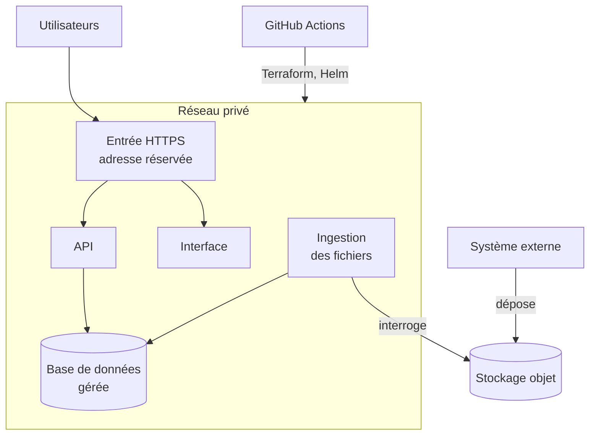
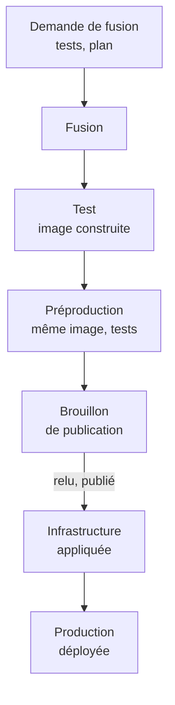

<ProjectMeta
  start="2026"
  role="Infrastructure, CI/CD et exploitation"
  domain="Mise en production cloud, infrastructure as code, livraison continue"
  stack={["Terraform", "Kubernetes", "Helm", "GitHub Actions", "Docker", "PostgreSQL", "Traefik", "Python"]}
/>

## Contexte

L'application est une API web écrite en Python, consommée par une interface développée à part. Elle tournait d'abord en test et en préproduction sur le cluster Kubernetes interne de l'équipe, avec sa base de données et son stockage de fichiers installés dans le cluster. Son ouverture à de premiers utilisateurs demandait une vraie production, hébergée chez un fournisseur de cloud, avec une base de données et un stockage gérés par ce fournisseur.

Le travail couvrait toute la chaîne qui mène le code jusqu'à la production : l'infrastructure, le paquet de déploiement de l'application, la livraison continue et l'exploitation. S'y ajoutait l'ingestion automatique des fichiers de données qu'un système externe dépose régulièrement.

## Architecture

L'application tourne dans un cluster Kubernetes géré par le fournisseur, placé avec la base de données dans un réseau privé : la base n'est joignable que de l'intérieur. Seule l'entrée HTTPS, sur une adresse publique réservée, reçoit le trafic des utilisateurs. Les fichiers de l'application et ceux du système externe vivent dans des espaces de stockage objet séparés.

## Infrastructure Terraform

**Deux ensembles indépendants.** Le premier décrit le socle chez le fournisseur : réseau, cluster, base de données, stockage et noms de domaine. Le second installe dans le cluster ce dont l'application a besoin pour fonctionner : l'entrée HTTPS, la gestion automatique des certificats et la configuration qui relie l'application à son socle. Terraform ne sait pas configurer l'accès à un cluster qu'il crée dans le même ensemble, et la séparation limite la portée d'une erreur : une modification du second ne peut pas toucher la base. Le second lit les sorties du premier, sans rien recopier. L'état des deux est conservé dans un stockage objet versionné, avec un verrou qui empêche deux modifications simultanées ; l'article [Terraform : state remote avec S3](/blog/2026/07/11/08-iac/terraform-remote-state) décrit ce mécanisme.

**Une identité par usage.** L'application de l'infrastructure, sa simple lecture par l'intégration continue, l'application elle-même et le système externe ont chacun leurs propres accès, limités à ce dont ils ont besoin. Le système externe, par exemple, ne voit que l'espace où il dépose ses fichiers.

**Des secrets hors de l'état.** Le mot de passe de la base n'est jamais écrit dans l'état de Terraform, et le changer revient à incrémenter un numéro de version. L'adresse privée de la base change quand le réseau est recréé : Terraform la publie dans une configuration que l'application lit au démarrage, au lieu de la recopier à la main dans les paramètres de déploiement.

**Des ressources protégées.** La base, le stockage, le réseau et l'adresse publique sont protégés contre une destruction accidentelle ; le cluster ne l'est pas, puisqu'il se recrée depuis le code. Ces protections s'appuient sur les mécanismes décrits dans [Terraform : depends_on et lifecycle](/blog/2026/07/11/08-iac/terraform-depends-on-lifecycle). L'entrée HTTPS transmet à l'application l'adresse réelle de chaque client, sans quoi les limites de débit s'appliqueraient à tous les utilisateurs à la fois.

**Une production qui peut se mettre en pause.** Sans utilisateur, la production peut être suspendue : le cluster et la base sont détruits, le réseau, l'adresse publique et le stockage sont gardés. L'ordre compte. L'équilibreur de charge est créé par Kubernetes et non par Terraform : s'il n'est pas supprimé avant le cluster, il lui survit, reste facturé et garde l'adresse réservée. La procédure de pause et de reprise impose donc cet ordre.

## Chart Helm

Un seul chart Helm sert au test, à la préproduction et à la production ; la production ne diffère que par son fichier de paramètres. En test et en préproduction, le chart embarque sa propre base de données et son propre stockage, et s'expose derrière l'authentification commune du cluster interne. En production, il les désactive, lit la configuration posée par Terraform et publie une entrée avec son certificat.

Les migrations de la base passent par une tâche dédiée, lancée à chaque nouvelle version. L'API et l'ingestion attendent que la base soit à jour avant de démarrer. Si les migrations échouent, le déploiement n'aboutit pas dans le temps imparti et Helm revient de lui-même à la version précédente ; l'API continue de répondre pendant ce retour arrière, ce qui a été vérifié en provoquant volontairement l'échec.

Les services ne redémarrent que si leur configuration ou leurs secrets changent réellement : redéployer à l'identique ne relance rien. Tous les conteneurs tournent sans droits d'administrateur, sur un système de fichiers en lecture seule. Les ressources réservées pour chaque service viennent d'une semaine de mesures. L'image est désignée par une étiquette fixe, tirée du commit qui l'a produite, selon le principe décrit dans [Helm : déploiement par tag immuable](/blog/2026/09/24/04-ci-cd/helm-tag-immuable).

## Chaîne de livraison

**Une image construite une seule fois.** Chaque version est construite une fois, testée, puis promue telle quelle en préproduction et en production, sans être reconstruite. La production exécute donc exactement l'image qui a passé les tests. L'image est organisée pour qu'un simple changement de numéro de version n'oblige pas à réinstaller les dépendances : en local, sa reconstruction passe de plus d'une minute et demie à quelques secondes.

**Un plan relu avant d'être appliqué.** Avant chaque mise en production, un brouillon de publication rassemble tout ce qui va changer : les différences du déploiement, les migrations prévues sur la base de production et le plan de Terraform. Publier ce brouillon vaut validation. Au moment d'appliquer, le plan est recalculé et comparé à celui qui a été relu, au moyen d'une empreinte qui résume la liste des changements sans en révéler aucune valeur. Si le plan a changé entre-temps, rien n'est appliqué.

**Des suppressions refusées par défaut.** Un plan qui supprime ou remplace une ressource est refusé par la chaîne automatique. Une suppression voulue passe par un lancement manuel, avec une confirmation explicite. Deux modifications d'un même ensemble ne se chevauchent jamais, et une modification en cours n'est jamais interrompue.

**Un accès au cluster toujours à jour.** Après une reprise, le cluster recréé change d'adresse. La chaîne lit donc l'accès au cluster dans les sorties de Terraform à chaque exécution, au lieu de le garder dans un secret qui deviendrait périmé, et refuse tout cluster qui n'est pas celui de la production.

## Ingestion des fichiers déposés

Le système externe dépose des fichiers de mesures et des jeux de données de référence dans un stockage objet. En test et en préproduction, chaque dépôt déclenchait un traitement par notification. Le stockage du fournisseur ne propose pas ces notifications : elles ont été remplacées par un service permanent qui interroge le stockage chaque minute. Une tâche planifiée a été écartée, parce qu'elle relancerait toute l'application à chaque passage et n'empêcherait pas deux passages longs de se chevaucher. Le stockage étant versionné, chaque dépôt garde une identité propre, même quand le même fichier est déposé deux fois.

À chaque passage, le service compare ce qui est déposé à ce qui a déjà été traité, et décide pour chaque fichier de le traiter, de l'ignorer ou de le signaler comme non reconnu. Un stockage déjà traité ne coûte qu'une liste et une requête. Un verrou pris dans la base garantit qu'un même fichier n'est jamais traité deux fois en même temps, même si un rejeu manuel tourne en parallèle.

Les erreurs sont classées. Un fichier au contenu invalide est marqué en échec. Une panne passagère du stockage laisse le fichier pour le passage suivant, et une série de pannes arrête le passage au lieu d'insister. Un jeu de référence est refusé en entier s'il contient une seule entrée invalide : un import automatique partiel passerait inaperçu. Un fichier de mesures arrivé avant le jeu de référence dont il dépend est rejoué automatiquement après l'import de ce dernier, et une commande permet de rejouer les échecs à la main.

Une seule instance du service existe à la fois. Elle termine le fichier en cours avant de s'arrêter, refuse de démarrer si le stockage n'est pas versionné, et Kubernetes la redémarre si elle cesse de donner signe de vie.

## Exploitation

La documentation d'exploitation est écrite pour qu'un collègue puisse reprendre la production sans son auteur : accès et procédure en cas de perte, préparation du poste, renouvellement des clés et du mot de passe, pause et reprise, reconstruction complète depuis un compte vide. Un manuel d'urgence décrit la mise en production à la main quand l'intégration continue est indisponible.

La base est sauvegardée chaque jour, avec sept jours de rétention. La restauration passe par une base temporaire, d'où les données sont recopiées dans la base de production, application arrêtée ; la production garde ainsi sa base, son adresse et sa description dans Terraform.

## Rôle

Trois développeurs ont contribué à l'application. Ma part couvre l'infrastructure Terraform, le chart Helm, l'image Docker, les workflows GitHub Actions, le service d'ingestion et la documentation de déploiement et d'exploitation, ainsi que, côté application, la gestion des données de référence alimentées par l'ingestion. Un collègue a écrit l'essentiel de l'API métier et ses tests. Un second collègue a mis en place les journaux structurés, la supervision locale et les tests de bout en bout lancés sur la préproduction.

## Résultats

La production est en service pour de premiers utilisateurs. Elle n'est déployée que par l'intégration continue, à la publication d'une version ; les interventions manuelles sont réservées à la pause, à la reprise et à la reconstruction. Avant la mise en service, les droits de chaque identité ont été testés un par un, et la protection de la base contre la destruction a été vérifiée. Les fichiers du système externe sont ingérés sans intervention : l'import manuel après chaque dépôt n'existe plus.

## Limites connues

- Le cluster ne compte qu'un nœud : chaque mise à jour, y compris celles que le fournisseur applique automatiquement chaque semaine, coupe le service quelques minutes. Un second nœud supprimerait la coupure.
- Les journaux de la production ne sont pas encore collectés par l'outil de supervision du fournisseur ; les alertes et le tableau de bord ont été mis au point sur la supervision locale.

## Liens

Le dépôt est privé.
