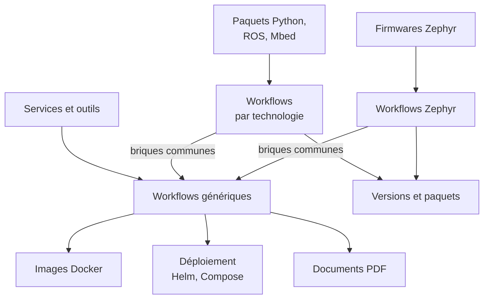

import Tabs from '@theme/Tabs';
import TabItem from '@theme/TabItem';

<ProjectMeta
  start="2024"
  role="Concepteur et mainteneur principal"
  domain="CI/CD mutualisée, standardisation"
  stack={["GitHub Actions", "Docker", "Helm", "Python", "ROS", "Zephyr"]}
/>

## Contexte

La migration des dépôts du CATIE de GitLab vers GitHub a posé une question concrète : comment éviter que chaque équipe réécrive ses propres pipelines ? Sans cadre commun, il y aurait eu autant de variantes que de projets, chacune un peu différente et à maintenir séparément. Une bibliothèque de workflows GitHub Actions réutilisables a donc été conçue, rangée par domaine technique, que chaque projet de l'organisation appelle en quelques lignes.

## Un workflow central, des dizaines de projets appelants

GitHub Actions permet à un workflow d'en appeler un autre, situé dans un autre dépôt. La logique de CI/CD vit ainsi à un seul endroit : quand un workflow partagé évolue (nouvelle version d'un outil, correction, nouvelle fonction), tous les projets qui l'appellent en profitent à leur prochaine exécution, sans modifier leur propre dépôt. Un projet ne précise que le workflow à appeler et quelques paramètres propres à son contexte ; les étapes, le choix des machines et la gestion des secrets sont centralisés. Les jobs tournent sur les [runners auto-hébergés ARC](github-arc-kubeadm.md) du cluster interne. L'article [GitHub Actions : architecture CI/CD réutilisable](/blog/2024/12/20/04-ci-cd/github-actions-architecture-reutilisable) présente ce modèle.

Les workflows propres à une technologie ne refont pas les briques communes : les vérifications avant commit et le marquage automatique des versions viennent des workflows génériques, qu'ils appellent à leur tour.

## Les domaines couverts

<Tabs>
  <TabItem value="generic" label="Générique">

Le dépôt générique couvre ce qui ne dépend d'aucune technologie : construction et publication d'images Docker, déploiement par Helm ou Docker Compose, marquage automatique des versions, vérifications avant commit, test des modèles de projet Python et production de documents PDF à partir de Markdown. Les Dockerfile passent par un outil d'analyse qui bloque dès le premier avertissement ; une règle trop stricte pour un cas donné s'écarte nommément plutôt qu'en baissant le seuil pour tous.

Trois évolutions récentes y ont été apportées.

**Image marquée du commit.** Le workflow de publication peut ajouter à chaque image une étiquette fixe, tirée du commit qui l'a produite. Le [cluster interne](sonu-k8s-cluster.md) déploie ainsi une version précise plutôt que « la dernière de la branche », et ne redémarre une application que si son image a changé ([Helm : déploiement par tag immuable](/blog/2026/09/24/04-ci-cd/helm-tag-immuable)).

**Cache de construction.** Les runners étant jetables, chaque construction refaisait toutes les étapes du Dockerfile. Un cache de construction a été ajouté, rangé à côté des images de chaque dépôt et nettoyé après chaque construction, sans jamais toucher aux images en service ([Docker : cache BuildKit](/blog/2026/10/31/03-containerization/docker-cache-buildkit)).

**Diagnostic des déploiements.** En cas d'échec, Helm revenait automatiquement à la version précédente et supprimait les pods en erreur, avant que quiconque ait pu voir pourquoi. Le retour arrière est désormais précédé d'un diagnostic, écrit dans le journal du job : dernières versions déployées, état des pods qui ne démarrent pas, événements du cluster qui les concernent et, pour les dépôts privés seulement, dernières lignes de leurs journaux. Le retour arrière n'a lieu que si le déploiement a réellement commencé, pour ne pas défaire une version en service à cause d'une simple erreur dans le chart.

  </TabItem>
  <TabItem value="python" label="Python">

Les workflows Python couvrent la vie d'un paquet : tests, publication sur le serveur de paquets interne et marquage automatique de la version déclarée dans le projet. Ils ont suivi les pratiques de l'équipe : des équivalents fondés sur uv ont été ajoutés à côté des workflows Poetry, au fil de la migration des projets Python.

  </TabItem>
  <TabItem value="ros" label="ROS">

Les workflows ROS couvrent ROS 1 et plusieurs distributions de ROS 2. Ils s'appuient sur les outils officiels de la communauté ROS pour préparer l'environnement, compiler et tester, avec une vérification facultative du code Python. Ils tournent sur les runners auto-hébergés, qui disposent déjà de l'environnement ROS.

  </TabItem>
  <TabItem value="zephyr" label="Zephyr">

Les workflows Zephyr compilent et testent les firmwares de l'équipe embarquée : applications, bibliothèques, pilotes, cartes et cartes d'extension, sur plusieurs cartes cibles. Ils sont développés et maintenus par un collègue de cette équipe, et s'appuient sur les briques communes des workflows génériques.

  </TabItem>
</Tabs>

## Documentation vérifiée contre le code

Fin septembre 2026, la bibliothèque comptait plusieurs dizaines de workflows et d'actions, documentés de façon inégale : un court README pour certains, rien pour d'autres. Pour un projet appelant, la seule référence fiable était le code lui-même. Tous les dépôts ont alors été documentés au même format : une page par workflow et par action, avec un exemple d'appel, les paramètres, les secrets attendus, les résultats, le fonctionnement, les dépendances et les points d'attention. La documentation décrit le code tel qu'il est : les anomalies constatées pendant la rédaction ont été notées, et non corrigées au passage, pour que chaque correction reste une modification relue à part.

Un dépôt transverse complète ces pages, au format des modes opératoires de l'équipe :

- un catalogue de tous les workflows (rôle, machines utilisées, projets appelants connus, statut) et des anomalies relevées, classées par gravité, du comportement erroné aux simples dettes techniques ;
- un guide pour les équipes qui appellent les workflows, notamment sur les droits accordés à un workflow appelé, qui ne peuvent pas dépasser ceux du job appelant ;
- un mode opératoire pour modifier un workflow partagé sans casser ses appelants.

Une documentation écrite à la main s'écarte du code dès la modification suivante. Un script, lancé sur chaque dépôt, compare la déclaration de chaque workflow à sa page : chaque paramètre, secret et résultat doit y figurer, avec le bon type, le bon caractère obligatoire et la bonne valeur par défaut. Il signale aussi les pages qui documentent un workflow supprimé et les liens cassés, et il a ses propres tests.

## Rôle

La bibliothèque a été conçue pour le CATIE, dans le cadre de la migration de GitLab vers GitHub, et ses utilisateurs sont les équipes de l'organisation. J'en ai assuré la conception et l'évolution des workflows génériques, Python, ROS et Mbed, dont l'image marquée du commit, le cache de construction et le diagnostic des déploiements, ainsi que la campagne de documentation et le script de vérification. Un collègue a contribué aux workflows génériques. Les workflows Zephyr sont l'œuvre d'un collègue de l'équipe embarquée ; ma part s'y limite à leur documentation.

## Résultats

En septembre 2026, la recherche de code de GitHub recensait plus de 70 dépôts de l'organisation qui appellent les workflows génériques, une trentaine pour les workflows Python et 17 pour les workflows ROS ; les workflows Zephyr en comptaient près de 90. Tous les services du [cluster Kubernetes interne](sonu-k8s-cluster.md) se déploient par le même workflow. La campagne de documentation a fait apparaître une vingtaine d'anomalies jusque-là invisibles, dont des appels vers des workflows supprimés ; elles sont recensées et classées dans le catalogue. Un déploiement qui échoue laisse maintenant dans le journal du job de quoi comprendre pourquoi, sans connexion au cluster.

## Limites connues

- Aucune version de la bibliothèque n'est publiée : tous les projets suivent la branche principale, si bien qu'une régression se propage aussi vite qu'une correction. La relecture de chaque modification et le mode opératoire de modification sont les seuls garde-fous.

## Liens

- [generic_workflows](https://github.com/catie-aq/generic_workflows)
- [ros_workflows](https://github.com/catie-aq/ros_workflows)
- [zephyr_workflows](https://github.com/catie-aq/zephyr_workflows)

Les workflows Python et Mbed et le dépôt de documentation transverse sont privés.
