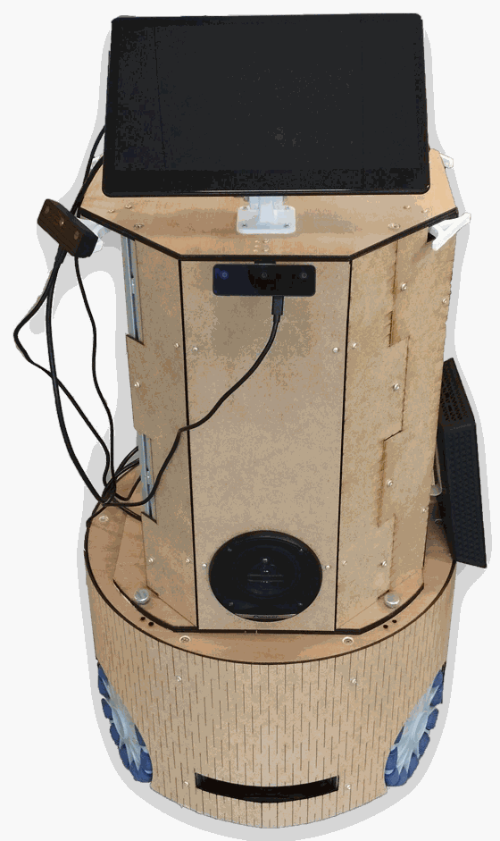
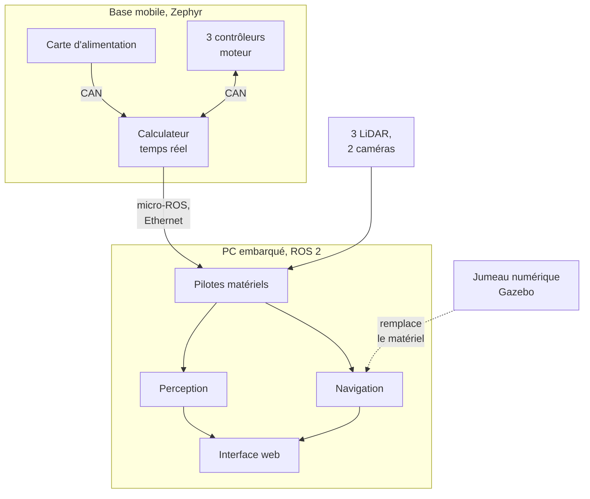

<ProjectMeta
  start="2024"
  role="Coordination technique, lead ROS 2 (Python)"
  domain="Robotique de service modulaire, architecture distribuée, navigation, perception"
  stack={["ROS 2", "Python", "Zephyr", "micro-ROS", "Nav2", "Gazebo", "Docker", "GitHub Actions"]}
/>

## Contexte

Pendant six ans, l'équipe CATIE Robotics a concouru à la RoboCup@Home avec un TIAGo de PAL Robotics (voir [RoboCup@Home 2023](./robocup-home-2023-catie.md)). Une plateforme commerciale fermée impose ses limites : capteurs et calculateur figés, firmware inaccessible, pièces et évolutions dépendantes du constructeur. Début 2024, le CATIE a lancé un groupe de travail pour concevoir sa propre plateforme : C-Rob, un démonstrateur de robotique de service dont toute la chaîne (mécanique, électronique, firmware, logiciel) est maîtrisée en interne.

Le cahier des charges est issu de l'analyse des épreuves RoboCup@Home et des besoins du CATIE : navigation rapide et précise en intérieur (passage de portes de 70 cm, évitement d'obstacles dynamiques, suivi de personnes), perception de l'environnement à 360°, détection et ré-identification de personnes, et à terme manipulation d'objets. La plateforme est pensée comme un empilement de modules détachables :

- **Base mobile** : trois roues omnidirectionnelles (cinématique holonome), trois LiDAR 2D en couronne, batteries et carte d'alimentation, calculateur temps réel sous Zephyr.
- **Module central C2I** : PC embarqué sous ROS 2 Jazzy, caméras RGB-D OAK-D, écran, haut-parleur et bandeaux LED pour l'interaction.
- **Module bras** : prévu dans la spécification, pas encore intégré.

## Architecture

Le logiciel se répartit sur deux niveaux. Les microcontrôleurs de la base mobile, sous Zephyr, gèrent tout ce qui relève du temps réel et de la sûreté : commande des moteurs, odométrie, alimentation, arrêt d'urgence. Ils dialoguent entre eux sur un bus CAN. Le calculateur temps réel de la base se présente au reste du robot comme un nœud ROS 2 ordinaire, grâce à micro-ROS, par le réseau Ethernet interne. Le PC embarqué exécute ROS 2 : chaque bloc fonctionnel (pilotes matériels, description du robot, navigation, perception, interface web) est un paquet distinct, livré dans sa propre image Docker.

## Réalisations

### Spécification

La phase de spécification de 2024 a produit l'analyse des besoins par axe (navigation, perception, IA, manipulation) : pour chaque axe, ce qu'exige la RoboCup@Home, ce qui intéresse le CATIE au-delà de la compétition, et les dépendances avec les autres axes. Les états de l'art (roues holonomes, bras collaboratifs, capteurs) ont été menés en équipe. Les schémas d'architecture du robot (topologie réseau, liaisons des capteurs, découpage en modules détachables) ont été complétés par l'équipe électronique pour le budget d'alimentation. Cette phase a fixé les choix structurants : cinématique holonome, LiDAR en couronne, calculateur temps réel distinct du PC embarqué.

### Organisation et déploiement

Le logiciel est découpé en un dépôt par bloc fonctionnel (pilotes matériels, description, navigation, perception, messages, interface web). Un dépôt racine les assemble en un espace de travail ROS 2 et référence aussi les firmwares, ce qui fige une combinaison cohérente de versions. Cet espace de travail fournit une image de base ROS 2 en deux variantes, l'une pour l'environnement de développement, l'autre pour le robot. Chaque paquet construit sa propre image à partir de cette base et la publie sur le registre de conteneurs de GitHub. Sur le robot, Docker Compose assemble les services ; chacun vérifie en continu que son nœud principal répond et redémarre seul en cas de panne.

Toute la configuration du robot tient dans un seul fichier : nom du robot, simulation ou matériel réel, carte, monde simulé, paramètres de navigation. Chaque conteneur le lit au démarrage et le valide contre un schéma : une valeur absente ou mal formée arrête le lancement, au lieu de produire un comportement incohérent plus loin.

Tous les dépôts partagent la même chaîne d'intégration continue : vérifications avant commit, compilation et tests ROS 2, analyse et publication de l'image Docker, nouvelle version publiée automatiquement quand le numéro du paquet change, mise à jour hebdomadaire des outils de vérification.

### Description et simulation

La description du robot est modulaire : base, module central, roues omnidirectionnelles modélisées rouleau par rouleau, deux caméras et trois LiDAR, chaque composant étant un bloc réutilisable placé par sa position. Elle est générée au lancement pour le robot réel comme pour la simulation, avec des erreurs explicites quand un fichier est mal formé.

Le paquet de simulation lance Gazebo, y place le robot et relie les deux mondes : commandes de vitesse, odométrie, repères, états des articulations et mesures des LiDAR. Les mesures simulées sont republiées sous les mêmes noms et dans les mêmes repères que celles du robot réel. La navigation se lance donc à l'identique en simulation et sur le robot ; seul le fichier de configuration change.

### Pilotes matériels

Le paquet des pilotes regroupe tout ce qui parle au matériel : liaison avec le calculateur de la base, pilote des LiDAR (acquisition et configuration à distance), pilote des caméras, conversion de l'odométrie brute de la base en odométrie ROS 2 complète, fusion des images des deux caméras en nuage de points, et surveillance des caméras avec relance automatique quand un flux se fige. Un lancement unique, piloté par le fichier de configuration, démarre l'ensemble.

Deux fonctions relient le logiciel au matériel du robot. L'arrêt sécurisé répond à une demande de la carte d'alimentation : tous les nœuds s'arrêtent proprement, puis le système s'éteint si l'option est activée. Les bandeaux LED se pilotent par un message ROS 2 dédié (effet, couleurs, luminosité, vitesse), que le contrôleur LED traduit en commandes.

### Navigation

La navigation repose sur Nav2 : localisation sur une carte, planification de trajectoire, évitement d'obstacles, surveillance des collisions et navigation par points de passage. La cartographie 2D est faite avec Cartographer, à partir des trois LiDAR et de l'odométrie, et la téléopération au clavier sert pendant les phases de cartographie. Le contrôleur MPPI a été retenu parce qu'il échantillonne directement des commandes en translation dans toutes les directions et en rotation : il exploite la cinématique holonome de la base, là où un contrôleur pensé pour un robot à deux roues motrices la bride.

### Perception

La perception a été développée en grande partie pendant un stage de fin d'études, sur des modèles fournis par le département IA du CATIE. Un nœud chef d'orchestre pilote des nœuds spécialisés (objets, personnes), qui lancent à leur tour les modèles : détection et segmentation d'objets, estimation de la pose, et ré-identification, qui garde une bibliothèque de signatures des personnes déjà rencontrées. Chaque modèle tourne dans son propre processus, avec ses propres dépendances, et redémarre seul s'il s'arrête. Une demande de perception renvoie un retour de progression jusqu'à son résultat. Les interfaces (demandes et messages) sont regroupées dans un paquet partagé par tous les blocs.

### Embarqué et interface

Les firmwares sont le travail de l'équipe électronique et embarqué. Le calculateur de la base, un microcontrôleur STM32 sous Zephyr, calcule la cinématique holonome, pilote les trois contrôleurs moteur, intègre l'odométrie et la publie par micro-ROS, avec l'état des deux batteries remonté par la carte d'alimentation. La carte d'alimentation gère le choix de la batterie, l'arrêt d'urgence et la demande d'extinction. Un module commun définit le protocole d'échange entre ces cartes. Côté opérateur, une interface web, développée elle aussi pendant le stage, affiche l'état du robot (batteries, caméras, personnes reconnues) et permet de le piloter au joystick.

## Décisions techniques

- **Temps réel sur microcontrôleur, intelligence sur PC.** La commande des moteurs, l'arrêt d'urgence et la gestion des batteries ne dépendent ni de Linux ni de l'état de ROS 2. Un redémarrage du PC embarqué ou d'un conteneur ne laisse jamais la base sans contrôle.
- **micro-ROS sur Ethernet, à la place d'une liaison série maison.** La base apparaît comme un nœud ROS 2 parmi d'autres : ses données s'inspectent, s'enregistrent et se rejouent avec les outils standard. Le microcontrôleur n'envoie qu'une odométrie minimale ; l'odométrie complète et les repères sont calculés côté PC, où le calcul ne coûte rien.
- **Un dépôt et une image par bloc fonctionnel.** Chaque bloc se versionne, se teste et se déploie seul. Les équipes embarqué, navigation et perception avancent ainsi en parallèle sans se bloquer.
- **Simulation et robot réel interchangeables.** Mêmes noms de données, mêmes repères, mêmes lancements : le jumeau numérique permet de développer et de tester la navigation sur n'importe quel poste, sans mobiliser le robot.
- **Perception à la demande.** Avec un calcul embarqué limité, les modèles ne tournent pas en permanence : chacun s'active quand la tâche en cours en a besoin, dans un processus isolé dont la panne n'emporte pas le reste.

## Rôle

Le projet est porté par le groupe de travail robotique du CATIE. Ma part couvre la coordination technique : animation de la phase de spécification et schémas d'architecture, découpage du robot en modules et en dépôts, interfaces entre les équipes, conventions communes (intégration continue, vérifications, journal des versions, documentation de chaque paquet) et suivi de l'intégration. Côté développement, j'ai conçu l'espace de travail et le déploiement Docker, la description et la simulation, les pilotes matériels avec l'arrêt sécurisé et le pilotage des LED, la mise en place de Nav2, ainsi que la structure de la perception et des messages. Un stagiaire a développé la perception, l'interface web, la surveillance et la fusion des caméras, la cartographie et le réglage de la navigation. Les firmwares viennent de l'équipe électronique et embarqué, les modèles de perception du département IA.

## Résultats

C-Rob est une plateforme maîtrisée de bout en bout, de la carte d'alimentation jusqu'à la perception, conçue et assemblée au CATIE. La base mobile holonome se pilote depuis ROS 2 et sait cartographier, se localiser et naviguer seule. Le jumeau numérique reproduit les interfaces du robot réel : il sert au développement et à la prise en main par les nouveaux contributeurs. Toute la pile est conteneurisée et versionnée, si bien qu'une mise à jour du robot consiste à changer le fichier de configuration et à récupérer les images publiées par l'intégration continue. La détection d'objets, l'estimation de pose et la ré-identification de personnes ont été démontrées sur le robot.

## Limites connues

- Le module bras, spécifié dès 2024, n'est pas intégré.
- Docker Compose ne lance pas encore tous les blocs : la perception et la cartographie démarrent à part.
- La navigation ne voit que ce que voient les trois LiDAR : un obstacle hors de leur plan (plateau de table, objet posé en hauteur) lui échappe tant que les caméras ne sont pas branchées sur l'évitement d'obstacles.
- La reconnaissance vocale et les scénarios des épreuves RoboCup@Home, qui existaient sur la plateforme précédente, ne sont pas encore portés sur C-Rob.

## Liens

- [Rapport d'activités CATIE 2025 (PDF)](https://www.catie.fr/wp-content/uploads/2026/04/RA2025_web.pdf)
