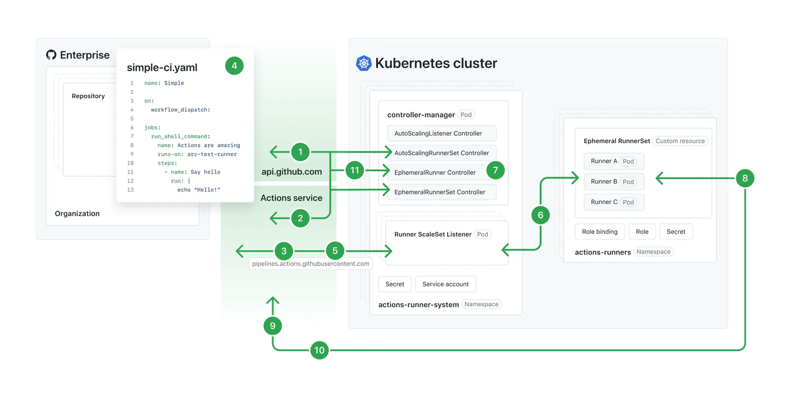
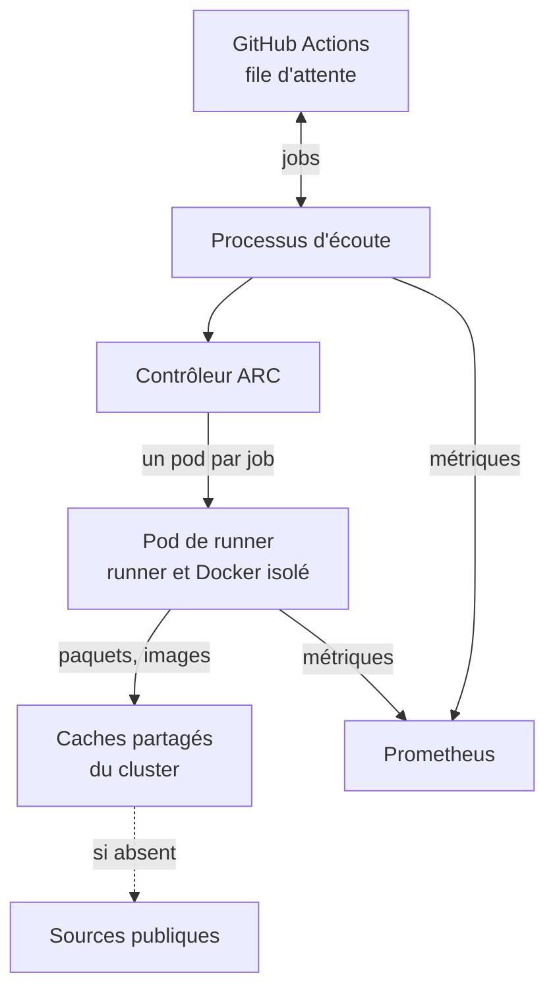

<ProjectMeta
  start="2024"
  role="Ingénieur DevOps, conception et exploitation"
  domain="CI/CD, runners auto-hébergés, Kubernetes"
  stack={["Kubernetes", "GitHub ARC", "Helm", "Docker-in-Docker", "Prometheus", "Calico"]}
/>

## Contexte

Le CATIE disposait d'une infrastructure CI/CD sur GitLab. La décision de migrer tous les dépôts vers GitHub a imposé de la reconstruire sur la nouvelle plateforme. Côté exécution, GitHub Actions a été retenu comme socle, et Actions Runner Controller (ARC) a été déployé sur le [cluster Kubernetes interne](sonu-k8s-cluster.md) pour disposer de runners auto-hébergés, éphémères et élastiques, capables d'absorber les pipelines de toutes les équipes. Les workflows eux-mêmes sont mutualisés dans une [bibliothèque de workflows réutilisables](cicd.md).

## Pourquoi ARC

Un runner auto-hébergé classique s'installe à la main sur une machine et tourne en permanence : une machine porte un runner, sans élasticité, et les traces d'un job restent pour le suivant si rien ne les nettoie. ARC gère les runners comme des pods Kubernetes : un pod neuf par job, détruit à la fin, et un nombre de runners ajusté en continu selon la file d'attente de GitHub. Les runners hébergés par GitHub étaient l'autre option ; ils n'ont accès ni au réseau interne ni au matériel du cluster, et leur coût croît avec le nombre de minutes consommées.

## Architecture

ARC se compose de deux parties, installées par les charts Helm officiels dans deux espaces séparés. Le contrôleur gère le cycle de vie des runners : il crée un pod quand un job arrive, ajuste leur nombre selon la charge et supprime chaque pod après son job. Pour chaque groupe de runners, il lance un petit processus d'écoute qui reste connecté à GitHub et reçoit les jobs en attente.

Le groupe de runners est enregistré au niveau de l'organisation GitHub, et s'authentifie par une application GitHub dédiée plutôt que par un compte personnel. Il garde quatre runners prêts et monte jusqu'à soixante selon la file d'attente. Chaque pod associe le runner, qui exécute le workflow, à un démon Docker isolé qui lui est propre : un workflow peut construire des images sans toucher au Docker de la machine hôte.

ARC est lui-même déployé par GitHub Actions, avec le même workflow réutilisable que les autres services du cluster. Une montée de version d'ARC suit une procédure écrite dans son dépôt, parce que Helm ne met pas à jour seul les définitions de ressources qu'ARC ajoute à Kubernetes.

## Observabilité

Prometheus collecte les métriques du contrôleur et des processus d'écoute : jobs démarrés et terminés par dépôt et par workflow, runners occupés et disponibles, nombre de runners demandé, temps de démarrage et durée des jobs. Ces mesures repèrent un job bloqué ou un groupe trop petit avant que les équipes ne le constatent. Elles ont aussi guidé le dimensionnement : le plafond est passé de vingt à quarante, puis à soixante runners, au fil de la montée en charge.

## Performances

Les durées de jobs ont montré que le temps se perdait dans le réseau et les téléchargements plus que dans le calcul. Quatre réglages en sont sortis.

**Taille des paquets réseau.** Le réseau virtuel du cluster utilise des paquets un peu plus petits que ceux que le Docker de chaque runner crée par défaut. Les paquets trop grands étaient perdus sans message d'erreur, et certains téléchargements se bloquaient. Le Docker des runners a été réglé sur la même taille que le réseau du cluster.

**Miroir des paquets Ubuntu.** Le miroir Ubuntu par défaut était environ deux cents fois plus lent depuis le réseau du CATIE que le miroir français. Chaque pod passe donc par un petit relais qui redirige vers le miroir français : la mise à jour de la liste des paquets suivie d'une installation simple passe de près de trois minutes à une douzaine de secondes.

**Caches partagés.** Les runners passent par des caches communs installés dans le cluster, pour les paquets Ubuntu et pour les images de conteneurs de Docker Hub et de GitHub, et se replient sur les sources publiques si un cache ne répond pas. Une image de compilation de 1,4 Go se télécharge en deux minutes depuis le cache, contre près de neuf depuis GitHub. Les caches sont répartis sur des nœuds différents.

**Téléchargements en parallèle.** Docker ne téléchargeait que trois couches d'image à la fois, ce qui ralentissait les grosses images. Il en télécharge maintenant dix.

## Placement des runners

Un runner écrit beaucoup sur le disque système de son nœud : fichiers du job et images Docker. Sur un disque dur, un job qui installe des paquets ou lance une base de données est environ dix fois plus lent que sur un SSD ; une même installation de bibliothèques a pris 36 secondes sur l'un et près de six minutes sur l'autre. Les nœuds dont le disque système est un disque dur sont donc marqués comme tels et exclus des runners.

Parmi les nœuds restants, les runners sont répartis autant que possible à raison d'un par nœud, sans jamais bloquer un démarrage si ce n'est pas possible. Un build lourd seul sur son nœud démarre nettement plus vite qu'à trois sur le même nœud, dont le disque sature pendant l'extraction des images. Cette répartition ne vaut toutefois qu'à la création des pods : GitHub confie ensuite un job à n'importe quel runner prêt, même sur un nœud déjà occupé. Avec dix runners en réserve, la moitié du temps de runner se passait avec un autre job sur le même nœud, et un build lourd y prenait presque deux fois plus de temps que seul. La réserve a été ramenée à quatre runners, pour que les jobs démarrent plus souvent sur des pods neufs, donc bien répartis.

## Rôle

La décision de migrer les dépôts vers GitHub relève du CATIE. Ma part couvre l'exécution : le choix de GitHub Actions comme socle, le déploiement et l'exploitation d'ARC sur le [cluster Kubernetes interne](sonu-k8s-cluster.md), la supervision des runners et leurs réglages de performance. Les workflows sont ceux de la [bibliothèque mutualisée](cicd.md).

## Résultats

Les runners ARC exécutent les pipelines GitHub Actions de l'organisation, appelés par les [workflows mutualisés](cicd.md) de plusieurs dizaines de dépôts, sans runner à installer ni à nettoyer à la main. Chaque job démarre dans un environnement neuf. Le groupe garde quatre runners prêts et monte jusqu'à soixante selon la demande, avec un dimensionnement fixé à partir des mesures. Les blocages de téléchargement ont disparu, et les installations de paquets et les téléchargements d'images, qui occupaient l'essentiel de la durée des jobs, sont plusieurs fois plus rapides.

## Limites connues

- Au-delà de quatre jobs simultanés, un job attend qu'un nouveau pod démarre.
- Une fois les runners créés, GitHub peut toujours confier deux jobs lourds à des runners du même nœud, qui se ralentissent alors l'un l'autre.
- Les runners tournent sur le cluster interne : s'il est indisponible, la CI l'est aussi. Un déploiement de secours manuel est documenté.

## Liens

- [Documentation ARC (GitHub)](https://docs.github.com/fr/actions/hosting-your-own-runners/managing-self-hosted-runners-with-actions-runner-controller/quickstart-for-actions-runner-controller)
- [Cluster Kubernetes interne cluster interne](sonu-k8s-cluster.md)
- [Workflows GitHub Actions mutualisés](cicd.md)
