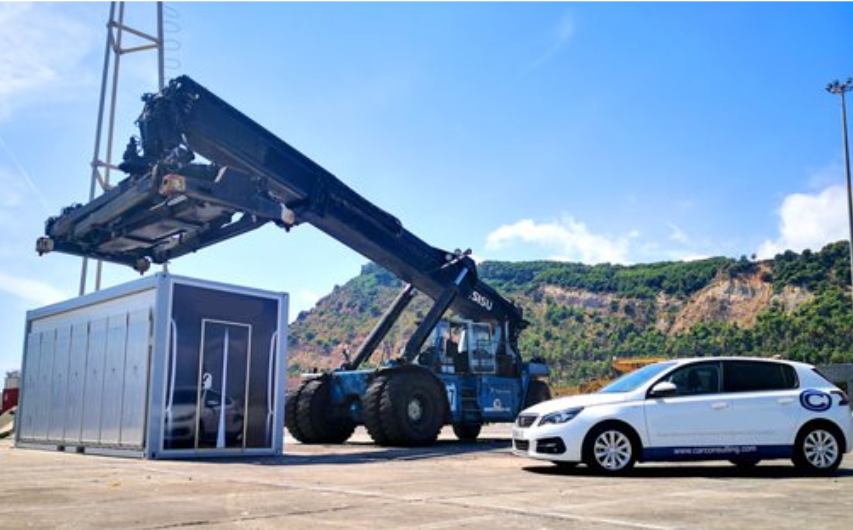

import Tabs from '@theme/Tabs';
import TabItem from '@theme/TabItem';

<ProjectMeta
  start="2023"
  end="2026"
  role="Contributeur sur deux sous-systèmes"
  domain="Vision par ordinateur, pipeline d'images, inférence embarquée"
  stack={["Python", "Docker", "GitHub Actions"]}
/>

## Contexte

Sur les parcs portuaires, les véhicules neufs arrivent par convois avant d'être chargés dans des navires rouliers. Chaque véhicule doit passer une inspection visuelle pour détecter les dommages survenus pendant le transport : rayures, impacts, déformations de carrosserie. Ces inspections se faisaient manuellement : lentes, coûteuses et inégales selon l'opérateur.

Le CATIE a accompagné une entreprise internationale spécialisée dans le contrôle automatisé des véhicules sur sites portuaires pour automatiser entièrement ce processus. Le dispositif final capture jusqu'à 20 000 images en 3 secondes par véhicule, détecte les défauts de surface, et redirige les cas suspects vers une zone de vérification sans interrompre le flux logistique. L'ensemble est piloté par un orchestrateur central ; cette page décrit deux de ses composants, la transformation des images et l'inférence embarquée.

## Composants

<Tabs>
  <TabItem value="trans" label="Pipeline de transformation">
    Chaque véhicule traversant le couloir d'inspection génère un volume d'images brutes considérable en quelques secondes. Ce composant prend en charge leur transformation pour les rendre exploitables par la suite de la chaîne : conversion du format brut des capteurs (dématriçage), découpe en zones d'analyse, orientation selon la position de chaque caméra, et compression pour le stockage et le transfert.

    Le traitement est parallélisé pour absorber le débit imposé par le rythme industriel, et le système attend que le logiciel de capture ait terminé d'écrire ses fichiers avant de démarrer, ce qui évite de traiter des données incomplètes. Un orchestrateur asynchrone découple le traitement de la capture : il détecte les nouveaux scans, les traite sans bloquer la prise de vue suivante, puis écrit un marqueur de fin enrichi (durée, statut). Un scan déjà traité n'est pas retraité, un scan incomplet est nettoyé avant reprise, et les scans en erreur sont copiés à part avec leur marqueur. À l'issue du traitement, les résultats sont transmis à l'orchestrateur central et les archives sont gérées selon le statut de chaque scan.

    L'étape de découpe numérote chaque zone à partir des informations portées par le nom des fichiers bruts, et une étape d'optimisation, activée par un paramètre de sensibilité, écarte certaines zones. Une autre étape lit l'identifiant du véhicule dans les images. Elle s'exécute en parallèle du pipeline principal et publie l'identifiant dès qu'il est décodé plutôt qu'à la fin du traitement.

    Le composant est livré en exécutable Windows autonome construit par la CI (PyInstaller) à chaque release. Il écrit des journaux CSV quotidiens, s'arrête après plusieurs erreurs consécutives, et transmet tel quel un dossier de scan vide quand la capture a expiré, au lieu de le traiter en erreur. Une suite de tests couvre les opérations d'image, l'optimisation des zones et le pipeline, avec un test de fumée sur l'exécutable.
  </TabItem>
  <TabItem value="inference" label="Inférence embarquée">
    L'inférence de détection de défauts tourne directement dans les conteneurs d'inspection installés sur site, sans dépendance à un serveur distant. Le modèle de détection est développé par les collègues en charge de la partie IA.

    L'infrastructure d'exécution charge le modèle, le relie au pipeline de traitement des images et s'intègre à l'API REST de l'orchestrateur central. L'inférence est parallélisée, tout comme la préparation des images en entrée du modèle (découpe en carrés, création du jeu de données), et un script convertit les résultats en CSV pour la validation.

    :::info Choix d'architecture
    Le traitement local n'est pas uniquement motivé par la latence : les images de véhicules constituent des données industrielles sensibles pour le client. L'inférence de production reste sur site, sans transfert des images vers un service tiers.
    :::
  </TabItem>
</Tabs>

## Itérations

Ce projet s'est construit par paliers sur plusieurs années. Une première phase a posé les bases : interfaçage avec le système existant de l'industriel, construction du jeu de données d'entraînement, validation de l'architecture globale. Les phases suivantes ont traité les performances (stabilité du traitement sous charge, temps d'inférence) avant d'aboutir à un déploiement opérationnel sur site.

Le composant de transformation a été repris début 2026 pour le séparer de la capture : orchestrateur asynchrone, marqueurs de fin de traitement, exécutable Windows. Les mois suivants ont ajouté la lecture de l'identifiant du véhicule, d'abord en fin de traitement, puis en parallèle du traitement pour la publier plus tôt. L'intégration continue de l'exécutable a été refondue à l'automne 2026.

## Rôle

Le CATIE a mené le projet pour le client, et l'équipe IA du CATIE a développé et fourni le modèle de détection. Ma part couvre le traitement des images et l'exécution embarquée : le pipeline de transformation, auquel un collègue a contribué, l'infrastructure d'inférence embarquée, une bibliothèque commune (client de l'API de l'orchestrateur, journalisation), une visionneuse web d'images et les rapports d'implémentation du composant de transformation. S'y ajoutent l'optimisation de la chaîne d'acquisition et des scripts d'automatisation et de test.

## Résultats

Le dispositif déployé capture jusqu'à 20 000 images en 3 secondes par véhicule, avec une inférence parallélisée et un affichage quasi instantané des zones suspectes sur l'interface opérateur. L'inspection s'intègre ainsi dans les cadences industrielles sans ralentir le flux de chargement.

## Liens

- [Rapport d'activités CATIE 2025, section Vision par ordinateur](https://www.catie.fr/wp-content/uploads/2026/04/RA2025_web.pdf)
