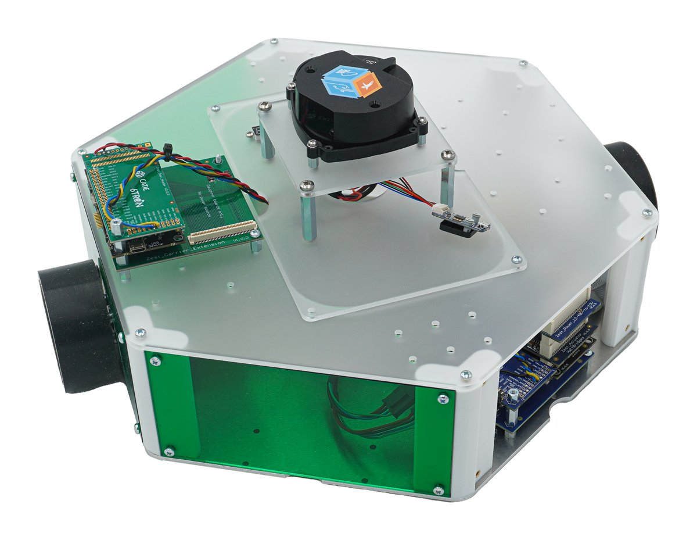
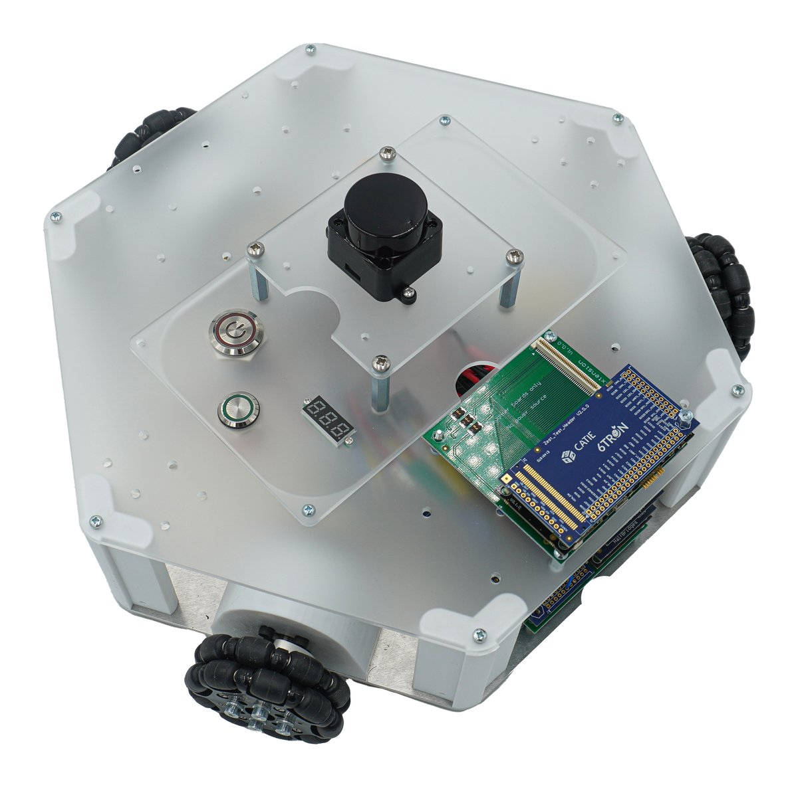
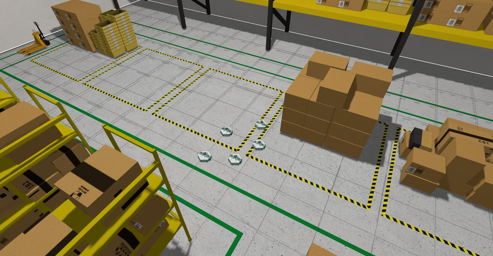
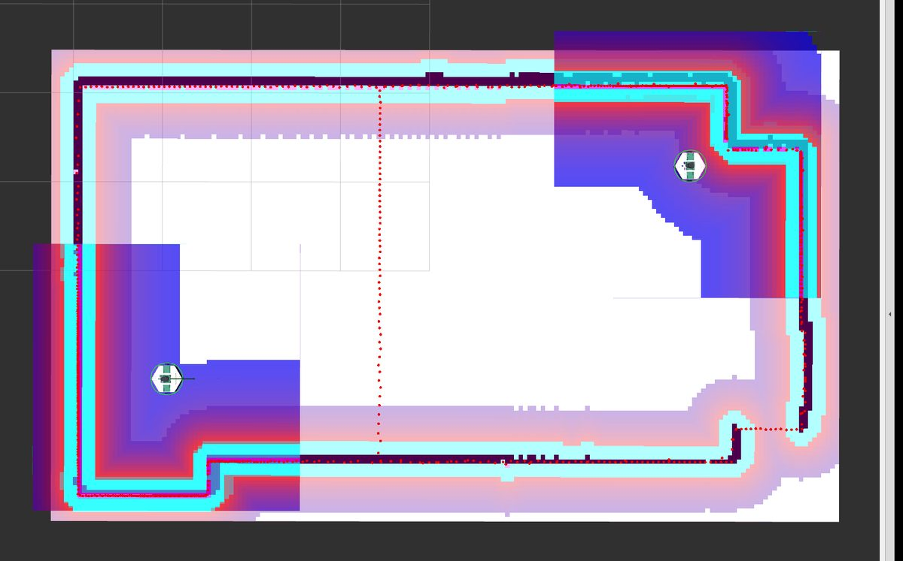
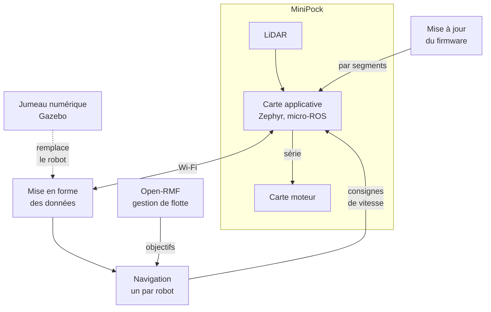

import Tabs from '@theme/Tabs';
import TabItem from '@theme/TabItem';

<ProjectMeta
  start="Septembre 2023"
  end="Décembre 2025"
  role="Développeur principal et mainteneur de la pile ROS 2"
  domain="Robotique mobile, simulation, systèmes multi-robots"
  stack={["ROS 2", "Nav2", "Gazebo", "micro-ROS", "Open-RMF", "Zephyr", "Docker", "GitHub Actions", "Python"]}
/>

## Contexte

Le CATIE développe 6TRON, une famille de cartes électroniques modulaires (cœurs STM32, cartes de puissance, radio, prototypage) destinées à accélérer le prototypage de systèmes embarqués. MiniPock est la plateforme robotique mobile construite sur ces cartes : un châssis hexagonal de 33,5 cm et 3,85 kg, sur batterie 4S, qui sert à la fois de démonstrateur de l'écosystème 6TRON et de base de développement pour des applications ROS 2 (navigation, cartographie, flottes de robots).

Le besoin était double. Côté robot, il fallait une pile logicielle capable de piloter deux cinématiques, différentielle et holonome, sans dupliquer le code. Côté équipe, il fallait pouvoir développer et tester sans robot physique sous la main, puis passer à plusieurs robots partageant le même espace. La partie ROS 2 du projet s'est étendue de septembre 2023 à décembre 2025.

## Aperçu

<Tabs>
  <TabItem value="differentiel" label="Différentiel">
    

    Version différentielle : deux moteurs à courant continu, LiDAR sur une platine surélevée, cartes 6TRON applicative et de contrôle moteur sur les flancs.
  </TabItem>
  <TabItem value="holonome" label="Holonome">
    

    Version holonome : trois roues omnidirectionnelles à 120°, même châssis et mêmes cartes électroniques que la version différentielle.
  </TabItem>
  <TabItem value="simulation" label="Simulation multi-robots">
    

    Cinq MiniPock dans un entrepôt simulé sous Gazebo, chacun isolé des autres, créés à partir d'un seul fichier de configuration de flotte.
  </TabItem>
  <TabItem value="rmf" label="Navigation de flotte">
    

    Deux MiniPock localisés sur la même carte, chacun avec sa propre navigation, coordonnés par Open-RMF.
  </TabItem>
</Tabs>

## Architecture

Le robot embarque deux empilements de cartes 6TRON. La carte applicative, sous Zephyr avec micro-ROS, lit le LiDAR, publie l'odométrie et reçoit les consignes de vitesse. Elle les transmet par liaison série à la carte de contrôle moteur, qui convertit une consigne de déplacement et de rotation en commande pour chaque moteur. Tout le reste tourne sur un poste distant, relié au robot en Wi-Fi par micro-ROS. En simulation, Gazebo remplace le robot derrière les mêmes données : la navigation ne voit pas la différence.

## Réalisations

### Pile ROS 2

La description du robot, le démarrage du matériel, la liaison avec Gazebo et la navigation ont d'abord vécu dans des dépôts séparés, puis ont été fusionnés en un seul dépôt à la version 2.0 : les paquets évoluaient toujours ensemble, et synchroniser quatre dépôts coûtait plus que cela n'apportait.

La décision structurante a été de réunir toute la configuration dans un seul fichier, validé contre un schéma au lancement : nom de chaque robot, carte, monde simulé, affichage et, pour chaque robot de la flotte, sa cinématique et sa position de départ. Description, simulation, démarrage et navigation lisent tous ce même fichier. Ajouter un robot, ou passer un robot de différentiel à holonome, revient à modifier une ligne, sans toucher aux fichiers de lancement.

Les deux cinématiques partagent le même modèle et la même pile. Elles ne diffèrent que par leur simulation physique dans Gazebo et par les réglages de la navigation : modèle de mouvement de la localisation, déplacement latéral autorisé ou non pour le contrôleur.

### Simulation et multi-robots

Le jumeau numérique sous Gazebo existe dès le début du projet, pour développer la navigation pendant que la mécanique avançait. Il a été migré en 2024 vers ROS 2 Jazzy et Gazebo Harmonic.

Le passage à plusieurs robots a demandé d'isoler chaque robot de bout en bout : chacune de ses données, chacun de ses repères et de ses réglages porte son nom, du modèle 3D jusqu'aux cartes d'obstacles de la navigation. Ce travail, mené en 2024, a ensuite été intégré à la configuration centralisée. Les robots sans position de départ sont répartis automatiquement en couronnes autour de l'origine, ce qui permet de créer une flotte de n'importe quelle taille.

La cartographie passe par Cartographer. La téléopération propose un mode clavier classique et un mode « jeu vidéo », où le robot avance tant qu'une touche reste enfoncée.

### Lien avec l'embarqué

Le firmware et le contrôle moteur ont été développés par des collègues de l'équipe ; leur raccordement à ROS 2 est traité côté pile ROS 2. Le démarrage lance la liaison micro-ROS, et un nœud convertit les données brutes du microcontrôleur (position et mesures du LiDAR) en odométrie, mesures et repères exploitables par la navigation. Une fusion de deux sources d'odométrie par filtre de Kalman y a été ajoutée en 2025.

La version 2.1 a supprimé la Raspberry Pi embarquée : le microcontrôleur parle directement en Wi-Fi avec le poste distant. Le robot y gagne en simplicité et en autonomie, au prix d'une dépendance au réseau que l'architecture assume.

Pour mettre à jour une flotte sans câble, un nœud de mise à jour du firmware a été développé. Il récupère la dernière version publiée du firmware sur GitHub, puis le robot la télécharge par petits segments, chacun contrôlé à la réception. La compilation du firmware en intégration continue a aussi été mise en place, et son interface web de configuration (Wi-Fi, nom du robot, adresse du poste distant) a reçu des contributions.

### Gestion de flotte avec Open-RMF

Pour planifier des missions sur une flotte, le projet s'appuie sur Open-RMF, un cadre de gestion de flottes de robots hétérogènes fondé sur ROS 2. La première intégration a posé la carte et le graphe de circulation, un adaptateur qui lit la position de chaque robot et lui envoie ses objectifs, et une tâche de patrouille de démonstration. Ce travail a été intégré au dépôt et à l'image Docker, les cartes et mondes ont été alignés sur la configuration centralisée, puis le mode holonome a été complété pour servir dans les scénarios de flotte.

### Intégration continue, Docker et documentation

L'environnement de développement est entièrement conteneurisé. Une image de base ROS 2 (navigation, cartographie, Open-RMF) se décline en une image de simulation, avec Gazebo, et une image pour le robot réel, avec la liaison micro-ROS. Ces images sont publiées sur le registre de conteneurs de GitHub et servent aussi d'environnement de développement ; Docker Compose lance l'une ou l'autre.

L'intégration continue s'appuie sur les [workflows mutualisés](cicd.md) de l'organisation : vérifications avant commit, compilation et tests ROS 2, analyse et publication des images, nouvelle version marquée automatiquement, mise à jour des outils de vérification.

La documentation est regroupée dans un dépôt dédié et versionnée avec chaque publication : installation, démarrage rapide, simulation, navigation, cartographie, système embarqué, mise à jour, planification de missions. Chaque version de MiniPock y indique les versions compatibles de la mécanique, du firmware et des paquets ROS, qui suivent chacun leur propre numérotation.

## Rôle

Le projet a été mené au CATIE. J'ai été l'auteur principal de la pile ROS 2 (description, simulation, démarrage du matériel, navigation, intégration de la gestion de flotte et de la mise à jour du firmware) et de sa documentation. Le firmware Zephyr est pour l'essentiel l'œuvre d'un collègue, qui a aussi contribué au nœud de mise à jour. Une collègue a porté l'isolation des robots pour le multi-robots et la première intégration d'Open-RMF, et un stagiaire a ajouté la fusion d'odométrie.

## Résultats

Quatre versions ont été publiées, de la 1.0 à la 2.2, chacune avec son journal des changements et une documentation alignée sur la mécanique et le firmware. Une seule pile ROS 2 pilote les deux cinématiques : la version différentielle atteint 2 m/s et 12 rad/s, et le choix se fait par configuration. Une flotte de robots, simulée ou réelle, se lance à partir d'un seul fichier, avec une navigation indépendante par robot et une coordination par Open-RMF. L'environnement de développement est prêt à l'emploi, sans installer ROS 2 ni Gazebo sur le poste. Les robots n'ont plus d'ordinateur embarqué : ils sont pilotés et mis à jour à distance, à travers micro-ROS.

## Limites connues

- Sans ordinateur embarqué, le robot dépend entièrement du réseau Wi-Fi : la navigation tourne sur le poste distant, et une coupure l'interrompt.

## Liens

- [Dépôt `minipock` (paquets ROS 2)](https://github.com/catie-aq/minipock)
- [Dépôt `minipock_documentation`](https://github.com/catie-aq/minipock_documentation)
- [Dépôt `minipock_zephyr-demo` (firmware Zephyr)](https://github.com/catie-aq/minipock_zephyr-demo)
- [6TRON](https://6tron.io/)
