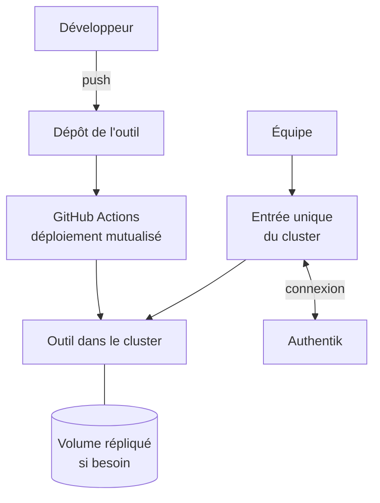

<ProjectMeta
  start="2023"
  role="Concepteur et mainteneur"
  domain="Automatisation interne, bots, outillage d'équipe"
  stack={["Python", "FastAPI", "React", "Slack API", "Kubernetes", "Helm"]}
/>

## Contexte

Dans une petite équipe technique, certaines tâches récurrentes finissent par ne plus être faites, parce qu'elles sont fastidieuses ou simplement oubliées, comme envoyer à la main un e-mail à chaque demande de téléchargement. Prises une à une, ces frictions sont tolérables ; cumulées, elles coûtent du temps chaque semaine.

Ces outils ne sont pas des projets clients. Chacun existe parce qu'un problème concret se répétait et que l'automatiser coûtait moins cher que de continuer à le traiter à la main. Les premiers tournaient sur une machine avec Docker Compose ; tous tournent aujourd'hui sur le [cluster Kubernetes interne](sonu-k8s-cluster.md) de l'équipe.

## Architecture : une chaîne de déploiement commune

L'ensemble reste maintenable parce que tous les outils suivent le même modèle. Chacun est une application Python (ou, pour le site de documentation, une application Docusaurus), construite en image Docker et décrite par un chart Helm dans son propre dépôt. Une modification poussée sur la branche principale, ou une nouvelle version selon le dépôt, est déployée par le workflow mutualisé des [workflows GitHub Actions communs](cicd.md). Ajouter un outil ou en mettre un à jour ne demande donc aucune connexion aux machines du cluster.

Les applications web passent par l'entrée unique du cluster, derrière l'authentification commune ; les bots n'ont pas d'interface à exposer. Cette chaîne commune a permis, en septembre 2026, de migrer tous les outils vers le stockage répliqué, de durcir leurs déploiements et de les placer derrière l'authentification commune en une seule campagne.

Les applications web suivent aussi la même charte graphique, décrite dans la documentation d'exploitation : couleurs, thème clair, logo. L'activité GitHub et la recherche de composants affichent le nom de la personne connectée, transmis par l'authentification commune, sans gérer de comptes eux-mêmes.

## Outils

### Kiosque d'état du cluster

Un écran de l'open space affiche l'état du [cluster](sonu-k8s-cluster.md), sans interaction, lisible à un ou deux mètres. Un serveur interroge le cluster en lecture seule, ainsi que sa supervision, ses alertes, son stockage et ses journaux, et transforme ce qu'il voit en événements datés. Un « réalisateur » donne une note à chaque événement, d'après sa nouveauté et sa fraîcheur, et choisit ce que l'écran montre : un événement important interrompt la scène en cours, les autres rejoignent un fil d'actualité et un bandeau des alertes ouvertes. Quand rien ne se passe, l'écran fait défiler des vues (nœuds, stockage, traces, bases de données, mises à jour, certificats), dont le choix varie selon l'heure de la journée. Les alertes y sont reformulées en français clair. L'écran s'éteint le week-end et les jours fériés : un petit agent sur la machine qui le pilote allume et éteint l'écran lui-même.

Toute la logique de décision vit dans le serveur, qui pousse l'état à l'écran en continu ; l'écran se contente d'afficher. Un mode démonstration rejoue des événements enregistrés, pour régler le réalisateur sans attendre un véritable incident.

### Recherche de composants électroniques

Un collègue avait écrit un bot Slack qui interrogeait les catalogues de Mouser, DigiKey et Farnell à partir d'une référence ou d'une nomenclature Excel, et renvoyait disponibilité et prix. En octobre 2026, il a été remplacé par une application web, « Composants », qui reprend ses fournisseurs. On y saisit une référence, on colle une liste ou on dépose une nomenclature ; l'application interroge les trois fournisseurs en parallèle et remplit le tableau au fil des réponses : disponibilité, prix pour la quantité demandée, délai, liens vers la fiche produit et la documentation, alertes. Une référence de remplacement est cherchée quand la principale est introuvable ou en rupture, et le conditionnement est choisi selon la quantité. Le résultat s'exporte en Excel, au même format que celui du bot.

### Suivi de campagne

Chaque année, plusieurs coordinateurs rédigent ensemble un document qui alimente les dossiers de financement du centre. Une application web, écrite en octobre 2026, leur permet de suivre leurs échéances et de commenter les documents, avec des droits selon le rôle (coordinateur, responsable, lecteur). Les livrables sont régénérés automatiquement à chaque modification. L'espace de fichiers partagé de l'équipe est la seule source de vérité : configuration, documents, commentaires et livrables y sont des fichiers, sans base de données à côté.

### Site de documentation interne

Le site de documentation de l'équipe a été refondu avec Docusaurus. Il rassemble les documents de l'espace partagé de l'équipe : un bot suit le dossier commun, convertit chaque document (Word, Markdown et notes partagées) en page et publie une modification en une à deux minutes. Le site garde l'historique de chaque page et propose, par section, une page qui signale les documents anciens, ainsi qu'une carte des liens entre pages. Il publie aussi la documentation de dépôts GitHub choisis, relus toutes les cinq minutes ; chaque page qui en vient renvoie à son fichier d'origine, et une page de statut liste les fichiers qui n'ont pas pu être publiés. La rédaction reste l'affaire de toute l'équipe ; le site ne fait que publier.

### Activité GitHub de l'équipe

Une application rassemble l'activité GitHub de l'organisation, lue au nom d'une application GitHub dédiée : classement des contributeurs, demandes de fusion fusionnées ou en attente de relecture, nouvelles versions et nouveaux dépôts, annuaire de l'équipe (qui travaille sur quoi) et état du parc de dépôts, avec ceux qui ne reposent que sur une personne et ceux qui ne bougent plus. Le classement met en évidence la personne connectée.

### Envoi des ressources 6TRON

6TRON, la marque matérielle du CATIE, met à disposition sur son site des fichiers de conception et de la documentation technique. Chaque demande de téléchargement envoyée par le formulaire arrivait dans Slack, et quelqu'un devait ensuite envoyer à la main l'e-mail contenant le lien. Le bot traite cette chaîne de bout en bout : il lit la demande dans Slack, retrouve le lien correspondant dans une liste centralisée, envoie l'e-mail et confirme l'envoi dans un canal dédié. Kubernetes vérifie en continu qu'il répond, et le redémarre s'il est bloqué.

### Configuration des dépôts GitHub

Les dépôts de l'organisation étaient créés et protégés à la main, chacun avec ses réglages. Une extension de la ligne de commande GitHub crée un dépôt et le configure selon les règles de l'équipe : options de fusion, équipes et droits selon un modèle, et un jeu de règles de protection de référence, versionné. Depuis octobre 2026, l'extension remet aussi à niveau les dépôts existants à chaque passage, pour qu'une évolution des règles atteigne tout le parc, et un mode de vérification liste les écarts d'un dépôt sans rien modifier. L'article [GitHub : rulesets](/blog/2026/10/29/10-git/github-rulesets) décrit ces règles de protection. Seul de ces outils, elle tourne sur le poste et non sur le cluster.

## Rôle

Ces outils ont été construits pour l'équipe du CATIE. J'ai développé le kiosque d'état du cluster, l'application Composants, qui remplace le bot d'un collègue, le suivi de campagne, l'application d'activité GitHub et la refonte du site de documentation, et j'ai aligné les applications sur la charte graphique. Le prototype du bot 6TRON a été écrit par un collègue : je l'ai mis en production et fait évoluer. L'extension de configuration des dépôts est un travail partagé : un collègue y a ajouté la gestion des règles de protection, et j'en ai mené la refonte.

## Résultats

Chaque outil a supprimé une tâche manuelle ou un angle mort. Les demandes de téléchargement 6TRON reçoivent leur e-mail sans intervention. Le site de documentation suit l'espace partagé en une à deux minutes. Une nomenclature entière se chiffre en un seul tableau exportable, et chaque coordinateur de la campagne voit ses échéances au même endroit. L'état du cluster est visible de toute l'équipe sur l'écran de l'open space. Tous les outils partagent la même chaîne de déploiement, ce qui permet d'appliquer un changement à tous en une seule campagne.

## Limites connues

- Composants garde ses recherches en cours en mémoire, et ne tourne donc qu'en un exemplaire : un redémarrage interrompt les recherches, que l'interface propose alors de relancer.

## Liens

- [Cluster Kubernetes interne](sonu-k8s-cluster.md)
- [Workflows GitHub Actions mutualisés](cicd.md)
