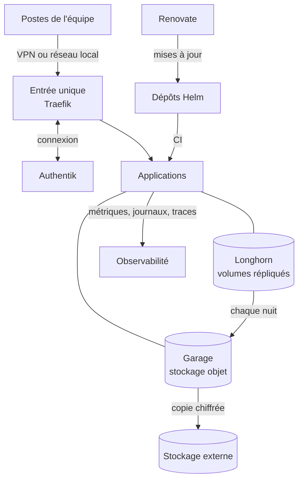
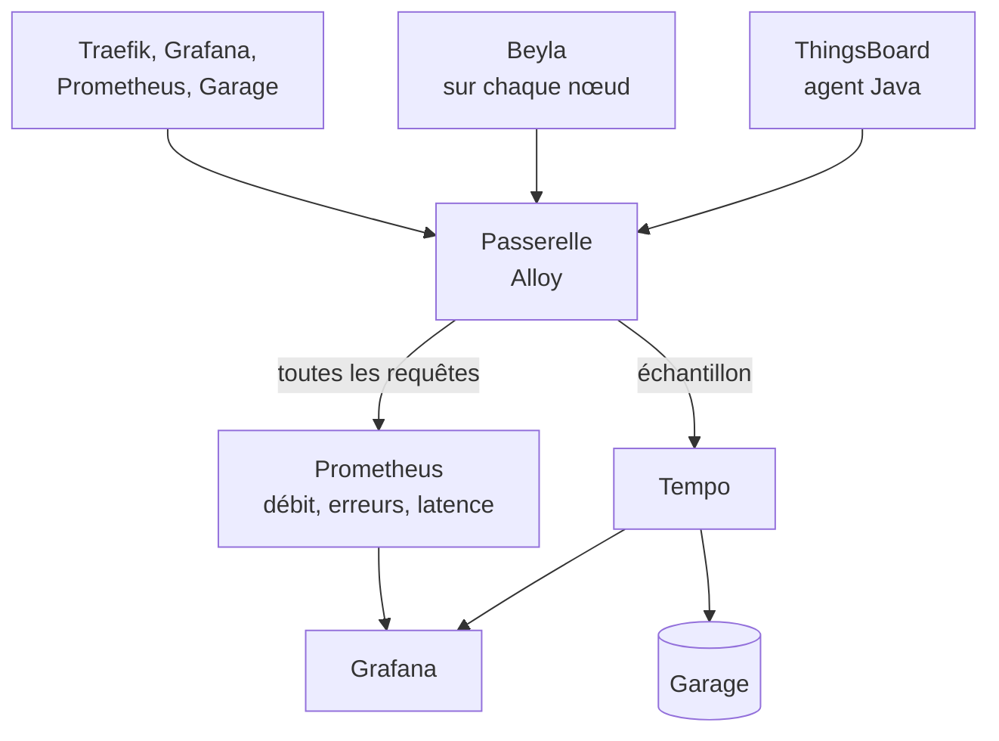

import Tabs from '@theme/Tabs';
import TabItem from '@theme/TabItem';

<ProjectMeta
  start="2024"
  role="Ingénieur DevOps, conception et exploitation"
  domain="Infrastructure interne, Kubernetes bare-metal, observabilité"
  stack={["Kubernetes", "kubeadm", "Ansible", "Calico", "Tailscale", "Traefik", "Authentik", "Longhorn", "Garage", "Helm", "GitHub Actions", "Renovate", "Prometheus", "Grafana", "Loki", "Alloy", "OpenTelemetry", "Tempo"]}
/>

## Contexte

Le CATIE disposait de serveurs tour inutilisés. Plutôt que de les virtualiser au cas par cas ou de louer du cloud, un cluster Kubernetes a été monté à partir de ces machines pour l'équipe. Il a été construit avec kubeadm, l'outil d'installation de référence de Kubernetes, plutôt qu'avec une distribution simplifiée comme k3s ou un service managé comme EKS. Un service managé prend en charge le plan de contrôle, le réseau des pods, les certificats et le stockage ; l'objectif était justement de les maîtriser, pour pouvoir ensuite conseiller les projets clients en connaissance de cause.

Le cluster a donc deux rôles. Il héberge des services dont l'équipe a besoin au quotidien, et il sert de terrain d'essai : une pratique y est éprouvée avant d'être recommandée sur un projet client.

## Architecture

Le cluster compte une dizaine de nœuds : un nœud de plan de contrôle et des nœuds de travail ajoutés au fil des besoins en capacité, dont deux équipés de cartes graphiques. Tout ce qui y tourne est décrit dans des dépôts Git et déployé par la CI.

## Préparation des nœuds

Les nœuds sont préparés par un dépôt Ansible, qui règle le système comme Kubernetes l'exige, installe le moteur de conteneurs et les outils de Kubernetes, et ajoute les réglages que demande le stockage répliqué. Une machine neuve s'installe sans écran ni clavier : une clé USB d'installation automatique reconnaît les machines prévues, installe Ubuntu Server sur le plus grand disque rapide, puis éteint la machine pour signaler la fin. Un second playbook remet le cluster en route après une coupure de courant, en suivant le mode opératoire prévu pour ce cas.

Les nœuds n'ont pas tous le même matériel : certains démarrent sur un disque dur, d'autres sur un SSD. Cette différence est indiquée sur chaque nœud, et les charges sensibles à la vitesse du disque, comme les runners de CI ou le stockage objet, en tiennent compte pour choisir où s'installer.

## Réseau : une entrée unique

Le cluster n'a pas d'adresse publique, et aucun port n'est ouvert vers Internet : les services sont joignables par le VPN Tailscale de l'équipe.

Depuis septembre 2026, Traefik est la seule porte d'entrée : il reçoit toutes les requêtes et les dirige vers la bonne application selon le nom demandé. Ce point d'entrée unique a rendu possibles trois choses :

- un certificat Let's Encrypt valable pour tous les sous-domaines, obtenu en prouvant la propriété du domaine par le DNS, ce qui permet de servir en HTTPS valide des services qui ne sont pas joignables depuis Internet ;
- une authentification commune devant toutes les applications (section suivante) ;
- un accès depuis le réseau local du CATIE sans client VPN, grâce à un petit serveur DNS interne qui oriente les postes du bureau vers l'entrée du cluster. L'article [Kubernetes : accès LAN par externalIPs et CoreDNS](/blog/2026/10/06/02-network/kubernetes-acces-lan-coredns) décrit ce montage.

## Authentification unique : Authentik

Authentik a été déployé comme fournisseur d'identité commun : une seule connexion donne accès aux applications web de l'équipe, et les droits de chacun suivent son équipe dans l'organisation. Sa configuration est décrite dans son dépôt et appliquée au déploiement, comme celle des autres services.

## Stockage répliqué : Longhorn

Jusqu'en septembre 2026, chaque volume de données était lié à un nœud et à un dossier de son disque : perdre le nœud, c'était perdre les données, et l'application ne pouvait pas redémarrer ailleurs. Longhorn a été déployé pour fournir des volumes répliqués en trois exemplaires sur les disques de plusieurs nœuds, et les services qui gardent des données y ont été migrés un à un : certificats, Authentik, supervision, ERP, plateforme de capteurs, outils internes. Un volume n'est jamais effacé quand on désinstalle l'application qui l'utilise. Longhorn surveille aussi l'état de santé de ses disques et alerte quand l'un d'eux se dégrade. L'article [Kubernetes : Longhorn](/blog/2026/09/27/06-orchestration/kubernetes-longhorn) détaille son fonctionnement et la migration.

Les bases les plus critiques, celle d'Authentik, dont la perte couperait l'accès à toutes les applications, et celle de l'ERP, ont en plus un instantané quotidien gardé sept jours. La restauration de la base d'Authentik a été répétée sur une copie, sans toucher à la production, et la procédure est écrite.

## Stockage objet : Garage

Pour les besoins de stockage objet compatible S3 (sauvegardes, traces, rapports), Garage, un logiciel libre auto-hébergé, a été ajouté, avec son interface web derrière Authentik. Il est passé d'un à quatre nœuds en octobre 2026, puis à deux copies de chaque objet en novembre. L'article [Garage : cluster multi-nœuds sur Kubernetes](/blog/2026/10/14/05-cloud/garage-kubernetes-multi-noeuds) décrit ce passage.

Garage tient l'index de ses objets dans une petite base par nœud. Placée d'abord sur des volumes Longhorn répliqués, en partie sur disque dur, elle subissait des écritures lentes et supportait mal les coupures réseau. Elle a été déplacée en novembre 2026 sur le disque local de chaque nœud : Garage réplique déjà ses données entre nœuds, et la réplication de Longhorn n'apportait que de la latence. Sur les nœuds à SSD, chaque écriture de l'index est confirmée sur le disque ; sur disque dur, cette confirmation aurait coûté trop cher. Garage garde en plus un instantané de cet index toutes les six heures.

## Sauvegardes

Un dépôt dédié met en place les sauvegardes, selon la règle 3-2-1 : la donnée en service, une copie dans Garage, une copie chiffrée hors du cluster.

Chaque volume est sauvegardé chaque nuit dans Garage sans rien déclarer, nouveaux volumes compris. Une exception se déclare sur le volume lui-même, avec sa raison : caches de CI, métriques, journaux, contenu reconstructible. Un premier design faisait déclarer chaque volume à sauvegarder ; il a été écarté, parce qu'un oubli ne se voit qu'au moment de restaurer, alors qu'avec la règle inverse un oubli ne coûte que de la place. Sept sauvegardes quotidiennes et huit hebdomadaires sont gardées. La base de données de Kubernetes est sauvegardée chaque nuit avec les certificats du plan de contrôle : sans eux, reconstruire le cluster sur une machine neuve obligerait à refaire rejoindre tous les nœuds.

Chaque nuit, rclone recopie ensuite les sauvegardes vers un stockage externe, chiffrées, noms de fichiers compris. Un fichier supprimé ou remplacé reste récupérable trente jours, et un nombre anormal de suppressions arrête la copie au lieu de vider la destination. La copie se fait dans un ordre qui garantit qu'une sauvegarde n'apparaît jamais complète à distance tant que toutes ses données ne sont pas arrivées. Un contrôle quotidien alerte quand un volume n'a pas de sauvegarde récente ou qu'une sauvegarde a échoué.

## Calcul GPU

Deux nœuds équipés de cartes NVIDIA de générations différentes ont été mis en service en octobre 2026. Une application demande une carte graphique comme elle demanderait de la mémoire, et choisit le modèle d'après des étiquettes posées automatiquement sur les nœuds, selon un guide de la documentation d'exploitation. L'opérateur GPU de NVIDIA, qui automatise tout cela, a été écarté : il ne prend en charge ni ces cartes ni cette version de Kubernetes. Les pilotes sont donc installés sur les hôtes, et seuls les composants de découverte sont déployés dans le cluster. L'utilisation, la mémoire et la température des cartes remontent dans la supervision. L'article [Kubernetes : GPU NVIDIA](/blog/2026/10/09/06-orchestration/kubernetes-gpu-nvidia) détaille l'installation.

## GitOps : un dépôt par service

Presque chaque service du cluster a son propre dépôt Helm : un chart, un fichier de valeurs qui rassemble la configuration, et un workflow qui appelle le déploiement mutualisé des [workflows GitHub Actions communs](cicd.md). Une modification poussée sur la branche principale est déployée par la CI. La configuration du cluster se lit donc dans les dépôts, et les rares exceptions installées à la main sont recensées dans la documentation d'exploitation.

En septembre et octobre 2026, tous les charts ont été remis à niveau :

- les outils internes sont déployés par une image marquée du commit qui l'a produite : un pod ne redémarre que si l'image change, et la version en service se lit dans le déploiement ;
- chaque conteneur tourne avec le minimum de droits que son image permet, déclare ses besoins en ressources et des sondes qui vérifient qu'il répond ;
- les secrets applicatifs sont fournis au démarrage par le cluster au lieu d'être inscrits dans l'image ;
- deux déploiements d'un même dépôt ne peuvent plus se chevaucher.

## Mises à jour automatisées : Renovate

Jusqu'en novembre 2026, les versions des applications tierces n'étaient mises à jour qu'à la main, quand quelqu'un y pensait. Renovate a été déployé dans le cluster pour les tenir à jour sans multiplier les demandes de fusion à relire. Il tourne du lundi au jeudi tôt le matin, jamais le vendredi : il ouvre les demandes de fusion, puis fusionne une heure plus tard celles que la politique autorise, ce qui déclenche le déploiement habituel. Sa configuration est centralisée dans son propre dépôt plutôt que répartie dans la trentaine de dépôts concernés.

La politique de fusion se règle application par application, d'après la criticité relevée dans la documentation d'exploitation : tout en automatique pour les outils peu critiques, seuls les correctifs pour les composants sensibles comme le stockage ou l'authentification, et une relecture humaine pour ceux dont la montée de version suit une procédure. L'objectif est de l'ordre de deux fusions manuelles par mois. Une version n'est proposée que quelques jours après sa publication, et deux semaines pour le stockage. Comme une fusion automatique peut casser un service qui démarre quand même, des alertes signalent la disparition de métriques attendues, et un contrôle prévient quand le déploiement qui suit une fusion échoue. L'article [GitHub Actions : Renovate](/blog/2026/08/16/04-ci-cd/github-actions-renovate) présente l'outil.

## Redémarrages automatiques : Kured

Les nœuds installent seuls leurs correctifs, mais un nouveau noyau n'est chargé qu'au redémarrage, qui se faisait à la main, par lots. Depuis novembre 2026, Kured vide, redémarre et remet en service les nœuds qui l'attendent, un à la fois, les nuits de semaine, avec un message à chaque étape. Avant chaque redémarrage, il consulte la supervision et attend si une alerte importante est active : nœud absent, volumes en cours de reconstruction, stockage objet en difficulté, disque plein. Le rythme réel suit donc la reconstruction des volumes après chaque redémarrage. Le nœud de plan de contrôle reste redémarré à la main. L'article [Kubernetes : redémarrages automatiques avec Kured](/blog/2026/11/18/06-orchestration/kubernetes-kured) décrit le mécanisme.

## Services hébergés

<Tabs>
  <TabItem value="observabilite" label="Observabilité">

Prometheus collecte les métriques des applications, de Kubernetes et des nœuds, et Grafana les affiche. Les tableaux de bord de Grafana, longtemps créés à la main dans l'interface, sont depuis octobre 2026 des fichiers versionnés dans son dépôt ([Grafana : dashboards et datasources versionnés](/blog/2026/10/17/07-monitoring/grafana-provisioning)). Smokeping mesure la latence réseau vers des cibles internes et externes, pour distinguer une panne applicative d'une dégradation du réseau. Gatus donne une vue simple de la disponibilité de chaque service ; il a remplacé Uptime Kuma parce que ses sondes se déclarent dans son dépôt, relues comme le reste de la configuration.

Un socle d'alertes, envoyées sur Slack, couvre les nœuds, les applications qui redémarrent en boucle ou manquent de mémoire, les tâches planifiées en échec, le stockage, les certificats du cluster et la température des cartes graphiques. Les alertes se regroupent par type, et celles qui découlent d'une panne déjà signalée (un nœud injoignable, par exemple) se taisent. L'article [Prometheus : alertes d'un cluster Kubernetes](/blog/2026/10/11/07-monitoring/prometheus-alertes-kubernetes) en détaille la construction.

Loki rassemble les journaux de tout le cluster, à côté des métriques, ce qui permet de rapprocher un pic d'un graphe des lignes de journal correspondantes. En octobre 2026, la collecte est passée à Grafana Alloy, qui remplace un outil en fin de vie et conserve aussi les événements Kubernetes trente jours au lieu d'une heure ; l'ancienne et la nouvelle chaîne ont tourné en parallèle avant la bascule ([Alloy](/blog/2026/10/25/07-monitoring/alloy)). Les traces, gérées par Tempo, sont décrites dans la section suivante.

  </TabItem>
  <TabItem value="services" label="Services internes">

Dashy rassemble tous les accès de l'équipe et grise les tuiles des outils auxquels l'utilisateur n'a pas droit, d'après l'information transmise par Authentik. Portainer offre une vue graphique des applications aux collègues qui n'utilisent pas la ligne de commande. L'ERP de l'équipe, Dolibarr, a été rapatrié d'un serveur isolé vers le cluster : chart écrit, base migrée, connexion par Authentik, et une sauvegarde quotidienne de la base et des documents, vérifiée avant d'être conservée ([Kubernetes : sauvegarde d'une base par CronJob](/blog/2026/10/20/06-orchestration/kubernetes-sauvegarde-cronjob)).

Plusieurs [outils internes](outils-internes.md) y tournent aussi : surveillance des stocks, traitement de demandes de téléchargement, recherche de composants chez les distributeurs, suivi de l'activité GitHub de l'équipe, et un kiosque qui affiche l'état du cluster sur un écran de l'open space. Le site interne de l'équipe y est également hébergé.

  </TabItem>
  <TabItem value="iot" label="IoT et projets">

ThingsBoard, la plateforme de collecte et de visualisation de données de capteurs, tourne avec sa base sur des volumes répliqués. Il a été mis à jour et raccordé à Authentik en octobre 2026 : le compte est créé à la première connexion. Sa configuration de connexion vit dans sa base ; elle est posée par un script qui peut être rejoué sans risque. Son interface reprend la charte graphique de l'équipe. Une passerelle IoT, développée principalement par un collègue, assure la liaison avec des équipements industriels.

Le cluster accueille aussi des projets en cours de développement, dans des espaces dédiés qui apparaissent et disparaissent au rythme des prototypes.

  </TabItem>
</Tabs>

## Traces distribuées

Depuis fin octobre 2026, une requête se suit de l'entrée du cluster jusqu'à la base de données, étape par étape. L'article [OpenTelemetry](/blog/2026/11/01/07-monitoring/opentelemetry) présente les principes de cette chaîne.

Les traces viennent de trois sources. Traefik, Grafana, Prometheus et Garage les produisent eux-mêmes. ThingsBoard, écrit en Java, reçoit un agent d'instrumentation au démarrage. Les applications internes, dont aucune n'embarque de bibliothèque de traçage, sont observées par Beyla, déployé sur chaque nœud : il lit depuis le noyau les échanges réseau et SQL des applications et les transforme en traces, sans modifier leurs images, ce qu'une instrumentation dans le code aurait demandé.

Toutes les traces passent par une passerelle Alloy. Elle y ajoute le nom de l'application et de son espace, retire le bruit (sondes de santé, collectes de métriques) et efface les données sensibles, comme les paramètres d'URL ou les en-têtes d'authentification. Elle calcule ensuite, sur toutes les requêtes, le débit, le taux d'erreur, la latence et la carte des appels entre services, qu'elle verse dans Prometheus. Elle n'envoie à Tempo qu'un échantillon : les traces en erreur, les plus lentes et une sur dix des autres. Les indicateurs restent ainsi exacts alors que seule une partie des traces est stockée, trente jours, dans Garage.

Dans Grafana, un point d'un graphe de latence ouvre la trace qui lui correspond, et une étape de trace mène aux journaux de son application. Une alerte prévient quand la latence d'un service dépasse nettement celle qu'il a d'habitude à la même heure, sur les sept jours précédents. Couper la passerelle n'a aucun effet sur les applications : le traçage peut tomber en panne sans les ralentir.

## Documentation d'exploitation

Un cluster que seul son auteur sait exploiter dépend entièrement de lui. Sa documentation est rédigée dans un dépôt dédié, avec des documents codés et révisés : des références (cartographie de l'infrastructure, inventaire des dépôts, parc de machines, charte graphique), des guides (déployer une application, accéder aux services) et une dizaine de modes opératoires pour les situations d'exploitation : redémarrage après une coupure de courant, ajout ou retrait d'un nœud, restauration d'un volume, renouvellement des certificats du cluster ([Kubernetes : certificats](/blog/2025/06/06/06-orchestration/renouveler-certificats)), montée de version, diagnostic d'une application indisponible, panne de la CI. La cartographie comprend aussi un catalogue de toutes les applications de l'équipe, hébergées sur le cluster ou non, avec leur référent, leurs utilisateurs, leur sauvegarde et leurs besoins de disponibilité, d'intégrité, de confidentialité et de traçabilité.

Cette documentation est publiée sur le site interne de l'équipe, refondu avec Docusaurus. Ce site rassemble aussi les documents partagés de l'équipe : un bot suit le dossier commun, convertit chaque document en page et publie une modification en une à deux minutes, avec l'historique de chaque page et une carte des liens entre pages.

## Rôle

Le cluster a été monté pour l'équipe du CATIE à partir de serveurs inutilisés. J'en ai assuré la conception, la construction et l'exploitation : réseau, authentification, stockage, sauvegardes, GPU, déploiement, mises à jour, observabilité et documentation d'exploitation. La passerelle IoT a été développée principalement par un collègue, et j'ai pris en charge son intégration dans le cluster.

## Résultats

Le cluster fait tourner les services du quotidien de l'équipe, ses outils internes et les [runners de CI](github-arc-kubeadm.md) de l'organisation sur du matériel réemployé, sans ressource cloud louée. Sa configuration se lit dans les dépôts et se déploie par la CI, sans connexion aux machines. Toutes les applications web passent par une entrée unique en HTTPS, derrière une connexion commune. Les données survivent à la perte d'un disque ou d'un nœud, les sauvegardes sortent du cluster chaque nuit, et une sauvegarde manquante déclenche une alerte. Les mises à jour des applications tierces et des noyaux se font seules, dans des fenêtres choisies. Chaque application web a un débit, un taux d'erreur et une latence mesurés sans une ligne de code ajoutée. Un autre membre de l'équipe peut intervenir sur les situations courantes en suivant les modes opératoires.

## Liens

Les dépôts des services sont privés. Pages liées :

- [Workflows GitHub Actions mutualisés](cicd.md)
- [GitHub ARC sur ce cluster](github-arc-kubeadm.md)
- [Outils internes](outils-internes.md)
