Ce chapitre traite de la notation des éléments chimiques, de l'organisation du tableau en périodes, groupes et blocs, des principales familles d'éléments et de quelques propriétés des atomes.

## Notation des éléments chimiques

- 1 atome = 1 noyau (**N** neutrons + **Z** protons) + **Z** électrons.
- Isotopes : même nombre de protons, nombres de neutrons différents.
- Masse atomique : moyenne des masses des différents isotopes pondérées par leur abondance naturelle, $\bar{M} = \displaystyle\sum_i C_i M_i$.
- Tableau périodique : ordre de nombre de protons croissant, organisé en fonction de la configuration électronique.

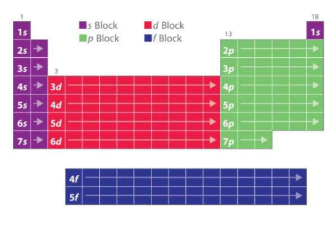

## Organisation en périodes, groupes et blocs

Règles de construction :

- même ligne (**période**) = couche de valence ayant la même valeur de $n$ ;
- même colonne (**famille**) = éléments dont la configuration électronique est similaire (à $n$ près).

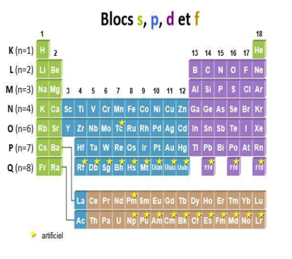

## Les familles chimiques

Les grandes familles chimiques :

- **Alcalins** (colonne 1) : $ns^1$ ;
- **Alcalino-terreux** (colonne 2) : $ns^2$ ;
- **Halogènes** (colonne 17) : $ns^2 np^5$ ;
- **Chalcogènes** (colonne 16) : $ns^2 np^4$ ;
- **Gaz rares**, inertes (colonne 18) : $ns^2 np^6$ ;
- **Éléments de transition** (colonnes 3 à 12) : $ns^2 (n-1)d^x$ avec $1 \leq x \leq 10 \wedge n \geq 4$ ;
- **Éléments de transition interne ou profonde** (en bas) : $ns^2 (n-1)d^1 (n-2)f^y$ avec $1 \leq y \leq 14 \wedge n \geq 6$, soit 4f (terres rares ou lanthanides) et 5f (actinides).

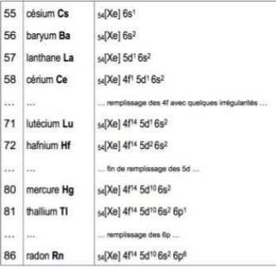

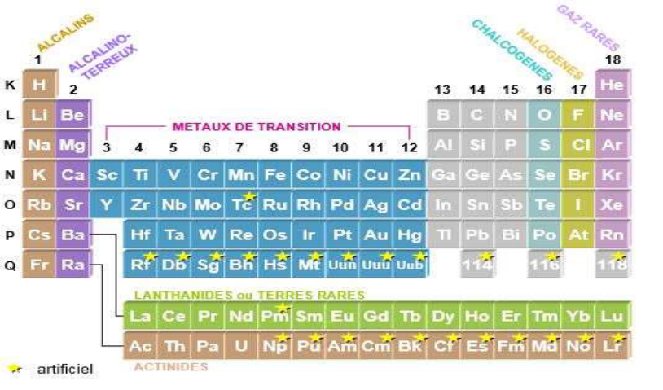

Cas particuliers :

- lanthanides ;
- actinides : règles de remplissage identiques à la couche P mais période incomplète.

### Métaux et non-métaux

Règle de Sanderson : pour une couche de valence $ns^x np^y$, il s'agit d'un métal si $x + y \leq n$.

- Métaux : formation de cations.
- Non-métaux : formation d'anions.

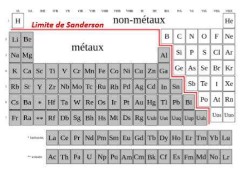

## Quelques propriétés des atomes

### Rayon des atomes

Distance moyenne entre le noyau et la frontière du nuage électronique.

**Rayon covalent.** Moitié de la distance entre deux noyaux atomiques identiques liés par une liaison covalente.

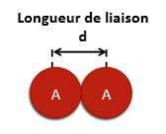

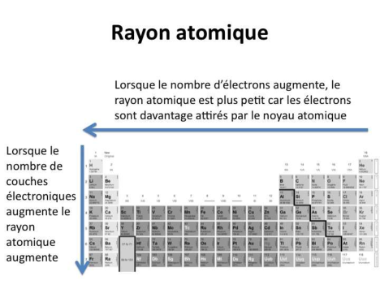

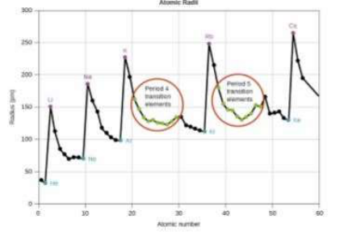

**Rayon de Van der Waals.** Moitié de la distance minimale à laquelle peuvent s'approcher 2 noyaux de deux atomes identiques quand ils ne sont pas engagés dans une liaison chimique.

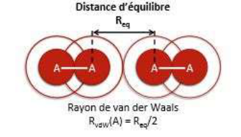

Les cations sont beaucoup plus petits que les atomes neutres correspondants.

### Énergie d'ionisation

Énergie minimale qu'il faut fournir à un atome pour arracher l'électron le moins lié (l'énergie est toujours positive).

- Première ionisation : $A \rightarrow A^+ + e^-$.
- Deuxième : $A \rightarrow A^{2+} + e^-$, etc.
- On remarque un changement d'ordre de grandeur lorsque l'ionisation touche des électrons de cœur.

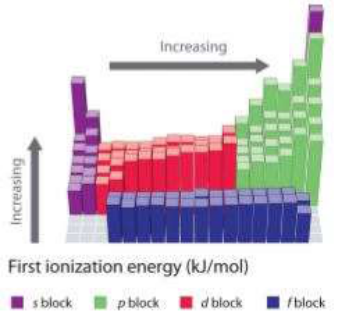

### Affinité électronique

Aptitude (relative) d'un atome neutre à capturer un électron supplémentaire :

$$
A^- \rightarrow A + e^- \qquad AE = E(A) - E(A^-)
$$

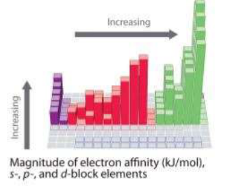

### Électronégativité

L'électronégativité est l'aptitude des atomes à gagner ou perdre des électrons lorsqu'ils sont engagés dans une liaison chimique avec un autre atome.

- **Électropositifs** s'ils cèdent un électron (faible énergie d'ionisation, faible affinité électronique).
- **Électronégatifs** s'ils capturent un électron (forte énergie d'ionisation et forte affinité électronique).
- Échelle de Pauling ($\chi(F) = 4$).

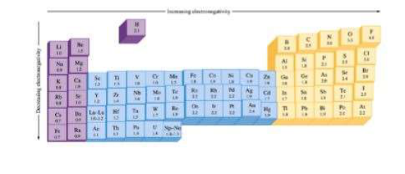

Différents types de liaison chimique :

- $X_a \sim X_b$ : liaison **covalente** ;
- si $X_a \gg X_b$ : liaison **ionique**.

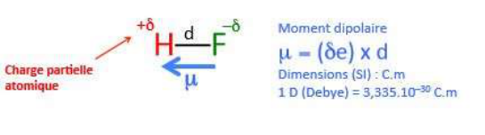

### Degré d'oxydation

Oxydoréduction : réaction au cours de laquelle une espèce chimique (oxydant) **capte** des électrons et une autre (réducteur) **cède** des électrons :

$$
\text{oxydant}\ \phi + \text{réducteur}\ \rho \rightarrow \text{oxydant}\ \rho + \text{réducteur}\ \phi
$$

Le DO est la charge électrique formelle déterminée après répartition des électrons de valence entre tous les atomes du composé.

- Pour un atome isolé, le DO est égal à la charge électrique de l'atome ou de l'ion.
- Dans une molécule, le DO est calculé en considérant **que l'atome le plus électronégatif capte tous les électrons** (la somme est égale à la charge).

Les alcalins perdent 1 électron, les alcalino-terreux 2 ; les halogènes gagnent 1 électron, les chalcogènes 2.
