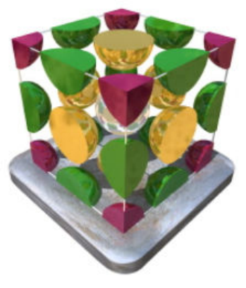
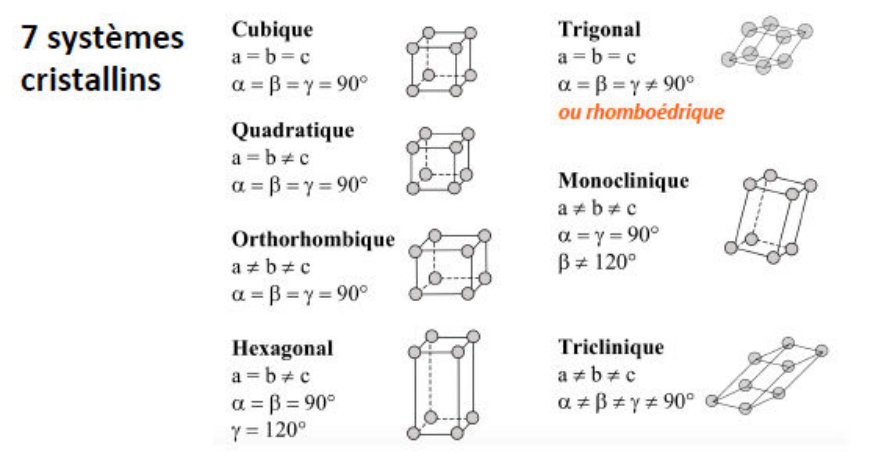
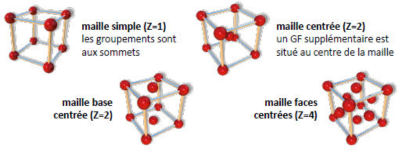
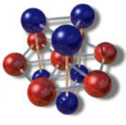
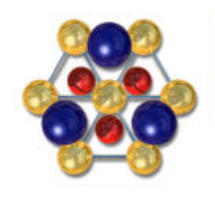
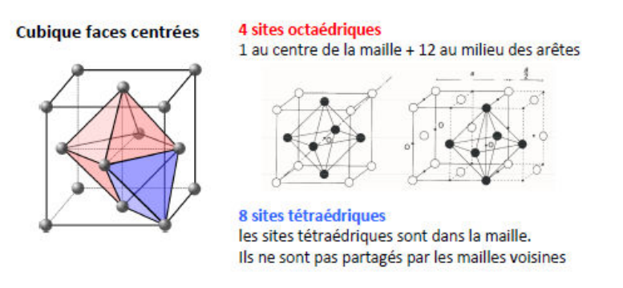
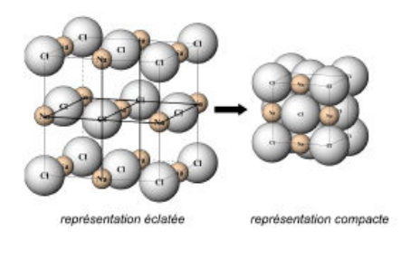

## Structure des solides cristallins parfaits

### Groupement formulaire

- Un cristal est la répétition d'un motif élémentaire appelé groupement formulaire.
- Un GF peut être un atome, un ion atomique ou une molécule.
- La position du motif dans le réseau est appelée nœud du réseau.

### Maille élémentaire

La maille élémentaire est la plus petite unité qui se répète dans les trois directions de l'espace. Elle est définie par 3 vecteurs élémentaires et 3 angles.

Une maille simple contient un seul groupement formulaire alors qu'une maille multiple en contient plusieurs. Le nombre de groupements formulaires est appelé multiplicité de la maille.

### Décompte des groupements formulaires

La multiplicité $Z$ est définie par $Z = \rho V N_A / M$.

- Un GF à l'intérieur d'une maille compte pour $1$.
- Un GF sur une face compte pour $1/2$.
- Un GF sur une arête compte pour $1/4$.
- Un GF sur un sommet compte pour $1/8$.

## Différents types d'arrangements cristallins

### Systèmes cristallins

### Réseaux de Bravais

Il existe 14 réseaux de Bravais :

| Système | Réseaux |
| --- | --- |
| Cubique | simple, centrée, faces centrées |
| Quadratique | simple, centrée |
| Orthorhombique | simple, centrée, base centrée, faces centrées |
| Hexagonale | simple |
| Rhomboédrique | simple |
| Monoclinique | simple, base centrée |
| Triclinique | simple |

## Empilements compacts

### Notion de compacité

La compacité traduit les forces de cohésion du cristal. Une grande compacité permet de maximiser les forces de cohésion du cristal.

$$
\text{Compacité} = \frac{\text{Volume des sphères}}{\text{Volume de la maille}} = \frac{4/3 \pi R^3 \times Z}{V}
$$

### Empilements compacts et non compacts

Deux types d'empilements :

- empilements compacts (une sphère est tangente à toutes ses voisines) :
  - empilement de type hexagonal compact, compacité = 74 % ;

    

  - empilement de type cubique faces centrées, compacité = 74 % ;

    

- empilements non compacts (les sphères sont tangentes dans certaines directions uniquement) :
  - empilement de type cubique centré, compacité = 68 % ;
  - empilement de type cubique simple, compacité = 52 %.

## Cristaux constitués d'atomes différents

Même dans des empilements compacts, il existe des espaces vides entre les sphères. On peut y placer des entités chimiques plus petites : ce sont les sites interstitiels.

