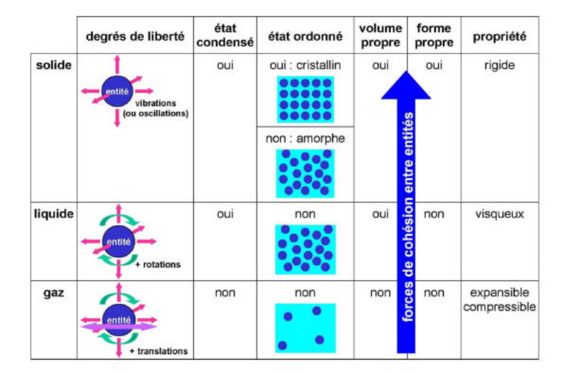

## Introduction

### États et changements d'état

- État gazeux : non condensé, désordonné.
- État liquide : condensé, désordonné.
- État solide : condensé, désordonné (amorphe) ou ordonné (cristallin).

## L'état gazeux

L'état gazeux se caractérise par son aspect **non condensé**[^1].

### Caractéristiques macroscopiques

- Masse volumique faible : environ 800 fois plus faible que celle de l'eau (pour l'air).
- Compressibilité élevée : la compressibilité est la variation relative de volume sous l'effet d'une pression appliquée. Elle est très grande pour les gaz et faible pour les liquides et les solides.
- Viscosité faible : la viscosité est la résistance à l'écoulement uniforme et sans turbulence.
- Dilatation thermique : si la température augmente, le volume augmente et la masse volumique diminue. C'est la convection naturelle.

Un gaz dépend donc de trois variables : la pression (Pa), la température (K) et le volume ($m^3$).

Trois types de transformations :

- isotherme : si $T = cte \Rightarrow PV = cte$, loi de **Boyle-Mariotte** ;
- isobare : si $P = cte \Rightarrow \dfrac{V}{T} = cte$, loi de **Gay-Lussac / Charles** ;
- isochore : si $V = cte \Rightarrow \dfrac{P}{T} = cte$.

### Équation d'état d'un gaz parfait

$$
\frac{PV}{T} = cte
$$

Loi d'Avogadro-Ampère :

$$
PV = nRT
$$

avec $R$ la constante universelle des gaz parfaits.

$$
\begin{aligned}
\text{Concentration : } C &= \frac{n}{V} = \frac{P}{RT} \\
\text{Masse volumique : } \rho &= \frac{m}{V} = \frac{nM}{V} = \frac{PM}{RT} \\
\text{Densité : } d &= \frac{\rho_{gaz}}{\rho_{air}} \\
\text{Volume molaire : } V_m &= \frac{V}{n} = \frac{RT}{P}
\end{aligned}
$$

### Description microscopique

**Introduction.** Le volume des seules molécules est faible devant le volume total. Les molécules sont animées d'un mouvement d'agitation très rapide et désordonné.

**Agitation thermique et pression.** La pression exercée par un gaz sur une paroi provient de la somme des chocs de chaque molécule sur cette paroi.

- La pression est proportionnelle à la concentration.
- La pression est proportionnelle à l'énergie cinétique.

**Agitation thermique et température.** Si une molécule de masse $m$ se déplace à une vitesse $v$ :

$$
\langle E_c \rangle = N_A . \frac{1}{2} m \langle v^2 \rangle
$$

La température d'un gaz est directement liée à l'énergie cinétique des molécules :

$$
\langle E_c \rangle = N_A . \frac{3}{2} k_b T
$$

avec $k_b$ la constante de Boltzmann.

### Mélanges de gaz

Pour décrire les mélanges, on utilise la notion de fraction molaire, en % :

$$
x_G = \frac{n_G}{n_{tot}} = \frac{C_g}{C_{tot}}
$$

**Loi de Dalton.** La pression totale d'un gaz est liée à la quantité totale de molécules :

$$
P_{tot} = \sum_i P_i \Leftrightarrow P_i = x_i P_{tot}
$$

### Modèles de gaz "réels"

Le modèle du gaz parfait est une bonne approximation lorsque la pression est faible et que la température est loin de la température d'ébullition.

Correction de Van der Waals :

1. Le volume occupé par les molécules de gaz n'est pas totalement négligeable devant le volume total : $V_{rel} = V - nV_b$.
2. Il existe des interactions entre les molécules de gaz : $P_{rel} = P + \alpha.C^2$.

## L'état liquide

### Caractéristiques macroscopiques

- Densité $d = \dfrac{\rho_{liq}}{\rho_{eau}}$.
- Faible compressibilité.
- Viscosité variable.

**Mélange de liquides.** 2 liquides ne sont pas toujours miscibles entre eux ; la miscibilité de 2 composés A et B résulte de l'existence de forces d'attraction entre les molécules A et B.

**Solvant, soluté.** Un solvant peut également servir à solubiliser une quantité d'un soluté. On obtient alors une solution. La solubilité augmente avec la température.

**Solvatation.**

- Les solvants protiques sont des molécules polaires susceptibles de former des liaisons hydrogène.
- Les solvants aprotiques n'établissent pas de liaisons H :
  - solvants apolaires = moment dipolaire négligeable ;
  - solvants polaires = moment dipolaire élevé.

**Additivité des volumes.** Lors d'un mélange, la masse totale se conserve mais pas le volume total.

## L'état solide

Voir les différentes modalités dans le chapitre sur les [cristaux](./cristaux.md).

### Solides amorphes

- Masse volumique plus faible.
- Propriétés isotropes.
- Pas de fusion franche.

### Solides cristallins

- Empilement régulier, structure périodique.
- Propriétés isotropes ou anisotropes.
- Point de fusion bien défini.

[^1]: Proust, Dalton, Gay-Lussac, Avogadro.
