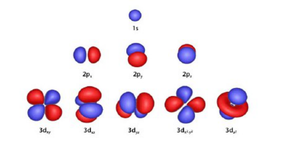
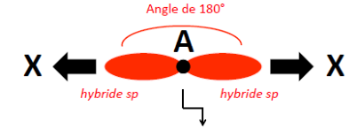
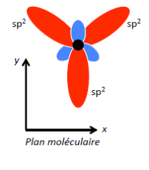
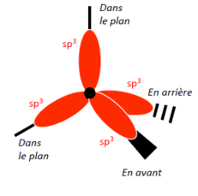
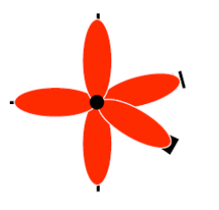
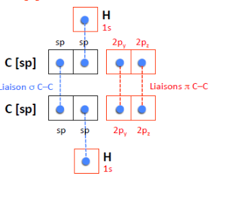
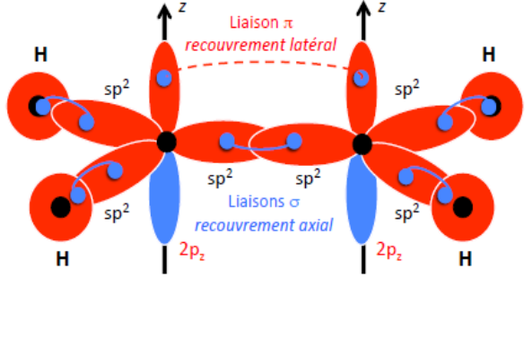

## Modèle des orbitales atomiques hybrides

### Définition d'une OA hybride

- Les orbitales atomiques sont un outil de description d'un atome isolé : elles reflètent la symétrie sphérique de l'atome.
- Dans une molécule, les orbitales se déforment et forment donc des hybrides.
- Les orbitales hybrides sont construites à partir du mélange des orbitales atomiques de l'atome isolé.

### Hybridation sp

- Mélange d'OA s et d'OA p.
- 2 hybrides orientées à 180°.
- Molécule de type $AX_2$ ou $AXE$.

### Hybridation sp²

Molécule du type $AX_3$, $AX_2E$ ou $AXE_2$.

### Hybridation sp³

Molécule du type $AX_4$, $AX_3E$ ou $AX_2E_2$.

### Hybridation sp³d

Molécule du type $AX_5$, $AX_4E$, $AX_3E_2$, etc.

### Hybridation sp³d²

Molécule du type $AX_6$, $AX_5E$ ou $AX_4E_2$.

## Liaisons doubles et triples

Deux types de liaisons : $\sigma$ et $\pi$.

