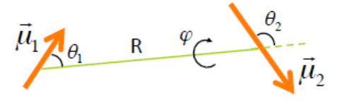
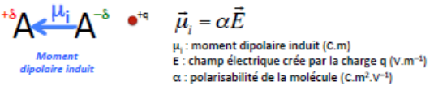
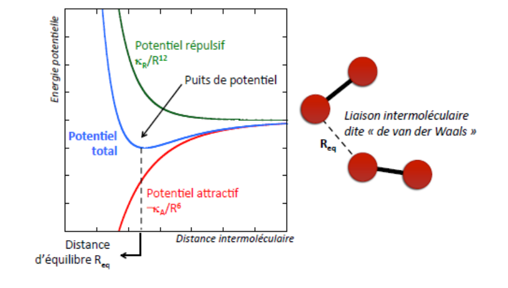

## Introduction

### Description électrostatique des interactions intermoléculaires

Deux types de liaisons :

- liaison intermoléculaire la plus forte : liaison **hydrogène** ;
- liaisons chimiques : covalente ou ionique, elles assurent la cohésion des atomes au sein des molécules.

Les interactions intermoléculaires sont de nature **électrostatique**. On utilise alors le principe des charges ponctuelles pour analyser une molécule :

- une molécule chargée a une charge ponctuelle égale à la charge totale ;
- une molécule neutre a :
  - deux charges fractionnaires si elle est dipolaire ;
  - un ensemble de plusieurs charges qui se compensent (multipôle) si la molécule est apolaire.

Le moment dipolaire est défini par $\mu = (\delta e).d$. Le moment dipolaire total est défini par :

$$
\vec{\mu} = \vec{\mu_1} + \vec{\mu_2} \Rightarrow \|\vec{\mu}\| = \left\| \vec{\mu_1} + \vec{\mu_2} \right\|
$$

Il y a différentes interactions intermoléculaires :

- **Charge/Charge** : entre deux molécules chargées positivement ou négativement ;
- **Charge/Dipôle** : entre une molécule chargée et une molécule neutre dipolaire ;
- **Dipôle/Dipôle** : entre deux molécules neutres dipolaires.

## Interactions électrostatiques

### Classification des interactions

**Interactions charge/dipôle.** Les interactions charge/dipôle sont à l'origine de la **solvatation des composés ioniques dans les solvants polaires**. On est de l'ordre de $\dfrac{1}{R^4}$.

**Interactions dipôle/dipôle.** Elles dépendent de l'orientation relative. On est de l'ordre de $\dfrac{1}{R^6}$.

Ce sont les interactions de Keesom : elles se produisent entre molécules possédant un moment dipolaire électrique permanent. On se rappelle les différents arrangements les plus favorables.

## Interactions induites

### Notion de polarisabilité

Le nuage électronique des molécules est sensible à la présence d'un champ électrique, il est donc polarisable. Lorsqu'on est dans un champ électrique, un moment dipolaire induit apparaît.

### Interactions charge/dipôle induit

L'interaction entre la charge et le moment induit est attractive. On est de l'ordre de $\dfrac{1}{R^4}$ : c'est un effet d'induction.

### Interactions dipôle/dipôle induit

Également appelées interactions de Debye, elles existent entre une molécule neutre polaire et une molécule neutre apolaire. Le dipôle permanent de la première molécule crée un champ électrique local sur la deuxième, qui se polarise. On est de l'ordre de $\dfrac{1}{R^6}$.

Entre deux molécules polaires, on prend en compte que 1 crée un dipôle induit dans 2 et inversement.

### Interactions de dispersion

La distribution des charges dans le nuage électronique n'est pas continue et statique : le moment dipolaire permanent n'est qu'un effet de moyenne.

**Interactions du type dipôle instantané - dipôle induit**, aussi appelées interactions de London. Elles s'ajoutent aux interactions de Keesom et de Debye. On est de l'ordre de $\dfrac{1}{R^6}$[^1].

## Liaisons de van der Waals

### Énergie potentielle d'attraction

En phase liquide, toute molécule interagit avec ses voisines. L'énergie potentielle d'attraction entre deux molécules est l'énergie de van der Waals :

$$
V_{VdW} = V_{Keesom} + V_{Debye} + V_{London} = -\frac{K_A}{R^6}
$$

La force de van der Waals dérive de cette énergie ; on est de l'ordre de $\dfrac{1}{R^7}$. Les interactions de van der Waals sont des interactions à très courte portée.

### Interactions répulsives

Lorsque deux molécules se rapprochent à très courte distance, les forces répulsives[^2] l'emportent sur les forces d'attraction de van der Waals. C'est l'énergie de Pauli, $V_{rep} = \dfrac{K_R}{R^{12}}$ :

$$
V_{total} = \frac{K_R}{R^{12}} - \frac{K_A}{R^6}
$$

### Énergie potentielle intermoléculaire, liaison de van der Waals

### Rayon de van der Waals

- Longueur de liaison : $r_c(A) = \dfrac{d(AA)}{2}$.
- Distance d'équilibre : $R_{vdW}(A) = \dfrac{R_{eq}}{2}$.
- Distance d'équilibre, atomes différents : $R_{eq} = R_{vdW}(A) + R_{vdW}(B)$[^3].

### Conséquences macroscopiques

Les températures de fusion, d'ébullition ou de sublimation résultent des forces intermoléculaires.

**Influence des interactions de Keesom.** Elles augmentent la température de fusion.

**Influence de la polarisabilité.** Plus une molécule est volumineuse, plus elle est polarisable, plus les interactions de London sont fortes.

**Influence des ramifications.** La présence de ramifications dans une molécule diminue l'intensité des forces intermoléculaires en diminuant les contacts intermoléculaires.

## La liaison hydrogène

**Définition.** La liaison hydrogène est la plus forte des interactions intermoléculaires. Elle joue un grand rôle dans la cohésion des phases solides et liquides. Elle se rencontre dans les composés avec une liaison F-H, O-H ou N-H.

*Elle est environ 2 fois plus longue que la liaison covalente A-H et son énergie est 10 fois moins intense que celle d'une liaison covalente*[^4].

## En résumé

- Nature : électrostatique.
- 3 types d'interactions :
  1. Charge / Charge ;
  2. Charge / Dipôle = solvatation des composés ioniques dans les solvants polaires ;
  3. Dipôle / Dipôle = interactions de Keesom.
- Polarisabilité = moment dipolaire induit :
  1. Charge / Dipôle induit = attractif ;
  2. Dipôle / Dipôle induit = interaction de Debye ;
  3. De dispersion = fluctuation des nuages électroniques = interaction de London.
- Énergie de van der Waals = Keesom + Debye + London = attraction = force de van der Waals.
- Énergie de Pauli = répulsion.
- Énergie potentielle d'interaction = énergie de van der Waals + énergie de Pauli.
- Rayon de van der Waals.
- Conséquences : températures de fusion, d'ébullition, etc. ; plus une molécule est volumineuse, plus elle est polarisable ; les ramifications diminuent les forces intermoléculaires.
- Liaison hydrogène = 2 fois plus longue, 10 fois moins intense, présente dans F-H, O-H, N-H ; ADN.

[^1]: Dans les molécules polaires, les interactions dipolaires de Keesom sont les plus fortes. Dans les molécules apolaires, c'est la dispersion qui assure la cohésion des molécules.
[^2]: Venant des noyaux atomiques et des nuages électroniques.
[^3]: Le rayon de van der Waals est toujours supérieur au rayon covalent.
[^4]: On peut la trouver par exemple dans l'ADN.
