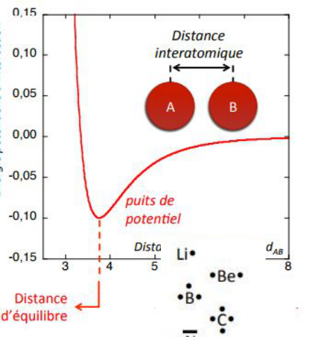
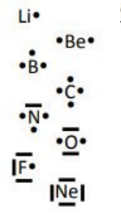
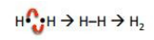
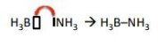
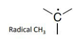
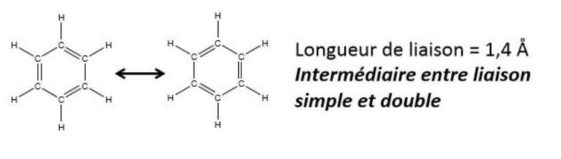

Ce chapitre sur la structure électronique des molécules présente le modèle de Lewis de la liaison covalente, puis les énergies et longueurs de liaison.

## La liaison chimique

- Équilibre entre interactions attractives et répulsives.
- Une liaison A-B est caractérisée par l'existence d'un minimum de la courbe $E = f(d_{AB})$.
- On ne peut pas décrire une liaison chimique par la physique classique.
- Théorie de la valence chimique : les électrons de valence des atomes sont responsables de l'existence des liaisons.
- Proposition de Lewis : la liaison covalente résulte du partage de deux électrons de valence par les atomes qui se lient.

## Le schéma de valence

- Traduction de l'organisation des électrons autour de l'atome.
- Le schéma de valence découle de la configuration électronique de valence : les électrons occupent un maximum d'OA de valence.

## Structure de Lewis

**Homolytique.**

**Coordinence.**

- Bases de Lewis : au moins une paire d'électrons non liante.
- Acides de Lewis : OA vacantes.

## Les radicaux

- Si le nombre d'électrons est impair, la molécule est un radical.
- On peut trouver des molécules paires ayant une **diradicalité** ($O_2$).

## Règle de complétude

Les éléments ont tendance à saturer leur couche de valence.

**Éléments de la couche K** (1 OA de valence) :

- règle du duet ;
- l'hydrogène peut partager un autre électron avec un élément voisin. Il est dit **monovalent**.

**Éléments de la couche L** (4 OA de valence) :

- tendance à respecter la règle de l'octet ;
- les éléments de la 2e période peuvent au plus former 4 liaisons.

## L'hypervalence

Si $n > 2$, les éléments peuvent accepter plus de 8 électrons.

## Énergie de liaison

- Énergie des différentes liaisons : simple $<$ double $<$ triple.
- Longueur des différentes liaisons : triple $<$ double $<$ simple (plus la liaison est forte, plus elle est courte).

