Ce chapitre de structure de la matière aborde les systèmes hydrogénoïdes puis les atomes polyélectroniques.

## Les systèmes hydrogénoïdes

### Fonction d'onde, probabilité de présence

Modèle actuel de la mécanique quantique :

- dualité onde/corpuscule (De Broglie) : $\lambda = \dfrac{h}{m.\nu} = \dfrac{h}{p}$ ;
- principe d'indétermination (Heisenberg) : $\Delta x . \Delta p \geq \dfrac{h}{4\pi}$ ;
- le concept de trajectoire n'existe pas en mécanique quantique.

Le comportement ondulatoire est décrit par une fonction d'onde (équation de Schrödinger) :

- pour un système hydrogénoïde, $\Psi^2 = \dfrac{dP}{dV}$ ($dP$ est la probabilité de trouver la particule dans un volume élémentaire $dV$) ;
- $P = \displaystyle\int_{V} \Psi^2 . dV = 1$ : la fonction d'onde est normalisée (voir exemple) ;
- le carré de la fonction d'onde représente la densité de probabilité de présence simultanée des électrons dans l'espace (voir équation de Schrödinger).

### Nombres quantiques

Les orbitales atomiques (OA) définissent des volumes dans lesquels un électron a une probabilité de se trouver ; elles dépendent de 3 nombres :

- $n$ : nombre quantique **principal** ($n > 0$) ;
- $l$ : nombre quantique **azimutal** ($0 \leq l < n$) ;
- $m$ : nombre quantique **magnétique** ($-l \leq m \leq +l$).

### Nomenclature des orbitales

Chaque valeur de $n$ définit une couche électronique :

| $n$ | 1 | 2 | 3 | 4 | 5 | 6 |
| --- | --- | --- | --- | --- | --- | --- |
| couche | K | L | M | N | O | P |

Chaque valeur de $l$ définit une sous-couche électronique :

| $l$ | 0 | 1 | 2 | 3 | 4 |
| --- | --- | --- | --- | --- | --- |
| sous-couche | s | p | d | f | g |

Voir le tableau de nomenclature.

### Expression des orbitales

Les orbitales atomiques dépendent de 3 coordonnées sphériques $(r, \theta, \phi)$. On a donc :

$$
x = r \sin\theta \cos\phi \; ; \quad y = r \sin\theta \sin\phi \; ; \quad z = r \cos\theta
$$

Ainsi les fonctions d'onde peuvent s'écrire comme le produit de 3 fonctions :

$$
\Psi_{nlm}(r, \theta, \phi) = R_{nl}(r) . \Theta_{lm}(\theta) . \Phi_m(\phi)
$$

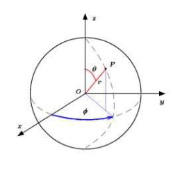

### Représentation des orbitales

- Partie radiale : $D(r) = r^2 \left| R_{nl}(r) \right|^2$, densité de probabilité de présence de l'électron à une distance $r$ du noyau.
- Partie angulaire : $\Theta_{lm}(\theta) . \Phi_m(\phi)$.

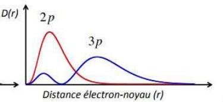

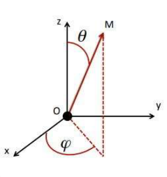

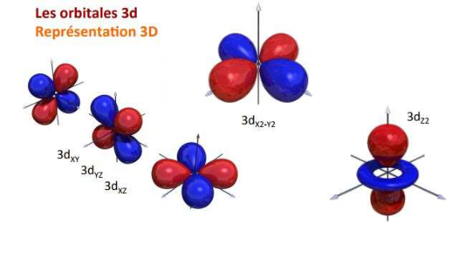

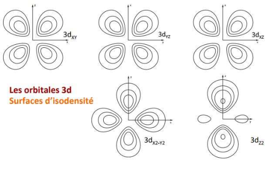

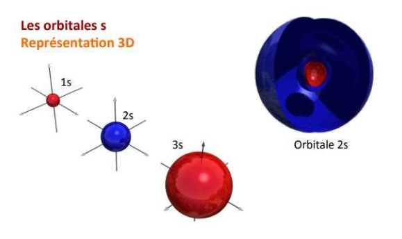

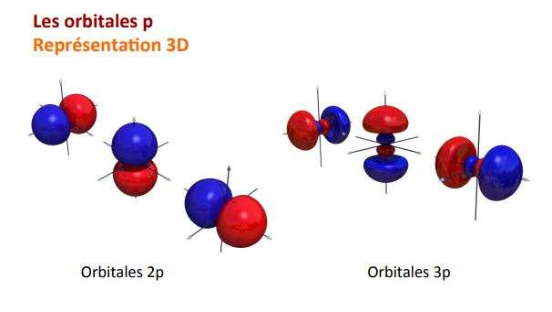

### Spin de l'électron

Quatrième nombre quantique, le nombre quantique **de spin $m_s$** est lié à la rotation de l'électron sur lui-même. Il peut prendre 2 valeurs :

$$
\alpha = \frac{1}{2} \qquad \beta = -\frac{1}{2}
$$

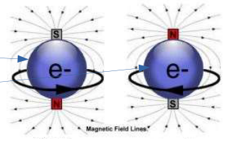

### Énergie des OA

L'état d'un atome est défini par $(n, l, m, m_s)$ ; chaque état est associé à une énergie :

$$
E_n = \frac{-m_e e^4 Z^2}{8 \epsilon_0^2 h^2 n^2} = -13{,}6 \frac{Z^2}{n^2}
$$

Toutes les OA d'une même couche ($n$) ont la même énergie : elles sont dégénérées. Ainsi le degré de dégénérescence est $g = n^2$.

L'occupation de l'OA par un électron est schématisée par une flèche dépendant du spin.

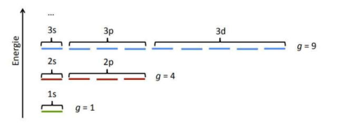

## Les atomes polyélectroniques

### Énergies des OA

L'équation de Schrödinger est insoluble de manière exacte pour les atomes polyélectroniques. L'énergie d'une OA dépend donc des nombres quantiques $n$ et $l$.

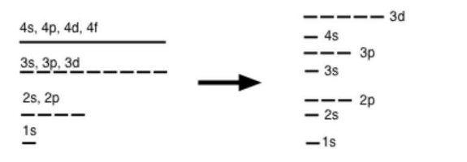

### Configuration électronique des éléments

**Principe d'exclusion de Pauli.**

- Dans un atome donné, deux électrons ne peuvent être caractérisés par 4 nombres quantiques identiques.
- Une OA peut être occupée par au plus 2 électrons.
- Si 2 électrons occupent une même OA ($n$, $l$, $m$ identiques), alors leurs spins sont différents.

**Règle de Klechkovski.**

- Dans l'état fondamental, les électrons occupent les OA de plus basses énergies.
- Si $n + l = n' + l'$, alors l'OA dont le nombre quantique $n$ est inférieur a une énergie inférieure.

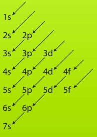

**Règle de Hund.**

- Dans une même sous-couche, les électrons occupent un maximum d'OA.
- Le spin total doit être maximal.

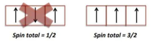

Exemple, l'atome de fer :

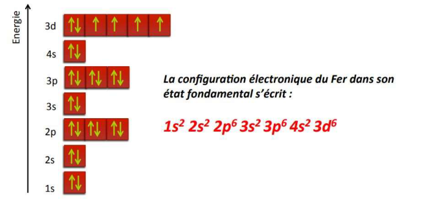

### Cœur et valence

- Électrons de cœur : électrons des couches internes, ils ne participent pas à la réactivité chimique de l'atome.
- Électrons de valence : électrons de la couche de plus grand $n$ et électrons de la dernière sous-couche non pleine.

### Exceptions aux règles de remplissage des OA

- Éléments $ns^2 (n-1)d^9$ : $ns^1 (n-1)d^{10}$.
- Éléments $ns^2 (n-1)d^4$ : $ns^1 (n-1)d^5$.
