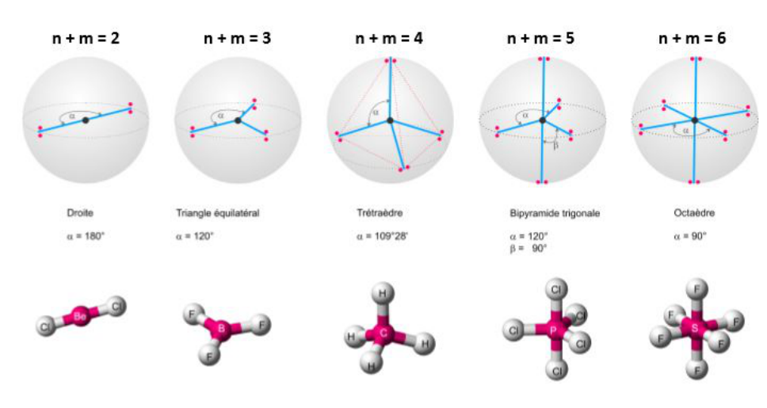
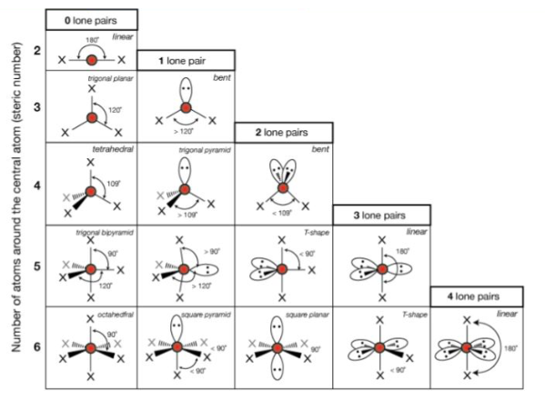

Ce chapitre présente le modèle VSEPR : définition, nomenclature, figures de répulsion, géométrie des molécules et position des paires non liantes.

## Définition

- VSEPR : Valence Shell Electron Pairs Repulsion.
- Hypothèse : toutes les paires se repoussent mutuellement.
- Elles se placent le plus loin possible les unes des autres.

## Nomenclature VSEPR

Écriture sous la forme $\textbf{AX}_\textbf{n}\textbf{E}_\textbf{m}$ avec A l'atome central, X les ligands et E les doublets non liants.

## Figures de répulsion

## Position des paires non liantes

Ne pas confondre figure de répulsion et géométrie de la molécule !

- Figure de répulsion = prise en compte des doublets non liants.
- Paire non liante = **plus répulsive** = **plus éloignée**.

## Récapitulatif

