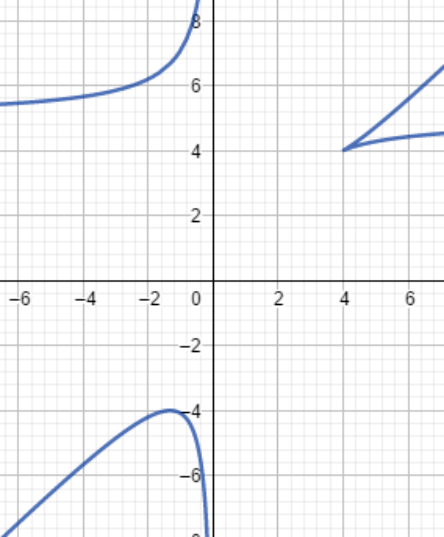

## Définition et généralités

**Rappel.** On munit $\mathbb{R}^2$ de sa base canonique $\vec{i} = (1, 0)$, $\vec{j} = (0, 1)$. Tout vecteur $\vec{u} = (a, b) \in \mathbb{R}^2$ s'écrit $\vec{u} = a\vec{i} + b\vec{j}$, $(a, b) \in \mathbb{R}^2$ uniques ; on les appelle coordonnées du vecteur $\vec{u}$ dans la base $(\vec{i}, \vec{j})$.

Soit $P$ le plan affine. On fixe un point $O$ du plan $P$, on considère le repère orthonormé $(O, \vec{i}, \vec{j})$. Tout point $M$ du plan s'écrit $\overrightarrow{OM} = x\vec{i} + y\vec{j}$ ; $(x, y)$ sont les coordonnées de $M$ dans le plan $(O, \vec{i}, \vec{j})$. On note $\begin{pmatrix} x \\ y \end{pmatrix}$.

**Définition de la norme.** On appelle norme de $\mathbb{R}^2$ dans $\mathbb{R}$ toute fonction $\phi : \mathbb{R}^2 \to \mathbb{R}^+$ telle que :

1. $\phi(x, y) = 0 \Leftrightarrow x = 0$ et $y = 0$.
2. $\phi(\lambda x, \lambda y) = |\lambda|\phi(x, y), \forall \lambda \in \mathbb{R}$
3. $\phi(x + z, y + t) \leq \phi(x, y) + \phi(z, t)$, où $(x + z, y + t) = (x, y) + (z, t)$

**Exemple.** $N_1 : \mathbb{R}^2 \to \mathbb{R}^+$, $(x, y) \to \sqrt{x^2 + y^2}$. C'est la norme canonique dans $\mathbb{R}^2$. On note aussi $N_1(x, y) = \|(x, y)\| = \sqrt{x^2 + y^2}$.

$N_2 : \mathbb{R}^2 \to \mathbb{R}^+$, $(x, y) \to \max(|x|, |y|)$ :

1. $N_2(x, y) = 0 \Rightarrow \max(|x|, |y|) = 0 \Leftrightarrow |x| = 0$ et $|y| = 0 \Leftrightarrow x = y = 0$
2. $N_2(\lambda x, \lambda y) = \max(|\lambda x|, |\lambda y|) = \max(|\lambda||x|, |\lambda||y|) = |\lambda|\max(|x|, |y|) = |\lambda| N_2(x, y)$
3. $N_2((x, y) + (z, t)) = N_2(x + z, y + t) = \max(|x + z|, |y + t|) \leq \max(|x|, |y|) + \max(|z|, |t|) = N_2(x, y) + N_2(z, t)$

## Fonctions vectorielles

**Définition.** Soit $I$ une partie de $\mathbb{R}$. On appelle fonction vectorielle dans $\mathbb{R}^2$ toute fonction $F : \begin{cases} I \to \mathbb{R}^2 \\ t \to (x(t), y(t)) \end{cases}$

**Remarque.** La donnée d'une fonction vectorielle dans $\mathbb{R}^2$ est équivalente à la donnée de deux fonctions numériques :

$$
x : \begin{cases} I \to \mathbb{R} \\ t \to x(t) \end{cases}
\quad \text{et} \quad
y : \begin{cases} I \to \mathbb{R} \\ t \to y(t) \end{cases}
$$

**Définition de la limite.** Soit $F : I \to \mathbb{R}^2$ une fonction vectorielle. Soit $t_0 \in I$. On dit que $F$ admet une limite quand $t \to t_0$ s'il existe un vecteur $\vec{l} = (a, b)$ tel que :

$$
\begin{aligned}
&\forall \epsilon > 0, \exists \eta > 0, |t - t_0| < \eta, \|F(t) - \vec{l}\| \leq \epsilon \\
\Leftrightarrow\ &\forall \epsilon > 0, \exists \eta > 0, |t - t_0| < \eta \Rightarrow \|F(t) - (a, b)\| = \|(x(t) - a, y(t) - b)\| = \sqrt{(x(t) - a)^2 + (y(t) - b)^2} \leq \epsilon
\end{aligned}
$$

On note $\displaystyle\lim_{t \to t_0} F(t) = \vec{l}$.

**Remarque.** Toutes les propriétés de la limite (somme, produit par une fonction numérique) restent valables.

**Définition de la continuité.** Soit $F : I \to \mathbb{R}^2$ une fonction vectorielle. Soit $t_0 \in I$. On dit que $F$ est continue en $t_0$ si et seulement si $\displaystyle\lim_{t \to t_0} F(t) = F(t_0)$. On dit que $F$ est continue sur $I$ si et seulement si $F$ est continue en tout point $t_0 \in I$.

**Remarque.** Toutes les propriétés de la continuité restent valables (somme, produit par une fonction numérique).

**Définition de la dérivabilité.** Soit $F : I \to \mathbb{R}^2$ une fonction vectorielle et $t_0 \in I$. On dit que $F$ est dérivable en $t_0$ s'il existe un vecteur $\vec{l} = (a, b)$ tel que :

$$
\lim_{t \to t_0} \frac{F(t) - F(t_0)}{t - t_0} = \vec{l}
$$

On note $\vec{l} = \vec{f} = F'(t_0)$. On dit que $F$ est dérivable sur $I$ si et seulement si $F$ est dérivable en tout point $t_0$ de $I$.

**Remarque.** Toutes les propriétés de dérivabilité (somme, produit par une fonction numérique) restent valables.

**Théorème.** Soit $F : \begin{cases} I \to \mathbb{R}^2 \\ t \to (x(t), y(t)) \end{cases}$ une fonction vectorielle. Étudier la continuité et la dérivabilité de $F$ est équivalent à étudier les continuités et les dérivabilités des deux fonctions numériques $\begin{cases} x : t \to x(t) \\ y : t \to y(t) \end{cases}$

**Rappel.** Soient $\vec{u} = (a, b)$ et $\vec{v} = (c, d)$ deux vecteurs de $\mathbb{R}^2$. On définit le déterminant de $(\vec{u}, \vec{v})$ par :

$$
\det(\vec{u}, \vec{v}) = \begin{vmatrix} a & b \\ c & d \end{vmatrix} = ad - bc
$$

En particulier, la famille $(\vec{u}, \vec{v})$ est libre si et seulement si $\det(\vec{u}, \vec{v}) \neq 0$. On rappelle que $(\vec{u}, \vec{v})$ est une famille libre si et seulement si $\forall \alpha, \beta \in \mathbb{R}$, $\alpha\vec{u} + \beta\vec{v} = 0 \Leftrightarrow \alpha = \beta = 0$.

**Définition de la famille libre.** $(\vec{u}, \vec{v})$ est une famille libre si et seulement si $\vec{u} \neq 0$, $\vec{v} \neq 0$ et l'un ne s'écrit pas sous la forme d'une combinaison linéaire de l'autre.

**Définition de la base.** Une base $(\vec{u}, \vec{v})$ de $\mathbb{R}^2$ est une famille libre de $\mathbb{R}^2$ composée de deux vecteurs. Autrement dit, deux vecteurs qui forment une famille libre sont une base de $\mathbb{R}^2$.

**Base directe et indirecte.** Soit $(\vec{i}, \vec{j})$ la base canonique de $\mathbb{R}^2$. Soit $\vec{u} = a\vec{i} + b\vec{j}$, $\vec{v} = c\vec{i} + d\vec{j}$ une autre base de $\mathbb{R}^2$.

1. Si $\begin{vmatrix} a & b \\ c & d \end{vmatrix} > 0$, alors on dit que $(\vec{u}, \vec{v})$ est une base directe.
2. Si $\begin{vmatrix} a & b \\ c & d \end{vmatrix} < 0$, alors on dit que $(\vec{u}, \vec{v})$ est une base indirecte.

## Arcs paramétrés

**Définition.** Soit $I$ un intervalle de $\mathbb{R}$ et $F : \begin{cases} I \to \mathbb{R}^2 \\ t \to (x(t), y(t)) \end{cases}$ une fonction vectorielle. On appelle arc paramétré, que l'on note $\mathcal{C}$, l'ensemble $\left\{(x(t), y(t)) \in \mathbb{R}^2, t \in I\right\}$. C'est donc l'ensemble des points du plan $M(t) = (x(t), y(t))$ lorsque $t \in I$. On dit que $t \to (x(t), y(t))$ est une représentation paramétrique de la courbe $\mathcal{C}$.

**Exemple.** La représentation paramétrique d'un cercle est $\begin{cases} t \to (\cos(t), \sin(t)) \\ t \in [0, 2\pi] \end{cases}$

**Remarque.** En général, il y a plusieurs représentations paramétriques d'une courbe $\mathcal{C}$.

**Exemple.** $f : x \in I \to f(x) \in \mathbb{R}$ une fonction numérique. La courbe $\mathcal{C}$ associée à $f$ est $C_f = (x, f(x)), x \in I$.

**Représentation géométrique.** Soit $(O, \vec{i}, \vec{j})$ orthonormé. Soit $(I, \vec{F})$ un arc paramétré, $\vec{F} : \begin{cases} I \to \mathbb{R}^2 \\ t \to (x(t), y(t)) \end{cases}$. On considère le point $M(t)$ de coordonnées $(x(t), y(t))$ dans $(O, \vec{i}, \vec{j})$, c'est-à-dire $\overrightarrow{OM}(t) = x(t)\vec{i} + y(t)\vec{j}$. Étudier la courbe $\mathcal{C}$ associée à l'arc paramétré $(I, \vec{F})$ est équivalent à étudier le mouvement du point mobile $M(t)$ par rapport à $t$ :

1. $\mathcal{C}$ est appelée la trajectoire du mouvement.
2. $\vec{F}'(t)$ est la vitesse de $M$ à l'instant $t$.
3. $\vec{F}''(t)$ est l'accélération de $M$ à l'instant $t$.

**Définition (Point double).** Soit $(I, \vec{F})$, $\vec{F} : \begin{cases} I \to \mathbb{R}^2 \\ t \to (x(t), y(t)) \end{cases}$ un arc paramétré. Soit $M(t)$ le point tel que $\vec{F}(t) = (x(t), y(t)) = \overrightarrow{OM}(t)$. On dit que $M$ est un point double s'il existe $t_1, t_2 \in I$, $t_1 \neq t_2$ et $\begin{cases} x(t_1) = x(t_2) \\ y(t_1) = y(t_2) \end{cases}$, c'est-à-dire $M(t_1) = M(t_2)$, $t_1 \neq t_2$.

En général, on dit que $M$ est un point de multiplicité $K$ s'il existe $t_1, t_2, \dots, t_k \in I$ avec $t_i \neq t_j$ pour $i \neq j$ et $M(t_1) = M(t_2) = \dots = M(t_k)$.

## Étude locale

**Définition (tangente).** Soit $\vec{F} : \begin{cases} I \to \mathbb{R}^2 \\ t \to (x(t), y(t)) \end{cases}$ un arc paramétré. Soit $t_0 \in I$ ; on suppose que $\vec{F}$ est défini dans un voisinage de $t_0$. On pose

$$
\vec{G}(t) = \frac{\overrightarrow{M(t_0)M(t)}}{\|\overrightarrow{M(t_0)M(t)}\|}
$$

Or $\overrightarrow{M(t_0)M(t)} = (x(t) - x(t_0), y(t) - y(t_0))$ et $\|\overrightarrow{M(t_0)M(t)}\| = \sqrt{(x(t) - x(t_0))^2 + (y(t) - y(t_0))^2}$, donc

$$
\vec{G}(t) = \frac{1}{\sqrt{(x(t) - x(t_0))^2 + (y(t) - y(t_0))^2}}(x(t) - x(t_0), y(t) - y(t_0))
$$

**Définition.**

1. Si $\vec{\gamma}_+ = \displaystyle\lim_{t \to t_0^+} \vec{G}(t)$ existe, on dit que la courbe admet au point $M(t_0)$ une demi-tangente à droite de direction $\vec{\gamma}_+$.
2. Si $\vec{\gamma}_- = \displaystyle\lim_{t \to t_0^-} \vec{G}(t)$ existe, on dit que la courbe admet au point $M(t_0)$ une demi-tangente à gauche de direction $\vec{\gamma}_-$.
3. Si $\vec{\gamma} = \displaystyle\lim_{t \to t_0} \vec{G}(t)$ existe, on dit que la courbe $\mathcal{C}$ admet au point $M(t_0)$ une tangente de direction $\vec{\gamma}$.

**Théorème V.1.** Soit $\vec{F} : \begin{cases} I \to \mathbb{R}^2 \\ t \to (x(t), y(t)) \end{cases}$ un arc paramétré de classe $C^1$. Soit $t_0 \in I$ ; si $\vec{F}'(t_0) = (x'(t_0), y'(t_0)) \neq (0, 0)$, alors la courbe $\mathcal{C}$ admet au point $M(t_0)$ une tangente de direction $\vec{F}'(t_0) = (x'(t_0), y'(t_0))$. De plus, l'équation de la tangente au point $M(t_0)$ est $(x - x(t_0))y'(t_0) = (y - y(t_0))x'(t_0)$.

**Démonstration.** Par définition, la direction de la tangente est $\displaystyle\lim_{t \to t_0} \frac{\overrightarrow{M(t_0)M(t)}}{\|\overrightarrow{M(t_0)M(t)}\|}$.

$$
\begin{aligned}
&\overrightarrow{M(t_0)M(t)} = (x(t) - x(t_0), y(t) - y(t_0)) \\
\Leftrightarrow\ &\frac{\overrightarrow{M(t_0)M(t)}}{t - t_0} = \left(\frac{x(t) - x(t_0)}{t - t_0}, \frac{y(t) - y(t_0)}{t - t_0}\right) \to (x'(t_0), y'(t_0)) \\
&\|\overrightarrow{M(t_0)M(t)}\| = \sqrt{(x(t) - x(t_0))^2 + (y(t) - y(t_0))^2} \\
\Leftrightarrow\ &\frac{\|\overrightarrow{M(t_0)M(t)}\|}{|t - t_0|} = \sqrt{\left(\frac{x(t) - x(t_0)}{t - t_0}\right)^2 + \left(\frac{y(t) - y(t_0)}{t - t_0}\right)^2} \to \sqrt{x'(t_0)^2 + y'(t_0)^2} \\
\Rightarrow\ &\frac{\overrightarrow{M(t_0)M(t)}}{\|\overrightarrow{M(t_0)M(t)}\|} = \frac{\overrightarrow{M(t_0)M(t)}}{|t - t_0|} \cdot \frac{1}{\dfrac{\|\overrightarrow{M(t_0)M(t)}\|}{|t - t_0|}} \to \frac{(x'(t_0), y'(t_0))}{\|\vec{F}'(t_0)\|} \\
&\frac{\overrightarrow{M(t_0)M(t)}}{\|\overrightarrow{M(t_0)M(t)}\|} \to \frac{\vec{F}'(t_0)}{\|\vec{F}'(t_0)\|}
\end{aligned}
$$

C'est un vecteur de même direction que $\vec{F}'(t_0)$.

**Rappel.** L'équation d'une droite $\Delta$ qui passe par le point $(x_0, y_0)$ et qui a pour direction le vecteur $\vec{u} = (a, b)$ est

$$
\Delta : (x - x_0) \cdot b = (y - y_0) \cdot a
$$

$$
M = (x, y) \in \Delta \Leftrightarrow \overrightarrow{M_0M} \mathbin{/\!/} \vec{u} \Leftrightarrow (x - x_0, y - y_0) \mathbin{/\!/} \vec{u} = (a, b) \Leftrightarrow (x - x_0)b - a(y - y_0) = 0
$$

## Tangente en un point singulier

**Définition (Point singulier).** Soit $\vec{F} : \begin{cases} I \to \mathbb{R}^2 \\ t \to (x(t), y(t)) \end{cases}$ un arc paramétré. On dit qu'on a un point singulier en $t_0$ si et seulement si $x'(t_0) = y'(t_0) = 0$.

**Théorème V.2** (Tangente en un point singulier)**.** Soit $\vec{F} : \begin{cases} I \to \mathbb{R}^2 \\ t \to (x(t), y(t)) \end{cases}$ un arc paramétré de classe $C^\infty$. Soit $t_0 \in I$. On suppose que $x'(t_0) = y'(t_0) = 0$.

Soit $p$ le plus petit entier non nul tel que $(x^{(p)}(t_0), y^{(p)}(t_0)) \neq (0, 0)$ ; on rappelle que $x^{(p)}(t_0)$ est la dérivée d'ordre $p$ en $t_0$. Alors l'équation de la tangente de la courbe $\mathcal{C}$ associée à l'arc paramétré $(I, \vec{F})$ est la droite d'équation :

$$
(x - x(t_0)) \cdot y^{(p)}(t_0) = (y - y(t_0)) \cdot x^{(p)}(t_0)
$$

**Démonstration.** Soit $p$ le plus petit entier non nul tel que $(x^{(p)}(t_0), y^{(p)}(t_0)) \neq (0, 0)$. D'après la formule de Taylor-Young, on a :

$$
\begin{aligned}
&x(t) = x(t_0) + \frac{(t - t_0)^p}{p!} x^{(p)}(t_0) + o((t - t_0)^p) \quad \text{car } x'(t_0) = \dots = x^{(p-1)}(t_0) = 0 \\
&y(t) = y(t_0) + \frac{(t - t_0)^p}{p!} y^{(p)}(t_0) + o((t - t_0)^p) \\
\Rightarrow\ &(x(t) - x(t_0), y(t) - y(t_0)) = \left(\frac{(t - t_0)^p}{p!} x^{(p)}(t_0) + o((t - t_0)^p), \frac{(t - t_0)^p}{p!} y^{(p)}(t_0) + o((t - t_0)^p)\right) \\
\Rightarrow\ &\overrightarrow{M(t_0)M(t)} = \frac{(t - t_0)^p}{p!}\left(x^{(p)}(t_0) + o(1), y^{(p)}(t_0) + o(1)\right) \\
\Rightarrow\ &\frac{\overrightarrow{M(t_0)M(t)}}{\frac{(t - t_0)^p}{p!}} \to (x^{(p)}(t_0), y^{(p)}(t_0)) \\
\Rightarrow\ &\frac{\|\overrightarrow{M(t_0)M(t)}\|}{\frac{(t - t_0)^p}{p!}} \to \|(x^{(p)}(t_0), y^{(p)}(t_0))\| = \sqrt{(x^{(p)}(t_0))^2 + (y^{(p)}(t_0))^2} \\
\Rightarrow\ &\frac{\overrightarrow{M(t_0)M(t)}}{\|\overrightarrow{M(t_0)M(t)}\|} \to \frac{(x^{(p)}(t_0), y^{(p)}(t_0))}{\sqrt{(x^{(p)}(t_0))^2 + (y^{(p)}(t_0))^2}}
\end{aligned}
$$

C'est un vecteur qui a la même direction que $(x^{(p)}(t_0), y^{(p)}(t_0))$.

**Conclusion.** La tangente au point $M(t_0) = (x(t_0), y(t_0))$ est la droite qui passe par $M(t_0)$ et de direction le vecteur $(x^{(p)}(t_0), y^{(p)}(t_0))$ $\Rightarrow$ l'équation de la tangente est $(x - x(t_0)) \cdot y^{(p)}(t_0) = (y - y(t_0)) \cdot x^{(p)}(t_0)$.

**Allure de la courbe près d'un point $M(t_0)$.** Soit $\vec{F} : \begin{cases} I \to \mathbb{R}^2 \\ t \to (x(t), y(t)) \end{cases}$ un arc paramétré de classe $C^\infty$. Soit $t_0 \in I$. Soit $p$ le plus petit entier non nul tel que $(x^{(p)}(t_0), y^{(p)}(t_0)) \neq (0, 0)$. Soit $q$ le plus petit entier tel que $q > p$ et que les vecteurs $(x^{(p)}(t_0), y^{(p)}(t_0))$ et $(x^{(q)}(t_0), y^{(q)}(t_0))$ ne soient pas colinéaires. On pose

$$
\begin{cases} \vec{u} = (x^{(p)}(t_0), y^{(p)}(t_0)) \\ \vec{v} = (x^{(q)}(t_0), y^{(q)}(t_0)) \end{cases}
$$

$(M(t_0), \vec{u}, \vec{v})$ est un repère du plan. Par la formule de Taylor-Young :

$$
\begin{aligned}
x(t) - x(t_0) &= \frac{(t - t_0)^p}{p!} x^{(p)}(t_0) + \dots + \frac{x^{(q)}(t_0)}{q!}(t - t_0)^q + o((t - t_0)^q) \\
y(t) - y(t_0) &= \frac{(t - t_0)^p}{p!} y^{(p)}(t_0) + \dots + \frac{y^{(q)}(t_0)}{q!}(t - t_0)^q + o((t - t_0)^q)
\end{aligned}
$$

Ainsi, par application de la formule de Taylor :

$$
\begin{aligned}
\overrightarrow{M(t_0)M(t)} &= (x(t) - x(t_0), y(t) - y(t_0)) \\
&= \frac{(t - t_0)^p}{p!}\vec{u} + \frac{(t - t_0)^{p+1}}{(p+1)!}\vec{w} + \dots + \frac{(t - t_0)^q}{q!}\vec{v} + \left(o((t - t_0)^q), o((t - t_0)^q)\right) \quad \text{avec } \vec{w} \mathbin{/\!/} \vec{u} \\
&= \frac{(t - t_0)^p}{p!}\vec{u}\,(1 + o(t - t_0)) + \frac{(t - t_0)^q}{q!}\left(\vec{v} + (o(1), o(1))\right) \sim \frac{(t - t_0)^p}{p!}\vec{u} + \frac{(t - t_0)^q}{q!}\vec{v}
\end{aligned}
$$

**Conclusion.** $\overrightarrow{M(t_0)M(t)} \sim \dfrac{(t - t_0)^p}{p!}\vec{u} + \dfrac{(t - t_0)^q}{q!}\vec{v}$. Donc, dans le repère $(M(t_0), \vec{u}, \vec{v})$, $M(t)$ a pour coordonnées $\left(\dfrac{(t - t_0)^p}{p!}, \dfrac{(t - t_0)^q}{q!}\right)$.

1. Si $p$ est impair et $q$ est pair, on a un point ordinaire.
2. Si $p$ est impair et $q$ est impair, on a un point d'inflexion.
3. Si $p$ est pair et $q$ impair, c'est un point de rebroussement de première espèce.
4. Si $p$ et $q$ sont pairs, on a un point de rebroussement de seconde espèce.

**Résumé.**

| $q$ \ $p$ | Impair | Pair |
| --- | --- | --- |
| Pair | Point ordinaire | Rebroussement de seconde espèce |
| Impair | Point d'inflexion | Rebroussement de première espèce |

## Étude des branches infinies

Soit $\vec{F} : \begin{cases} I \to \mathbb{R}^2 \\ t \to (x(t), y(t)) \end{cases}$ un arc paramétré, $t_0 \in \mathbb{R} \cup \{\pm\infty\}$ avec $t_0$ un point de l'extrémité de l'intervalle $I$. On dit qu'on a une branche infinie en $t_0$ si $\displaystyle\lim_{t \to t_0} x(t) = \infty$ ou $\displaystyle\lim_{t \to t_0} y(t) = \infty$.

1. Si $\displaystyle\lim_{t \to t_0} x(t) = a$ et $\displaystyle\lim_{t \to t_0} y(t) = \infty$, alors la courbe admet une asymptote d'équation $x = a$.
2. Si $\displaystyle\lim_{t \to t_0} y(t) = b$ et $\displaystyle\lim_{t \to t_0} x(t) = \infty$, alors la courbe admet une asymptote d'équation $y = b$.
3. Si $\displaystyle\lim_{t \to t_0} x(t) = \infty$ et $\displaystyle\lim_{t \to t_0} y(t) = \infty$, on étudie $\displaystyle\lim_{t \to t_0} \frac{y(t)}{x(t)}$.
   1. Si $\displaystyle\lim_{t \to t_0} \frac{y(t)}{x(t)} = \infty$, on a une branche parabolique de direction l'axe des ordonnées.
   2. Si $\displaystyle\lim_{t \to t_0} \frac{y(t)}{x(t)} = 0$, on a une branche parabolique de direction l'axe des abscisses.
   3. Si $\displaystyle\lim_{t \to t_0} \frac{y(t)}{x(t)} = a$, il faut étudier $\displaystyle\lim_{t \to t_0} (y(t) - ax(t))$ :
      1. Si $\displaystyle\lim_{t \to t_0} y(t) - a \cdot x(t) = b$, alors la courbe admet une asymptote d'équation $y = ax + b$.
      2. Si $\displaystyle\lim_{t \to t_0} y(t) - a \cdot x(t) = \infty$, on dit que la courbe admet une branche parabolique de direction la droite d'équation $y = ax$.

**Remarque.** Pour connaître la position de la courbe par rapport à l'asymptote $y = ax + b$, il faut étudier le signe de $y(t) - ax(t) - b$ lorsque $t \to t_0$.

## Symétrie d'une courbe

On cherche une fonction $\phi : I \to I$ telle que :

1. $\begin{cases} x(\phi(t)) = x(t) \\ y(\phi(t)) = -y(t) \end{cases} \Rightarrow$ la courbe a une symétrie par rapport à l'axe $(Ox)$.
2. $\begin{cases} x(\phi(t)) = -x(t) \\ y(\phi(t)) = y(t) \end{cases} \Rightarrow$ la courbe a une symétrie par rapport à l'axe $(Oy)$.
3. $\begin{cases} x(\phi(t)) = -x(t) \\ y(\phi(t)) = -y(t) \end{cases} \Rightarrow$ la courbe est symétrique par rapport à l'origine.
4. $\begin{cases} x(\phi(t)) = y(t) \\ y(\phi(t)) = x(t) \end{cases} \Rightarrow$ la courbe est symétrique par rapport à l'axe $y = x$.

## Plan d'étude d'un arc paramétré

Soit $\begin{cases} I \to \mathbb{R}^2 \\ t \to (x(t), y(t)) \end{cases}$ un arc paramétré.

1. On détermine le domaine de $t \to x(t)$ et $t \to y(t)$.
2. On détermine les symétries de la courbe $\mathcal{C}$ associée à $(I, \vec{F})$.
3. On réduit le domaine d'étude s'il y a des symétries.
4. On calcule $x'(t)$ et $y'(t)$.
5. On étudie les variations de $x(t)$ et $y(t)$.
6. On calcule les limites de $t \to x(t)$ et $t \to y(t)$ pour $t$ au bord de l'intervalle.
7. Tableau de variations.
8. On détermine les points singuliers : $x'(t_0) = y'(t_0) = 0$.
   1. On cherche le plus petit entier $p > 1$ tel que $(x^{(p)}(t_0), y^{(p)}(t_0)) \neq (0, 0)$. Ensuite, on cherche le plus petit entier $q > p$ tel que $(x^{(p)}(t_0), y^{(p)}(t_0))$ et $(x^{(q)}(t_0), y^{(q)}(t_0))$ ne soient pas colinéaires.
   2. Écrire la tangente au point $M(t_0) = (x(t_0), y(t_0))$ : $(x - x(t_0))y^{(p)}(t_0) = (y - y(t_0))x^{(p)}(t_0)$.
   3. On détermine la nature du point $M(t_0)$ (pour comprendre l'allure de la courbe au voisinage de $M(t_0)$).
9. On cherche les points tels que :
   1. $x'(t_1) = 0$ et $y'(t_1) \neq 0$ (tangente verticale au point $M(t_1)$) ;
   2. $x'(t_2) \neq 0$ et $y'(t_2) = 0$ (tangente horizontale).
10. Étudier les branches infinies, déterminer les positions des asymptotes par rapport à la courbe.
11. Déterminer les points multiples.
12. Tracer la courbe $\mathcal{C}$.

## Exemple

Étudier la courbe $\mathcal{C}$ définie par :

$$
t \to \begin{cases} x(t) = \dfrac{t^2}{t - 1} \\ y(t) = t + \dfrac{4}{t} \end{cases} \qquad t \in \mathbb{R} \setminus \{0, 1\}
$$

**Dérivées.**

$$
x'(t) = \frac{2t}{t - 1} - \frac{t^2}{(t - 1)^2} = \frac{2t(t - 1) - t^2}{(t - 1)^2} = \frac{t^2 - 2t}{(t - 1)^2} = \frac{t(t - 2)}{(t - 1)^2}
$$

$$
y'(t) = 1 - \frac{4}{t^2} = \frac{t^2 - 4}{t^2} = \frac{(t - 2)(t + 2)}{t^2}
$$

**Limites.**

- $\displaystyle\lim_{t \to -\infty} x(t) = -\infty$, $\displaystyle\lim_{t \to 0} x(t) = 0$, $\displaystyle\lim_{t \to 1^-} x(t) = -\infty$, $\displaystyle\lim_{t \to 1^+} x(t) = +\infty$, $\displaystyle\lim_{t \to +\infty} x(t) = +\infty$
- $\displaystyle\lim_{t \to -\infty} y(t) = -\infty$, $\displaystyle\lim_{t \to 0^-} y(t) = -\infty$, $\displaystyle\lim_{t \to 0^+} y(t) = +\infty$, $\displaystyle\lim_{t \to 1} y(t) = 5$, $\displaystyle\lim_{t \to +\infty} y(t) = +\infty$

**Tableau de variations.**

| $t$ | $-\infty$ |  | $0$ |  | $1$ |  | $2$ |  | $+\infty$ |
| --- | --- | --- | --- | --- | --- | --- | --- | --- | --- |
| $x'(t)$ |  | $+$ | $0$ | $-$ | ‖ | $-$ | $0$ | $+$ |  |
| $x(t)$ | $-\infty$ | $\nearrow$ | $0$ | $\searrow$ | $-\infty$ ‖ $+\infty$ | $\searrow$ | $4$ | $\nearrow$ | $+\infty$ |

| $t$ | $-\infty$ |  | $-2$ |  | $0$ |  | $2$ |  | $+\infty$ |
| --- | --- | --- | --- | --- | --- | --- | --- | --- | --- |
| $y'(t)$ |  | $+$ | $0$ | $-$ | ‖ | $-$ | $0$ | $+$ |  |
| $y(t)$ | $-\infty$ | $\nearrow$ | $-4$ | $\searrow$ | $-\infty$ ‖ $+\infty$ | $\searrow$ | $4$ | $\nearrow$ | $+\infty$ |

**Point singulier.** Au point $M(2)$, on a un point singulier.

$$
\begin{aligned}
x'(t) &= \frac{t(t - 2)}{(t - 1)^2} & y'(t) &= 1 - \frac{4}{t^2} \\
x^{(2)}(t) &= \frac{2}{t - 1} - \frac{2t(t - 2)}{(t - 1)^3} & y^{(2)}(t) &= \frac{8}{t^3} \\
x^{(3)}(t) &= \frac{-2}{(t - 1)^2} - \frac{4t - 4}{(t - 1)^3} + \frac{6t(t - 2)}{(t - 1)^4} & y^{(3)}(t) &= \frac{-24}{t^4}
\end{aligned}
$$

Ainsi $x^{(2)}(2) = 2$ et $y^{(2)}(2) = 1$ ; de plus, $x^{(3)}(2) = -6$ et $y^{(3)}(2) = -\frac{3}{2}$. Donc au point $M(2)$ ($p = 2$, $q = 3$), on a un point de rebroussement de première espèce.

**Branche infinie.** $\displaystyle\lim_{t \to +\infty} x(t) = +\infty$, $\displaystyle\lim_{t \to +\infty} y(t) = +\infty \Rightarrow \lim_{t \to +\infty} \frac{y(t)}{x(t)} = 1$. On étudie donc

$$
\lim_{t \to +\infty} y(t) - x(t) = \lim_{t \to +\infty} \left(t + \frac{4}{t} - \frac{t^2}{t - 1}\right) = -1 + \frac{3}{t} - \frac{1}{t^2} + o\left(\frac{1}{t^2}\right) = -1
$$

$\Rightarrow$ la droite d'équation $y - x = -1$ est une asymptote à la courbe en $\infty$. Pour connaître la position de la droite $y - x = -1$ et de la courbe ($t \to \infty$), on cherche le signe de $y(t) - x(t) + 1 \sim \frac{3}{t}$. Donc la courbe est au-dessus de la droite.

