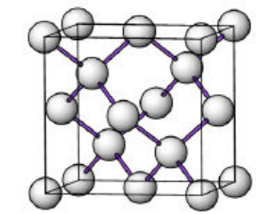
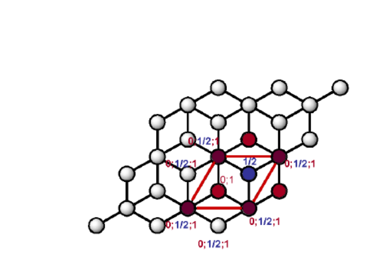

**Définition de la liaison covalente.** La liaison covalente est présente entre des éléments ayant une forte $\chi$ et une faible $\Delta\chi$. Les hybridations imposent une distribution spatiale spécifique des liaisons.

## Structure diamant

| Caractéristique | Diamant |
| --- | --- |
| Empilement | CFC de C |
| Système cristallin | Cubique |
| Mode de réseau | F |
| Sites interstitiels | $[T]$ |
| Taux d'occupation | 50 % |
| Atomes indépendants | $C(0, 0, 0)$, $C(1/4, 1/4, 1/4)$ |
| $Z$ | 8 unités formulaires par maille |
| Justification de $Z$ | CFC de C $\rightarrow 4\,C$ par maille ; 50 % $[T]$ C $\rightarrow 4\,C$ par maille |
| Coordinence | 4 $[T]$ |
| $a = f(R)$ | $\frac{a\sqrt{3}}{4} = 2R_{cov}(C)$ |
| Compacité | $\frac{V_{atomes}}{V_{maille}} = \frac{\pi\sqrt{3}}{16} = 0{,}34$ |
| Exemple | C, Si, Ge, nitrure de bore |

## Structure graphite

| Caractéristique | Graphite |
| --- | --- |
| Empilement | HC |
| Système cristallin | Hexagonal |
| Mode de réseau | P |
| Sites interstitiels | [triangulaire] |
| Taux d'occupation | non défini |
| Atomes indépendants | $C(0, 0, 0)$, $C(1/3, 2/3, 1/2)$, $C(2/3, 1/3, 0)$, $C(0, 0, 1/2)$ |
| $Z$ | 4 unités formulaires par maille |
| Justification de $Z$ | HC de C $\rightarrow 2\,C$ par maille ; C sur les bases (1 C par maille), C sur les arêtes (1 C par maille) |
| Coordinence | 3 [triangle] |
| $a = f(R)$ | Non traité, $c = 6{,}8$ Å |
| Exemple | C, SiC |
