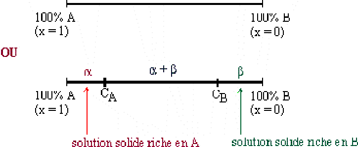
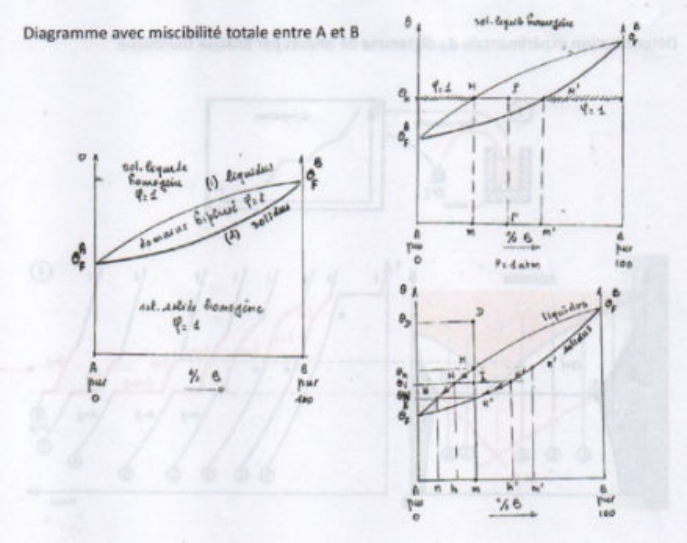

## Introduction

**Équilibres hétérogènes :** équilibres dans lesquels interviennent différentes phases (liquide-solide, solide-solide, liquide-liquide).

**Phase :** partie physiquement homogène d'un système.

**Système :** mélange de corps (simples ou composés) entre lesquels des transformations physico-chimiques peuvent se produire.

Pour deux espèces $A$ et $B$, on peut avoir une $\begin{cases} \text{miscibilité} \\ \text{solubilité} \end{cases}$ totale ou partielle.

**Totale.** On représente la solubilité sur une droite qui représente la part de $B$ dans $A$. Si ce pourcentage est de 0, alors $A$ est pur ; s'il est de 100, alors $B$ est pur.

**Partielle.** De manière analogue, on représente la solubilité sur une droite qui représente la part de $B$ dans $A$. Cependant, le diagramme se décompose en trois parties :

- entre 0 et la limite de solubilité de $B$ dans $A$, on est dans une phase homogène : c'est une solution solide $\alpha$ ;
- entre la limite de solubilité de $B$ dans $A$ et celle de $A$ dans $B$, on a deux phases, le mélange est hétérogène : c'est ce que l'on appelle la **démixtion** ;
- au-delà de la limite de solubilité de $A$ dans $B$, on est dans une phase homogène : c'est une solution solide $\beta$.

## Diagrammes de composition

Les diagrammes de composition sont des segments dont les extrémités correspondent aux deux constituants.

**Solides complètement miscibles.** On parle alors de solution solide **continue** ou totale. On définit l'alliage de substitution par :

$$
A_{1-x}B_x \quad \text{où} \quad (0 \leq x \leq 1)
$$

La solution solide sera continue si et seulement si :

- $A$ et $B$ cristallisent avec la même structure ;
- $A$ et $B$ ont le même rayon atomique ;
- $A$ et $B$ ont la même électronégativité ;
- $A$ et $B$ ont la même valence.

**Remarque.** Il y a différentes manières de tracer les diagrammes de composition :

- fraction atomique d'un des constituants $x_i$ :

  $$
  x_i = \frac{n_i}{n_{Total}}
  $$

- pourcentage atomique d'un des constituants :

  $$
  \%at(x) = x_i \times 100
  $$

- fraction massique (ou pondérale) de $i$ dans le mélange :

  $$
  p_i = \frac{m_i}{m_{Tot}} = \frac{m_i}{\sum m_i} = \frac{n_i M_i}{\sum n_i M_i} = \frac{x_i M_i}{\sum x_i M_i}
  $$

- pourcentage massique de $i$ dans le mélange :

  $$
  p_i \times 100
  $$

Dans le cas d'une solution solide continue, les paramètres de maille varient linéairement avec la composition : c'est la loi de Végard.

$$
a_{ss}\,A_{1-x}B_x = x\,a_B + (1 - x)\,a_A
$$

On a donc $A_{1-x}B_x = xB + (1 - x)A$, que l'on retrouve en composition, et donc $a_{SS} = (a_B - a_A)x + a_A$.

**Solides partiellement miscibles.** La zone de démixtion représente une lacune de miscibilité où deux phases sont en équilibre ($\alpha + \beta$). La composition de $\alpha$ à la limite de solubilité est la plus riche possible en $B$ ; la composition de $\beta$ à la limite de solubilité est la plus riche possible en $A$.

**$A$ et $B$ non miscibles.** Si $A$ et $B$ sont non miscibles, on a deux phases distinctes.

**Composés intermédiaires.** Pour certaines compositions, on peut former un solide (une phase) qui présente une nouvelle structure (différente de celles de A et de B). On a donc une seule phase solide $c$, de composition particulière et de structure différente de celles de $A$ et $B$.

**Pour le composé $c$ :** le pourcentage atomique de $B$ dans $A$ est de 33,33 %, donc $x_B = \frac{1}{3}$ :

$$
A_{1-x}B_x \rightarrow A_{\frac{2}{3}}B_{\frac{1}{3}} \Rightarrow A_2B
$$

**Pour le composé $d$ :** le pourcentage atomique de $B$ dans $A$ est de 66,67 %, on a donc $x_B = \frac{2}{3}$ :

$$
A_{\frac{1}{3}}B_{\frac{2}{3}} \rightarrow AB_2
$$

## Diagrammes de phases (température, composition) pour des systèmes binaires

**Règle des phases.** On appelle facteurs d'équilibre d'un système des facteurs physiques (température ou pression) ou chimiques (composition) dont la variation entraîne un déplacement de l'état d'équilibre du système. On appelle facteurs d'équilibre indépendants les facteurs auxquels on peut donner une valeur arbitraire sans détruire l'état d'équilibre du système. Le nombre de facteurs d'équilibre indépendants est appelé variance du système $(v)$.

$$
v = c + n - \phi
$$

On définit $c$ le nombre de constituants, $n$ le nombre de facteurs d'équilibre et $\phi$ le nombre de phases en présence.

La règle des phases s'énonce donc ainsi :

- si $P = cte$, $n = 1$ ($T$ varie) ;
- si le diagramme est binaire, alors il y a deux constituants, $c = 2$.

Donc $\phi_{max} = 3$ : on peut avoir trois phases en équilibre au maximum, car $v \geq 0$.

Dans ce cours, on prend des diagrammes de température et de composition, donc à pression constante. C'est ce qu'on appelle un diagramme binaire (deux constituants). Suivant la zone du diagramme, on pourra avoir une phase homogène, ou deux ou trois phases en équilibre.

**Règle du barycentre.**

$$
P_{liq}\,\overline{MP} = P_\alpha\,\overline{PM'}
$$

On remarque ainsi que $P$ est le barycentre du segment $\overline{MM'}$. Ceci n'est applicable que si la composition est donnée en fraction ou en pourcentage massique. C'est la règle des segments inverses :

$$
\begin{cases} \%\text{liquide} = \dfrac{\overline{PM'}}{\overline{MM'}} \cdot 100 \\ \%\text{solide} = \dfrac{\overline{PM}}{\overline{MM'}} \cdot 100 \end{cases}
$$

où $\overline{PM'}$ est la longueur du segment exprimée en fraction ou pourcentage massique.

**Équilibre solide-liquide avec miscibilité totale entre $A$ et $B$ dans les deux états.**

**Coupe isotherme :** on définit $C_B$ comme la teneur en $B$ dans le mélange.

- $0 < C_B < C_m$ : il y a une seule phase liquide homogène. La variance vaut $v = 2$ (deux facteurs d'équilibre indépendants : température et composition). La température étant fixée, on peut faire varier la composition sans changer l'état du système.
- $C_B = C_m$ : apparition des premiers cristaux de la phase $\alpha$ dans le liquide, c'est la **germination**.
- $C_m < C_B < C_{m'}$ : il y a deux phases en équilibre (liquide + $\alpha$) de compositions fixes, $\begin{cases} \text{phase liquide de composition } C \\ \text{phase solide de composition } C' \end{cases}$. Quand $C_B$ augmente dans cette zone, le liquide disparaît progressivement et les cristaux grossissent. On a donc $v = 1$ (monovariant). La composition des phases en équilibre est fixée, seules les proportions changent.
- $C_B = C_{m'}$ (**solidus**) : disparition des dernières gouttes de liquide.
- $C_{m'} < C_B < 100$ : une seule phase homogène solide, la variance vaut $v = 2 + 1 - 1 = 2$.

**Coupe verticale : refroidissement d'un liquide homogène pour une composition fixe $C_B$.**

- $T > T_M$ : une seule phase homogène liquide, $v = 2$.
- $T = T_M$ : apparition des premiers cristaux $\alpha$, de composition $C_{m'}$.
- $T_M > T > T_N$ : il y a deux phases en équilibre, liquide + $\alpha$ ; on a donc $v = 2 + 1 - 2 = 1$.
- $T = T_{N'}$ : disparition des dernières gouttes de liquide, de composition $C_n$.
- $T < T_{N'}$ : une phase solide homogène.

On a donc une phase liquide dont la composition, donnée par le point $H$, varie entre $C_m$ et $C_n$, et une phase solide dont la composition, donnée par le point $H'$, varie entre $C_{m'}$ et $C_m$. On utilise la règle du barycentre, ou des segments inverses, toujours applicable :

$$
\begin{cases} \%\text{liquide} = \dfrac{\overline{IH'}}{\overline{HH'}} \\ \%\text{solide} = \dfrac{\overline{IH}}{\overline{HH'}} \end{cases}
$$
