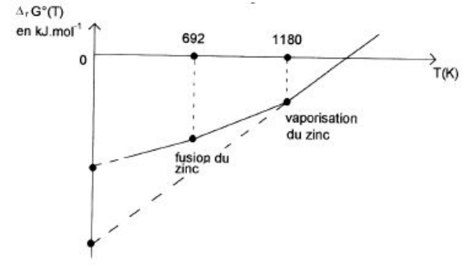
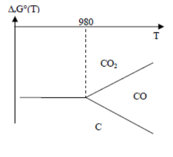
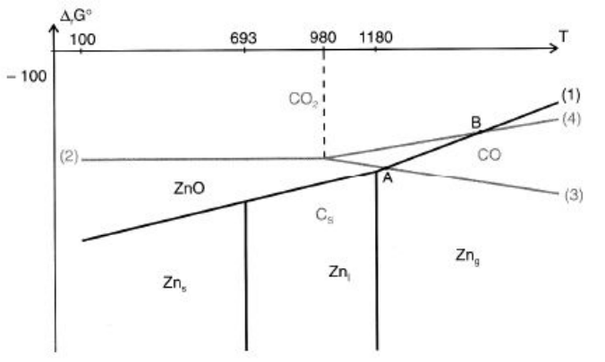

## Construction d'un diagramme d'Ellingham

Les diagrammes d'Ellingham ont pour but de déterminer la stabilité relative des métaux et de leurs oxydes. Ils permettent de réduire les oxydes pour obtenir les métaux, à l'aide de $H_2$, du $C$, du $CO$ et du $CO_2$. Pour cela, on se base sur la **thermodynamique** et sur les équations de formation de l'oxyde, équilibrées pour **1 mole d'$O_2$** (comparaison de différents couples $M/M_xO_y$) :

$$
\frac{2x}{y}M + O_{2(g)} \rightarrow \frac{2}{y}M_xO_y
$$

On cherche alors la variation de l'enthalpie libre :

$$
\underbrace{\Delta_r G^\circ(T)}_{\text{variation de l'enthalpie libre standard}} = \underbrace{\Delta_r H^\circ(T)}_{\text{variation d'enthalpie standard}} - \underbrace{T\Delta_r S^\circ(T)}_{\text{variation d'entropie standard}}
$$

$$
\Delta_r H^\circ(T) = \sum \gamma_i \Delta_f H^\circ(T)
\qquad
\Delta_r S^\circ(T) = \sum \gamma_i S^\circ_i(T)
$$

**Approximation d'Ellingham :** $\Delta_r H^\circ$ et $\Delta_r S^\circ$ sont indépendantes de la température (sauf changement de phase) $\Rightarrow \Delta_r G^\circ = f(T)$.

**Droites sur un diagramme d'Ellingham.** Sur les diagrammes d'Ellingham, on a des droites

$$
\begin{cases} \text{de pente } -\Delta_r S^\circ \\ \text{d'ordonnée à l'origine } \Delta_r H^\circ \end{cases}
$$

Pour un couple $M/M_xO_y$, on trouve sur les diagrammes d'Ellingham un ensemble de segments de droite $\Delta_r G^\circ$ en fonction de $T$, en $\text{kJ.mol}^{-1}$.

Sur les diagrammes d'Ellingham, le signe de la pente de la droite (sans changement d'état physique) indique les conditions de formation de l'oxyde à partir du métal. Cela dépend de la variation de la quantité de matière gazeuse :

$$
\begin{cases} \Delta\nu_{gaz} > 0 \rightarrow \text{pente} < 0 \\ \Delta\nu_{gaz} < 0 \rightarrow \text{pente} > 0 \\ \Delta\nu_{gaz} = 0 \rightarrow \text{pente} \approx 0 \end{cases}
$$

**Influence des changements d'état physique.** En général, on prend la température croissante.

- Dans un corps simple, l'ordonnée à l'origine augmente après la transition de phase. Lors de la transition de l'état solide à l'état liquide, le métal devient plus réactif mais moins stable : il est donc plus facile de former l'oxyde, c'est-à-dire que $\Delta_r G^\circ$ diminue.
- Dans un oxyde, l'ordonnée à l'origine diminue après la transition de phase. L'oxyde se forme à l'état liquide (qui est moins stable) : la réaction est donc plus difficile et il faut fournir plus d'énergie, c'est-à-dire que $\Delta_r G^\circ$ augmente.

## Utilisation

**Domaine de stabilité des espèces.** Le métal $M$, réducteur, est présent sous la courbe, alors que $M_xO_y$, oxydant, est au-dessus de la courbe.

**Exemple : diagramme d'Ellingham du zinc.** Les données sont les suivantes : $T_{fus} = 693\ \text{K}$, $\Delta_{fus}H^\circ = 6{,}7\ \text{kJ/mol}$, $T_{eb} = 1180\ \text{K}$, $\Delta_{vap}H^\circ = 114{,}8\ \text{kJ/mol}$.

|  | $Zn$ | $ZnO$ | $O_2$ |
| --- | --- | --- | --- |
| $\Delta_f H^\circ$ en kJ/mol | 0 | $-350{,}5$ | 0 |
| $S^\circ$ en J/K/mol | 41,6 | 43,6 | 205 |

**Pour $T < 693$ K :**

$$
2Zn_{(s)} + O_{2(g)} \rightleftharpoons 2ZnO_{(s)} \qquad (1)
$$

On trouve donc $\Delta_r G^\circ_1 = -701 + 0{,}201T$ en kJ/mol.

**Pour $693\ \text{K} < T < 1180\ \text{K}$ :**

$$
2Zn_{(l)} + O_{2(g)} \rightleftharpoons 2ZnO_{(s)} \qquad (2)
$$

On pose

$$
Zn_{(s)} \rightleftharpoons Zn_{(l)} \qquad (3)
$$

ainsi $(2) = (1) - 2(3)$. On trouve donc :

$$
\Delta_r G^\circ_2 = \Delta_r H^\circ_1 - 2\Delta_r H^\circ_{fus} - T\left(\Delta_r S^\circ_1 - 2\frac{\Delta H_{fus}}{T_{fus}}\right) = -714{,}4 + 0{,}2204T
$$

**Pour $T > 1180$ K :**

$$
2Zn_{(g)} + O_2 \rightleftharpoons 2ZnO_{(s)} \qquad (4)
$$

On pose

$$
Zn_{(l)} \rightleftharpoons Zn_{(g)} \qquad (5)
$$

ainsi $(4) = (2) - 2(5)$. On trouve donc :

$$
\Delta_r G^\circ_3 = \Delta_r H^\circ_2 - 2\Delta_r H^\circ_{eb} - T\left(\Delta_r S^\circ_2 - 2\frac{\Delta H_{eb}}{T_{eb}}\right) = -944 + 0{,}415T
$$

**Propriétés de la pente.** Elle permet d'étudier la stabilité du métal en comparant la stabilité relative des couples métal/oxyde, et de réduire sélectivement certains métaux.

$$
\frac{2}{y}(M_xO_y)_{(s)} + \frac{2x'}{y'}M'_{(s)} \rightarrow \frac{2}{y'}(M'_{x'}O_{y'}) + \frac{2x}{y}M \qquad (*)
$$

La réaction est possible si $\Delta_r G^\circ < 0$ (à $T$ et $P$ constantes) : $\Delta_r G^\circ(*) = \Delta_r G^\circ(2) - \Delta_r G^\circ(1) < 0$, avec

$$
\Delta_r G^\circ(1) : \frac{2x}{y}M_{(s)} + O_{2(g)} \rightarrow \frac{2}{y}M_xO_{y(s)}
$$

$$
\Delta_r G^\circ(2) : \frac{2x'}{y'}M'_{(s)} + O_{2(g)} \rightarrow \frac{2}{y'}M'_{x'}O_{y'(s)}
$$

- La réduction de $M_xO_y$ par $M'$ est possible si la courbe $\Delta_r G^\circ(1)(T)$ (formation de $M_xO_y$) est située au-dessus de la courbe $\Delta_r G^\circ(2)(T)$ (formation de $M'_{x'}O_{y'}$) dans le diagramme d'Ellingham.
- La réaction est possible si $M_xO_y$ est moins stable que $M'_{x'}O_{y'}$.
- Les espèces gazeuses peuvent provoquer des pentes plus prononcées, voire des droites.
- Les meilleurs réducteurs (oxydes les plus stables) sont en bas du diagramme.
- Les meilleurs oxydants (oxydes les moins stables) sont en haut du diagramme.

**Réduction par $H_2$, $CO$, $C$.**

1. $C_{(s)} + O_{2(g)} \rightarrow CO_{2(g)}$
2. $2CO_{(g)} + O_{2(g)} \rightarrow 2CO_{2(g)}$
3. $2C_{(s)} + O_{2(g)} \rightarrow 2CO_{(g)}$
4. $2H_{2(g)} + O_{2(g)} \rightarrow 2H_2O_{(g)}$

Tous les oxydes produits sont gazeux (élimination facile). Attention, $H_2$ a une efficacité moindre, surtout pour les métaux les moins électropositifs (à droite dans la classification périodique) :

$$
CuO + H_2 \rightarrow Cu + H_2O
$$

$CO$ est un bon réducteur, qui peut remplacer $H_2$ ; $C$ est encore meilleur :

$$
\begin{cases} \text{à basse } T : C_{(s)} + O_{2(g)} \rightarrow CO_{2(g)} \\ \text{à haute } T : 2C_{(s)} + O_{2(g)} \rightarrow 2CO_{(g)} \end{cases}
$$

Dans certains cas, on a réduction par le $C$ puis par le $CO$ (produit pendant la réaction), car le $CO$ participe encore à la réduction de l'oxyde métallique. $C$ ou $CO$ peuvent réduire la plupart des métaux : on en a donc une utilisation industrielle. Cependant, $C$ peut former des carbures ($Fe_3C$, $WC$...).

**Exemple pratique de réduction.** En superposant les deux diagrammes (du zinc et du carbone), on remarque que les droites du zinc coupent celles du carbone en deux points $A$ et $B$, avec $T_A = 1217$ K et $T_B = 1562$ K.

On cherche quel réducteur peut réduire l'oxyde $ZnO$ et sur quelle plage de température : on doit trouver un couple dont la droite est au-dessous de celle de $ZnO/Zn$.

- Si $T_A < T < T_B$, seul le carbone (du couple $CO/C$) peut réduire $ZnO$.
- Si $T > T_B$, le monoxyde de carbone $CO$ (du couple $CO_2/CO$) peut également réduire $ZnO$.
