## Empilements de sphères

**Introduction.** Un arrangement dense implique le contact des sphères.

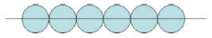

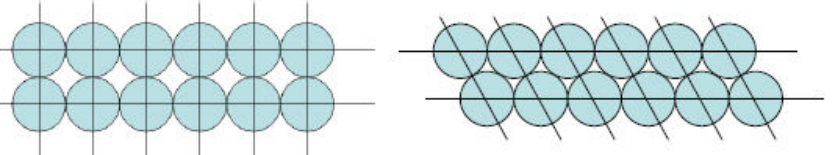

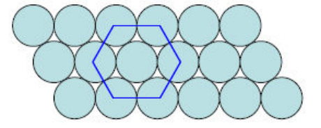

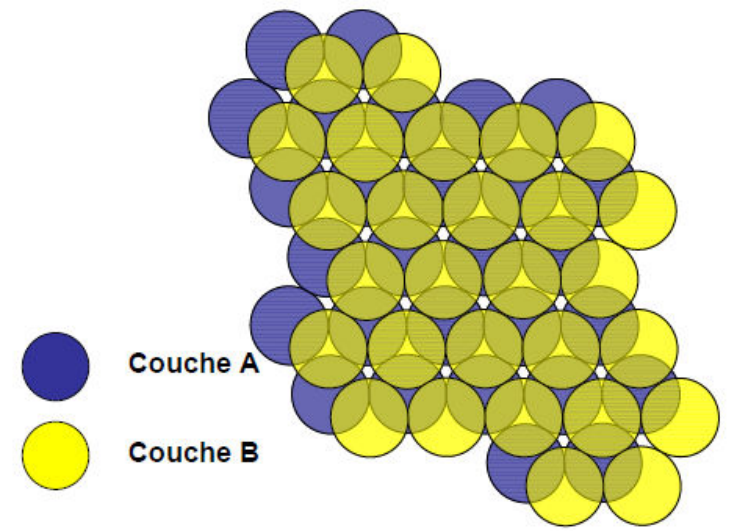

**Empilement hexagonal compact (HC).** Système cristallographique hexagonal, mode de réseau P. Coordinence 12 : 6 voisins coplanaires, 3 voisins dans le plan inférieur et 3 voisins dans le plan supérieur.

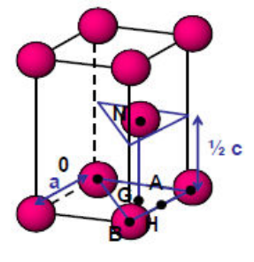

- $OA = OB = AB = 2R$ (contact dans les couches) ;
- $ON = 2R$ (contact entre les couches) ;
- $GN = \frac{1}{2}c$ ;
- $OG = \frac{2}{3}OA\cos(30)$.

Dans le triangle $OGN$, on a $OG^2 + GN^2 = ON^2$ :

$$
\left(\frac{2}{3} \cdot 2R\cos(30)\right)^2 + \left(\frac{c}{2}\right)^2 = (2R)^2
\Rightarrow
\left(\frac{2}{3}a\frac{\sqrt{3}}{2}\right)^2 + \frac{c^2}{4} = a^2
\Rightarrow
\frac{a^2}{3} + \frac{c^2}{4} = a^2
\Rightarrow
\frac{c}{a} = \sqrt{\frac{8}{3}}
$$

Si on s'écarte de cette valeur, cela veut dire que l'empilement est déformé.

**Notion de compacité.**

$$
\text{Compacité} = \frac{V_{\text{atomes}}}{V_{\text{maille}}} = \frac{2 \cdot \frac{4}{3}\pi R^3}{a \cdot a\cos(30) \cdot c}
$$

Pour un empilement compact HC, $C = \dfrac{\pi}{3\sqrt{2}} = 0{,}74$.

| Empilement HC | |
| --- | --- |
| Séquence ABABA | 2 atomes indépendants $(000)$, $(1/3, 2/3, 1/2)$ |
| Système cristallin hexagonal | $Z = 2$ |
| Mode de réseau P | Coordinence 12 |
| $a = 2R$ | $\frac{c}{a} = \sqrt{\frac{8}{3}}$ |
| $C = 0{,}74$ | |

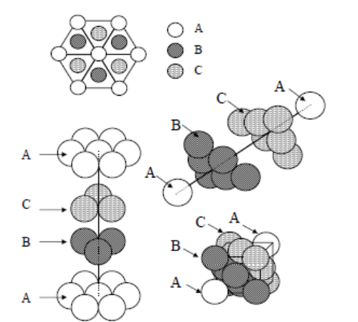

**Empilement cubique à faces centrées.**

| Empilement CFC | |
| --- | --- |
| Séquence ABCABCA | 1 atome indépendant $(000)$ |
| Système cristallin cubique | $Z = 4$ |
| Mode de réseau F | Coordinence 12 |
| $\sqrt{2}a = 4R$ | $C = 0{,}74$ |

**Empilement cubique simple (CS).**

| Empilement CS | |
| --- | --- |
| Séquence AAAAAA | 1 atome indépendant $(000)$ |
| Système cristallin cubique | $Z = 1$ |
| Mode de réseau P | Coordinence 6 |
| $a = 2R$ | $C = 0{,}52$ |

**Empilement cubique centré (CC).**

| Empilement CC | |
| --- | --- |
| Séquence ABABAB | 1 atome indépendant $(000)$ |
| Système cristallin cubique | $Z = 2$ |
| Mode de réseau I | Coordinence 8 |
| $\sqrt{3}a = 4R$ | . |
| $C = 0{,}68$ | . |

**Liaison métallique.** On s'intéresse à :

- la localisation des électrons ;
- la direction de la liaison ;
- la différence d'électronégativité (si elle est faible, on a une liaison métallique).

La liaison métallique est une liaison forte, non directionnelle, dans laquelle les électrons sont délocalisés, et qui implique des éléments de faible électronégativité ($\chi < 2$) présentant une faible différence d'électronégativité ($\Delta\chi < 0{,}5$).

## Sites interstitiels

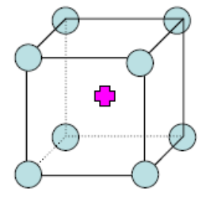

**Sites cubiques.** Cube de côté $a \Rightarrow a = 2R$.

$$
a\sqrt{3} = 2R + 2r \Leftrightarrow R\sqrt{3} = R + r \Leftrightarrow R(\sqrt{3} - 1) = r
\qquad
\frac{r}{R} = 0{,}732
$$

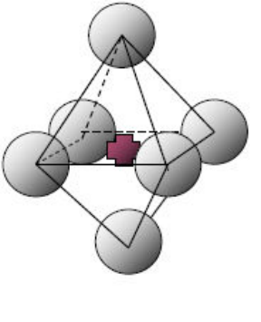

**Sites octaédriques.** Contact sur l'arête de l'octaèdre :

$$
d = \frac{a\sqrt{2}}{2} = 2R
\qquad
a = 2R + 2r
\qquad
\frac{2R}{\sqrt{2}} = R + r \Rightarrow R\left(\frac{2}{\sqrt{2}} - 1\right) = r
\qquad
\frac{r}{R} = \sqrt{2} - 1 = 0{,}414
$$

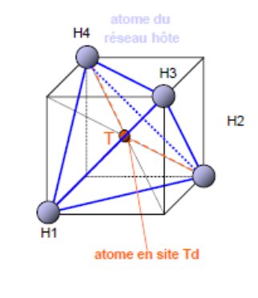

**Sites tétraédriques.** Contact sur l'arête du cube :

$$
a\sqrt{2} = 2R
\qquad
\frac{a\sqrt{3}}{2} = R + r
\qquad
\frac{2R}{\sqrt{2}}\frac{\sqrt{3}}{2} = R + r
\qquad
R\left(\frac{\sqrt{3}}{\sqrt{2}} - 1\right) = r
\qquad
\frac{r}{R} = 0{,}225
$$

### Différents sites interstitiels

**Cubique simple.**

- $[cub]$, au centre de la maille : 1 site $[cub]$ par maille.

**Cubique à faces centrées.**

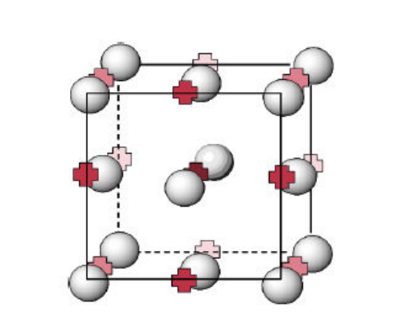

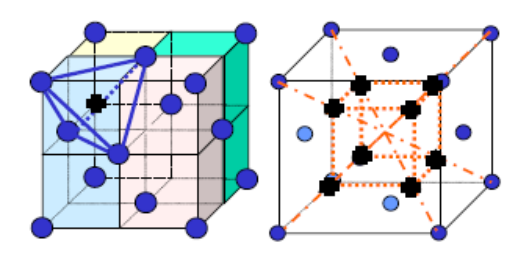

**8 sites tétraédriques :** $(1/4, 3/4$, diagonale$)$ ; il y a 2 positions indépendantes (occupation à 0 %, 50 % ou 100 %).

**4 sites octaédriques :** présents au centre du cube et au milieu des arêtes ; il y a 1 position indépendante (occupation à 0 % ou 100 %).

**Hexagonal compact.**

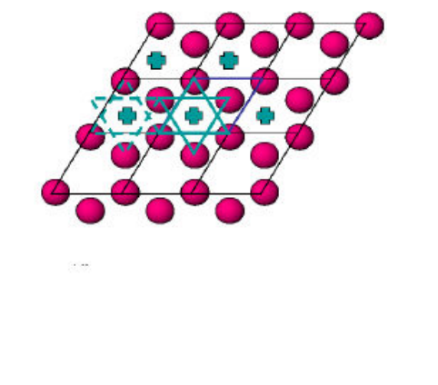

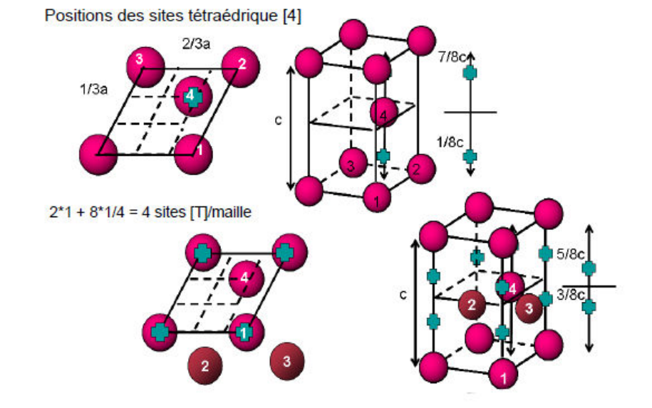

**4 sites tétraédriques :** $\begin{cases} (1/3, 2/3, 1/8) \\ (1/3, 2/3, 7/8) \end{cases}$ plans A et B, $\begin{cases} (0, 0, 3/8) \\ (0, 0, 5/8) \end{cases}$ et translations élémentaires. On a 4 positions indépendantes (occupation à 0 %, 25 %, 50 %, 75 % ou 100 %).

**2 sites octaédriques :** $\begin{cases} (2/3, 1/3, 1/4) \\ (2/3, 1/3, 3/4) \end{cases}$. On a 2 positions indépendantes (occupation à 0 %, 50 % ou 100 %).

### Stabilité

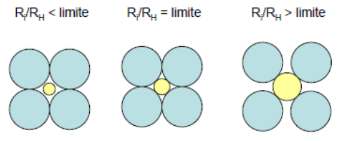

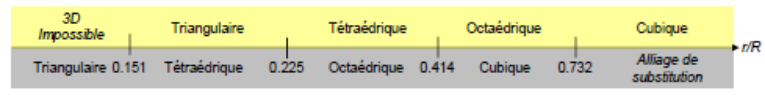
