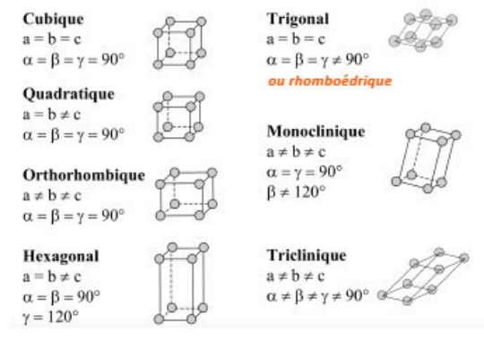
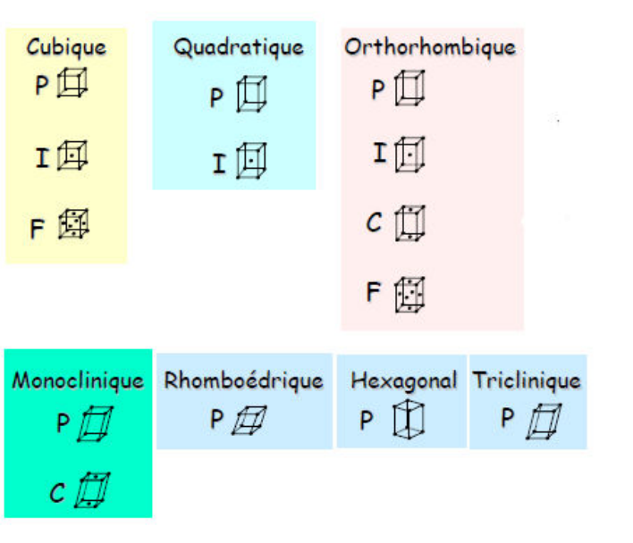

## Introduction

Dans la nature, on peut décrire la matière grâce à trois types d'états :

**Gazeux :** particules ou constituants **sans interactions**.

**Liquide :** interactions (voir le cours de chimie générale) à **courte portée**, pas dans toutes les directions de l'espace.

**Solide :** fortes interactions (la plupart du temps) entre les entités dans les trois directions de l'espace. Interactions à **longue portée**. Le solide peut être organisé, ordonné, « ordre à longue distance / longue portée » (cristaux comme le quartz $SiO_2$), ou désordonné, « ordre à courte portée » (amorphes, comme le verre $SiO_2$).

L'étude des cristaux renseigne sur leurs propriétés ; dans ce cours, on s'intéresse aux solides cristallins.

Exemple : grâce à sa désorganisation, le verre laisse passer la lumière ; grâce à son organisation, le quartz possède la propriété piézoélectrique (variation du cristal au cours du temps, obtention d'une fréquence), ce qui permet de compter le temps.

## Outils et définitions

**Cristal.** Solide constitué d'entités chimiques (atomes, ions, molécules, virus...) réparties régulièrement dans l'espace pour former un assemblage périodique.

**Périodicité.** Se décrit à l'aide de la symétrie de translation (on n'étudiera pas les symétries de rotation).

**Symétrie de translation :** fait correspondre à un atome un autre atome de même nature et de même environnement.

**Réseau.** On définit le réseau à l'aide des translations élémentaires.

**Maille 1.** La maille de réseau est le volume défini à l'aide des trois translations élémentaires.

**Maille 2.** La maille de réseau est une portion de l'espace au sein de laquelle il n'existe pas deux points équivalents par une translation élémentaire du réseau.

On choisit la maille la plus petite et la plus symétrique.

Les systèmes cristallins traduisent des relations existant entre les paramètres de maille et définissent la symétrie de base de la maille. On a besoin de six paramètres : $a, b, c$, les normes des vecteurs, et $\alpha, \beta, \gamma$, les angles. Si le système est cubique, on dit qu'il est isotrope.

**Notion de motif.** Un cristal est formé par la répétition, dans les trois directions de l'espace, d'un motif cristallographique. On peut définir le motif cristallographique comme suit : « assemblage d'atomes, ions, molécules ou autres entités chimiques qui se répète dans le cristal de manière périodique ».

**Notion de réseau, de translation élémentaire et de nœud du réseau.** La reproduction du motif cristallographique dans l'espace forme un **réseau tridimensionnel** caractérisé par trois translations élémentaires $\vec{a}, \vec{b}, \vec{c}$.

Toute **translation élémentaire** associe à un point du cristal un **point équivalent** (c'est-à-dire de même nature chimique, de même environnement...).

En remplaçant le motif cristallographique par un point, on définit un **réseau ponctuel**. Chaque point est un **nœud du réseau** tel que :

$$
\vec{r} = u\vec{a} + v\vec{b} + w\vec{c}
$$

où $\vec{r}$ représente le vecteur reliant le point « origine » au nœud considéré, $u, v, w$ étant des entiers.

**Multiplicité de la maille.** Maille simple ou primitive (1 nœud par maille) ou multiple (plus d'un nœud par maille).

Mode de réseau : il est caractérisé par des translations supplémentaires qui décrivent la position de nœuds du réseau supplémentaires. Il existe quatre modes de réseaux :

**Simple :** aucune translation supplémentaire du mode de réseau.

**Centré :** un nœud au centre $\left(\frac{1}{2} \frac{1}{2} \frac{1}{2}\right)$.

**Faces centrées :** un nœud au centre des faces[^combinaisons] $\left(\frac{1}{2} \frac{1}{2} 0\right)$, $\left(\frac{1}{2} 0 \frac{1}{2}\right)$, $\left(0 \frac{1}{2} \frac{1}{2}\right)$.

**Bases centrées :** un nœud au centre de deux faces opposées $\left(\frac{1}{2} \frac{1}{2} 0\right)$.

[^combinaisons]: On peut faire des combinaisons linéaires de translations.

**Z : nombre d'unités formulaires par maille.** La multiplicité de la maille de réseau a été définie précédemment comme étant égale au nombre de nœuds du réseau que contient la maille. Cependant, un cristal est constitué d'atomes ou d'ions (ou...). On doit donc évaluer le **contenu de la maille** et mettre ce contenu **en relation avec la formule chimique du cristal**.

Le décompte des atomes contenus dans la maille repose sur le même principe que le décompte des nœuds du réseau, soit :

- atomes aux **sommets** : partagés entre 8 mailles, contribution de 1/8 ;
- atomes sur les **arêtes** : partagés entre 4 mailles, contribution de 1/4 ;
- atomes sur les **faces** : partagés entre 2 mailles, contribution de 1/2 ;
- atomes dans la **maille** : contribution de 1.

Une fois ce décompte réalisé, on connaît le **contenu de la maille**, que l'on **peut réduire à une formule chimique simple** (coefficients stœchiométriques entiers et premiers entre eux) : l'unité formulaire.

**Z, nombre d'unités formulaires par maille, est égal au rapport entre le contenu de la maille et l'unité formulaire.**

Le nombre d'unités formulaires par maille $Z$ est dit aussi nombre de motifs par maille. Il est important de comprendre que le « motif » dont il est question dans ce cas n'est pas le motif cristallographique mais, en quelque sorte, le « motif chimique », c'est-à-dire la formule chimique du cristal. C'est pourquoi il est plus rigoureux d'appeler $Z$ « le nombre d'unités formulaires par maille ».

**Notion de système cristallin.** Les **paramètres de maille**, métriques ou angles, peuvent être corrélés entre eux (métriques égales ou non, angles prenant des valeurs particulières, angles égaux ou non...). Chaque corrélation limite les libertés dont on dispose pour définir ces paramètres, et augmente la **symétrie de la maille** (on acceptera cette dernière affirmation). On peut ainsi définir sept **systèmes cristallins**, qui sont la traduction des relations pouvant exister entre les **paramètres de maille** :

| Système | Longueurs | Angles | Symétrie |
| --- | --- | --- | --- |
| Cubique | $a = b = c$ | $\alpha = \beta = \gamma = 90^\circ$ | 3 axes d'ordre 4 |
| Hexagonal | $a = b \neq c$ | $\alpha = \beta = 90^\circ, \gamma = 120^\circ$ | 1 axe d'ordre 6 |
| Quadratique | $a = b \neq c$ | $\alpha = \beta = \gamma = 90^\circ$ | 1 axe d'ordre 4 |
| Rhomboédrique | $a = b = c$ | $\alpha = \beta = \gamma \neq 90^\circ$ | 1 axe d'ordre 3 |
| Orthorhombique | $a \neq b \neq c$ | $\alpha = \beta = \gamma = 90^\circ$ | 3 axes d'ordre 2 |
| Monoclinique | $a \neq b \neq c$ | $\alpha = \gamma = 90^\circ, \beta \neq 90^\circ$ | 1 axe d'ordre 2 |
| Triclinique | $a \neq b \neq c$ | $\alpha \neq \beta \neq \gamma \neq 90^\circ$ | seulement un centre d'inversion |

**Notion de réseaux de Bravais.**

**Notion d'atomes cristallographiquement indépendants.** Les positions atomiques dans les mailles élémentaires peuvent être reliées entre elles par des éléments de symétrie ; on parle alors de positions équivalentes. L'atome occupant la position permettant de retrouver les autres par symétrie est désigné comme l'atome cristallographiquement indépendant.

Pour définir une maille avec un atome isolé interne :

**Système :** système hexagonal, mode de réseau P.

**Atomes :** 1 atome de cobalt $(0, 0, 0)$.

**Atomes isolés :** $\left(\frac{1}{3}, \frac{2}{3}, \frac{1}{2}\right)$.

On a donc besoin de deux atomes cristallographiquement indépendants pour décrire toute la maille.

**Notion de coordinence.** Un élément de symétrie, quel qu'il soit, sert à relier un atome du cristal à un autre atome de même nature et de même environnement.

L'environnement d'un atome est décrit à l'aide de deux informations :

- la coordinence : c'est le nombre de premiers voisins, c'est-à-dire le nombre d'atomes à proximité immédiate de l'atome dont on évalue la coordinence ;
- le polyèdre de coordination : il s'agit de la figure géométrique formée par les premiers voisins de l'atome considéré (tétraèdre, octaèdre, cube...).

La coordinence et le polyèdre de coordination associé d'un atome peuvent avoir une influence très importante, sur ses propriétés électroniques en particulier. Par ailleurs, étudier la manière dont s'enchaînent les polyèdres de coordination (mise en commun de sommets, d'arêtes...) permet souvent de mieux « comprendre » la structure cristalline d'un matériau et son influence sur ses propriétés.

**Masse volumique.** La masse volumique (en $\text{g.cm}^{-3}$) est le rapport entre la masse d'un corps et le volume qu'occupe ce corps. La masse volumique est mesurée expérimentalement par pycnométrie, mais la connaissance de la structure cristalline d'un matériau permet d'évaluer sa masse volumique théorique :

$$
\rho = \frac{ZM}{N_a V}
$$

La comparaison de la masse volumique théorique, calculée à partir de la formule précédente, et de la masse volumique mesurée expérimentalement peut permettre de vérifier que la structure cristalline envisagée est la bonne (si le cristal est exempt de défauts), ou au contraire d'évaluer la présence de certains défauts dans le cristal (si la structure cristalline a été confirmée par d'autres moyens). De faibles écarts entre masses volumiques théorique et expérimentale peuvent aussi traduire des distorsions de la structure cristalline.

**Coordonnées réduites.** Les coordonnées réduites $(x, y, z)$ d'un atome sont des nombres, compris entre 0 et 1, qui permettent de définir les fractions de translations élémentaires du réseau à appliquer à partir de l'origine de la maille pour retrouver la position de l'atome.

Ainsi, un atome qui a pour coordonnées $\left(0{,}23 ; \frac{1}{2} ; 0{,}43\right)$ sera situé dans la maille à l'extrémité d'un vecteur $\vec{r}$ reliant cet atome à l'origine et défini par :

$$
\vec{r} = x\vec{a} + y\vec{b} + z\vec{c}
$$

avec $x = 0{,}23$, $y = 1/2$, $z = 0{,}43$.

Lorsque $x$, $y$ ou $z$ prennent une valeur remarquable (généralement pour des raisons de symétrie), telle que 0,25, 0,33, 0,5, 0,66 ou 0,75, on note pour cette coordonnée la fraction correspondante : $\frac{1}{4}$, $\frac{1}{3}$, $\frac{1}{2}$, $\frac{2}{3}$ ou $\frac{3}{4}$. Ainsi, pour un atome situé en $(0{,}75 ; 0{,}5 ; 0{,}25)$, on notera ses coordonnées de la façon suivante : $\left(\frac{3}{4}, \frac{1}{2}, \frac{1}{4}\right)$.
