Présence d'une forte différence d'électronégativité ($\Delta\chi \geq 1$). Les interactions électrostatiques sont proportionnelles à $\dfrac{qq'}{r^2}$. Si les charges sont de signes contraires, la liaison est **attractive** ; si elles sont de même signe, la liaison est **répulsive**.

On trouve une **stabilité** en cas de contact cation-anion, mais une **instabilité** en cas de contact anion-anion. Les cristaux ioniques sont donc des empilements d'anions dont les cations occupent les sites interstitiels.

## Structure type CsCl

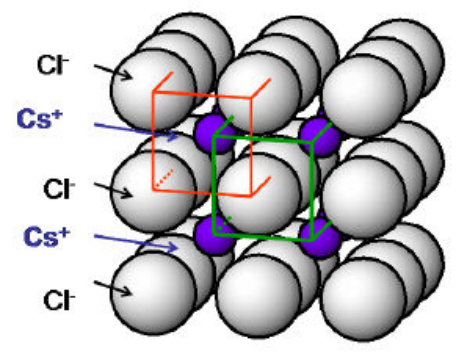

| Caractéristique | CsCl |
| --- | --- |
| Empilement des anions | CS |
| Système cristallin | Cubique |
| Mode de réseau | P |
| Sites interstitiels | $[cub]$ |
| Taux d'occupation | 100 % |
| Atomes indépendants | $1\,Cl^-$ en $(000)$ et $1\,Cs^+$ en $(1/2, 1/2, 1/2)$ |
| $Z$ | 1 unité formulaire par maille |
| Coordinence cations/anions | 8 $[cub]$ |
| Coordinence anions/cations | 8 $[cub]$ |
| $a = f(R^+, R^-)$ | $a\sqrt{3} = 2(r^+ + r^-)$ |
| Formulation | $MX$ |

## Structure type fluorine $CaF_2$

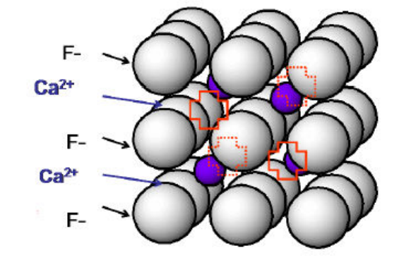

| Caractéristique | $CaF_2$ |
| --- | --- |
| Empilement des anions | CS |
| Système cristallin | Cubique |
| Mode de réseau | F |
| Sites interstitiels | $[cub]$ |
| Taux d'occupation | 50 % |
| Atomes indépendants | $1\,Ca^{2+}$ en $(000)$ et $2\,F^-$ en $(1/4, 1/4, 1/4)$ et $(1/4, 1/4, 3/4)$ |
| $Z$ | 4 unités formulaires par maille $CaF_2$ |
| Coordinence cations/anions | 8 $[cub]$ |
| Coordinence anions/cations | 4 $[T]$ |
| $a = f(R^+, R^-)$ | $\frac{a\sqrt{3}}{4} = r^+ + r^-$ |
| Formulation | $MX_2$ |

## Structure type $NaCl$

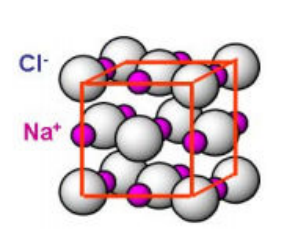

| Caractéristique | $NaCl$ |
| --- | --- |
| Empilement des anions | CFC |
| Système cristallin | Cubique |
| Mode de réseau | F |
| Sites interstitiels | $[o]$ |
| Taux d'occupation | 100 % |
| Atomes indépendants | $Cl(0, 0, 0)$, $Na(1/2, 0, 0)$ |
| $Z$ | 4 unités formulaires par maille $NaCl$ |
| Justification de $Z$ | CFC de Cl $\Rightarrow 4\,Cl$ par maille, 1 $Na$ au centre et 3 $Na$ sur les arêtes |
| Coordinence cations/anions | 6 $[o]$ |
| Coordinence anions/cations | 6 $[o]$ |
| $a = f(R^+, R^-)$ | $a = 2(r^+ + r^-)$ |
| Formulation | $MX$ |
| Exemple | Halogénures (petits alcalins) |

## Structure type $Na_2O$, anti-fluorine

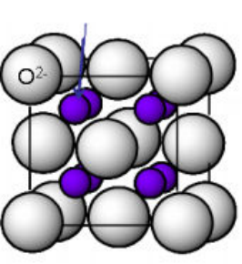

| Caractéristique | $Na_2O$ |
| --- | --- |
| Empilement des anions | CFC |
| Système cristallin | Cubique |
| Mode de réseau | F |
| Sites interstitiels | $[T]$ |
| Taux d'occupation | 100 % |
| Atomes indépendants | $O(0, 0, 0)$, $Na(1/4, 1/4, 3/4)$ et $Na(1/4, 1/4, 1/4)$ |
| $Z$ | 4 unités formulaires par maille $Na_2O$ |
| Justification de $Z$ | CFC de O $\Rightarrow 4\,O$ par maille et 100 % $[T]$ Na $\Rightarrow 8\,Na$ par maille |
| Coordinence cations/anions | 4 $[T]$ |
| Coordinence anions/cations | 8 $[cub]$ |
| $a = f(R^+, R^-)$ | $\frac{a\sqrt{3}}{4} = r^+ + r^-$ |
| Formulation | $M_2X$ |
| Exemple | Oxydes, chalcogénures |

## Structure type $ZnS$, blende

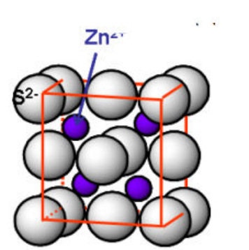

| Caractéristique | $ZnS$ blende |
| --- | --- |
| Empilement des anions | CFC |
| Système cristallin | Cubique |
| Mode de réseau | F |
| Sites interstitiels | $[T]$ |
| Taux d'occupation | 50 % |
| Atomes indépendants | $S(0, 0, 0)$ et $Zn(1/4, 1/4, 1/4)$ |
| $Z$ | 4 unités formulaires par maille $ZnS$ |
| Justification de $Z$ | CFC de S $\Rightarrow 4\,S$ par maille et 50 % $[T]$ Zn $\Rightarrow 4\,Zn$ par maille |
| Coordinence cations/anions | 4 $[T]$ |
| Coordinence anions/cations | 4 $[T]$ |
| $a = f(R^+, R^-)$ | $\frac{a\sqrt{3}}{4} = r^+ + r^-$ |
| Formulation | $MX$ |
| Exemple | Sulfures, chalcogénures, séléniures, nitrures |

## Structure type $ZnS$, würtzite

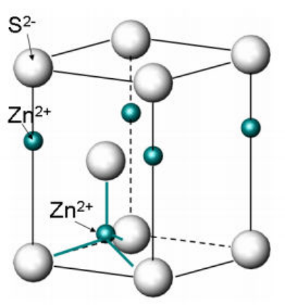

| Caractéristique | $ZnS$ würtzite |
| --- | --- |
| Empilement des anions | HC |
| Système cristallin | Hexagonal |
| Mode de réseau | P |
| Sites interstitiels | $[T]$ |
| Taux d'occupation | 50 % |
| Atomes indépendants | $S(0, 0, 0)$, $S(1/3, 2/3, 1/2)$, $Zn(1/3, 2/3, 1/8)$ et $Zn(0, 0, 5/8)$ |
| $Z$ | 2 unités formulaires par maille $ZnS$ |
| Justification de $Z$ | HC de S $\Rightarrow 2\,S$ par maille, et Zn à l'intérieur et sur les arêtes $\Rightarrow 2\,Zn$ par maille |
| Coordinence cations/anions | 4 $[T]$ |
| Coordinence anions/cations | 4 $[T]$ |
| $a = f(R^+, R^-)$ | non traité |
| Formulation | $MX$ |
| Exemple | Sulfures, chalcogénures, séléniures, nitrures |

## Structure type $NiAs$, nickeline

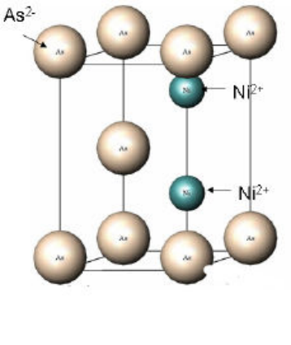

| Caractéristique | $NiAs$ |
| --- | --- |
| Empilement des anions | HC |
| Système cristallin | Hexagonal |
| Mode de réseau | P |
| Sites interstitiels | $[o]$ |
| Taux d'occupation | 100 % |
| Atomes indépendants | $As(0, 0, 0)$, $As(1/3, 2/3, 1/2)$, $Ni(2/3, 1/3, 1/4)$, $Ni(2/3, 1/3, 3/4)$ |
| $Z$ | 2 unités formulaires par maille $NiAs$ |
| Justification de $Z$ | HC d'As $\Rightarrow 2\,As$ par maille, et 100 % $[o]$ Ni $\Rightarrow 2\,Ni$ par maille |
| Coordinence cations/anions | 6 $[o]$ |
| Coordinence anions/cations | 6 [prisme triangulaire] |
| $a = f(R^+, R^-)$ | non traité |
| Formulation | $MX$ |
| Exemple | Sulfures, tellurures, séléniures |

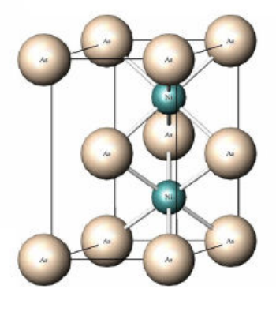

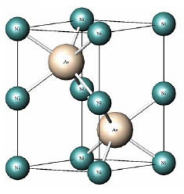

## Structure type $CdI_2$

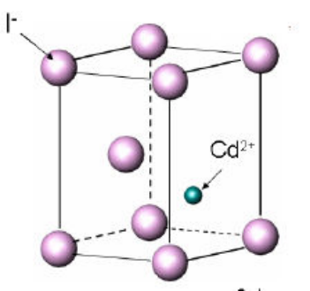

| Caractéristique | $CdI_2$ |
| --- | --- |
| Empilement des anions | HC |
| Système cristallin | Hexagonal |
| Mode de réseau | P |
| Sites interstitiels | $[o]$ |
| Taux d'occupation | 50 % |
| Atomes indépendants | $I(0, 0, 0)$, $I(1/3, 2/3, 1/2)$, $Cd^{2+}(2/3, 1/3, 1/4)$ |
| $Z$ | 1 unité formulaire par maille $CdI_2$ |
| Justification de $Z$ | HC d'I $\Rightarrow 2\,I$ par maille, et 50 % $[o]$ Cd $\Rightarrow 1\,Cd$ par maille |
| Coordinence cations/anions | 6 $[o]$ |
| Coordinence anions/cations | 6 [prisme triangulaire] |
| $a = f(R^+, R^-)$ | non traité |
| Formulation | $MX_2$ |
| Exemple | Halogénures |

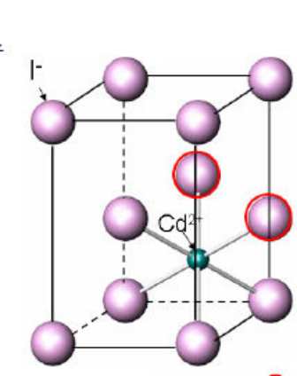

## Récapitulatif

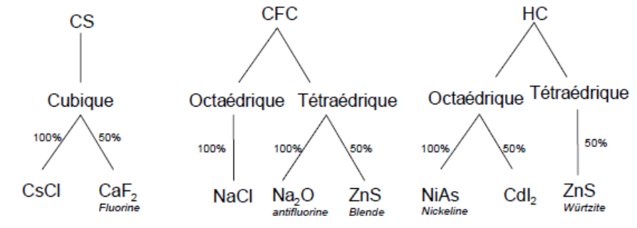
