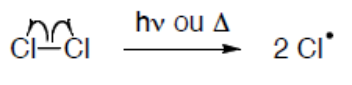
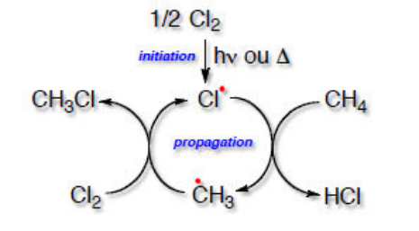

## Réactivité

Les alcanes sont faiblement réactifs. Ils sont appelés également "paraffines", du latin "parum affinis" qui signifie faible affinité. Les liaisons $C-H$ et $C-C$ sont fortes et apolaires. En pétrochimie, ils fournissent des alcènes par vapocraquage, des alcanes ramifiés par craquage catalytique et des composés aromatiques par reformage catalytique.

**Combustion :** cette réaction radicalaire est largement exploitée pour produire de l'énergie.

$$
C_nH_{2n+2} + \frac{3n+1}{2}\, O_2 \xrightarrow{\ \Delta\ } n\, CO_2 + (n+1)\, H_2O
$$

Cette réaction est très **exothermique**.

**Halogénation :** c'est une réaction de substitution radicalaire qui implique un dihalogène qui doit être irradié avec de la lumière UV ou chauffé.

**Cas de la chloration du méthane :**

$$
\overset{439}{CH_4} + \overset{242}{Cl_2} \xrightarrow{\ h\nu \text{ ou } \Delta > 250\,°C\ } \overset{328}{CH_3Cl} + \overset{431}{HCl}
$$

C'est une réaction radicalaire en chaîne (initiation, propagation, terminaison) :

**Initiation :** rupture d'une partie des liaisons les plus faibles dans les réactifs.

**Propagation :** réactions auto-entretenues.

**Terminaison :** couplage de deux radicaux.

$$
2\, Cl^\bullet \rightarrow Cl_2
\qquad
Cl^\bullet + {}^\bullet CH_3 \rightarrow CH_3Cl
\qquad
{}^\bullet CH_3 + {}^\bullet CH_3 \rightarrow C_2H_6
$$

Selon la proportion des réactifs, un remplacement progressif séquentiel des hydrogènes de l'alcane conduit à un mélange de composés halogénés.

On calcule la réactivité relative par le rapport :

$$
\frac{\text{Réactivité relative H secondaire}}{\text{Réactivité relative H primaire}}
$$

La bromation radicalaire est beaucoup plus sélective que la chloration. La chloration radicalaire est peu sélective. Le chlore peut être remplacé par d'autres sources moins toxiques et corrosives. La fluoration radicalaire est très exothermique et est difficile à contrôler.
