## Propriétés physiques et structurales

Les alcènes sont des hydrocarbures qui possèdent une double liaison $C=C$. Ils sont extrêmement rares dans la nature ; les gisements de gaz et de pétrole ne contenant pas ce type de composés, ils sont formés en quantité industrielle par vapocraquage au cours du raffinage du pétrole brut. En revanche, on trouve dans la nature des polyènes qui renferment plusieurs doubles liaisons, comme par exemple le myrcène dans le laurier. La réactivité des alcènes est caractérisée par des additions sur la liaison $\pi$, qui apporte la plus faible des contributions. Au cours de ces réactions, la liaison $\sigma$ $C-C$ n'est pas coupée.

## Réactivité

**Généralité :** la réaction d'addition est énergétiquement favorable (très souvent exothermique). Ces réactions sont stéréospécifiques : le mécanisme impose une stéréochimie relative précise dans le produit obtenu.

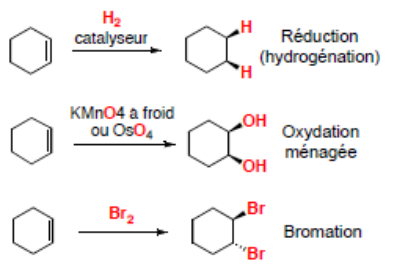

**Hydrohalogénation :** une addition électrophile (composée de deux étapes successives : une protonation suivie d'une addition nucléophile).

### Règle de Markovnikov

Le nucléophile se fixe sur le carbone le plus substitué.

La réaction est régiosélective : c'est une addition préférentielle du $H^+$ sur un des deux sites possibles. Les substituants électrodonneurs stabilisent l'intermédiaire carbocation (augmentation de la densité électronique), la réaction est plus rapide ($Ea_1$ diminue).

Il y a une stabilité décroissante de l'intermédiaire carbocation :

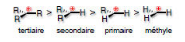

### Règle anti-Markovnikov (effet Kharasch)

Conditions radicalaires : inversion de la régiosélectivité de la réaction. En conditions radicalaires, le mécanisme comporte trois étapes : initiation, propagation et terminaison.

**Initiation :** rupture d'une partie des liaisons les plus faibles dans les réactifs.

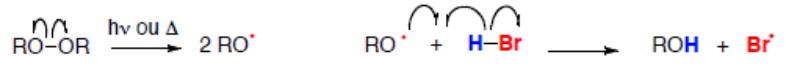

**Propagation :** la réaction est auto-entretenue.

**Terminaison :** couplage de deux radicaux.

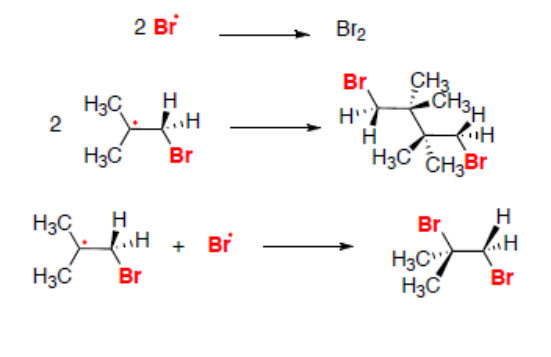

**Hydratation :** l'addition électrophile de $H_2O$ sur les alcènes, catalysée par les acides, conduit sélectivement à l'alcool le plus substitué. Cette réaction suit la règle de Markovnikov.

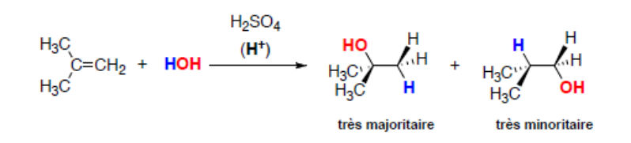

Cette hydratation suit le mécanisme suivant : une addition électrophile (composée de trois étapes successives : une protonation suivie d'une addition nucléophile et d'une déprotonation).

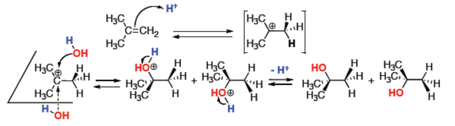

- Réaction régiosélective (addition de type Markovnikov) mais pas stéréosélective.
- Réaction réversible, l'alcool peut redonner l'alcène par élimination.
- Réarrangement du carbocation intermédiaire possible dans certains cas.

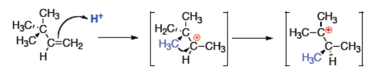

**Hydroboration suivie d'oxydation : une addition de $H-OH$ anti-Markovnikov.** La première réaction est une addition électrophile d'un organoborane $R_2BH$. $R_2BH$ est un acide de Lewis possédant une lacune électronique sur l'atome de bore. L'hydroboration est une réaction concertée qui se fait en une seule étape. Le bore se lie au carbone le moins substitué (moins de gêne stérique). Addition **syn** (du même côté du plan de l'alcène) de l'hydrogène et du bore.

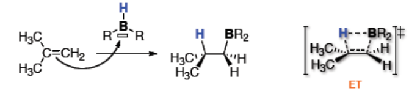

La seconde réaction est une oxydation de l'alkylborane formé précédemment par le peroxyde d'hydrogène ($H_2O_2$) en milieu basique pour donner l'alcool.

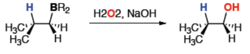

Le mécanisme de cette oxydation est le suivant.

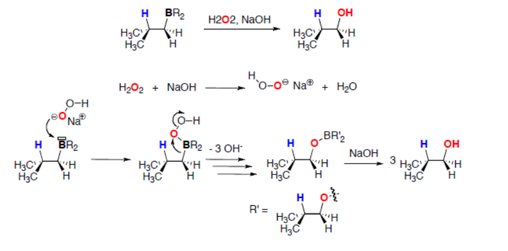

**Dihalogénation :** une addition **anti** (en dessous et au-dessus du plan de l'alcène). Elle provient d'une addition électrophile (composée de deux étapes successives : la formation d'un cation halonium ponté (bromonium ou chloronium) suivie d'une addition nucléophile en **anti**). Cette réaction est **stéréospécifique** : dihalogénures vicinaux **anti**. Cette addition **anti** est stéréospécifique. De plus, en présence d'autres nucléophiles que $X^-$, ces derniers peuvent s'additionner sur l'ion halonium.

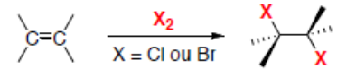

**Oxydations :**

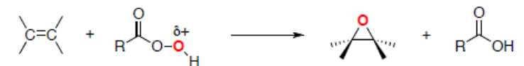

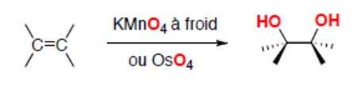

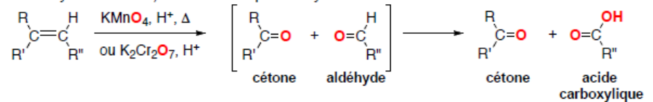

**Hydrogénation :** c'est une addition **syn** en une seule étape (réaction "concertée" et stéréospécifique).

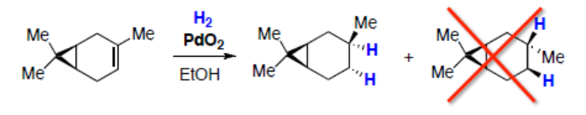

### Résumé

