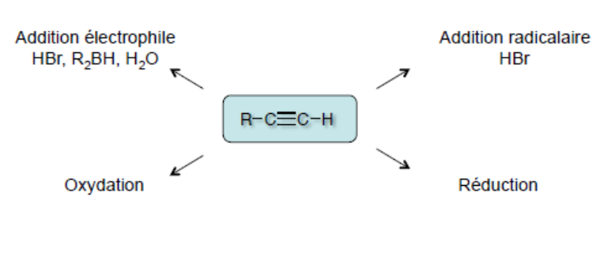
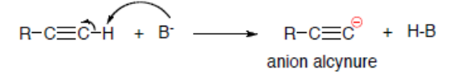

## Propriétés physiques et structurales

Les alcynes sont des hydrocarbures qui possèdent une triple liaison. Ils sont peu présents dans la nature.

- Hydrocarbures insaturés.
- Les alcynes terminaux sont également appelés alcynes vrais.
- Sous forme de gaz, liquide ou solide.
- Avec des hybridations $sp$.
- Une triple liaison mesure environ $1{,}203$ angström.

**Chaleur de combustion :** la combustion d'un alcyne permet de libérer une grande quantité d'énergie et donc de chaleur (chalumeau oxyacétylénique, $T > 2500\,°C$).

## Réactivité

**Des liaisons $\pi$ :**

**Des alcynes terminaux :** les alcynes vrais possèdent un proton acide ($pKa = 25$). Ils peuvent être déprotonés par des bases très fortes (amidures métalliques : $R_2N^-$, $M^+$, ou un réactif organométallique : $RLi$ ou $RMgX$).

