## Généralité : l'aromaticité, un siècle pour comprendre

**1825 :** Michael Faraday isole le benzène $C_6H_6$.

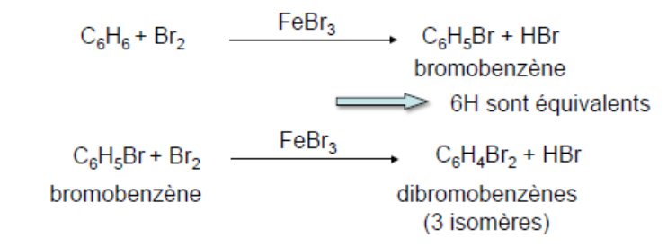

**1865 :** August Kekulé propose la première structure du benzène.

**1872 :** August Kekulé propose une nouvelle structure du benzène.

**1897 :** Thomson découvre l'électron.

**Années 1930 :** Linus Pauling développe le concept de l'hybridation des OA et de la résonance (le benzène est plan).

## Réactivité : substitution électrophile aromatique (SEA)

**Généralité, mécanisme :**

- Réaction très courante de la chimie des composés aromatiques.
- Le cycle aromatique se comporte comme un nucléophile qui attaque un électrophile.
- Mécanisme général : formation d'un complexe sigma suivie d'une élimination qui restaure l'aromaticité du cycle.

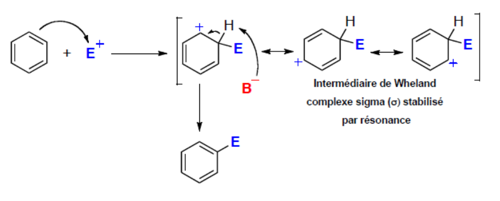

**Réactions d'halogénation du benzène :**

**Bromation :** pour avoir une SEA avec le brome, celui-ci doit être couplé avec un acide de Lewis.

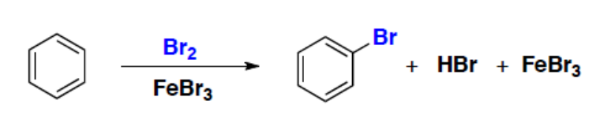

Dans un premier temps, le complexe $Br_2-FeBr_3$ se forme, il devient donc électrophile.

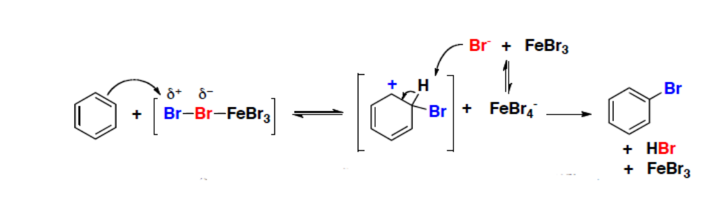

La formation du complexe sigma est endothermique, mais la réaction est dans son ensemble exothermique.

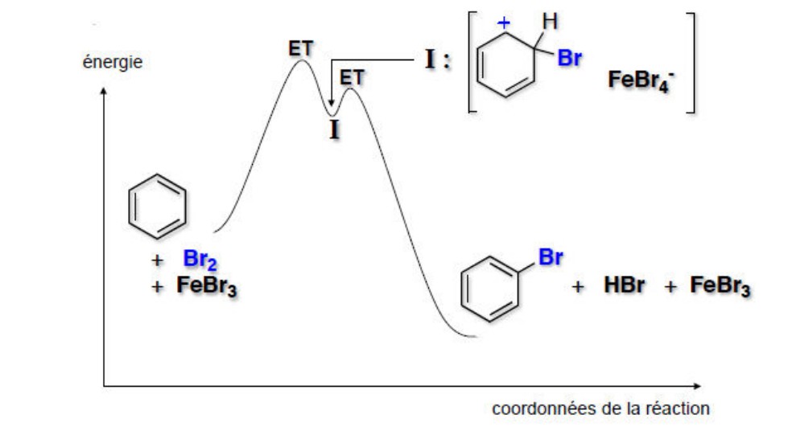

**Chloration :** cette réaction est similaire à la bromation, mais l'acide de Lewis $AlCl_3$ est utilisé comme catalyseur.

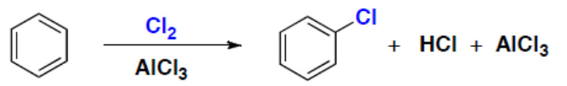

**Iodation :** dans cette réaction, le $HNO_3$ est un initiateur et non un catalyseur.

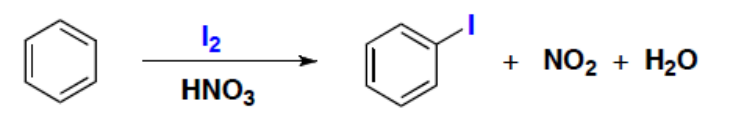

**Nitration du benzène :** si l'acide nitrique est utilisé seul, la nitration du benzène est une réaction lente ; l'ajout d'acide sulfurique augmente la vitesse de cette réaction.

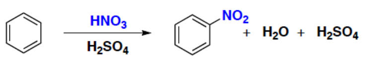

**Sulfonation du benzène :** dans la plupart des cas, l'électrophile est le trioxyde de soufre $SO_3$.

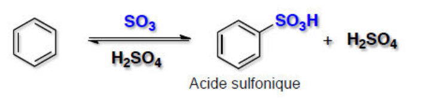

**Alkylation de Friedel et Crafts :** le réactif alkylant le plus souvent utilisé est le chlorure d'alkyle $RCl$ ou, plus généralement, un halogénure d'alkyle $RX$.

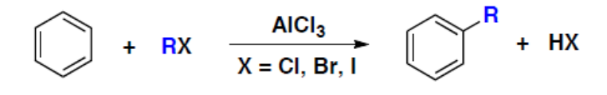

On a ensuite la formation de l'électrophile :

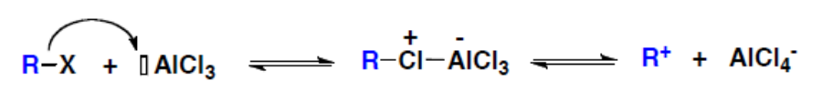

Il n'est pas certain que le carbocation soit formé dans tous les cas, car le complexe intermédiaire peut également jouer le rôle d'électrophile. Les nombreux réarrangements de Wagner-Meerwein accompagnant cette réaction plaident cependant en faveur d'un carbocation. Le réactif alkylant peut provenir de la protonation d'un alcool ou d'une double liaison. Le mécanisme est le suivant :

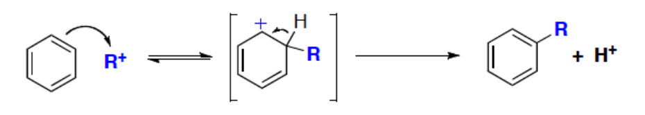

Dans la dernière étape, le proton est fixé par la base la plus forte du milieu, soit $AlCl_4^-$ lorsqu'on utilise $RCl + AlCl_3$. On a alors formation d'$HCl$ et régénération d'$AlCl_3$.

L'intérêt de cette réaction est le branchement d'une chaîne carbonée sur le noyau aromatique. Cette chaîne latérale peut éventuellement être convertie par oxydation en groupe $COOH$. De plus, les groupes alkyles sont donneurs et renforcent donc la nucléophilie du cycle aromatique. Les substitutions successives sont plus rapides que la première.

Cette réaction est cependant limitée :

- la réaction ne marche qu'avec le benzène, les halogénobenzènes et les cycles aromatiques activés ;
- les électrophiles sont des carbocations qui ont tendance à se réarranger ;
- des polysubstitutions sont généralement obtenues.

**Acylation de Friedel et Crafts :** l'acylation est la fixation d'un groupe acyle $R-C{=}O$ sur le cycle et peut s'effectuer le plus souvent à partir du chlorure d'acyle ou de l'anhydride d'acide en présence d'un catalyseur (acide de Lewis).

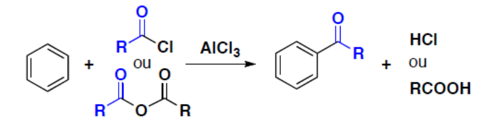

Un excès d'$AlCl_3$ est nécessaire du fait de la basicité de la cétone formée.

L'intérêt de cette réaction est que l'ion acylium ne se réarrange pas, contrairement au carbocation classique. Le groupe acyle est électroattracteur, il désactive le cycle et évite la polyacylation. Cette réaction permet de synthétiser indirectement des alkylbenzènes.

Cette réaction permet la réaction de formylation de Gattermann-Koch :

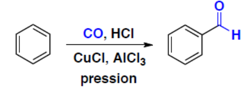

**Polysubstitution :** lorsque l'on introduit un second substituant sur un cycle déjà substitué, deux problèmes se posent :

1. La réaction est-elle favorisée ou défavorisée par la présence du substituant ?
2. Où se fixe le second substituant ?

**Cas de la nitration du toluène :** le toluène réagit 25 fois plus vite que le benzène, la réaction donne trois produits dont deux sont majoritaires.

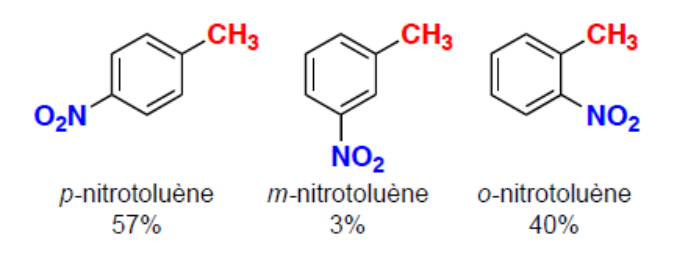

Le groupe méthyle est un groupe activant. Si la nitration était statistique, on aurait 20 % para, 40 % méta et 40 % ortho. Le groupe méthyle est donc ortho, para orienteur.

**Nature du contrôle :** généralement, les SEA ne sont pas réversibles, ce qui implique un contrôle d'ordre cinétique. Les proportions des différents régioisomères sont donc déterminées par les constantes de leurs vitesses de formation.

**Étape déterminante :** l'étape déterminante est la formation de l'intermédiaire de Wheland. D'après le postulat de Hammond, ces vitesses peuvent être comparées en comparant les stabilités des intermédiaires de Wheland.

**Conclusion :** l'orientation de la réaction sera donc déterminée par la stabilité relative des différents intermédiaires de Wheland. De même, l'effet du substituant sur la vitesse sera fonction de son influence sur la stabilité de l'intermédiaire.

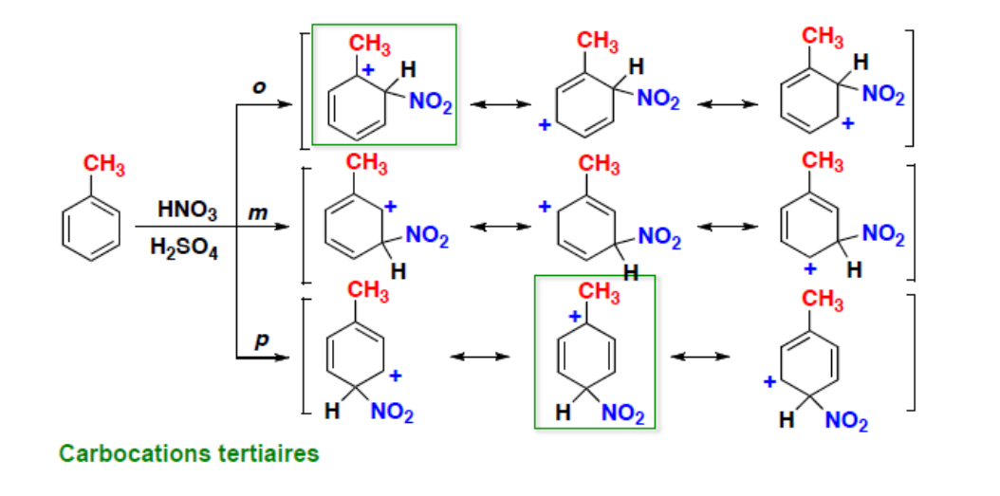

**Généralisation :** les substituants peuvent être classés en trois groupes : **activants** (ortho, para directeurs), **désactivants** (méta directeurs), **désactivants** (ortho, para directeurs).

**Groupes activants, ortho, para orienteurs :** ce sont les groupes alkyles, alkoxyles (méthoxyle). L'effet mésomère donneur du groupe méthoxyle apporte une stabilité supplémentaire au complexe de Wheland. L'anisole est si réactif que sa bromation ne nécessite pas de catalyseur. Ce sont donc les ortho, para orienteurs possédant un effet inductif donneur ou un effet mésomère donneur.

**Groupes désactivants, méta orienteurs :** ce sont les cétones, esters, nitriles, ammoniums ou acides sulfoniques. Ce sont donc les méta orienteurs ayant un effet inductif accepteur ou un effet mésomère accepteur.

**Cas des halogènes :** les halogènes diminuent la densité électronique du noyau aromatique par effet $-I$. La cinétique de réaction est donc diminuée. À cause de l'effet $+M$ des halogènes, la densité électronique du noyau aromatique est cependant plus importante au niveau des carbones ortho et para. L'orientation de la substitution se fait donc préférentiellement sur ces deux sommets.

**Plusieurs groupes activants et/ou désactivants :** lorsque le nombre de substituants est supérieur à un, la vitesse de réaction et la distribution des produits peuvent être prédites en combinant les effets de chaque groupe. La substitution entre deux substituants est défavorisée pour des raisons stériques.
