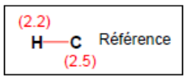
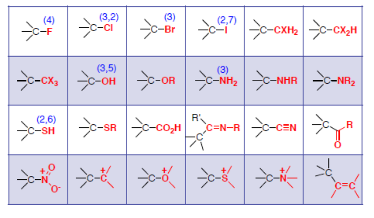
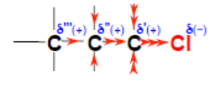
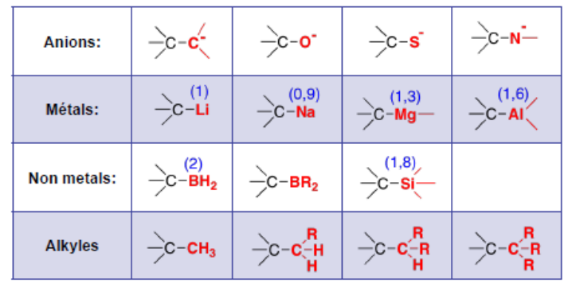
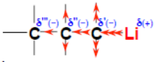
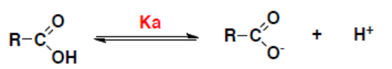
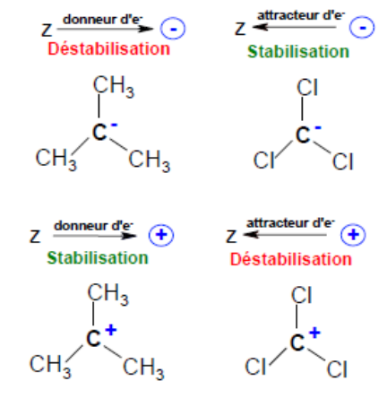
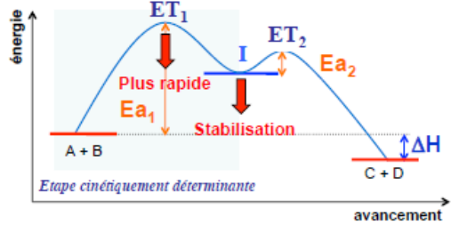

## Rappel : électronégativité

Apparition de charges partielles $\delta(+)$, $\delta(-)$ dues à la différence d'électronégativité des 2 atomes liés.

- Polarisation d'une liaison transmise à plusieurs liaisons voisines.
- La polarisation est induite par un atome ou groupe d'atomes (substituant) exerçant un effet inductif.

Effet inductif $-I$ (attracteur d'électrons).

Effet inductif $+I$ (donneur d'électrons).

## Effet inductif

**Effet inductif $-I$**

Effet électrostatique induit par un substituant (atome ou groupe d'atomes) plus électronégatif que le $C$ ($\chi = 2{,}5$) et qui se propage avec amortissement sur 3 à 5 liaisons.

L'effet inductif $-I$ est présent dans les atomes chargés positivement (déficit d'électrons) et dans les éléments à droite du tableau.

**Effet inductif $+I$**

Si le substituant est un donneur d'électrons, il développe une charge partielle positive et il exerce un effet inductif $+I$.

L'effet inductif $+I$ est présent dans les atomes chargés négativement (surplus d'électrons), les atomes situés à gauche du tableau ou les groupes alkyles[^1].

## Conséquences de l'effet inductif

**Acidité**

$$
Ka = \frac{[H^+][RCOO^-]}{[RCOOH]}
\qquad
pKa = -\log(Ka)
$$

Un effet $-I$ augmente l'acidité, un effet $+I$ diminue l'acidité.

| Acide | $pKa$ | Acide | $pKa$ |
| --- | --- | --- | --- |
| $CH_3COOH$ | $4{,}74$ | $ClCH_2COOH$ | $2{,}86$ |
| $Cl_2CHCOOH$ | $1{,}26$ | $Cl_3CCOOH$ | $0{,}64$ |

**Stabilisation d'une charge**

**Réaction multiétape ou complexe :**

$$
\overbrace{A + B}^{\text{Réactifs}} \rightleftharpoons \overbrace{[I]}^{\text{Intermédiaire}} \rightarrow \overbrace{C + D}^{\text{Produit}}
$$

[^1]: Plus il y a de ramifications, plus l'effet $+I$ est important.
