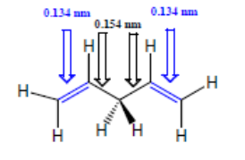
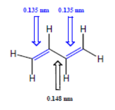
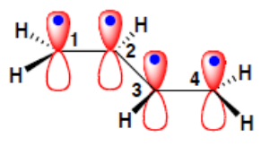
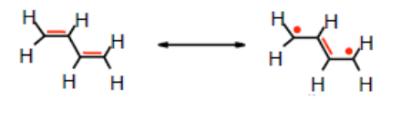
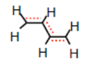
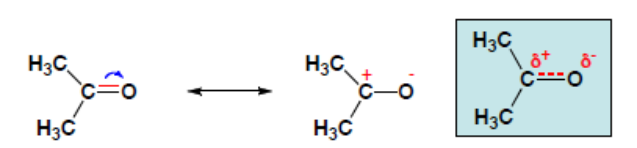
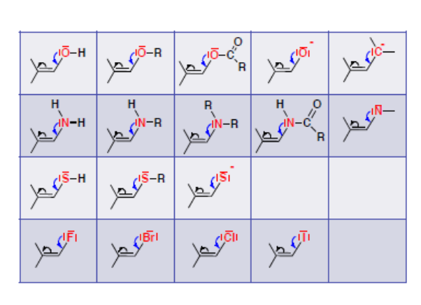
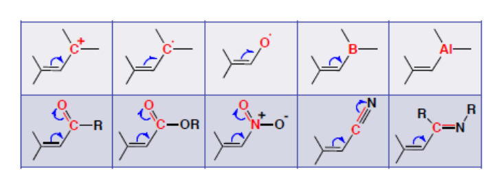
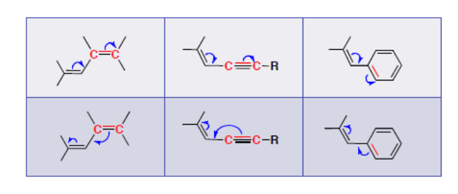

Il existe dans certains cas un effet stabilisant beaucoup plus fort que l'effet inductif : l'effet mésomère[^1].

## Répartition électronique dans les systèmes insaturés

Les liaisons doubles et simples ne sont pas alternées. Les $C=C$ sont indépendantes.

Les liaisons doubles et simples sont alternées. Les $C=C$ sont conjuguées.

Ainsi la représentation de Lewis est insuffisante à cause de la **mésomérie**.

Donc le diène est plus stable. Le squelette $\sigma$ est plan et rigide car les axes des orbitales $p_z$ sont parallèles.

## Méthode de la mésomérie

- On décrit un composé conjugué par une série de formules limites où l'on fait apparaître explicitement les électrons $\sigma$, $\pi$ et $n$.
- Chaque formule limite a un certain poids dans la description de la formule réelle, représentée par **l'hybride de résonance**.

La formule réelle décrite par **l'hybride de résonance** est plus stable que la formule limite.

## Aromaticité

En plus de l'énergie de stabilisation due à la conjugaison de trois doubles liaisons ($30\ \text{kJ/mol}$), le benzène bénéficie de la stabilisation due à l'aromaticité ($122\ \text{kJ/mol}$). L'énergie de conjugaison totale du benzène est donc $152\ \text{kJ/mol}$.

Pour qu'un système soit aromatique, il faut :

- qu'il soit cyclique, plan, avec une conjugaison cyclique ;
- que chaque atome du cycle soit un centre $\pi$ (plan, hybridé $sp^2$, avec une orbitale $p_z$ perpendiculaire) ;
- qu'il ait un nombre d'électrons $\pi$ ou $n$ conjugués répondant à la **règle de Hückel** :

$$
N = 4n + 2
$$

Pour une question de gain d'énergie, si le système peut devenir aromatique, il le deviendra.

## Formules limites

1. Le squelette $\sigma$ est conservé (il doit être plan pour que la conjugaison soit maximale).
2. On déplace les électrons $\pi$ et $n$ (à caractère $\pi$). Si leur nombre est pair : on les déplace par paires. Si leur nombre est impair (radicaux) : on les déplace un par un ($\rightharpoonup$, $\rightarrow$).
3. La **règle de l'octet** doit toujours être respectée pour les éléments de la 2e période et le plus souvent pour ceux de la 3e, lorsqu'ils sont liés au carbone.
4. On conserve l'appariement des électrons.
5. Le système est d'autant plus stabilisé que l'on peut écrire davantage de formules limites significatives de même énergie ou d'énergie proche.
6. La formule limite entièrement covalente (de Lewis) a plus de poids que les formules limites ioniques.
7. Parmi les formules limites ioniques, celle qui présente la plus faible séparation de charges contribue le plus.
8. Le poids d'une F.L. ionique est supérieur si les charges portées par les atomes sont en accord avec leur électronégativité.
9. L'énergie de conjugaison est la plus grande lorsque toutes les F.L. d'une molécule ou d'un ion sont équivalentes.
10. Les F.L. comportant plus de 2 charges formelles sont négligeables, et ce d'autant plus que les charges sont proches.

## Substituants à effet mésomère

**Définition :**

- Substituants à effet mésomère $+M \Rightarrow$ **donneurs** d'électrons $\pi$ ou $n$.
- Substituants à effet mésomère $-M \Rightarrow$ **accepteurs** d'électrons $\pi$ ou $n$.

Les propriétés physiques et chimiques des molécules réelles dépendent en fait de la résultante des 2 effets électroniques.

- Substituants à effets $I$ et $M$ de même signe $\Rightarrow$ ils s'ajoutent.
- Substituants à effets $-I$ et $+M$ en compétition : $+M > -I$ tout le temps, sauf dans le cas des halogènes.

## Propriétés acido-basiques

On considère très souvent en chimie organique l'acidité selon Brønsted. Un acide fort donnera une base conjuguée faible et inversement.

$$
AH \rightleftharpoons H^+ + A^-
$$

- Un $pKa$ élevé implique une base forte et un acide conjugué faible.
- Un $pKa$ faible implique une base faible et un acide fort.
- La force relative des acides et des bases peut être appréhendée par les effets inductifs et mésomères.
- Plus la charge négative est localisée, plus la base est forte, et inversement.
- Plus la vacance positive est localisée, plus l'acide est fort, et inversement.

## Réactifs électrophiles et nucléophiles

- Il y a un parallélisme entre pouvoir électrophile (nucléophile) et acidité (basicité).
- Un nucléophile est d'autant plus fort que sa charge est localisée.
- Les 4 facteurs qui contribuent à la force d'un nucléophile (électrophile) sont : la **charge**, l'**électronégativité**, les **interactions stériques** et la nature du solvant.
- Un nucléophile chargé est plus fort que son acide conjugué.
- Pour une même période de la classification, le pouvoir nucléophile varie comme la basicité.
- Le pouvoir nucléophile est sensible à l'effet stérique.

## Carbocations

Ils proviennent d'une rupture hétérolytique d'une liaison $C-X$ ou de la protonation d'une double liaison. Ils sont en général plans (hybridation $sp^2$).

## Carbanions

Ils proviennent de l'action d'une base sur un hydrogène acide d'une liaison $C-H$. Ils sont en général hybridés $sp^3$, mais ils peuvent s'hybrider $sp^2$ s'ils sont conjugués.

## Carboradicaux

Ils proviennent d'une dissociation homolytique de la liaison $C-X$ ou de l'addition d'un radical sur une double liaison. Les radicaux sont en général hybridés $sp^2$ (ou $sp^3$).

[^1]: Sauf dans le cas des halogènes.
