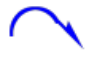
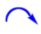
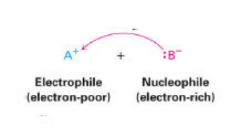
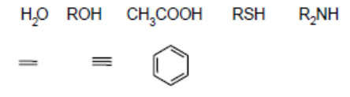
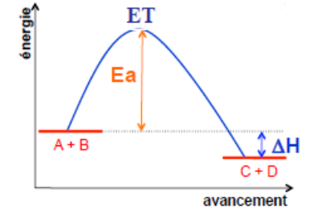
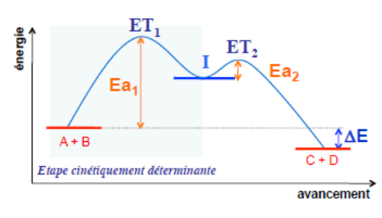
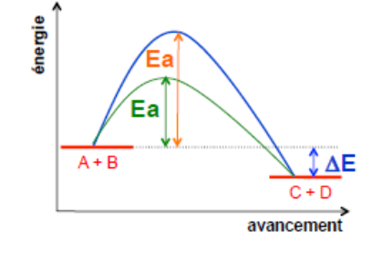
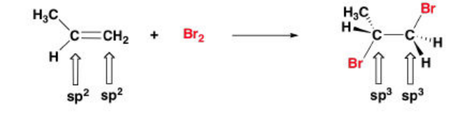
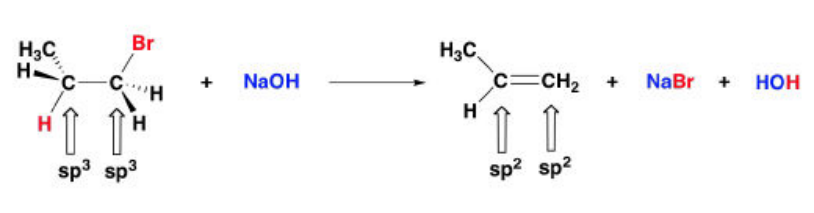
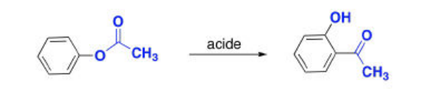

## Rappels et généralités

Dans toute réaction, on a une **conservation de la matière** et une **conservation de l'énergie**. Une réaction chimique résulte d'un "impact" entre deux entités chimiques ayant une énergie cinétique assez importante, c'est **l'énergie d'activation**.

Si l'énergie des produits est inférieure à celle des réactifs, alors la réaction est **exothermique**. Si c'est l'inverse, alors elle est **endothermique**. Si les deux sont égales, alors on parle de réaction **athermique**.

## Rupture et création de liaisons

La rupture d'une liaison covalente ($\sigma$) entre deux partenaires A-B peut se produire de deux façons :

- **Hétérolytique :** les deux électrons de la liaison sont réassignés à un seul partenaire. La réaction est **ionique** ou **polaire**.
- **Homolytique :** un électron reste avec chacun des partenaires, la réaction est dite **radicalaire**.

En général, la nature de la rupture dépend de la polarisation de la liaison $\sigma$.

Une flèche dite "hameçon" indique une rupture homolytique de liaison.

Une flèche dite "normale" indique une rupture hétérolytique de liaison.

**Polarisation de la liaison $\sigma$ et électronégativité :** si la différence d'électronégativité entre deux atomes formant une liaison est supérieure à $0{,}3$ et inférieure à $2{,}0$, la liaison covalente est dite **polarisée** et des charges partielles $\delta^+$ et $\delta^-$ sont créées en raison de la distribution non symétrique des électrons de la liaison.

- Si les électronégativités sont égales, la liaison covalente est dite **non polarisée**.
- Si la différence d'électronégativité est égale ou supérieure à 2, la liaison est dite **ionique**.

La nature de la rupture dépend également :

- de la nature des réactifs (acides-bases, nucléophiles...) ;
- des intermédiaires réactionnels (carbocations, radicaux libres...) ;
- du rôle du solvant (polaire, apolaire, protique, aprotique...).

**Réactions radicalaires :** ce type de réactions est moins fréquent que les réactions de type ionique.

Une **espèce radicalaire** réagit pour compléter à 8 électrons sa couche de valence.

- Une **espèce radicalaire** peut rompre une liaison d'une autre molécule pour s'associer à un nouveau partenaire, donnant un produit de substitution.
- Une **espèce radicalaire** peut s'additionner sur un alcène pour donner une nouvelle espèce radicalaire, causant une réaction d'addition.

**Réactions ioniques :**

- **Électrophile :** une espèce pauvre en électrons, se combine avec un **nucléophile**, une espèce riche en électrons.
- **Nucléophile :** une espèce chimique qui fournit les deux électrons qui vont former la nouvelle liaison.
- **Électrophile :** une espèce chimique qui accepte les deux électrons qui vont former la nouvelle liaison.

Un **électrophile** est un **acide de Lewis** alors qu'un **nucléophile** est une **base de Lewis**.

La flèche va toujours du $B^-$ vers le $A^+$.

## Réactifs électrophiles et nucléophiles

**Exemples de réactifs nucléophiles**

Anions : $F^-$, $Cl^-$, $Br^-$, $I^-$, $HO^-$, $RO^-$, $CH_3COO^-$, $RS^-$, $R_2N^-$, $CN^-$.

Molécules neutres :

**Exemples de réactifs électrophiles**

Cations : $H^+$, $NO_2^+$, $R_3C^+$, $R\overset{+}{C}{=}O$, $Cl^+$, $Br^+$, $I^+$.

Molécules neutres, acides de Lewis : $BF_3$, $AlCl_3$.

## Profils de réaction

**Réaction en une étape ou concertée :** la réaction s'accomplit en un seul acte, à la suite d'une collision qui déclenche à la fois la rupture et la formation des liaisons, et s'accompagne d'un **état de transition**. Ce processus est appelé **réaction élémentaire**.

$$
A + B \rightleftharpoons C + D + \text{énergie}
$$

Lorsque la transformation est dans l'état de transition, la liaison n'est pas encore rompue mais la nouvelle n'est pas complète, on la représente donc en pointillé.

On note l'état de transition entre crochets ; cet état n'a pas de durée de vie, il est représentatif.

$$
[A \dots B \dots C]^{\#}
$$

**Réaction multiétape ou complexe :** beaucoup de réactions s'effectuent en deux ou plusieurs étapes, par une succession d'actes élémentaires qui conduisent à la formation d'espèces intermédiaires. Ce sont alors des **réactions complexes** ou multiétapes.

$$
A + B \rightleftharpoons [I] \rightarrow C + D + \text{énergie}
$$

I est une espèce à courte durée de vie qui n'est généralement pas isolée. Elle sera très sensible à son environnement électronique (effets I et M).

**Réaction catalysée :** un catalyseur est un corps qui, par sa présence dans un système capable d'évoluer chimiquement, accélère la transformation sans participer à son bilan et en général sans être modifié lui-même. Le catalyseur ne change pas $\Delta E$ mais il **diminue l'énergie d'activation** et par conséquent le chemin réactionnel.

## Types de réactions

**Réaction de substitution :** dans les **réactions de substitution**, un atome ou groupe d'atomes est remplacé par un autre. Le degré de substitution du carbone reste inchangé.

$$
H_3C{-}CH_2{-}Br + OH^- \rightarrow H_3C{-}CH_2{-}OH + Br^-
$$

**Réaction d'addition :** les **réactions d'addition** impliquent un accroissement du nombre de substituants liés à l'atome de carbone. Le degré de substitution du carbone s'accroît.

**Réaction d'élimination :** les **réactions d'élimination** impliquent une diminution du nombre de substituants liés à l'atome de carbone. Le degré de substitution du carbone décroît.

**Réaction de transposition :** dans les réactions de transposition, il y a réarrangement du squelette carboné.

