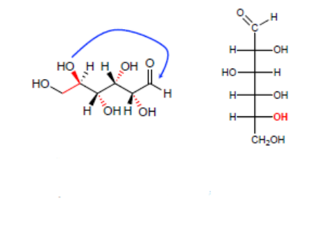
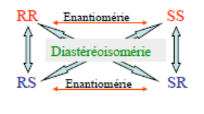
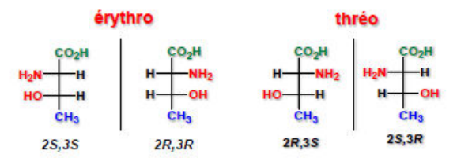
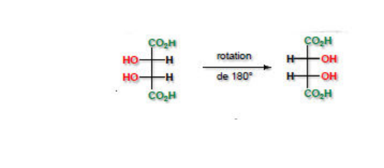
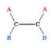
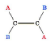

## Classification

## Énantiomérie

**Définition :** notion de chiralité : deux objets sont chiraux s'ils sont images l'un de l'autre dans un miroir et qu'ils ne sont pas superposables.

Une molécule est chirale si elle ne possède ni plan, ni centre de symétrie.

Cependant, la présence d'un carbone asymétrique[^1] rend obligatoirement la molécule chirale (réciproque fausse).

**Propriétés :** deux énantiomères ont exactement les mêmes propriétés, mis à part l'activité optique[^2]. Une déviation dans le sens des aiguilles d'une montre se nomme **dextrogyre** (d) ou (+). Dans le sens contraire des aiguilles d'une montre, elle se nomme **lévogyre** (l) ou (-)[^3].

Un mélange équimolaire de deux énantiomères n'a pas de propriétés optiques. C'est un **mélange racémique**[^4].

L'activité optique d'un composé ne peut être déterminée qu'expérimentalement. Elle **ne peut pas** être prédite à partir des configurations absolues des centres chiraux.

Si l'on augmente la concentration ou la longueur de la cuve, la déviation optique est modifiée.

$$
[\alpha]^{\text{Température}}_{\text{Raie D du sodium}} = \frac{\text{rotation optique } \alpha\ (°)}{\text{longueur de la cellule (dm) } l \cdot \text{concentration (g/mL) } C}
$$

**Projection de Fischer et nomenclature :** le ou les carbones asymétriques occupent le ou les points d'intersection de deux lignes formant une croix.

1. La chaîne carbonée la plus longue est dessinée verticalement.
2. L'atome de **carbone le plus oxydé** est placé en haut de la verticale.
3. Les groupes sur l'horizontale pointent vers l'avant.

Si le groupe $OH$ est à droite, la molécule est appelée **D**. S'il est à gauche, elle est appelée **L**.

Si la position du groupe est équatoriale alors on parle de $\beta$, s'il est axial on parle de $\alpha$.

## Diastéréoisomérie

S'il y a $n$ carbones asymétriques, alors il y a au maximum $2^n$ stéréoisomères possibles, soit $2^{n-1}$ couples d'énantiomères. Un énantiomère a $2^n - 2$ diastéréoisomères.

**Intrinsèque : configuration relative thréo/érythro**

On parle d'érythro lorsque les 2 substituants sont du même côté. Sinon on parle de thréo.

**Intrinsèque : configuration méso.** Une molécule qui possède plusieurs carbones asymétriques mais un plan de symétrie interne est achirale : c'est un composé méso. La projection de Fischer de l'acide tartrique méso, tournée de 180°, se superpose à elle-même.

**Isomérie Z/E.**

## Propriétés : homochiralité du vivant

En synthèse, les configurations absolues R et S apparaissent de manière équiprobable : on obtient généralement un mélange racémique, difficile à séparer.

On remarque que tous les acides aminés sont de série L alors que tous les sucres sont de série D. C'est ce que l'on appelle l'homochiralité du vivant.

[^1]: C'est un carbone avec 4 substituants différents.

[^2]: L'énantiomère aura une déviation égale mais dans le sens contraire.

[^3]: L'appareil qui mesure la déviation du plan de polarisation de la lumière (le pouvoir rotatoire) est le polarimètre.

[^4]: Un mélange non équimolaire des deux énantiomères est dit scalémique ; il présente une activité optique.
