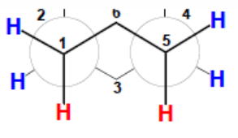
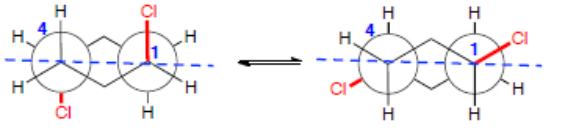

## Analyse conformationnelle d'une courbe de torsion : cas de l'éthane

Les atomes peuvent tourner autour de l'axe principal de la molécule, ce qui permet d'avoir différentes conformations (de différentes énergies). Elle s'exprime par la **tension de Pitzer**, due à la répulsion des nuages électroniques des liaisons. L'angle de rotation est l'angle **dièdre**. La **tension de Pitzer** est modélisée par un sinus : lorsqu'elle est maximale on dit que la conformation est **éclipsée**, lorsqu'elle est minimale on dit que la conformation est **décalée**.

## Courbe de torsion du butane

Sur les extrémités, la courbe de torsion est similaire à celle de l'éthane.

Sur la liaison centrale, présence d'une **interaction de van der Waals / stérique**.

- $0°$ : conformation **éclipsée**, on a la tension de Pitzer et les interactions de van der Waals.
- $60°$ : interactions de **type gauche**, on n'a plus de tension de Pitzer mais toujours les interactions de van der Waals.
- $180°$ : conformation **anti**, aucune interaction.

## Série cyclique

Une nouvelle tension d'angle apparaît, la tension **de Baeyer**, qui intervient dans les cycles lorsque l'on s'éloigne de $109{,}5°$. C'est l'énergie qu'il faut fournir pour déformer l'angle de liaison normal du carbone tétraédrique. Le plus stable est le cyclohexane (et non le cyclopentane, qui a pourtant des angles de $108°$).

Les molécules ne sont pas planes (sauf le cyclopropane).

- **Cyclopropane :** plan, les hydrogènes sont éclipsés, fortes interactions de Pitzer.
- **Cyclobutane :** coudé, hydrogènes décalés.
- **Cyclopentane :** coudé, hydrogènes décalés et éclipsés.
- **Cyclohexane :** plus de tension de Pitzer ni de Baeyer, conformation de la chaise (qui peut changer par une interconversion chaise-chaise).

Interconversion chaise-chaise : la branche du dessous remonte vers le haut, 5 atomes arrivent dans le même plan (premier pic) ; ensuite, pour abaisser les tensions de Baeyer et de Pitzer, il n'y a plus que 4 atomes dans le même plan (l'un s'abaisse un petit peu), on est en bateau croisé (premier creux) ; puis 4 atomes sont dans le même plan et les 2 autres le sont aussi (bateau, deuxième pic) ; enfin l'opération inverse se déroule et on repasse en conformation chaise.

Si l'on remplace les hydrogènes par des atomes plus volumineux, on induit des interactions de van der Waals, ce qui peut faire monter l'énergie nécessaire ; si elle dépasse $100\ \text{kJ/mol}$, l'interconversion chaise-chaise est impossible. Si l'on remplace un hydrogène par un méthyle, par exemple en position axiale, le méthyle provoque des interactions de van der Waals : ainsi le méthylcyclohexane est moins stable si le méthyle est axial que s'il est équatorial. **La conformation la plus stable est celle où les substituants sont équatoriaux.**

Lors d'une interconversion :

- toutes les liaisons axiales deviennent équatoriales ;
- toutes les liaisons équatoriales deviennent axiales ;
- les liaisons vers le haut restent vers le haut ;
- les liaisons vers le bas restent vers le bas.

Représentation du cyclohexane en Newman :

On parle d'isomère cis lorsque les deux groupes sont du même côté du plan moyen du cycle, et d'isomère trans lorsqu'ils sont de part et d'autre. La correspondance avec les positions axiales et équatoriales dépend de la place des substituants : pour un cyclohexane disubstitué en 1,2 ou en 1,4, l'isomère cis porte un groupe axial et un groupe équatorial, et l'isomère trans deux groupes équatoriaux ou deux groupes axiaux ; en 1,3, c'est l'inverse.
