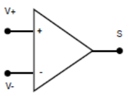
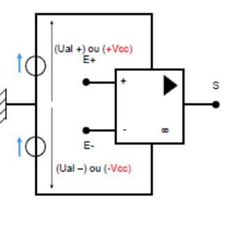
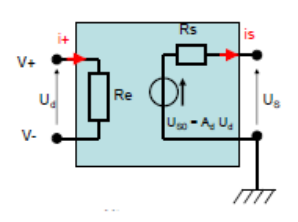
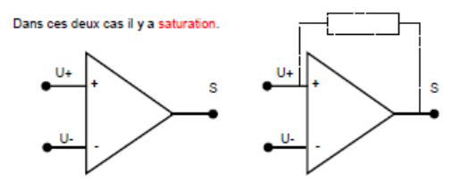
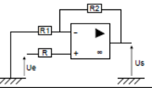
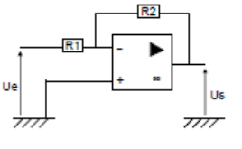
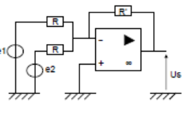

## L'AO en régime linéaire

### Introduction

Un amplificateur opérationnel est un amplificateur **différentiel** : il **amplifie une différence de tension**. Il permettait de modéliser les opérations mathématiques. On le trouve communément sous la forme de **circuit intégré**.

Il possède deux bornes d'entrée : une entrée non inverseuse et une entrée inverseuse.

Notion de potentiel de référence : on peut prendre sur un nœud $V_M = 0\ \text{V}$. On a donc $U_{NM} = V_N - V_M = V_N - 0 = V_N$, ainsi $U_N = V_N$.

### Alimentation

### Réel et idéal

La tension de sortie d'un amplificateur différentiel est donnée par (réel) :

$$
V_S = A_D(V^+ - V^-) + A_{MC}\left(\frac{V^+ + V^-}{2}\right)
$$

On admettra que la tension de sortie $V_S$ vaut (idéal) :

$$
V_S = A_D(V^+ - V^-) = A_D U_d
$$

Régimes de fonctionnement :

**Linéaire :** si $-\epsilon \leq U_d \leq +\epsilon \Rightarrow U_S = A_d U_d$.

**Saturé :** si $U_d < -\epsilon \Rightarrow U_S = cte = -U_{alim}$, ou si $U_d > \epsilon \Rightarrow U_S = cte = +U_{alim}$.

| Grandeur | AO réel | AO idéal |
| --- | --- | --- |
| Résistance $R_e$ | $0{,}1\ \text{M}\Omega$ à $1000\ \text{G}\Omega$ | $+\infty$ |
| Intensité | $< 1\ \text{nA}$ | $i^+ = i^- = 0$ |
| Résistance $R_s$ | 10 à 500 $\Omega$ | 0 |
| $U_d$ | . | $U^+ = U^-$ |
| Coefficient d'amplification $A_d$ | $10^5$ à $10^7$ | $\infty$ |
| Gain-bande passante | $> 100\ \text{MHz}$ | . |

### Les deux régimes de l'AO idéal

1. L'AOI est dit en **boucle ouverte** si la sortie S n'a pas de liaison avec les deux entrées $U^+$ et $U^-$. Il fonctionne en **saturation**.
2. L'AOI est dit en **boucle fermée avec réaction positive** si la sortie S est en liaison avec l'entrée $U^+$. Il fonctionne en **saturation**.
3. L'AOI est en **boucle fermée avec réaction négative** si la sortie S est en liaison avec l'entrée inverseuse $U^-$. Le montage peut fonctionner **en régime linéaire** tant que :

$$
-U_{sat} \leq U_S \leq U_{sat} \quad \text{avec} \quad U_S = A_D U_E
$$

### En régime linéaire

**L'amplificateur non inverseur.**

On cherche la relation $U_s = f(U_e)$. Méthode des nœuds : $V_S = V_S - 0 = V_S$. **AO idéal**, donc $i^- = i^+ = 0$ et $U^+ = U^-$.

$$
\frac{V_S}{R_2} = V_P\left(\frac{1}{R_1} + \frac{1}{R_2}\right) = V_P\left(\frac{R_2 + R_1}{R_1 R_2}\right)
\qquad
V_e - V_Q = R \cdot i^+ = 0
\Rightarrow V_Q = V_e = V_P
$$

$$
V_S = V_e\left(\frac{R_2}{R_1} + 1\right)
\qquad
A = \frac{U_S}{U_e} = 1 + \frac{R_2}{R_1}
$$

**L'amplificateur inverseur.**

Au nœud de la borne négative :

$$
\frac{V_e - V^-}{R_1} + \frac{V_S - V^-}{R_2} + i^- = 0
\Rightarrow
\frac{V_e}{R_1} + \frac{V_S}{R_2} = V^-\left(\frac{1}{R_1} + \frac{1}{R_2}\right)
$$

$$
A = \frac{U_S}{U_e} = -\frac{R_2}{R_1}
$$

**L'amplificateur sommateur.**

$$
\frac{V_1 - V^-}{R} + \frac{V_2 - V^-}{R} + i^- + \frac{V_S - V^-}{R'} = 0
$$

Avec $i^- = i^+ = 0$, $V^+ = V^-$ et $V^+ = 0$ :

$$
\frac{V_1}{R} + \frac{V_2}{R} = -\frac{V_S}{R'}
\Rightarrow
V_S = -\frac{R'}{R}(V_1 + V_2)
$$

soit $V_S = -\dfrac{R'}{R}(e_1 + e_2)$.
