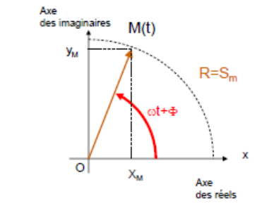
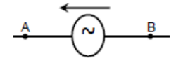
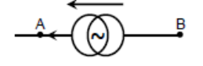

## Circuits électriques en régime transitoire

### Introduction générale

Lorsqu'une tension et un courant sont appliqués à un circuit, celui-ci traverse un état d'excitation. Les tensions et les courants induits constituent la réponse du circuit.

Sans excitation, le circuit est au repos.

Il existe deux types d'excitations : en régime continu ou en régime variable.

La réponse d'un circuit électrique comprend deux phases : le régime transitoire, limité, puis le régime permanent.

Une tension ou une intensité ne peut jamais présenter de discontinuité. La tension en échelon n'est qu'une approximation.

### Régime transitoire dans des circuits du premier ordre

**Résistance.** On se rappelle de l'utilisation des résistances au premier semestre.

**Condensateurs et dipôle RC.**

$$
q(t) = C \cdot u_{AB}(t)
\qquad
i(t) = C\frac{du_{AB}(t)}{dt}
$$

**Équivalence des condensateurs.**

- **Série :** $\dfrac{1}{C_{eq}} = \dfrac{1}{C_1} + \dfrac{1}{C_2}$
- **Dérivation :** $C_{eq} = C_1 + C_2$
- **Énergie stockée par le condensateur :** $\dfrac{1}{2}CU^2$
- **Énergie perdue par effet Joule dans la résistance :** $\dfrac{1}{2}CU^2$

**Décharge du condensateur.** $u(t) = Ri(t)$ et $i(t) = -\dfrac{dq}{dt}$.

**Bobines RL.**

$$
u = L\frac{di}{dt}
$$

**Aspect énergétique.** L'énergie stockée par la bobine vaut $\dfrac{1}{2}LI^2$.

**Conclusion : évolution temporelle.**

|  | $t = 0^+$ | $t \to +\infty$ |
| --- | --- | --- |
| Condensateur | Comportement similaire à un fil | Comportement d'un fil ouvert |
| Bobine | Comportement d'un fil ouvert | Comportement similaire à un fil |

### Régime transitoire dans des circuits du second ordre, le dipôle RLC

Analyse d'un circuit : $E - u_c - u_R - u_L = 0 \Rightarrow u_c + LC\dfrac{d^2u_c}{dt^2} + RC\dfrac{du_c}{dt} = 0$. On pose $LC\omega_0^2 = 1$, on résout et on a :

- $\Delta > 0$ : régime apériodique ;
- $\Delta = 0$ : régime critique ;
- $\Delta < 0$ : régime pseudo-périodique, oscillations amorties.

## Amplificateur opérationnel idéal

### Introduction

Un amplificateur opérationnel permet d'amplifier une différence de tension.

### Réel et idéal

$$
V_s = A_D(V^+ - V^-) = A_D u_D
$$

**Linéaire :** si $-\epsilon \leq U_d \leq +\epsilon \Rightarrow U_S = A_d U_d$.

**Saturé :** si $U_d < -\epsilon \Rightarrow U_S = cte = -U_{alim}$, ou si $U_d > \epsilon \Rightarrow U_s = cte = +U_{alim}$.

| Grandeur | AO réel | AO idéal |
| --- | --- | --- |
| Résistance $R_e$ | $0{,}1\ \text{M}\Omega$ à $1000\ \text{G}\Omega$ | $+\infty$ |
| Intensité | $< 1\ \text{nA}$ | $i^+ = i^- = 0$ |
| Résistance $R_s$ | 10 à 500 $\Omega$ | 0 |
| $U_d$ | . | $U^+ = U^-$ |
| Coefficient d'amplification $A_d$ | $10^5$ à $10^7$ | $\infty$ |
| Gain-bande passante | $> 100\ \text{MHz}$ | . |

### Les deux régimes de l'AO idéal

1. L'AOI est dit en **boucle ouverte** si la sortie S n'a pas de liaison avec les deux entrées $U^+$ et $U^-$. Il fonctionne en **saturation**.
2. L'AOI est dit en **boucle fermée avec réaction positive** si la sortie S est en liaison avec l'entrée $U^+$. Il fonctionne en **saturation**.
3. L'AOI est en **boucle fermée avec réaction négative** si la sortie S est en liaison avec l'entrée inverseuse $U^-$. Le montage peut fonctionner **en régime linéaire** tant que :

$$
-U_{sat} \leq U_S \leq U_{sat} \quad \text{avec} \quad U_S = A_D U_E
$$

Pour un AO idéal : $i^- = i^+ = 0$ et $U^+ = U^-$.

$$
\text{Coefficient d'amplification } A = \frac{U_{\text{sortie}}}{U_{\text{entrée}}}
$$

## Circuits électriques en régime sinusoïdal

### Définitions, généralités

**Force de Lorentz.**

$$
\vec{F} = q\vec{v} \wedge \vec{B}
$$

**Grandeurs périodiques $s(t)$.** Une grandeur est périodique si $s(t + T) = s(t)$ ; $T$ est la période.

- La fréquence vaut $f = \dfrac{1}{T}$.
- Si $s(t)$ est de signe constant, la grandeur est monodirectionnelle.
- Si $s(t)$ change de signe, la grandeur est bidirectionnelle.
- La valeur moyenne vaut $\langle s \rangle = \dfrac{1}{T}\displaystyle\int_0^T s(t)\,dt$.
- La valeur efficace vaut $s_{eff}^2 = \dfrac{1}{T}\displaystyle\int_0^T s^2(t)\,dt$.

**Grandeurs sinusoïdales.** Soit la grandeur sinusoïdale $s(t) = S_m\cos(\omega t + \phi)$.

- Sa valeur instantanée est $s(t)$.
- Sa valeur maximale, ou valeur crête, est $S_m$.
- Sa pulsation est $\omega$, la période est $T = \dfrac{2\pi}{\omega}$. La fréquence est $f = \dfrac{1}{T} = \dfrac{\omega}{2\pi}$.
- Sa phase (à l'origine) est $\phi$.
- La valeur moyenne d'une grandeur sinusoïdale est $\langle s \rangle = 0$.
- La valeur efficace est $S_{eff} = \dfrac{S_m}{\sqrt{2}} \Rightarrow s(t) = S_{eff}\sqrt{2}\cos(\omega t + \phi)$.

**Représentations pratiques des grandeurs sinusoïdales.** On utilise le vecteur de Fresnel tournant $\overrightarrow{OM}$, de module constant égal à $S_m$. Ainsi $x_{s(t)} = x_M$ et $y_{s(t)} = y_M = S_m\sin(\omega t + \phi)$.

**Déphasage de deux grandeurs sinusoïdales de même période.**

$$
\phi = 2\pi\frac{x'}{x}\ (\text{rad})
$$

**Représentation complexe d'une grandeur sinusoïdale.** La grandeur physique est la partie réelle de la grandeur complexe associée.

Conventions d'écriture adoptées pour la suite :

| Désignation | Notation |
| --- | --- |
| Écriture temporelle (ou valeur instantanée) | $s(t) = S_m\cos(\omega t + \phi) = S\sqrt{2}\cos(\omega t + \phi)$ |
| Valeur maximale | $S_m$ |
| Valeur efficace | $S$ |
| Vecteur de Fresnel associé | $\overrightarrow{OM} = S$ |
| Amplitude efficace complexe associée | $\underline{S} = Se^{j\phi}$ |
| Notation phaseur | $S\angle\phi$ |
| Amplitude efficace complexe conjuguée | $\underline{S}^* = Se^{-j\phi}$ |

**Circuits en régime permanent (ou forcé) sinusoïdal : conditions de validité de l'étude.**

$$
e(t) = E_m\cos(\omega t + \phi)
$$

### Dipôles en régime permanent sinusoïdal

**Impédance complexe.**

$$
\underline{Z} = \frac{\underline{U}}{\underline{I}} = Ze^{j\phi}
$$

$|\underline{Z}| = \dfrac{U}{I}$ et $\arg(\underline{Z}) = \phi$ ; $\underline{Z} = R + j \cdot \text{réactance}$.

**Admittance complexe.**

$$
\underline{Y} = \frac{1}{\underline{Z}}
$$

**Impédances élémentaires.**

| Dipôle | $Z$ | $U$ | $\phi$ |
| --- | --- | --- | --- |
| Résistance | $R$ | $R \cdot I$ | $0$ |
| Bobine | $L\omega$ | $L\frac{dI}{dt}$ | $\frac{\pi}{2}$ |
| Condensateur | $\frac{1}{C\omega}$ | $I = C\frac{dU}{dt}$ | $-\frac{\pi}{2}$ |

**Générateurs sinusoïdaux.**

$$
\text{g.t} \rightarrow \text{g.c} : \begin{cases} \underline{I_0} = \dfrac{\underline{E_t}}{\underline{Z_t}} \\ \underline{Z_0} = \underline{Z_t} \end{cases}
\qquad
\text{g.c} \rightarrow \text{g.t} : \begin{cases} \underline{E_t} = \underline{Z_0} \cdot \underline{I_0} \\ \underline{Z_t} = \underline{Z_0} \end{cases}
$$

### Association dipôle actif et dipôle passif

**Puissance instantanée.**

$$
P(t) = \frac{dW}{dt} = u(t) \cdot i(t)
$$

**Puissance moyenne.**

$$
P = U \cdot I\cos(\phi)
$$

**Puissance complexe.**

$$
\underline{P} = \underline{U} \cdot \underline{I}^* = U \cdot I e^{j\phi} = U \cdot I\cos(\phi) + j\,U \cdot I\sin(\phi) = P + jQ
$$

- $S = U \cdot I$ : puissance apparente ;
- $P = U \cdot I\cos(\phi)$ : puissance active ;
- $Q = U \cdot I\sin(\phi)$ : puissance réactive.
