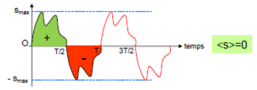
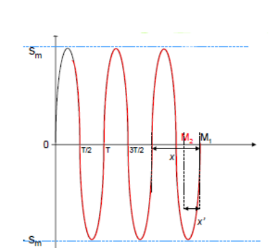
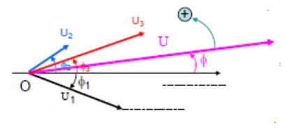
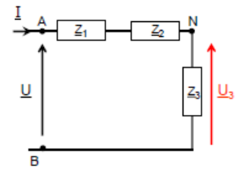
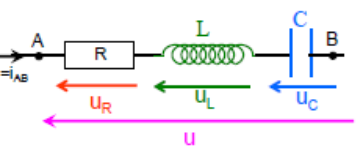
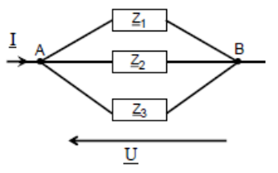

## Définitions, généralités

### Force de Lorentz

On définit la force de Lorentz par $\vec{F} = q\vec{v} \wedge \vec{B}$ (voir le cours d'électromagnétisme).

### Grandeurs périodiques s(t)

Une grandeur est dite périodique si elle prend les mêmes valeurs à intervalles de temps réguliers :

$$
s(t + T) = s(t)
$$

où $T$ est l'intervalle de temps appelé **période** (en secondes).

On définit la **fréquence** $f = \dfrac{1}{T}$, qui indique le nombre de cycles par unité de temps ($\text{Hz}$ ou $\text{s}^{-1}$).

La grandeur physique $s(t)$ est dite **monodirectionnelle** si $s(t)$ est de signe constant, et **bidirectionnelle** si elle change de signe.

La **valeur moyenne**, notée $\langle s \rangle$, d'une grandeur est définie par :

$$
\langle s \rangle = \frac{1}{T}\int_0^T s(t)\,dt
$$

La **valeur efficace**, notée $S_{eff}$, d'une grandeur périodique de période $T$ est définie par :

$$
S_{eff}^2 = \frac{1}{T}\int_0^T s^2(t)\,dt
$$

### Grandeurs sinusoïdales

Soit la grandeur sinusoïdale $s(t) = S_m\cos(\omega t + \phi)$.

- Sa valeur instantanée est $s(t)$.
- Sa valeur maximale, ou valeur crête, est $S_m$.
- Sa pulsation est $\omega$, la période est $T = \dfrac{2\pi}{\omega}$. La fréquence est $f = \dfrac{1}{T} = \dfrac{\omega}{2\pi}$.
- Sa phase (à l'origine) est $\phi$.
- La valeur moyenne d'une grandeur sinusoïdale est $\langle s \rangle = 0$.
- La valeur efficace est $S_{eff} = \dfrac{S_m}{\sqrt{2}} \Rightarrow s(t) = S_{eff}\sqrt{2}\cos(\omega t + \phi)$.

**Représentations pratiques des grandeurs sinusoïdales.** On définit le **vecteur de Fresnel tournant** par le vecteur $\overrightarrow{OM}$ de module constant égal à $S_m$, qui tourne autour de l'origine $O$ à la vitesse angulaire constante $\omega$ ($\text{rad.s}^{-1}$). Ainsi, à $t = 0$, le vecteur $\overrightarrow{OM}$ fait un angle $\phi$ avec l'axe $Ox$.

À l'instant $t$ : $x_M = \|\overrightarrow{OM}\|\cos(\omega t + \phi) = S_m\cos(\omega t + \phi)$, $\Rightarrow s(t) = x_M$ et $y_M = S_m\sin(\omega t + \phi)$.

**Déphasage de deux grandeurs sinusoïdales de même période.**

$$
s_1 = S_{1m}\cos(\omega t) = S_{1eff}\sqrt{2}\cos(\omega t) = S_1\sqrt{2}\cos(\omega t)
$$

$$
s_2 = S_{2m}\cos(\omega t + \phi) = S_{2eff}\sqrt{2}\cos(\omega t + \phi) = S_2\sqrt{2}\cos(\omega t + \phi)
$$

$$
\phi = 2\pi\frac{x'}{x}\ (\text{rad}) \quad \text{ou} \quad \phi = 360 \cdot \frac{x'}{x}
$$

**Représentation complexe d'une grandeur sinusoïdale.** Le vecteur de Fresnel $\overrightarrow{OM}$ précédent, représenté dans le plan complexe, est l'image du nombre complexe :

$$
\underline{s}(t) = S_m(\cos(\omega t + \phi) + j\sin(\omega t + \phi)) = S_m e^{j(\omega t + \phi)}
$$

- $s(t) = \mathcal{R}(\underline{s}(t))$ ;
- $S_m$ = module de $\underline{s}(t) = \|\underline{s}(t)\|$ ;
- phase $\omega t + \phi$ = argument de $\underline{s}(t)$.

$$
\underline{s}(t) = S_m(\cos(\omega t + \phi) + j\sin(\omega t + \phi)) = S_m e^{j(\omega t + \phi)} = S_m e^{j\phi}e^{j\omega t} = \sqrt{2}(S_{eff}e^{j\phi})e^{j\omega t}
$$

En pratique, on utilisera plutôt les amplitudes efficaces complexes associées : $\underline{S} = S_{eff}e^{j\phi} = Se^{j\phi}$.

**La grandeur physique est la partie réelle de la grandeur complexe associée.**

Conventions d'écriture adoptées pour la suite :

| Désignation | Notation |
| --- | --- |
| Écriture temporelle (ou valeur instantanée) | $s(t) = S_m\cos(\omega t + \phi) = S\sqrt{2}\cos(\omega t + \phi)$ |
| Valeur maximale | $S_m$ |
| Valeur efficace | $S$ |
| Vecteur de Fresnel associé | $\overrightarrow{OM} = S$ |
| Amplitude efficace complexe associée | $\underline{S} = Se^{j\phi}$ |
| Notation phaseur | $S\angle\phi$ |
| Amplitude efficace complexe conjuguée | $\underline{S}^* = Se^{-j\phi}$ |

### Circuits en régime permanent (ou forcé) sinusoïdal

**Conditions de validité de l'étude.** Les phénomènes d'induction électromagnétique conduisent à la création de différences de potentiel sinusoïdales du type :

$$
e(t) = E_m\cos(\omega t + \phi)
$$

**Additivité des différences de potentiel.** Si on a $u(t) = u_1(t) + u_2(t) + u_3(t)$, par Fresnel on a $\vec{U} = \vec{U_1} + \vec{U_2} + \vec{U_3}$, soit $Ue^{j\phi} = U_1e^{j\phi_1} + U_2e^{j\phi_2} + U_3e^{j\phi_3}$.

## Dipôles en régime permanent sinusoïdal

### Loi d'Ohm, impédance, admittance

Le dipôle est soumis à la différence de potentiel $u(t) = U\sqrt{2}\cos(\omega t) \Rightarrow \underline{U} = Ue^{j \cdot 0} = U$.

Il est alors parcouru par un courant $i$ en retard de $\phi$ sur $u$ : $i(t) = I\sqrt{2}\cos(\omega t - \phi) \Rightarrow \underline{I} = Ie^{-j\phi}$.

**L'impédance complexe.**

$$
\underline{Z} = \frac{\underline{U}}{\underline{I}} = \frac{U}{Ie^{-j\phi}} = \frac{U}{I}e^{j\phi} = Ze^{j\phi}
$$

Module : $|\underline{Z}| = \left|\dfrac{\underline{U}}{\underline{I}}\right| = \dfrac{U}{I} = Z\ (\Omega)$ et $\arg(\underline{Z}) = \arg(\underline{U}) - \arg(\underline{I}) = \phi$.

$\underline{Z} = Ze^{j\phi}$ = **résistance** + $j$ · **réactance**.

**L'admittance complexe.**

$$
\underline{Y} = \frac{1}{\underline{Z}} = Ye^{-j\phi}
$$

Module : $|\underline{Y}| = \left|\dfrac{\underline{I}}{\underline{U}}\right| = Y\ (\text{S})$ et $\arg(\underline{Y}) = \arg(\underline{I}) - \arg(\underline{U}) = -\phi$.

$\underline{Y} = Ye^{-j\phi}$ = **conductance** + $j$ · **susceptance**.

### Impédances élémentaires

**Résistance linéaire $R$.** La résistance $R$ est parcourue par un courant alternatif d'expression $i(t) = I\sqrt{2}\cos(\omega t) \Rightarrow u_R(t) = Ri(t) \Rightarrow u(t) = RI\sqrt{2}\cos(\omega t) = U_R\sqrt{2}\cos(\omega t) \Rightarrow u(t)$ et $i(t)$ sont en phase.

$$
\underline{Z_R} = \frac{\underline{U_R}}{\underline{I}} = \frac{U_R}{I} \Leftrightarrow \underline{Z} = Ze^{j\phi} \Rightarrow \phi = 0 \Leftrightarrow Z = R
$$

**Bobine idéale ($r = 0$) $L$.** La bobine $L$ est parcourue par un courant alternatif d'expression $i(t) = I\sqrt{2}\cos(\omega t)$. Par définition :

$$
u_L(t) = L\frac{di(t)}{dt}
$$

$\Rightarrow u(t) = -L\omega I\sqrt{2}\sin(\omega t) = U_L\sqrt{2}\cos\left(\omega t + \dfrac{\pi}{2}\right)$ avec $U_L = L\omega I$ $\Rightarrow u(t)$ est en **quadrature avance** sur $i(t)$.

$$
\underline{Z_L} = \frac{\underline{U_L}}{\underline{I}} = \frac{U_L e^{j\frac{\pi}{2}}}{Ie^{j0}} = L\omega e^{j\frac{\pi}{2}}
$$

Module $|\underline{Z_L}| = L\omega$ et $\arg(\underline{Z_L}) = \phi = +\dfrac{\pi}{2}$.

**Condensateur idéal $C$.** Le condensateur $C$ est parcouru par un courant alternatif d'expression $i(t) = I\sqrt{2}\cos(\omega t)$ ; par définition $i(t) = C\dfrac{du_c}{dt}$.

$\Rightarrow u(t) = \dfrac{1}{C}\displaystyle\int i(t)\,dt = \dfrac{1}{C}\int I\sqrt{2}\cos(\omega t)\,dt = \dfrac{I\sqrt{2}}{C\omega}\sin(\omega t)$ $\Rightarrow u(t)$ est en **quadrature retard** sur $i(t)$.

$$
\underline{Z_C} = \frac{1}{C\omega}e^{-j\frac{\pi}{2}} = -\frac{j}{C\omega}
$$

Module $|\underline{Z_C}| = \dfrac{1}{C\omega}$ et $\arg(\underline{Z_C}) = \phi = -\dfrac{\pi}{2}$.

**Association d'impédances en série.**

**Impédance complexe équivalente.** Si $u(t) = u_1(t) + u_2(t) + u_3(t) \Rightarrow \underline{Z_e} = \underline{Z_1} + \underline{Z_2} + \underline{Z_3}$.

**Diviseur de tension, utilisation des « phaseurs ».**

$$
\underline{U_3} = \underline{Z_3}\,\underline{I} = \underline{U}\left(\frac{\underline{Z_3}}{\underline{Z_1} + \underline{Z_2} + \underline{Z_3}}\right)
$$

**Circuit résonant série (R, L, C).**

$$
\underline{Z_e} = \underline{Z_R} + \underline{Z_L} + \underline{Z_C} = R + j\left(L\omega - \frac{1}{C\omega}\right)
$$

De module $|\underline{Z_e}| = \sqrt{R^2 + \left(L\omega - \dfrac{1}{C\omega}\right)^2}$ et d'argument $\arg(\underline{Z_e}) = \phi = \arctan\left(\dfrac{L\omega - \dfrac{1}{C\omega}}{R}\right)$.

$Z_e$ est minimum : $Z_e = R$ et $I$ est maximum. Ainsi $\underline{U}$ et $\underline{I}$ sont en phase, et $LC\omega^2 = 1$.

Il y a surtension aux bornes de $L$ et de $C$ :

$$
Q = \frac{U_L}{U} = \frac{U_C}{U} \Rightarrow Q = \frac{L\omega}{R} = \frac{1}{RC\omega}
$$

**Association d'impédances en parallèle.**

$$
\underline{I} = \frac{\underline{U}}{\underline{Z_e}} \Rightarrow \underline{Y_e} = \underline{Y_1} + \underline{Y_2} + \underline{Y_3}
$$

**Diviseur de courant.**

$$
\underline{I_3} = \underline{Y_3}\,\underline{U} = \underline{I}\left(\frac{\underline{Y_3}}{\underline{Y_1} + \underline{Y_2} + \underline{Y_3}}\right)
$$

**Circuit résonant parallèle (RLC).**

$$
\underline{Y_e} = \frac{1}{R} + j\left(C\omega - \frac{1}{L\omega}\right)
$$

Module $|\underline{Y_e}| = \sqrt{\left(\dfrac{1}{R}\right)^2 + \left(C\omega - \dfrac{1}{L\omega}\right)^2}$ et $\arg(\underline{Y_e}) = \phi = \arctan\left(R\left(C\omega - \dfrac{1}{L\omega}\right)\right)$.

### Générateurs sinusoïdaux

**Générateurs.**

**Dualité générateur de tension et générateur de courant.**

$$
\text{g.t} \rightarrow \text{g.c} : \begin{cases} \underline{I_0} = \dfrac{\underline{E_t}}{\underline{Z_t}} \\ \underline{Z_0} = \underline{Z_t} \end{cases}
\qquad
\text{g.c} \rightarrow \text{g.t} : \begin{cases} \underline{E_t} = \underline{Z_0} \cdot \underline{I_0} \\ \underline{Z_t} = \underline{Z_0} \end{cases}
$$

### Association dipôle actif et dipôle passif

**Puissance instantanée.** On prend $u(t) = U\sqrt{2}\cos(\omega t)$ et $i(t) = I\sqrt{2}\cos(\omega t - \phi)$.

$$
P(t) = \frac{dW}{dt} = u(t) \cdot i(t)
$$

Finalement $P(t) = U \cdot I\cos(\phi) + U \cdot I\cos(2\omega t - \phi)$, avec $U \cdot I\cos(\phi)$ la puissance active et $U \cdot I\cos(2\omega t - \phi)$ la puissance **fluctuante**.

**Puissance moyenne.**

$$
P = U \cdot I\cos(\phi)
$$

$\cos(\phi)$ est le facteur de puissance : s'il est positif, le **dipôle est passif**, sinon le **dipôle est actif**. La puissance active est $P$ (en watts) et la puissance apparente est $U \cdot I$.

**Puissance complexe.**

$$
\underline{P} = \underline{U} \cdot \underline{I}^* = U \cdot I e^{j\phi} = U \cdot I\cos(\phi) + j\,U \cdot I\sin(\phi) = P + jQ
$$

- $S = U \cdot I$ : puissance **apparente** ;
- $P = U \cdot I\cos(\phi)$ : puissance **active** ;
- $Q = U \cdot I\sin(\phi)$ : puissance **réactive**.

## Analyse de circuits en régime sinusoïdal

Toutes les méthodes d'analyse vues dans le cas des circuits en courant continu sont transposables avec les **notations complexes**.

### Méthode des mailles

On exprime les différentes tensions en fonction des impédances complexes et on applique la loi des mailles classique.

### Méthode des nœuds

Idem.

### Thévenin

On se rappelle que $E_{TH} = V_{AB}$ (à déterminer avec n'importe quelle méthode). On trouve l'impédance équivalente.

### Norton

On calcule $\underline{I_N}$ en mettant un fil entre A et B. On trouve l'impédance équivalente.
