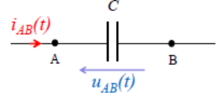
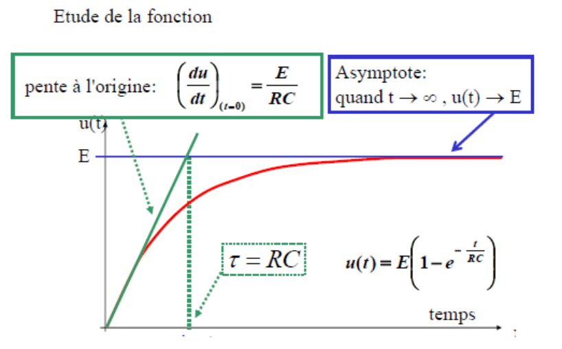
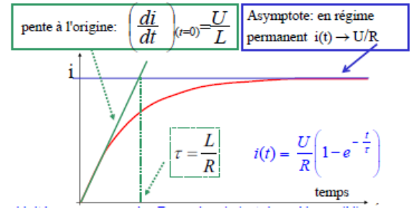
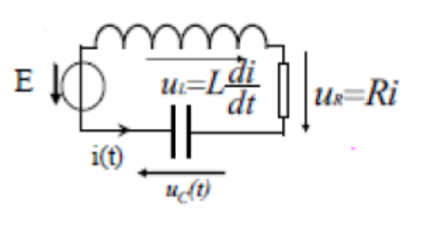

## Introduction générale

On considère un circuit auquel on applique des sources de tension et de courant à un instant $t = 0\ \text{s}$. Ces sources constituent **l'excitation**. Sans excitation, le circuit est au **repos**.

Il existe deux types d'excitations :

- en **régime continu**, si l'excitation est **indépendante du temps** ;
- en **régime variable**, si l'excitation dépend du temps ou varie au cours du temps.

La réponse d'un circuit électrique, suite à l'application d'une excitation, comprend généralement un **régime transitoire** et un **régime permanent**.

On définit $0^-$ le temps juste **avant** la fermeture de l'interrupteur, et $0^+$ le temps juste **après** la fermeture de l'interrupteur.

Par convention, les grandeurs électriques qui ne varient pas au cours du temps sont notées en **majuscules (E, U, I)** et celles qui varient en **minuscules (e, u, i)**.

Le modèle de la fonction « échelon » ne décrit pas correctement la fermeture d'un interrupteur : la tension ou le courant ne peut jamais présenter de discontinuité.

## Régime transitoire dans des circuits du premier ordre

### Résistance

La loi d'Ohm $U = R \cdot I$ est conservée, celles des mailles et des nœuds aussi.

### Condensateurs, circuit RC

Un condensateur est l'ensemble formé par deux électrodes métalliques planes séparées par un milieu isolant. On a $Q^+ = -Q^- = C \cdot U_{AB} = C \cdot E$ ; au cours du temps, on obtient $i = \dfrac{dq}{dt} = C\dfrac{du_{AB}(t)}{dt}$.

On détermine $C$ en **farads** avec $C = \dfrac{\epsilon_0 S}{d}$.

En résumé, les électrons sont chargés négativement ; une électrode est chargée positivement (donc en manque d'électrons), alors que l'autre électrode est chargée négativement (donc en excès d'électrons). Les charges électriques sont localisées **à la surface** des conducteurs.

L'orientation du courant est la même que celle du déplacement des charges **positives**.

Les deux bornes d'un condensateur sont séparées par un isolant (diélectrique).

**Équivalence des condensateurs.**

- **Série :** $\dfrac{1}{C_{eq}} = \dfrac{1}{C_1} + \dfrac{1}{C_2}$
- **Dérivation :** $C_{eq} = C_1 + C_2$

À l'instant $t = 0$, le condensateur est déchargé : $u(0) = 0$ et $q(0) = 0$. Pour analyser le circuit, on a $u(t) = \dfrac{q(t)}{C}$ et $i(t) = \dfrac{dq}{dt}$.

Mise en équation : $E = R \cdot i(t) + u(t) \Rightarrow E = R \cdot i(t) + \dfrac{q(t)}{C}$, ainsi

$$
R\frac{di}{dt} + \frac{i}{C} = 0
$$

On sait que $i = C\dfrac{du}{dt} \Rightarrow E = RC\dfrac{du}{dt} + u \Rightarrow \dfrac{du}{dt} + \dfrac{u}{RC} = \dfrac{E}{RC}$. Ainsi

$$
u = -Ee^{-\frac{t}{RC}} + E
$$

On définit $\tau = RC$ (en secondes) comme le **temps de relaxation** du circuit.

On a $u(t) = E\left(1 - e^{-\frac{t}{RC}}\right) \Rightarrow u'(t) = \dfrac{E}{RC}e^{-\frac{t}{RC}}$.

Équation de la tangente à l'origine : $u'(0)(t - 0) + u(0) = \dfrac{E}{RC}t \Rightarrow$ pour $t = \tau$ : $y = E = \dfrac{E}{RC}\tau$, d'où

$$
\tau = RC
$$

**Comment évolue l'énergie au cours d'un régime transitoire de charge de condensateur ?**

$$
p(t) = u(t) \cdot i(t)
$$

$$
dW = u(t) \cdot i(t)\,dt
$$

- **Énergie fournie par le générateur :** $\displaystyle\int -Ei(t)\,dt = \int_0^Q -E\frac{dq}{dt}\,dt = -E\int_0^Q dq = -CE^2$
- **Énergie stockée par le condensateur :** $\displaystyle\int u \cdot i\,dt = \int_0^Q u\frac{dq}{dt}\,dt = \int_0^Q u\,dq = \int_0^E u\,C\,du = \frac{1}{2}CE^2$
- **Énergie perdue par effet Joule dans la résistance :** $\dfrac{1}{2}CU^2$

**Décharge du condensateur.** Mise en équation :

$$
u(t) = Ri(t)
\qquad
i(t) = -\frac{dq}{dt}
$$

$$
u(t) = -R\frac{dq}{dt} = -RC\frac{du}{dt}
\qquad
\frac{du}{dt} = -\frac{u}{RC}
$$

On trouve une solution de la forme $u(t) = u_0 e^{-\frac{t}{RC}}$.

### Bobines, circuit RL

Une bobine est constituée par l'enroulement d'une grande longueur de fil conducteur. Un noyau de matériau magnétique est parfois placé à l'intérieur.

Considérons une bobine d'inductance $L$ orientée en convention récepteur. Une bobine réelle présente toujours une résistance interne $r$.

En régime continu, $i = cte$ et $L\dfrac{di}{dt} = 0$.

On définit le flux du champ magnétique $\vec{B}$ à travers la surface $S$ : $\Phi = \vec{B} \cdot S\vec{n}$ et $\dfrac{d\Phi}{dt} = u_{AB}$. Dans le cas d'une bobine, $\Phi = L \cdot I$, avec $\Phi$ en webers.

$$
u = L\frac{di}{dt} \qquad \text{(relation intensité-tension)}
$$

**Évolution temporelle.** $U = R \cdot i + L\dfrac{di}{dt}$, où $R$ est la résistance totale du circuit ; ainsi on a $i(t) = \dfrac{U}{R}\left(1 - e^{-\frac{Rt}{L}}\right)$.

|  | $t = 0^+$ | $t \to +\infty$ |
| --- | --- | --- |
| Condensateur | Comportement similaire à un fil | Comportement d'un fil ouvert |
| Bobine | Comportement d'un fil ouvert | Comportement similaire à un fil |

L'énergie stockée dans l'inductance est $\dfrac{1}{2}LI^2$.

## Régime transitoire dans des circuits du second ordre, le dipôle RLC

Analyse d'un circuit : $E - u_c - u_R - u_L = 0$, donc

$$
u_c + LC\frac{d^2u_c}{dt^2} + RC\frac{du_c}{dt} = 0
$$

On pose $LC\omega_0^2 = 1$ :

$$
\frac{1}{\omega_0^2}\frac{d^2u_c}{dt^2} + RC\frac{du_c}{dt} + u_c = 0
\Rightarrow
\frac{d^2u_c}{dt^2} + RC\omega_0^2\frac{du_c}{dt} + \omega_0^2 u_c = 0
$$

On pose $RC\omega_0^2 = 2\lambda$, d'où la forme « canonique » :

$$
\frac{d^2u_c}{dt^2} + 2\lambda\frac{du_c}{dt} + \omega_0^2 u_c = 0
$$

On résout cette équation et on a :

- $\Delta > 0$ : régime apériodique ;
- $\Delta = 0$ : régime critique ;
- $\Delta < 0$ : régime pseudo-périodique, oscillations amorties.
