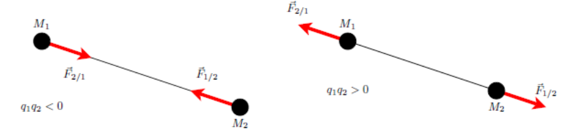
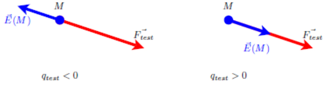
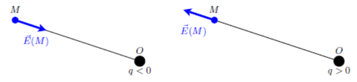
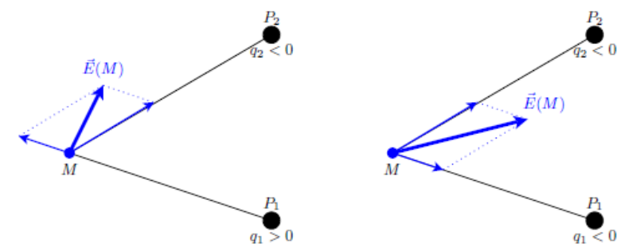
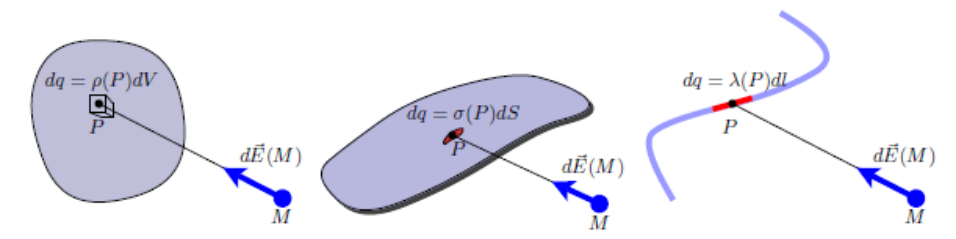

## Force de Coulomb

En 1785, Charles Augustin de Coulomb a déterminé quantitativement l'expression de la force d'interaction entre deux corps chargés.

Considérons deux particules supposées ponctuelles :

- $M_1$ de charge $q_1$ ;
- $M_2$ de charge $q_2$.

La force d'interaction électrostatique vérifie le principe des actions mutuelles : l'action et la réaction sont opposées et portées par la droite joignant les deux points.

Des charges de signes opposés s'attirent, des charges de même signe se repoussent. La force est de plus proportionnelle à chaque charge et varie comme l'inverse du carré de la distance entre les charges.

$$
\vec{F}_{1/2} = -\vec{F}_{2/1} = \frac{q_1 q_2}{4\pi\epsilon_0} \frac{\vec{u}_{M_1 M_2}}{M_1 M_2^{\,2}}
$$

$\vec{u}_{M_1 M_2}$ est un vecteur unitaire orienté de la cause vers l'effet (de la charge créant la force vers celle la subissant).

La permittivité électrique du vide est notée $\epsilon_0 = 8{,}854 \times 10^{-12}\ \text{F.m}^{-1} = \dfrac{1}{\mu_0 c^2}$.

## Champ électrique

En un point $M$ de l'espace, plaçons une charge « test » notée $q_{\text{test}}$, qui subit la force de Coulomb $\vec{F}_{\text{test}}$. Le rapport des deux est appelé champ électrique :

$$
\vec{E}(M) = \frac{\vec{F}_{\text{test}}}{q_{\text{test}}}
$$

**Champ créé par une charge ponctuelle.** Plaçons une charge ponctuelle $q$ en un point noté $O$ (cause). La charge test $q_{\text{test}}$ placée en $M$ (effet) subit la force de Coulomb :

$$
\vec{F}_{\text{test}} = \frac{q\,q_{\text{test}}}{4\pi\epsilon_0} \frac{\vec{u}_{OM}}{OM^2}
$$

$\vec{u}_{OM}$ est un vecteur unitaire orienté de la cause vers l'effet (de la charge créant la force vers celle la subissant). Le champ créé par la charge placée en $O$ est alors donné par :

$$
\vec{E}(M) = \frac{\vec{F}_{\text{test}}}{q_{\text{test}}} = \frac{q}{4\pi\epsilon_0} \frac{\vec{u}_{OM}}{OM^2}
$$

En utilisant les coordonnées sphériques, le champ devient :

$$
\vec{E}(M) = \frac{q}{4\pi\epsilon_0 r^2}\vec{u}_r
$$

Comme la force de Coulomb, le champ varie comme l'inverse du carré de la distance à la charge ; il a toujours une direction radiale.

**Champ créé par $N$ charges ponctuelles.** Plaçons $N$ charges ponctuelles $q_i$ en des points notés $P_i$ (cause). La charge test $q_{\text{test}}$ placée en $M$ (effet) subit la force de Coulomb :

$$
\vec{F}_{\text{test}} = \sum_{i=1}^{N} \frac{q_i\,q_{\text{test}}}{4\pi\epsilon_0} \frac{\vec{u}_{P_i M}}{P_i M^2}
$$

$\vec{u}_{P_i M}$ est un vecteur unitaire orienté de la cause vers l'effet (de la charge créant la force vers celle la subissant). Le champ créé par les $N$ charges est alors donné par :

$$
\vec{E}(M) = \frac{1}{4\pi\epsilon_0} \sum_{i=1}^{N} q_i \frac{\vec{u}_{P_i M}}{P_i M^2}
$$

**Théorème de superposition.** Le champ créé par $N$ charges est la somme (superposition) des champs créés par chaque charge prise indépendamment des autres.

**Champ créé par une distribution continue.** Une distribution continue de charge est en fait soit un volume chargé $V$, soit une surface chargée $S$, soit une courbe chargée $C$.

Chaque élément infinitésimal de la distribution (noté $dV$, $dS$ ou $dl$) centré au point $P$ (cause) porte une charge infinitésimale $dq$ et crée un champ infinitésimal en $M$ (effet) :

$$
d\vec{E}(M) = \frac{dq}{4\pi\epsilon_0} \frac{\vec{u}_{PM}}{PM^2}
$$

Selon le type de distribution, on peut définir une densité volumique ($\text{C.m}^{-3}$), surfacique ($\text{C.m}^{-2}$) ou linéique ($\text{C.m}^{-1}$) de charges électriques en divisant la charge infinitésimale de l'élément infinitésimal par sa mesure (volume, surface ou longueur) :

- densité volumique de charge : $dq = \rho(P) \times dV$ ;
- densité surfacique de charge : $dq = \sigma(P) \times dS$ ;
- densité linéique de charge : $dq = \lambda(P) \times dl$.

La distribution est dite uniformément chargée si sa densité de charge est uniforme. Le champ total créé par la distribution est obtenu en intégrant le champ infinitésimal : soit dans le volume $V$, soit sur la surface $S$, soit le long de la courbe $C$.

## Potentiel électrique

**Potentiel créé par une charge ponctuelle.** Plaçons une charge ponctuelle $q$ en un point noté $O$. En utilisant les coordonnées sphériques, le champ créé par la charge placée en $O$ est alors donné par :

$$
\vec{E}(M) = \frac{q}{4\pi\epsilon_0 r^2}\vec{u}_r
$$

En coordonnées sphériques, le gradient d'un champ scalaire ne dépendant que de $r$ est donné par :

$$
\overrightarrow{\text{grad}}(f) = \frac{\partial f}{\partial r}\vec{u}_r
$$

On remarque alors que :

$$
\overrightarrow{\text{grad}}\left(\frac{1}{r} + cte\right) = -\frac{1}{r^2}\vec{u}_r
$$

Pour le champ créé par une charge placée à l'origine, on obtient :

$$
\vec{E}(M) = \frac{q}{4\pi\epsilon_0 r^2}\vec{u}_r = -\frac{q}{4\pi\epsilon_0}\overrightarrow{\text{grad}}\left(\frac{1}{r} + cte\right)
$$

Le champ électrique dérive donc d'un potentiel électrique par la relation :

$$
\vec{E}(M) = -\overrightarrow{\text{grad}}(V(M))
$$

Pour une charge ponctuelle placée à l'origine :

$$
V(M) = \frac{q}{4\pi\epsilon_0 r} + cte
$$

**Potentiel créé par $N$ charges ponctuelles.** Plaçons $N$ charges ponctuelles $q_i$ en des points notés $P_i$. Le champ créé par la charge $q_i$ placée en $P_i$ dérive d'un potentiel électrique :

$$
\vec{E}_i(M) = -\overrightarrow{\text{grad}}(V_i(M)) = -\overrightarrow{\text{grad}}\left(\frac{q_i}{4\pi\epsilon_0 P_i M} + cte\right)
$$

Le champ total est obtenu en sommant les champs créés par chaque charge :

$$
\vec{E}(M) = \sum_{i=1}^{N} \vec{E}_i(M) = -\overrightarrow{\text{grad}}\left(\sum_{i=1}^{N} V_i(M)\right)
$$

Le potentiel électrostatique créé par l'ensemble des $N$ charges est alors donné par :

$$
V(M) = \frac{1}{4\pi\epsilon_0} \sum_{i=1}^{N} \frac{q_i}{P_i M} + cte
$$

**Théorème de superposition.** Le potentiel créé par $N$ charges est la somme (superposition) des potentiels créés par chaque charge prise indépendamment des autres.

**Potentiel créé par une distribution continue.** Chaque élément infinitésimal de la distribution (noté $dV$, $dS$ ou $dl$) centré au point $P$ porte une charge infinitésimale $dq$ et crée un potentiel infinitésimal :

$$
dV(M) = \frac{dq}{4\pi\epsilon_0 PM} + cte
$$

Le potentiel total créé par la distribution est obtenu en intégrant le potentiel infinitésimal : soit dans le volume $V$, soit sur la surface $S$, soit le long de la courbe $C$.

| Distribution | Uniformément chargée | Non uniformément chargée |
| --- | --- | --- |
| Volumique | $V(M) = \dfrac{\rho}{4\pi\epsilon_0} \displaystyle\iiint_V \dfrac{dV}{PM} + cst.$ | $V(M) = \dfrac{1}{4\pi\epsilon_0} \displaystyle\iiint_V \dfrac{\rho(P)\,dV}{PM} + cst.$ |
| Surfacique | $V(M) = \dfrac{\sigma}{4\pi\epsilon_0} \displaystyle\iint_S \dfrac{dS}{PM} + cst.$ | $V(M) = \dfrac{1}{4\pi\epsilon_0} \displaystyle\iint_S \dfrac{\sigma(P)\,dS}{PM} + cst.$ |
| Linéique | $V(M) = \dfrac{\lambda}{4\pi\epsilon_0} \displaystyle\int_C \dfrac{dl}{PM} + cst.$ | $V(M) = \dfrac{1}{4\pi\epsilon_0} \displaystyle\int_C \dfrac{\lambda(P)\,dl}{PM} + cst.$ |

## Courants électriques : charges en mouvement

### Notion d'intensité électrique

$$
I = \frac{\Delta Q}{\Delta t} \quad \text{en C.s}^{-1} \text{ ou A}
$$

L'intensité du courant électrique dépend de $q$, de $\vec{v_d}$ et de la densité d'électrons $n$ (en nombre d'électrons par mètre cube). $\Delta N$ est le nombre d'électrons dans un cylindre de longueur $v_d \Delta t$ et de section $S$ ; le volume de ce cylindre vaut $v_d \Delta t S$, donc $\Delta N = n v_d \Delta t S$.

D'où $I = \dfrac{\Delta N q}{\Delta t} = nqv_d S = j \cdot S$, avec $j$ en $\dfrac{\text{A}}{\text{m}^2}$.

Vecteur densité de courant en 3D : $\vec{j} = nq\vec{v_d}$ ; il a le sens et la direction de $q\vec{v_d}$.

L'intensité $I$ est le flux du vecteur $\vec{j}$ à travers la section :

$$
I = \iint \vec{j} \cdot d\vec{S} = \vec{j}\,S
$$
