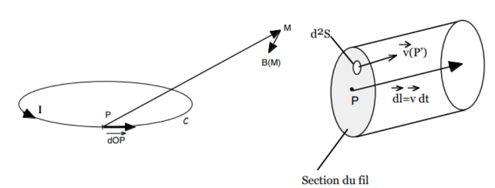
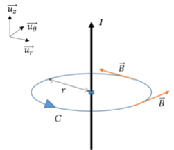
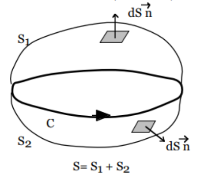

## Le champ magnétique

### Introduction

Il faut attendre la fin du XIXe siècle pour qu'une théorie complète apparaisse : la théorie de l'électromagnétisme. Tout commença avec l'expérience d'Oersted en 1820. Il plaça un fil conducteur au-dessus d'une boussole et y fit passer un courant. En présence d'un courant, l'aiguille de la boussole est effectivement déviée, prouvant sans ambiguïté un lien entre le courant électrique et le champ magnétique. L'étude quantitative des interactions entre aimants et courants fut faite par les physiciens Biot et Savart (1820). Ils mesurèrent la durée des oscillations d'une aiguille aimantée en fonction de sa distance à un courant rectiligne. Ils trouvèrent que la force agissant sur un pôle est dirigée perpendiculairement à la direction reliant ce pôle au conducteur et qu'elle varie en raison inverse de la distance. De ces expériences, Laplace déduisit ce qu'on appelle aujourd'hui la loi de Biot et Savart.

### Expressions du champ magnétique

**Champ magnétique créé par une charge en mouvement.** Le champ magnétique créé en un point $M$ par une particule de charge $q$ située en un point $P$ et animée d'une vitesse $\vec{v}$ dans un référentiel galiléen est

$$
\vec{B}(M) = \frac{\mu_0}{4\pi} \frac{q\vec{v} \wedge \overrightarrow{PM}}{\|\overrightarrow{PM}\|^3}
$$

L'unité du champ magnétique dans le système international est le tesla ($\text{T}$). Dans le système centimètre-gramme-seconde, on peut utiliser le gauss ($\text{G}$), et on a $1\ \text{G} = 10^{-4}\ \text{T}$.

Le facteur $\mu_0$ est la perméabilité du vide : il décrit la capacité du vide à laisser passer le champ magnétique. Sa valeur dans le système international est $\mu_0 = 4\pi \cdot 10^{-7}\ \text{H.m}^{-1}$.

**Remarques.** Comme pour le champ électrostatique, le principe de superposition s'applique au champ magnétique. Si on considère deux particules 1 et 2, alors le champ magnétique créé en un point $M$ quelconque de l'espace sera la somme vectorielle des champs créés par chaque particule.

**Champ magnétique créé par un ensemble de charges en mouvement.** Considérons $N$ particules de charges $q_i$ situées en des points $P_i$ et de vitesses $\vec{v_i}$. En vertu du principe de superposition, le champ magnétique créé en un point $M$ est la somme vectorielle des champs créés par chaque particule et vaut

$$
\vec{B}(M) = \frac{\mu_0}{4\pi} \sum_{i=1}^{N} \frac{q_i\vec{v_i} \wedge \overrightarrow{P_i M}}{\|\overrightarrow{P_i M}\|^3}
$$

Le passage à la limite continue consiste à assimiler tout volume élémentaire $dV$, situé autour d'un point $P'$ quelconque de la distribution de charges en mouvement, à une charge $dq$ animée d'une vitesse moyenne $\vec{v}$. Le champ magnétique résultant s'écrit alors :

$$
\vec{B}(M) = \frac{\mu_0}{4\pi} \int_V \frac{dq\,\vec{v}(P') \wedge \overrightarrow{P'M}}{\|\overrightarrow{P'M}\|^3}
$$

où l'intégrale porte sur le volume $V$ total embrassé par ces charges.

On peut exprimer cette formule en fonction du vecteur densité locale de courant $\vec{j}$. L'expression du champ magnétique créé par une distribution volumique de charges quelconque est donc

$$
\vec{B}(M) = \frac{\mu_0}{4\pi} \iiint_V \frac{\vec{j}(P') \wedge \overrightarrow{P'M}}{\|\overrightarrow{P'M}\|^3}\,dV
$$

Ce résultat est général et valable quelle que soit la forme du conducteur. On peut l'appliquer, par exemple, à l'intérieur d'un métal de volume $V$ quelconque.

**Champ créé par un circuit électrique, formule de Biot et Savart.** Dans le cas particulier d'un circuit filiforme fermé, parcouru par un courant permanent $I$, la formule précédente va nous fournir la loi de Biot et Savart.

Dans ce cas, le volume élémentaire s'écrit $dV = dS \cdot dl$, où $dS$ est un élément de surface transverse situé en $P'$ et $dl$ un élément de longueur du fil. Or, on considère toujours des cas où le point $M$ est situé à une distance telle du fil qu'on peut considérer celui-ci comme très mince. Plus précisément, le vecteur vitesse (ou densité de courant) a la même orientation sur toute la section du fil ($\vec{j}$ parallèle à $\vec{dl}$ et à $\vec{dS}$). Ainsi, on écrit :

$$
\vec{B}(M) = \frac{\mu_0}{4\pi} \oint dl \iint \frac{\vec{j}(P') \wedge \overrightarrow{P'M}}{\|\overrightarrow{P'M}\|^3}\,dS = \frac{\mu_0}{4\pi} \oint \frac{I\,\vec{dl} \wedge \overrightarrow{PM}}{\|\overrightarrow{PM}\|^3}
$$

**Formule de Biot et Savart.** On obtient donc la formule de Biot et Savart, qui donne les éléments infinitésimaux de champ magnétique :

$$
d\vec{B} = \frac{\mu_0}{4\pi} \frac{I\,\vec{dl} \wedge \overrightarrow{PM}}{\|\overrightarrow{PM}\|^3}
$$

Chaque $d\vec{B}$ est défini par un produit vectoriel. Il faut donc faire attention à l'orientation des circuits (règle des trois doigts, bonhomme d'Ampère).

Tout plan contenant le segment est plan de symétrie de la distribution, donc $\vec{B}$ est suivant $\vec{u_\phi}$.

Le champ créé en $M$ par une longueur infinitésimale $dl$ au point $P$ du segment vaut :

$$
d\vec{B} = \frac{\mu_0}{4\pi} \frac{I\,\vec{dl} \wedge \vec{u_r}}{r^2}
$$

Ainsi

$$
d\vec{B} = \frac{\mu_0 I}{4\pi r^2}(dz\,\vec{u_z}) \wedge (\cos(\alpha)\vec{u_r} + \sin(\alpha)\vec{u_z}) = \frac{\mu_0 I}{4\pi r^2}\,dz\cos(\alpha)\,\vec{u_\phi}
$$

On intègre suivant $\alpha$ ; on exprime toutes les variables en fonction de $\alpha$ et de $R$ :

$$
z = R\tan(\alpha)
\qquad
dz = R\frac{d\alpha}{\cos^2(\alpha)}
\qquad
r = \frac{R}{\cos(\alpha)}
$$

On remplace et on obtient $d\vec{B} = \dfrac{\mu_0 I}{4\pi R}\cos(\alpha)\,d\alpha\,\vec{u_\phi}$. Finalement :

$$
\vec{B} = \frac{\mu_0 I}{4\pi R}\left[\sin(\alpha)\right]_i^f \vec{u_\phi}
$$

## Lois fondamentales de la magnétostatique

### Flux du champ magnétique

**Conservation du flux magnétique.** Considérons une surface fermée $S$ quelconque, s'appuyant sur une courbe $C$ fermée et orientée, c'est-à-dire pour laquelle on peut définir localement un élément de surface $\vec{dS} = dS\,\vec{n}$ dont le vecteur normal est orienté vers l'extérieur, comme en électrostatique.

Le flux du champ magnétique à travers cette surface fermée vaut

$$
\Phi = \oint\!\!\oint_S \vec{B} \cdot \vec{dS} = 0
$$

La conservation du flux magnétique montre une différence fondamentale entre le champ magnétique et le champ électrostatique (voir le théorème de Gauss). Si la charge totale est positive, le flux est positif et il « sort » de cette surface un champ électrostatique (source). Si la charge est négative, le flux est négatif et le champ converge vers la surface (puits). On ne connaît pas de charge magnétique analogue à la charge électrique (pas de monopôle magnétique) : tout le champ qui rentre dans une surface fermée doit également en ressortir, on a donc des dipôles (comme les aimants).

**Lignes de champ et tubes de flux.** Une ligne de champ d'un vecteur quelconque est une courbe $C$ dans l'espace telle qu'en chacun de ses points le vecteur y soit tangent. La conservation du flux magnétique implique que les lignes de champ magnétique se referment sur elles-mêmes. Un tube de flux est alors un rassemblement de lignes de champ. Soit une surface $S$ s'appuyant sur une courbe fermée $C$ telle que le champ magnétique y soit tangent. En chaque point de $C$ passe donc une ligne de champ particulière. En prolongeant ces lignes de champ, on construit ainsi un tube de flux (exemple : les taches solaires).

### Circulation du champ magnétique

**Circulation du champ autour d'un fil infini.** On a vu que le champ $\vec{B}$ créé par un fil infini en un point $M(\rho, \phi, z)$ s'écrit en coordonnées cylindriques

$$
\vec{B} = \frac{\mu_0 I}{2\pi R}\vec{u_\phi}
$$

Considérons maintenant une courbe fermée quelconque $C$. Un déplacement élémentaire le long de cette courbe s'écrit $\vec{dl} = dr\,\vec{u_r} + r\,d\phi\,\vec{u_\phi} + dz\,\vec{u_z}$. La circulation de $\vec{B}$ sur la courbe fermée $C$ vaut alors

$$
\oint \vec{B} \cdot \vec{dl} = \mu_0 I \oint \frac{d\phi}{2\pi}
$$

On a donc plusieurs cas de figure :

- si $C$ n'enlace pas le fil, $\oint d\phi = 0$ ;
- si $C$ enlace le fil une fois, $\oint d\phi = 2\pi$ ;
- si $C$ enlace le fil $N$ fois, $\oint d\phi = 2N\pi$.

La circulation de $\vec{B}$ sur une courbe fermée est donc reliée au courant qui traverse la surface délimitée par cette courbe. C'est Ampère qui, en recherchant une explication du magnétisme dans une théorie de la dynamique des courants, découvrit cette propriété du champ magnétique.

**Théorème d'Ampère.** La circulation de $\vec{B}$ le long d'une courbe $C$ quelconque, orientée et fermée, appelée contour d'Ampère, est égale à $\mu_0$ fois la somme algébrique des courants qui traversent la surface délimitée par $C$.

$$
\oint \vec{B} \cdot \vec{dl} = \mu_0 I_{\text{enlacée}}
$$
